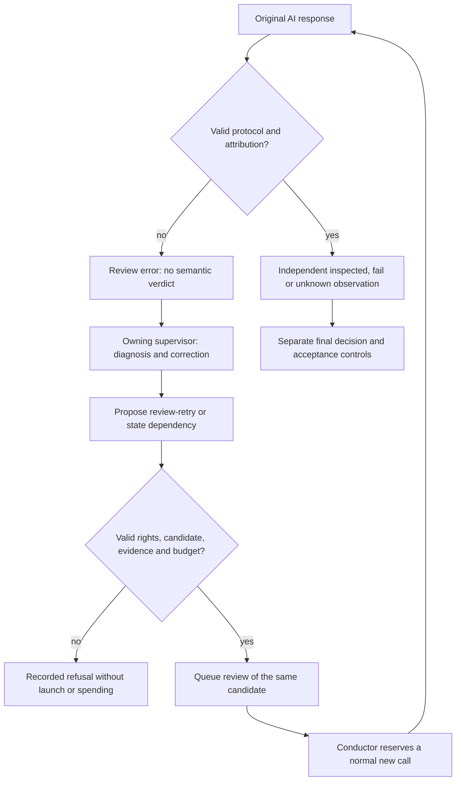
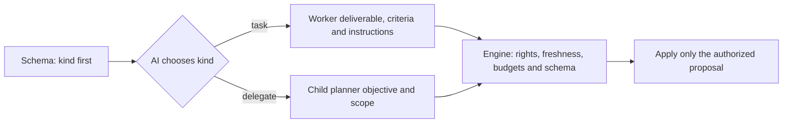

# Protocol between AI roles and the deterministic engine

AI roles submit structured proposals. The engine checks authority and evidence
before applying them. Receipt, inspection and acceptance are separate states.
See [traceability](TRACEABILITY.md), [review evidence](REVIEW-EVIDENCE.md) and
[recursive recovery](AUTORECURSIVE-RECOVERY.md).

| Boundary | AI proposal | Engine checks |
| --- | --- | --- |
| Root or child supervisor | Consumed events, diagnosis, operations | Revision, lease, generation, supplied events, ownership, dependencies and budgets |
| Producer | Candidate, report, criterion evidence | Attempt, isolation, Git blobs, complete dossier and executed controls |
| Independent inspection | Exact identities, complete coverage, observations and defects | Decodable JSON without unknown fields or extra documents, unique indices, identities, digests, capacities and attributed quotations |
| Review recovery | Cause and relevant correction | Current review, unchanged contract and candidate, intact originals, recoverable journal and existing budget |
| Acceptance | Favorable independent opinion | Freshness, controls, criteria, same candidate and applicable validations |

Evidence remains untrusted and grants no authority to change budgets or accept.
The engine does not invent proof, test results or explanations. Verifying a claim's
location does not certify its semantic correctness.

## Exact defect locations

Fragment protocol V2 and later require one actionable defect per failed artifact:
`artifact`, `line`, `quote`, `explanation`, `reproduction`, `expected`.
`line` is the physical, one-based line in decoded original source or the supplied
patch. `quote` contains exact contiguous bytes, starting at any character on that
line. It may span following lines, preserving whitespace, patch signs and line
separators. A quote found only on another line is invalid. Capacity limits and
full coverage remain required.

The previous check implicitly required column zero, absent from the contract.
It rejected an exact quotation inside a long JSON line. The October 11, 2026 fix
specifies and tests the rule without rewriting historical verdicts.

## Error ownership and controlled recovery

A protocol `error` differs from `changes_requested`. Machine code
`review_fragment_protocol` identifies invalid inspection responses. Historical
compatibility recognizes only a current fragment review in error bearing the old
engine prefix. Worker prose and obsolete events cannot assign current routing.

The owning root or child receives `review_failure_routing`, bound to the current
event's review, attempt and candidate. This error maps to `owner: reviewer_protocol`,
`operation: review-retry`, `producer_correction_required: false`.

`review-retry` accepts `id` and `next` describing a new correction; other schema
fields must be empty or zero. It consumes the current review event. The engine
checks ownership, contract, attempt, candidate, original evidence, provider
availability and budget before queueing. This decision creates no call or producer
attempt. The conductor later reserves calls within existing limits. The guard
against two identical interruptions still applies. A justification alone cannot
prove its correction was executed.

The frozen delivery schema omits `retry` when no owned task permits producer
recovery, considering status, launch holds, already granted recovery, remaining
attempts and protocol failures. It retains `review-retry`. This avoids offering
an unavailable operation; transactional guards remain required and no new rights
are granted. Task projection attributes the current review and its error, while
a different older cause remains under `previous_blocker` without changing history.

Producer `retry`, dispatch and launch reservation reject this protocol error,
including obsolete producer authorization. Public operator `planning retry-review`
retains its path and clears superseded producer retry when queueing fragments.
Valid semantic refusals still require candidate correction and cannot be erased
by `review-retry`.

Original responses, journals, events and spent calls stay intact. A parser fix
requires a newly authorized review response; reinterpretation cannot manufacture
acceptance. Local temporary-repository tests with provider doubles do not establish
autonomous recovery using a real provider.

## Method changes between reviews

Changed methods or project guidance block inspection reuse. Public recovery preview
returns `method_restart_ready` only after original-integrity checks and complete
current-dossier preflight. Operator `planning retry-review` requires
`confirm_review_error_repair: true`; the owning supervisor may propose `review-retry`
after correction. The old review is archived without changing its files. No old
opinion is reused, and every new call must fit the remaining budget. The conductor
rechecks the same-candidate checkpoint and retains original control receipts;
this method change does not claim another control execution. Semantic refusals, active reservations,
engaged final decisions and altered evidence cannot be erased by this route.

## Passing a repaired result to a new producer

An explicit external correction retains the original producer Git reference and
records a separate `refs/swarm/repairs/PROOF_KEY` reference. After a semantic
refusal of that repaired result, the next worker’s recovery packet carries the
repaired result, its tree, external provenance and independent review. The engine
checks producer, attempt, terminal status, recorded result, repair reference, tree
and ancestry before supplying it. A failed binding never falls back to the
original production. The new worker starts at the accepted candidate; rejected
work is a private reference to inspect and correct, never an accepted new base.
Originals, consumed attempts and earlier calls are retained.

## A selected skill changed after launch preparation

Action skills are bound to their hashes. A preparation is reported as not ready
when a selected skill changes; ordinary resumption never silently adopts its
new contents. Public `agent resume-launch` allows an explicit update using
`confirm_action_skill_refresh: true`, `reason` and `skills` (the same paths with
exact current hashes). It retains the original manifest and copy, then records
an engine-produced `prepared_skill_refresh` receipt in the launch: preparation,
original request digest, previous selections, reason and actor. External
`agent start` requests cannot forge this receipt. Provider, role, candidate and
frozen settings remain checked, existing ceilings apply and repeated resumption
retrieves the same agent. Skill updates are neither new reviews nor acceptance.

## Process conduct

Duration now emits an attributed observation without an automatic stop. The owner proposes `continue-run` or `stop-run`; the engine validates and applies it without inferring completion. See [agent conduct](RUN-SUPERVISION.md), diagrams, evidence and limits.

## Future instruction learning

[`revise-instructions`](INSTRUCTION-LEARNING.md) adds an attributed learning to an owned future task from received events. It is applied by default and rejectable by the user before launch reservation; criteria and budgets remain unchanged. The engine routes the rejection back to the owner.

## Current inputs and historical returns

The supervisor context separates `events` from `historical_events`. While current
inputs remain pending, only their IDs may enter `input_events`; older returns
are read-only context. This prevents a stale identifier from contaminating a
current proposal and causing every operation to be rejected. Projection never
consumes an event. After current inputs are handled, `historical_only` admits a
batch of older returns with an empty `operations` array enforced by the provider
schema. The transaction also rejects actions based on stale attempts. Explicit
acknowledgement preserves history, attempts and costs.

The latest public `operator_resume` instruction leads the admitted batch, followed
by owned current review results and actionable returns. Earlier instructions
follow these results, so they cannot displace the evidence required for recovery.
No input is acknowledged automatically. The frozen receipt records
`review_retry_unavailable`: the provider schema omits `review-retry` unless the
exact owned current protocol-error result is actually supplied in this batch.
A smaller whole-event batch may therefore omit this operation. Backend candidate,
contract, event attribution and budget checks still apply.

Claim and execution compute the same context allowance from the exact workflow
and protocol instruction sizes. An estimated 3,000-byte reserve no longer covered
the expanded instructions and could reject the complete message after claim,
before a provider call. Reduced batches now preserve whole events while fitting
the existing 64,000-byte complete-message bound; omitted events remain pending. If a
minimal batch cannot fit, diagnosis precedes claim without truncation.

Rights and budgets remain enforced. Explicit user authority may permit an
increase through public operations; replan, agents and documentation do not
create that authority. Earlier expenses and refusals remain visible.

When the last historical batch is acknowledged and no other input remains, the
engine delivers `historical_acknowledged` to the owner. This current receipt
enables a new decision about open requirements or a closure proposal subject
to ordinary checks; the engine chooses neither action. The receipt, source
decision, consumption and history remain durable.

## Refused planning proposals

A parsed proposal refused by the transaction is routed to its owner as
`planning_rejected`, ahead of earlier inputs. The engine preserves the JSON
response returned by the provider adapter, the frozen admission receipt, workflow,
exact failed operation index/kind/ID and the identities of every proposed operation.
The complete proposal is retained separately; the diagnostic supplies its hash
reference, identity inventory and the complete identified failed operation as an
untrusted proposal. A tool-free owner therefore receives the `next` instruction
it must correct; this is neither validated evidence nor an applied operation.
Other operations remain in the original response. This explains a duplicate
within the same atomic proposal even when no such task exists after rollback.
`existing_task_ids` supplies the full global ID inventory, including tasks omitted
from the bounded task projection. No refused operation or input is applied.

The next inference may correct the proposal within existing authority and budgets.
If the same operation fails for the same cause under unchanged relevant state, its
owner receives a durable `rejection_wait`; leases, spent inference/review counters
and unrelated scope activity do not count as new evidence. A public owned input,
changed owned task/review, repository or explicit policy reopens eligibility.
The claim rechecks this guard. Other scopes continue. A valid decision clears the
wait and retains both refusals and their consumption. This is idempotence of a
refused operation, not a duration cap or an engine decision to finish the project.
Provider/configuration/transport failures still use their existing recovery path;
this change does not claim autonomous recovery for every failure category.

Every refusal has its own event and declares both diagnostic and response as artifacts, including a repeated refusal. The problem key controls eligibility only; export/import retains both originals and the wait without merging verdicts.
Imported pieces remain archived through the existing flow; their presence neither activates nor certifies evidence in the destination project.

## Reduce previews while preserving the current return

If the complete message exceeds its bound, the engine may omit only `next`
previews for `todo` or `accepted` tasks not named by received events. It retains
all rows, IDs, states, dependencies and requirements, complete `next` for named
tasks, other active or blocked tasks, and every complete event. Context records
`inactive_task_next_omitted`. Persisted instructions do not change; the receipt
freezes and hashes the projection actually delivered. No return is truncated or
acknowledged by this reduction. If the context still cannot fit, whole-event
batch reduction and the pre-claim diagnostic remain applicable. The reproduction
with eight tasks and a large current refusal exercises a provider double, not
an autonomous real provider's understanding.

## Choose the operation before its payload

`task` proposes an executable worker task; the planner does not code. `delegate` proposes another planning scope; a title containing “worker” does not turn it into a task. Further decomposition needs the owner's justification. The engine applies the authorized choice received without substituting one decision for another.

The output schema retains `anyOf`, required fields, enums and validation. `planningSchemaProperties.MarshalJSON` serializes `properties.kind` first in every branch, followed by its payload. Structured generation follows schema key order: [official OpenAI documentation](https://developers.openai.com/api/docs/guides/structured-outputs). In T7, alphabetical order put `criteria` before `kind` for `task` and `id` before `kind` for `delegate`. With the same complete prompt and route, the probe chose `delegate` in the original ordering and `task` when only the discriminator moved first; parsed schemas are equal. This supports the cause for that case, without guaranteeing every future model choice.

An available `judge` operation does not require a new cycle. The owner resumes the outstanding requirement after completed prerequisites; existing cycles and explorations remain retained. Refusals and failures are not erased. Real recipe and candidate review remain necessary; instructions alone do not prove the effect.
