# Internal agent identity and authority contract

17 October 2026 — [Français](../architecture/AGENT-IDENTITY-CONTRACT.md).
Scope: IA2.2 kernel, IA2.3a channel, IA2.3b durable source, IA3a plan binding,
IA3b human issuance, IA3c.1 receipts and the isolated IA3c.2a protocol. These
internal components are **not connected to public launchers**. The private 03c
handoff below is verified with a fixture helper, without agent admission.
The [IA1 findings](../plans/actions-confiance/verification-identites-agents-20261016/RAPPORT-IA1.md)
remain open. This contract adds no public endpoint, CLI command, Admin setting,
public bootstrap mechanism or provider confinement.

## Responsibilities and current flow

The [IA2 semantic contract](../plans/actions-confiance/identites-agents-contrat-IA2.md)
defines the full target. The kernel evaluates data and returns a decision
receipt. A positive decision is not a reservation, human approval, attested
process or observed business effect.

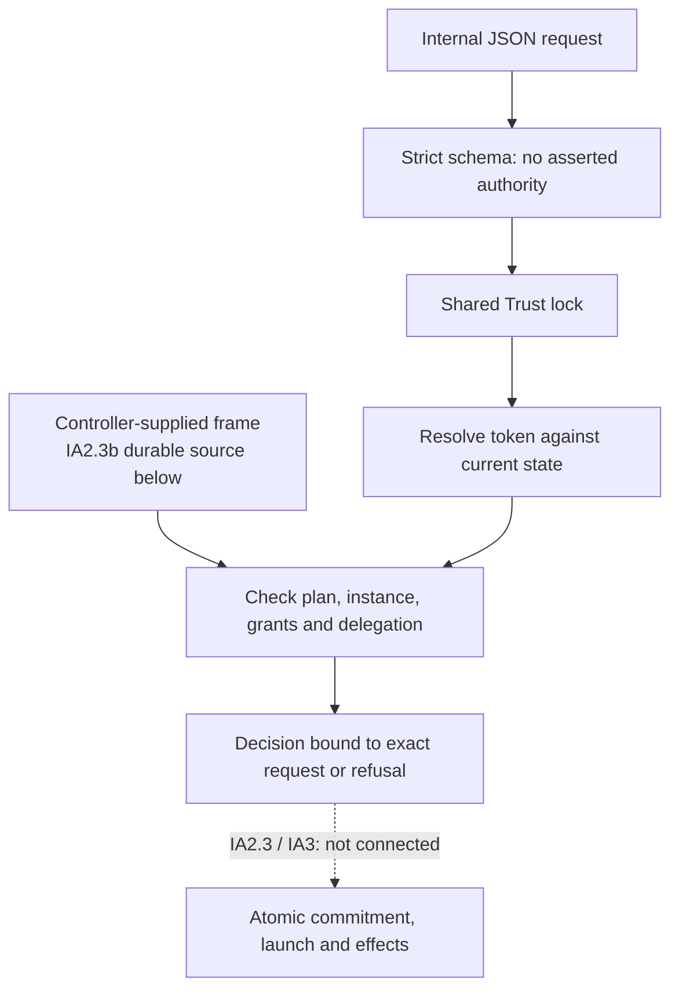

Trust supplies the issuer, external subject, `local`/`human`/`service` kind,
configuration revision and expiry. Local access is never promoted to a human,
and business roles (`requester`, `approver`, `admin`, `effect`) never implicitly
grant agent creation. A token alone does not establish an instance.

## Data and authority sources

Private types in `internal/engine/agent_identity_contract.go`:

| Type | Meaning |
| --- | --- |
| `agentIdentityPrincipal` | Separate local ID, kind, issuer and external subject; no credential or credential digest in attribution. |
| `agentIdentityActor` | Principal and optional controller-established instance. |
| `agentIdentityScope` | Work, persisted generation and recorded-contract digest. IA3a reads it from SQLite; this does not attest human adoption. |
| `agentIdentityGrant` | Issuer, holder, parent, scope, Trust revision, exact and delegable permissions, validity and revocation. |
| `agentIdentityInstance` | Instance, logical agent, principal, scope, grant and execution binding reference. Matching this reference is not process attestation. |
| `agentIdentitySnapshot` | Serializable schema 1, revision, grants and instances. Imports and backups remain data. |
| `agentIdentityRequest` | Schema 1, event, scope, grant, operation, resource and content digest. No author/approver/authority claim grants rights. |
| `agentIdentityDecision` | Project context, event, actor, request/snapshot digests, revisions and upper expiry bound. No implicit consumption or effect. |

`agentIdentityAuthority` is a private frame with no JSON-populatable fields:
canonical project root, current snapshot digest/revision, Trust revision, current plan and explicitly
recognized root grants. Its internal durable producer is described in IA2.3b;
protected permit/checkpoint issuers remain unconnected. Computing this frame from
the snapshot being checked would create circular authority. Historical IA2.2
tests use fixtures; IA2.3b reads persisted data under a controller checkpoint,
without deploying an external anchor.

Digests use lowercase hexadecimal SHA-256. IDs reuse `safeName`. Resources match
exactly, without wildcards or implicit path-prefix rules. Recognized operations
are `agent.create`, `memory.read`, `memory.summarize`, `memory.transmit`,
`tool.invoke`, `effect.execute`; their consumers are not connected by this change.
The kernel introduces no hidden operator timeout or execution ceiling.

Issuer and subject are opaque strings: brackets in an IPv6 issuer or a subject
are not treated as wildcards. Text validation rejects empty or invalid UTF-8
strings, control characters and surrounding whitespace; the `*?[]` restriction
applies only to permission resources.

The content digest must come from the actual proposal, parameters and resolved
context. Binding a receipt to the supplied digest does not prove that producer
or its correspondence with a later effect. These remain IA2.3/IA3 obligations.

## Checks and recovery

`decodeAgentIdentityRequest` rejects unknown/case-variant fields, duplicate keys
including nested and escaped duplicates, multiple documents, empty/null/invalid
input, asserted authority and wildcard permissions. The snapshot decoder also
rejects unknown fields, duplicate keys and absent objects.

`evaluateAgentIdentity` requires a caller verified at the evaluation instant, a
current private frame, a matching snapshot and the same scope. It checks holder,
instance binding, permission, dates, revocations and each delegation hop up to a
recognized root. Each child preserves scope, attenuates the parent's delegable
permissions and stays within its validity interval. An iterative traversal
detects cycles.

The consumer binds the caller to `Store.root`, canonicalized on opening. The
private frame must name that same root and the receipt includes a project-context
digest. Projects with identical fixture names and tokens cannot exchange frames
or receipts. This local check is not a durable cross-host project ID or proof of
OS account ownership. Root relocation or federation requires an explicit new
context and protected anchor in IA2.3.

A Trust configuration change invalidates old grants under this conservative
contract; renewal must be explicit. Reauthentication does not renew grants.
Decision expiry cannot exceed the caller's or any contributing grant's expiry.

`Store.evaluateAgentIdentityRequest` resolves and evaluates under the same Trust
lock. Reuse reauthenticates first, reevaluates, then compares the full receipt.
It never returns a cached result before authentication. The real clock is
sampled after lock acquisition; internal tests can inject a fixture clock, but
JSON cannot. This internal consumer has no runtime-agent caller path yet:
that requires the protected broker.

`validateAgentIdentityTransition` requires the next revision and retains all
historical records. Revocation cannot be cleared or moved; other fields of a
published grant/instance cannot be rewritten. A replacement needs a new ID.
This check neither authorizes nor publishes an update. The future writer must
validate against protected current state and atomically publish its new anchor.
No production storage writer uses this validator yet.

## Limits and required follow-up

Evidence is retained in the
[IA2.2 report](../plans/actions-confiance/verification-identites-agents-20261016/ia2-contract-kernel-20261017/RAPPORT-IA2.2.md).
Tests use isolated roots, simulated runtime bindings and local OIDC/service
issuers. They prove neither a real provider boundary nor independent review.
The cached-caller and cross-project frame regressions retain before/after evidence.

Remaining: protected bootstrap/frame/checkpoint issuers, admission commitment
lock order, runtime channel integration, prepared-content binding, exact
human approval, single consumption, start/revocation races, crash reconciliation
and **all** CLI/API/provider/memory consumers. Adding this evaluator does not make
Trust JSON and mission SQLite atomic. IDA-01–18 and the retrospective remain
required for overall qualification.

## IA2.3 channel experiment, separate from the kernel

The [17 October prototype](../plans/actions-confiance/verification-identites-agents-20261016/ia2-runtime-binding-20261017/RAPPORT-IA2.3-CANAL.md)
passes 13 local checks with two Linux sandboxes. The controller pins PID/mount
namespaces before execution and attributes each message using kernel credentials.
A connection copied from B to A retains peer B, but the message sender is A and
the claimed B identity is denied. Joining B with three copied namespace
descriptors is also denied. The user namespace changes during bootstrap and is
not assumed stable. This Python prototype is neither an integrated Go broker
nor an authority source; its registry and revocation are in memory. It does not
qualify the launchers.

## Go instance channel — IA2.3a

The receiver and binding registry are now implemented in
`agent_identity_channel_linux.go` and `agent_identity_runtime_linux.go`.
`Store.evaluateAgentIdentityMessage` connects them internally to IA2.2.
No server or launcher registers this path. The [IA2.3a report](../plans/actions-confiance/verification-identites-agents-20261016/ia2-go-channel-20261017/RAPPORT-IA2.3a.md)
records this slice's checks and limits.

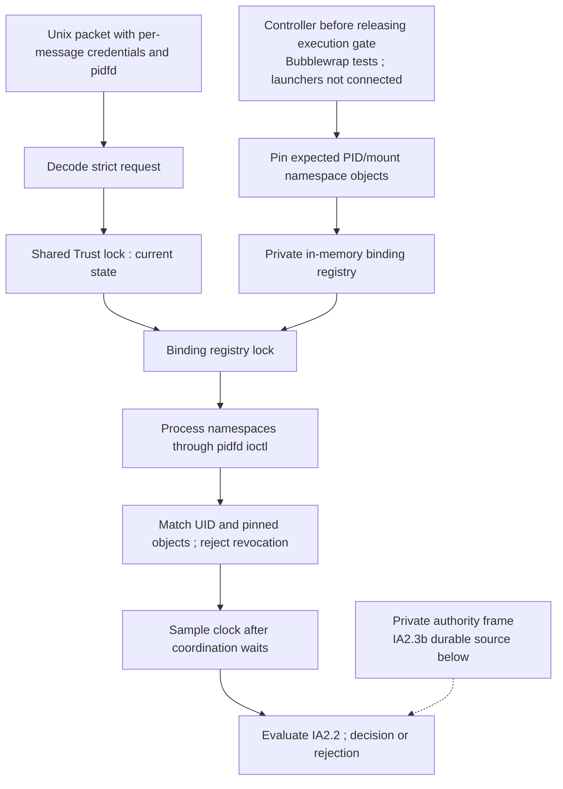

The controller calls `pin` using a gated launcher bootstrap and holds the resulting
PID/mount namespace descriptors. It rejects the host PID namespace, mismatching
references and reuse of an already reserved instance, binding or PID namespace.
A first worker message cannot populate this table. Process-private state does not
protect an unconfined controller account; a protected launcher/bootstrap remains
an integration obligation.

`configureAgentIdentityChannel` requires a Unix `SOCK_SEQPACKET` socket and enables
`SO_PASSCRED` and `SO_PASSPIDFD`. Reception requires credentials and exactly one
`SCM_PIDFD`. Namespaces are obtained from that descriptor, without reopening the
message's PID number. An exited sender is not reidentified by its number. The
connection peer does not determine message attribution. This identifies the
process/thread group represented by the mechanism, not each thread or executable
image. Missing kernel primitives fail closed, without a numeric fallback; only
the report's platform was executed.

The consumer supplies its transport buffer and deadline. No new operator ceiling
or timeout is introduced. Truncated packets, missing credentials and injected
file rights are rejected; received descriptors are closed on rejection. The
consumer closes an accepted message. Namespace pins remain held until registry
closure, including after revocation, to exclude reuse of historical references.
An empty registry after restart cannot adopt the first sender's authority.

Reception happens outside Trust. Evaluation takes the shared Trust lock, then
the registry lock, checks current revision/binding/UID/namespaces, samples real
time after those waits, and evaluates under both locks. Binding revocation and
registry closure are serialized with evaluation. This is not Trust/SQLite
commitment, single consumption or observed process termination. Authority frames
and snapshots used by the tests remain fixtures.

The runtime lock protects bindings, not maps in a snapshot supplied by another
component. IA2.3b provides its own current copy. Low-level IA2.2/IA2.3a consumers
still accepting caller-supplied snapshots/frames require their caller to preserve
ownership and freshness; they do not consult the durable registry. Public
operations must use the durable path.

## Durable source and recoverable publication — IA2.3b

The private registry is now produced from SQLite and an independent Trust head.
Version **36** added `agent_identity_snapshots` for versions and
`agent_identity_publications` for chained receipts. Migration backs up storage
and grants no authority to historical work. Inspection refuses implicit upgrades.
The [IA2.3b report](../plans/actions-confiance/verification-identites-agents-20261016/ia2-durable-authority-20261017/RAPPORT-IA2.3b.md)
binds sources, commands and results. Earlier sections describe the original
IA2.2/IA2.3a slices and their fixtures.

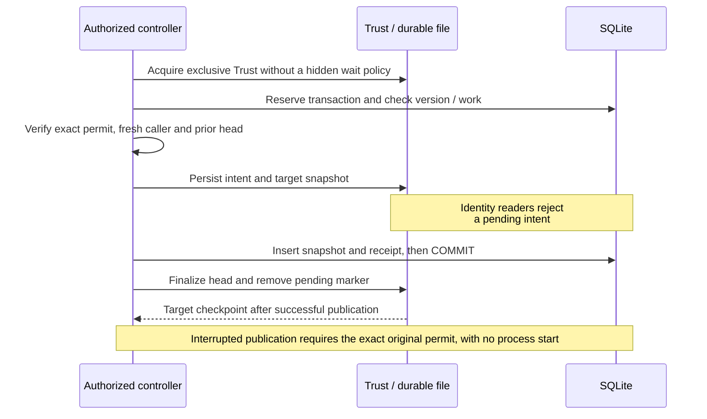

The head records project context, scope, snapshot revision/digest, Trust revision,
recognized roots, publishing principal, event and previous-head link. A private
`agentIdentityRegistryPermit` independently binds the exact content, scope and
approved roots. Normal publication resolves the current token under Trust after
waiting for SQLite and again before preparing the intent. Business roles or JSON
bodies do not mint this permit. IA3b adds the internal human producer below;
real enrollment and public integration remain open.

Publication takes a nonblocking exclusive Trust lock and reserves SQLite before
reading. It checks work existence, version, prior checkpoint, links, preserved
history and approved content. It persists an intent in Trust's
`agent_identity_authorities` before COMMIT, then publishes the new head. Failure
after intent or after COMMIT leaves an exact recovery to perform.
`recoverAgentIdentityRegistry` requires the original permit and snapshot; it
cannot prepare a new operation. Changed Trust configuration is preserved:
finalizing old history does not reactivate its rights.

`atomicWrite` now opens the parent before mutation, syncs the file, renames it,
then syncs the directory. Failure after rename means an uncertain result to
reconcile. Tests simulate neither power loss nor storage that lies about `fsync`.

Inspection requires a private current `agentIdentityRegistryCheckpoint` from
the controller, then checks the Trust head, receipt chain, snapshot and plan
in a read transaction before releasing its owned copy. Message consumer
`evaluateAgentIdentityRegistryMessage` likewise obtains source data from the
registry, not the message; since IA3a it reserves SQLite's writer through the
runtime decision, as described below. Real time is sampled after waits. These
paths neither consume a right nor start a business effect.

A checkpoint is never recomputed from an imported database or the same restored
files. Tests retain it outside the restored state and deploy no external witness.
If all files and an old witness are restored together, freshness is unproven.
Independent witness issuance/retention remains an open integration condition.
Scope is bound to the controller's permit and the IA3a recorded contract. Human
adoption attestation and exact creation membership still require integration. Go package privacy alone does not protect the host account,
control files or an arbitrary hostile SQLite image. F01–F07 remain open, together
with public admission, provider confinement, exact human approval,
reservation/start and memory rights.


## Binding to the current recorded plan contract — IA3a

`agent_identity_plan_linux.go` reads the work body/revision and
`agent_identity_plan_heads` in the same SQLite transaction as authority. It
requires a recorded `Work.Plans` plan or valid hierarchical planning. Classical
plan adoption, preparation conversion and hierarchical decisions feed this
common source. Recording data does not attest human approval or grant creation.

Projection **v1** retains definitions, instructions, owners, roles, dependencies,
hierarchy, budgets, profiles and unrecognized fields. It removes identified
result, status, attempt, review, lease, counter and integrated-candidate fields.
Memory selections remain inputs; their presence grants no usage right. Results,
framing and transmission still require separate permissions. Lists retain their
order; object keys are canonicalized recursively without rounding integers
through `float64`. Changing a retained field requires a new exact permit.

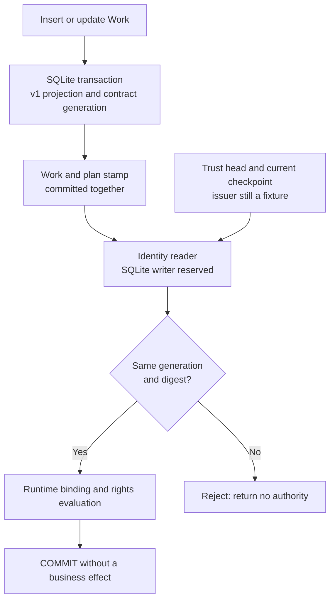

Current storage version **37** backs up storage, creates generation-1 initial
stamps and installs insert/update triggers on `works`. Contract changes advance
the generation in that transaction; identified runtime results preserve it.
Changing then reverting contents does not reactivate the previous scope,
including after reopening. Transaction rollback also rolls back its stamp. The
counter must remain a positive SQLite integer; technical overflow rejects the
entire update. It is not an operator resource limit.

Triggers call `swarm_identity_plan_digest_v1`, a pure function registered once
in the driver before connections open, and verify the prior stamp before
rewriting. Readers recompute the body digest and compare the stamp, projection
version and Trust-head scope. Missing plans return
`agent_identity_plan_unavailable`, different scopes `agent_identity_plan_mismatch`,
and missing/inconsistent stamps `agent_identity_plan_stamp_changed`. Normal
refusals prepare no intent, publish no rights and create no agent. A trigger
error rolls back the work write rather than yielding an empty success.

`readAgentIdentityNextPlanScope` is a read-only proposal of the observed scope
for a future permit. It requires an existing head's checkpoint, rejects pending
publication and never infers authority from imports. Normal publication compares
the permit against this same source after reserving SQLite, before preparing
an intent. Exact recovery may finish history prepared before a plan change;
normal reading still rejects that history. Instance decisions take shared Trust
→ SQLite writer reservation → current read → runtime lock → fresh time and pure
evaluation → COMMIT. The reservation prevents Work changes during the runtime
wait. This closed callback never reenters Store and the runtime methods called
do not access SQLite; future consumers must preserve that precondition. Any
error, including COMMIT failure, returns no positive decision. This serialization
has an unmeasured concurrency cost and implements neither consumption nor start.
The private component does not activate launcher admission.

Stamps/triggers enforce application integrity, not a boundary against a host
administrator or unconfined provider. Physically restoring all SQLite may
restore the old stamp as well. A checkpoint covering only an unchanged identity
head cannot attest freshness of a plan change not published in that head: the
future independent witness must also cover the plan watermark. Its issuer and
protection remain open, owned by Codex/operator. Creation membership, resolved
content, human approval, consumption and all public launchers still require
integration. F01–F07 and IDA classifications remain unchanged.

## Issue a permit from explicit human authority — IA3b

`mintAgentIdentityRegistryPermit` receives the full snapshot, token, previous
checkpoint, event and proposed roots. The controller separately supplies a
private `agentIdentityIssuerAuthority`: exact principal (local ID, `human` kind,
issuer and external subject), project, plan scope, Trust revision, enrollment
reference, exact permissions, delegable subset and validity interval. It explicitly
authorizes registry publication and limits its new root grants; neither an
`agent.create` permission alone nor an Admin role implies this authority.

This object is controller input, not configuration read from requested JSON. The
enrollment reference is checked syntactically; its digest alone proves no
enrollment. The protected service attesting, persisting, revoking and refreshing
this authority remains unconnected. Tests supply explicit fixture authority and
execute the OIDC protocol against a local signed-token provider; they qualify
neither an external human account nor a deployed enrollment service.

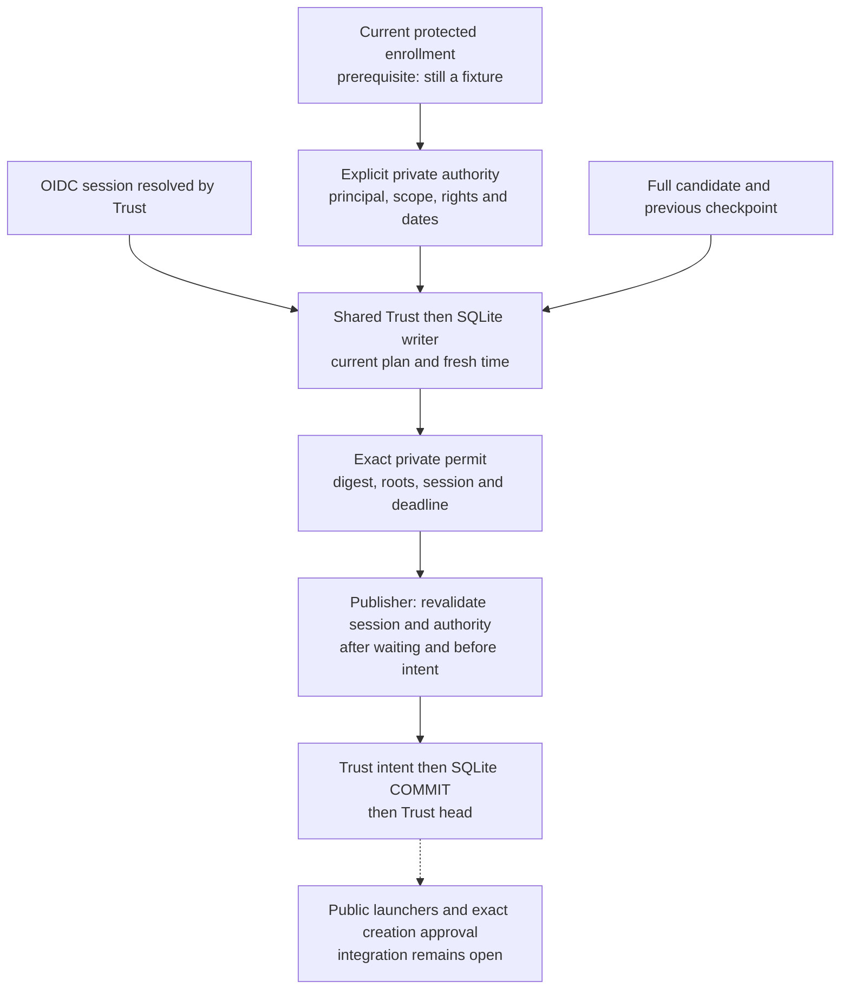

Issuance checks identity and authority under Trust before SQL or work lookup.
It then reserves the SQLite writer, reauthenticates after waiting and reads the
current plan and registry. Local sessions, workload services, instances, namesakes from
another issuer/subject and unenrolled identities are rejected. Importing data
does not grant authority. New roots, including unlisted ones, and activation
of previously unrecognized roots must respect the explicit issuer, permissions,
dates and delegation ceiling. History is preserved; issuance neither publishes
nor consumes rights.
Valid links do not attest that the named actor actually requested a delegation;
creation origin and receipt still require verification at admission.

The permit owns its lists and binds the full snapshot, roots, principal, project,
plan, Trust revision and event. Its private proof also binds the issuing session
and a deadline limited by enrollment and session expiry. Identity and authority
are checked again after reading history. Commit errors return a zero permit. No
raw token is retained in the permit or journal. No hidden duration or new setting
is added; dates are conditions of this controller-supplied authority.

Publication rechecks these conditions after reserving SQL and before durable
intent. A different session of the same human cannot reuse the permit; expiry
during a wait rejects publication without an intent or registry row.
`agent_identity_human_issuer_required` identifies a non-human caller;
`agent_identity_issuer_authority_required`, absent/incompatible authority;
`agent_identity_issuer_authority_stale`, stale dates/session; and
`agent_identity_issuer_ceiling_exceeded`, roots exceeding the grant. Correcting
a request requires explicit reissuance. Recovery after intent only completes
that exact historical decision; it may finalize after session expiry without
producing a new authorization.

The prior low-level API remains a private controller capability used by fixtures
without this human proof. This kernel therefore does not make every package
permit human or secure any existing public endpoint. The future public adapter
must require this producer and its protected enrollment source; no agent-supplied
flag selects a path. Out-of-process persistence/recovery of private capabilities
remains open. A cached authority does not prove current external non-revocation.
An OIDC session categorized as human proves neither physical human presence,
step-up authentication nor distinct human approval of a resolved creation. Those
criteria, the plan witness, F01–F07 and memory rights remain open.

Local recipe: `go test ./internal/engine -run '^TestAgentIdentityIssuer'
-count=1 -v -timeout=0`, then targeted registry and plan checks. Commands, frozen sources,
two original failing cases and outcomes are in the
[IA3b report](../plans/actions-confiance/verification-identites-agents-20261016/ia3-issuer-20261017/RAPPORT-IA3b.md).


## Preserve the human issuance receipt in history — IA3c.1

Human publication heads use format 2 and contain a version 1 `issuance_receipt`.
The head already binds the exact snapshot, roots, event and previous head; its
digest now also covers the receipt. The receipt retains the exact human
principal, project, plan, Trust revision, supplied enrollment reference,
authority permissions and dates, session digest and expiry, issuance time and
permit validity end. That end equals the minimum of both expirations. No raw
token is retained. Returned lists belong to their reader.

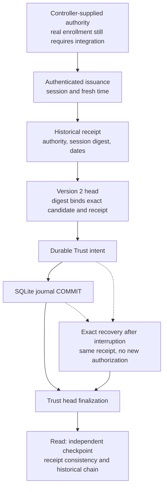

Format 2 requires a receipt; format 1 remains for the earlier private controller
capabilities without a receipt. Inconsistent combinations are rejected. Older
readers supporting only format 1 reject new heads; the SQLite schema remains 37.
The existing protocol stores the exact same receipt in the intent, journal and
final head, including after reopening and recovery at either durability boundary.
Historical reads validate dates at issuance time; reading an expired receipt
does not turn it into current authority.

This receipt is a controller-bound trace, not an independent signature or proof
of actual enrollment, external non-revocation or physical human presence. Reading
still requires an independently protected checkpoint. Restoring storage together
with its witness, or controlling the same UID without confinement, remains outside
the guarantee. The receipt cannot reconstruct a private permit or recover without
the original controller capability. Bootstrap, a witness covering the plan,
public admission, distinct human approval and memory rights remain open.

Verification results and limits are retained in the
[IA3c.1 report](../plans/actions-confiance/verification-identites-agents-20261016/ia3-issuance-receipt-20261017/RAPPORT-IA3c1.md).


## Authenticate replies from the future enrollment service — IA3c.2a

The isolated `internal/enrollmentproof` package implements a signed response
format without engine or network transport integration. `NewVerifier` receives
a controller-pinned public key and project digest; no response supplies its own
trusted key. `NewChallenge` generates a random 256-bit nonce and binds the key,
project and full request digest. `SignResponse` signs the envelope using Ed25519
and protocol/version domain separation; it makes no authorization decision.
Test private keys are ephemeral and local; no actual bootstrap is activated.

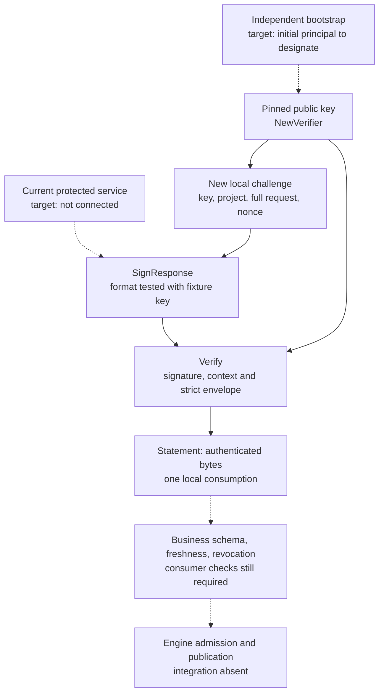

`Verify` requires the exact four string keys `protocol`, `challenge_digest`,
`payload` and `signature`. Duplicate, case-folded or unknown keys, null/non-string
values and trailing data are rejected. Payload and signature use canonical
unpadded base64url. Payload remains opaque: authenticating an empty string does
not establish enrollment or authority. `Statement.Payload()` returns a copy;
the consumer still needs schema, permission and current-source validation.
A signature provides no confidentiality.

A valid response consumes its local challenge exactly once under a mutex.
Value copies of its handle share the same internal consumption state.
Rejected responses do not consume it; a new request uses a new nonce. Concurrent
replays, changed project/request, rebinding a captured signature by rewriting its
digest, unpinned keys and foreign signature domains are rejected. JSON cannot
reconstruct challenge ownership. Its state is not durable and reserves no
publication or process start.

**Explicit limit:** a service may sign “active” and revoke before receipt or
application. That response can remain authentic; this package establishes no
freshness at final authorization. Neither signature, nonce nor historical receipt
replaces current-state validation and revocation linearization. No TTL, timeout,
business cap or operator setting is introduced. Ed25519/SHA-256 and nonce sizes
define the cryptographic format; they are not execution budgets.

The [target enrollment contract](../plans/actions-confiance/identites-agents-enrolement-IA3c2.md)
separates this verified module, missing guarantees and deployment decisions.
Isolated recipe: `go test ./internal/enrollmentproof -count=1 -timeout=0`, then
`-race` and `go vet` for this package. Results and limits are retained in the
[IA3c.2a report](../plans/actions-confiance/verification-identites-agents-20261016/ia3-enrollment-proof-20261017/RAPPORT-IA3c2a.md).


## Durable enrollment journal — IA3c.2b

`internal/enrollmentstate` adds a dedicated SQLite journal, isolated from the
engine. `Open` receives a controlled path, pinned public key and project digest.
Storage requires WAL and `BEGIN IMMEDIATE` transactions, with `synchronous=FULL`
on each connection. No private key is persisted and no actual service or system
account is created. This journal does not establish business authority: each
record body remains opaque bytes whose schema and permissions require validation
by the future adapter.

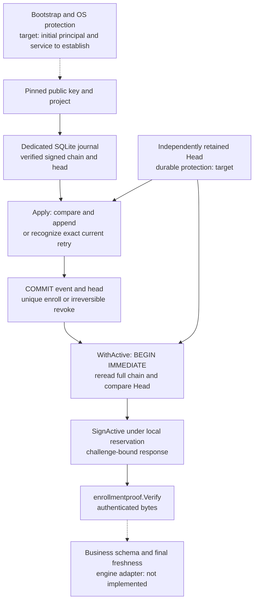

The `swarm-enrollment-change-v1` protocol requires canonical JSON with ten fields:
`protocol`, `authority_key_id`, `project_digest`, `sequence`, `previous`,
`operation`, `id`, `body`, `signature`. Ed25519 signs the protocol prefix, NUL,
`change`, NUL, then this JSON with an empty `signature`. `body` and `signature`
use canonical unpadded base64url. The head contains the sequence and SHA-256 of
the complete signed envelope. Unknown, duplicate, case-folded, null, wrongly
typed and noncanonical fields are rejected. IDs are opaque, never paths or SQL;
queries use parameters. Empty IDs, invalid UTF-8 and control characters are rejected.

`SignChange` signs a proposal only. `Apply` validates the key, project, entire
chain and expected head before appending an event. `enroll` creates an ID only
once; `revoke` requires an active ID and empty body. Revoked IDs stay in history
and cannot reactivate; another creation needs a new ID. An exact retry after
response loss succeeds only while that event is still the current head. A later
revocation prevents successful replay of an old enrollment. Event and head are
written in one transaction; storage errors never become successful empty results.

Each `WithActive` read reserves the writer before rereading the chain and holds
that reservation through its callback. A concurrent revocation cannot commit
during the callback; after revocation commits, active reads are rejected. The
callback must not reenter the journal, wait for another writer or perform
irreversible external effects: transaction completion may still fail afterwards.
`SignActive` returns signed bytes only after the transaction succeeds. Its
`ActiveReply` contains `schema_version: 1`, `head` (`sequence`, `digest`) and `record` (`id`, `body`,
encoded using JSON base64, and `enrolled_sequence`, the chain-derived creation
sequence). This reply can become stale as soon as the reservation
is released.

The controller must supply a `Head` retained independently of the journal/import.
Zero denotes explicitly authorized genesis only. Restoring a consistent old
journal is detected against a newer witness; restoring the witness too removes
that guarantee. This package does not persist the independent witness or solve
atomic transfer between the journal and an external witness. A lost response
can be recovered using the exact signed change; this does not establish
distributed recovery, effective termination or revocation delivery.

Errors distinguish context, head, invalid change, missing, previously enrolled
and revoked IDs; SQLite and cancellation errors preserve their cause. Contention
is surfaced immediately, without a busy timeout or automatic retry. WAL requires
a compatible local filesystem; its auxiliary files belong to the protected store,
not just the main database. Sequences are signed 64-bit SQLite/Go integers:
overflow is rejected as a representation limit, not an execution policy. No
duration, budget or business cap is introduced. Reads reconstruct the whole chain;
cost grows with history and large-scale performance has not been established.

Isolated recipe: `go test ./internal/enrollmentstate -count=1 -timeout=0`, then
`-race`, `go vet` and `go build` for this package. The
[IA3c.2b report](../plans/actions-confiance/verification-identites-agents-20261016/ia3-enrollment-state-20261017/RAPPORT-IA3c2b.md)
retains rejections, the original concurrent failure, correction and final evidence.
Reopening and injected transaction-error tests do not simulate hardware failure.
Protected service, durable external witness, human-authority schema, distributed
revocation/start and public admission remain open. F01–F07 and memory rights
have not been reclassified.


## Validate the authority document on both sides — IA3c.2c

`internal/enrollmentauthority` defines a human-authority document and local
producer/consumer. The generic journal keeps opaque bodies; this package refuses
to treat them as authority without a complete schema and independent expected
context. It returns validated data, never a private engine permit. No endpoint
or launcher imports this package.

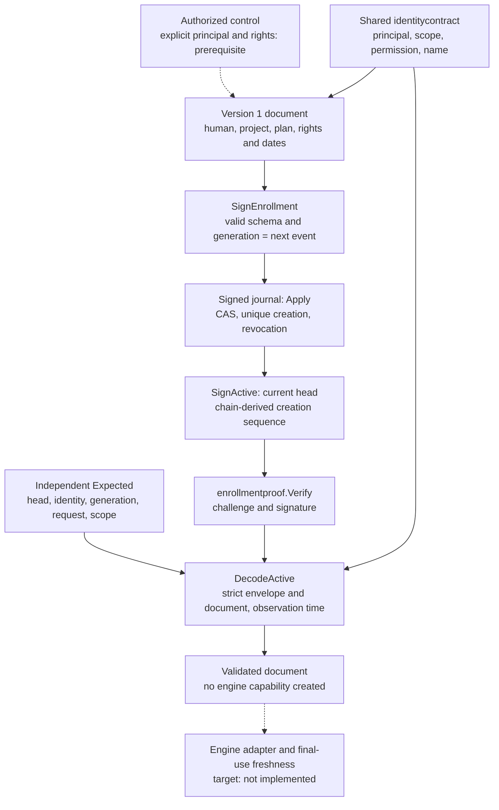

Version 1 requires eleven fields: `schema_version`, `enrollment_id`, `generation`,
`project_context_digest`, `principal`, `scope`, `trust_configuration_revision`,
`permissions`, `delegable`, `not_before`, `expires_at`. `principal` contains
`principal_id`, `principal_kind`, `issuer`, `subject`; `scope` contains `work_id`,
`plan_version`, `plan_digest`. Each permission has `operation` and `resource`.
Keys are exact and canonical JSON is the output of `Encode`, including declared
field order, UTC RFC3339Nano dates and `delegable: []` for an empty list. `Decode`
rejects omitted, null, duplicate, unknown, case-folded, wrongly typed or differently
encoded fields, including nested fields. Producers may supply other time zones:
`Encode` preserves their instants and writes UTC without inventing a duration.

`identitycontract` shares structures and validation with private engine types;
`safeName` delegates to it too. Existing JSON and rules are preserved: local ASCII
names of 1–100 bytes, positive plan versions and Trust revisions, lowercase hex
SHA-256 digests, exact resources without globs and six existing operations
(`agent.create`, `memory.read`, `memory.summarize`, `memory.transmit`, `tool.invoke`,
`effect.execute`). Existing name syntax does not apply to OIDC issuers/subjects:
these remain opaque and exactly compared, without URL, case or whitespace
normalization. Enrollment requires a valid `human` principal; neither `local`,
`service`, a business role nor a matching display name satisfies this condition.

Permissions must be nonempty, valid and unique. Delegable permissions must be
valid, unique and a subset of permissions. Both dates are explicit and
`not_before < expires_at`. The window includes its start and excludes expiry.
`Encode`/`Decode` validate structure without asserting validity now; `DecodeActive`
requires a controller-supplied observation time. That parameter is not evidence
of a fresh clock; the final adapter must supply it at the serialized decision.

`SignEnrollment` binds generation to `base.Sequence + 1`, the exact project and
document ID before signing. CAS still has to accept the append. The journal then
derives `Record.EnrolledSequence` from the verified `enroll` event, never from
its body. Generation remains stable when other enrollments or revocations advance
the current head. SQLite schema and existing signed events are unchanged; reads
reconstruct this field. Old reply envelopes without it fail the new strict
consumer; no existing engine client was connected to this isolated format.

`DecodeActive` receives an authenticated `Statement` and controller-supplied
`Expected`: current expected head, enrollment ID, generation, project, full
principal, full scope, Trust revision and request digest. It requires exact
agreement across the authenticated request, envelope, document and journal
creation sequence. A document signed through the opaque path with a declared
generation differing from its event is rejected. The complete engine request
covered by `request_digest` still needs an adapter (EP-02).

Errors distinguish invalid document, mismatched context and inactive window;
no partial document is returned. JSON alone can be structurally valid without
being authenticated; reconstruction grants no rights. An old `Statement` can
still pass with its old `Expected`: this check does not reread the service or
establish non-revocation at use time. No budget, TTL, timeout or new operator
setting is introduced.

Recipe: `go test ./internal/identitycontract ./internal/enrollmentauthority
./internal/enrollmentstate -count=1 -timeout=0`, then the same `-race` suite,
`go vet` and targeted compilation. Check private engine consumers separately
after extraction. The [IA3c.2c report](../plans/actions-confiance/verification-identites-agents-20261016/ia3-enrollment-authority-20261017/RAPPORT-IA3c2c.md)
retains results and limits. Actual enrollment, time source, durable independent
witness, final linearization, public admission, descendants and F01–F07 remain open.


## Bind the complete request to its challenge — IA3c.2d

`internal/enrollmentrequest` defines one purpose only:
`agent_identity_registry_publication`. It covers the complete candidate rather
than just its ID or a supplied digest. `Prepare` validates, encodes and owns
immutable data; it does not authenticate its source. `Decode` reconstructs data
from a canonical envelope without creating a private engine capability or proving
the declared identity.

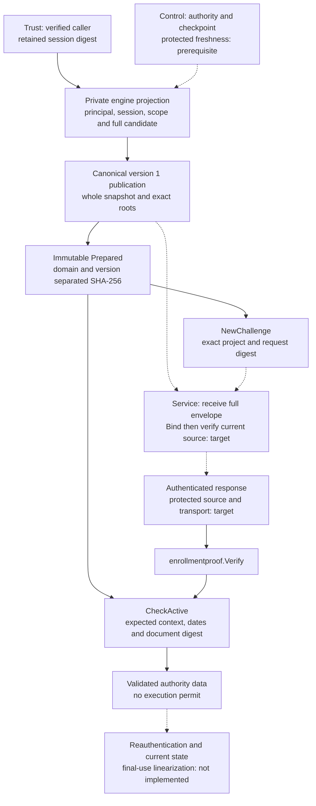

Version 1 `Publication` has sixteen required fields: `schema_version`, `purpose`,
`project_context_digest`, `principal`, `session_digest`, `session_verified_at`,
`session_expires_at`, `scope`, `trust_configuration_revision`, `enrollment`,
`event_id`, `snapshot_revision`, `snapshot_digest`, `snapshot`, `root_grants`,
`previous_registry_head_digest`. `enrollment` contains `id`, `generation`, `head`
(`sequence`, `digest`) and `document_digest`. Principal and scope reuse
`identitycontract`. The previous checkpoint is an explicit empty string only
for controller-supplied genesis; omission and null are rejected. Target enrollment
requires a positive generation, a covering head and the document digest.

Canonical JSON follows Go field order and writes UTC dates without inventing
a duration. `snapshot` carries the entire snapshot bytes as JSON base64;
`snapshot_digest` must be their exact SHA-256. This package checks a
JSON object without reimplementing the grant schema, transitions or publication
authorization. The engine projection applies its existing validators and uses
the full canonical snapshot JSON. Root order remains exact, as in the registry
head; no silent sorting or deduplication. Duplicate roots, invalid names,
noncanonical envelopes and unknown/duplicate fields, including nested envelope
fields, are rejected. Embedded snapshot semantics remain the engine's responsibility.

The request digest is SHA-256 of `swarm-enrollment-publication-request-v1`, NUL,
`request`, NUL, followed by the complete canonical envelope. It differs from
the snapshot digest alone and also covers the session reference/dates, expected
enrollment, exact authority document and two distinct checkpoints: enrollment
head and previous publication head. Changing any dimension changes the request;
a reply bound to the old request does not cover the new one. Purpose is fixed:
a different action needs an explicit contract rather than a free string reusing
this format.

`Prepared.Bytes()` and `Publication()` return owned copies. Go value copies of
the handle cannot modify its bytes or digest; JSON cannot reconstruct its private
fields. This preserves local consistency, not OS isolation. `Expected()` projects
authority-consumer context from those same bytes rather than maintaining a second
description. `NewChallenge` rejects a verifier for another project. A future
service must receive the full envelope and call `Bind` to compare project and
digest. `Bind` authenticates neither peer nor cryptographic envelope; these remain
obligations of `SignResponse`/`Verify` and protected control.

`CheckActive` checks the observed session window, complete expected context and
returned authority-document digest. Another authentic document for the same
ID/generation with different rights or ceilings is rejected. Session observation
is included and expiry excluded. A supplied time proves neither a fresh clock
nor an active session. No raw token is retained in the digest, which must never
be treated as an access credential itself.

In the engine, `resolveAgentIdentityCaller` now retains Trust's `TokenDigest`
in its private result. `prepareAgentIdentityEnrollmentRequest` therefore receives
no separate token to associate with that caller. It checks caller, authority,
scope, checkpoint, enrollment reference and snapshot using existing validators.
This pure function reads neither Trust nor SQLite; its future caller must resolve
and serialize current state. It does not replace permit issuance, checking new
ceilings against history, human approval or process start. Runtime callers without
a human session do not become issuers.

No endpoint, transport or deployed service consumes this format. Bytes and digests
prove neither human plan adoption, current non-revocation nor a unique effect.
Cost grows with candidate size; no transport cap, duration, TTL, budget or new
policy is introduced. Current source, final freshness, durable independent witness
and read-envelope versioning before external adoption remain open.

Recipe: `go test ./internal/enrollmentrequest -count=1 -timeout=0`, the same suite
with `-race`, then package `go vet` and `go build`. Check the private engine
projection and consumers separately. The [IA3c.2d report](../plans/actions-confiance/verification-identites-agents-20261016/ia3-enrollment-request-20261017/RAPPORT-IA3c2d.md)
retains commands, actual collection, sources and limits. No global F01–F07,
IDA or memory-rights PASS follows from these results.


## Explicit read-envelope version — IA3c.2e

`ActiveReply` is now versioned: `schema_version` must equal `1`
(`enrollmentstate.ActiveReplySchema`). It has three top-level fields:
`schema_version`, `head`, `record`. `SignActive` writes this version while holding
the journal reservation; the signature covers every byte, including the version.
This number describes the read envelope. It changes neither SQLite schema,
signed events, challenge, authority document nor complete request.

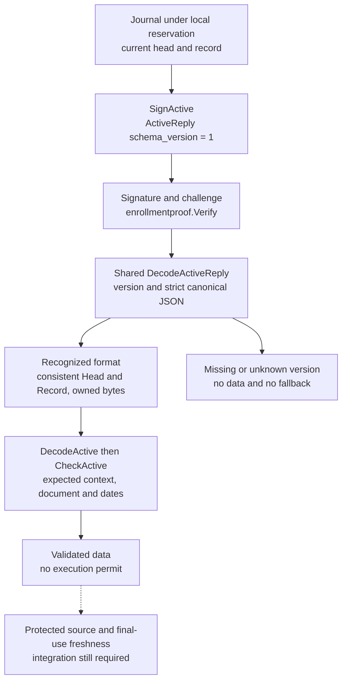

`enrollmentstate.DecodeActiveReply` is the single decoder for this envelope.
Missing, null, zero, negative, unknown or wrongly typed versions are rejected.
Unknown keys, duplicates, case aliases, omissions, noncanonical encoding and
trailing data are rejected. The head must be positive with a valid digest; the
creation sequence must be positive and covered by that head. IDs retain the
journal's opaque rules. `body` is a JSON base64 string, possibly empty, never
null. Empty opaque bytes remain valid journal data without becoming an authority
document.

`enrollmentauthority.DecodeActive` delegates envelope decoding to this shared
boundary before applying authority checks. Error chaining retains the cause:
an unsupported version remains detectable as `ErrReplyVersion` while also being
an `ErrDocument` for the consumer. Invalid shape yields `ErrReply`. No partial
data is returned; an authentic packet with an unknown version is still rejected.
Decoding alone does not verify a signature and must operate on an authenticated
Statement payload.

**Compatibility: explicit break of the prototype read format.** Unversioned
frames are rejected, without automatic retry in an older format. Producers and
consumers must explicitly select version 1; the only supported set is `{1}`.
No external client was connected. Real-peer negotiation and interoperability
still need verification before first external adoption (I2c-06 remains partial
at deployment). Historical replies and evidence are not rewritten; no journal
migration is needed. A correct version establishes neither freshness,
non-revocation nor action rights.

Recipe: `go test ./internal/enrollmentstate ./internal/enrollmentauthority
./internal/enrollmentrequest -count=1 -timeout=0`, the same suite with `-race`,
then `go vet` and targeted compilation. The [IA3c.2e report](../plans/actions-confiance/verification-identites-agents-20261016/ia3-enrollment-reply-20261017/RAPPORT-IA3c2e.md)
retains the unversioned counterexample, rejections, sources and limits. No TTL,
timeout, budget or new operator policy is introduced.

## Adopted boundary — local pilot, remote planned

User decision on 17 October 2026: a local service under a separate system account
with verified confinement for development and pilot use. An authority on a
separate machine with separate administration is planned for future installations,
including customer deployments. Customer demand remains a user hypothesis;
neither the service nor its configuration flow is delivered yet. The
[enrollment plan](../plans/actions-confiance/identites-agents-enrolement-IA3c2.md)
details initial setup, the Admin modal and criteria IA3c.2f-01 through -06.
Hosting is now decided. The selected human flow is specified below; its
implementation, actual enrollment and activation remain open.

Local mode keeps the host kernel and administration in the trusted computing
base. Remote mode aims to withstand a compromised Swarm host, subject to separate
administration and the authority's own checks. The business contract remains
common: exact request, identity, delegation, current state and revocation.
Transport adapters replace none of these checks. Portability and migration
between real services remain unproven.

Initial setup must prepare the selected mode, followed by an Admin modal managing
protected, persistent and revisioned configuration. Setup, API, CLI and UX must
share validation; non-mutating preview, stale-revision rejection and preserved
history are required. Saved choice, applied configuration and observed evidence
remain distinct. No secrets in the browser, agent sources or project exports;
no root learned from the peer. The remote option must be labelled as planned
until implemented. Docker/native describes Swarm installation, not its authority's
security boundary.

### Local authentication by default, configurable through the UX

User clarification on 17 October 2026: no existing identity provider is available.
The target is a **personal local human account by default**, offered by a
first-run wizard, then configurable in Admin. An enterprise provider is optional.
This authentication choice is independent of local/remote authority hosting
and of the AI model provider. Starting a workflow after local enrollment and
verification of its security prerequisites requires no external identity provider.

The default selects a fresh installation's flow, never a shared account/password
or automatic authority. Bootstrap requires installation proof independent of
the first visitor and the agents' channel, consumed once. The authority verifies
the account; a UID, cockpit cookie or declared `principal_kind: human` is
insufficient. The authenticated principal has kind `human`, an installation-bound
issuer and a stable subject; it differs from the unauthenticated technical
`local` category.

Requested mode, effective mode and evidence are displayed separately. Persistence,
non-mutating preview, revision checks and validation are shared by setup/API/CLI/Go/UX.
Configuration errors or loss never restart initial enrollment. Changing providers
requires verified authority and explicit account binding; matching names/emails
never merge identities or rights. Recovery and revocation preserve history.
Secrets are neither persisted in the browser nor supplied to the model. Identity
must be checked throughout the workflow.

**Status: decision and criteria documented; wizard and local authentication not
implemented.** The current configuration format has no such setting. The
[enrollment contract](../plans/actions-confiance/identites-agents-enrolement-IA3c2.md)
provides the target graph and seven IA3c.2f-04-UX1 through UX7 criteria; this text
closes none of them. Storage/channel evidence remains reusable within its scope
and does not establish this human flow.

Protecting the key and identifying a peer are insufficient: the authority must
check the exact request's rights and current state. SO_PEERCRED reports process
credentials, not a workflow role
([Linux unix(7)](https://man7.org/linux/man-pages/man7/unix.7.html)). A channel
accessible to an agent sharing the controller's UID may defeat the separation.
Unavailability cannot enable permissive fallback or automatic local failover.
Moving from local to remote will require an authorized migration preserving
evidence, consumption, reservations and checkpoints, with no implicit reset or
re-enrollment. Pilot use exempts none of these controls.

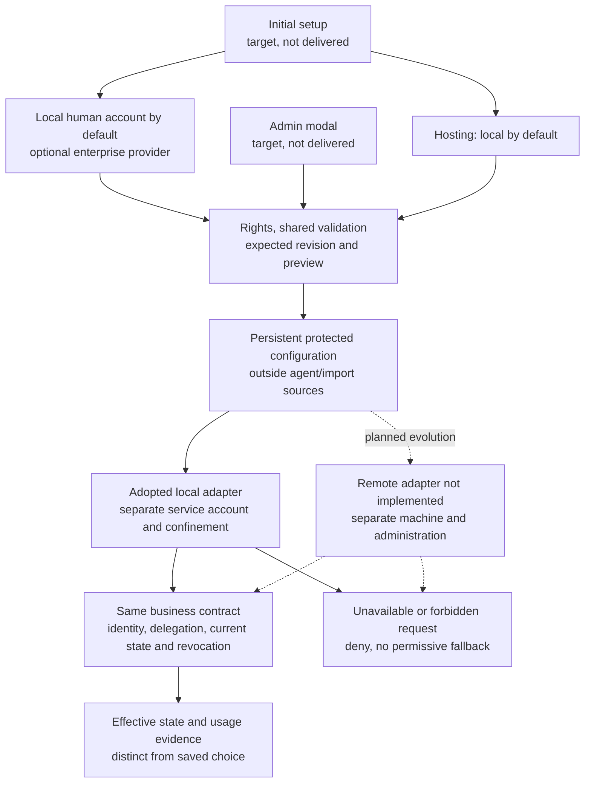

Verified scope of this increment: decision and documentation only. install.sh
supports Docker/native, compose.yaml defines only one Swarm service under the
operator's UID/GID, and trustRemoteOrigin accepts only an HTTP loopback origin
for Trust. None provides this new authority service or its remote adapter.
IA3c.2a through .2e modules retain their fixture evidence; F01–F07 and EP-01 through
EP-10 are not closed by this hosting decision. The [IA3c.2f report](../plans/actions-confiance/verification-identites-agents-20261016/ia3-deployment-choice-20261017/RAPPORT-IA3c2f.md)
links the decision, observed sources, rendered diagrams and documentation checks.

## Installation configuration kernel — IA3c.2f-02a

`internal/enrollmentconfig` now provides a strict format and Linux storage for
**desired configuration** of the local authority. No engine, CLI, HTTP, installer
or Admin adapter imports this package; no application setting is active. It
prepares IA3c.2f-02, which remains partial. Known mode `remote` returns ErrMode
without local fallback.

Bootstrap independently supplies `Pins`: `installation_digest` (lowercase SHA-256
hex), `authority_public_key` (32 Ed25519 bytes in unpadded base64url), and the exact
human `bootstrap_principal` from identitycontract. The opened file cannot supply
its own root. Ordinary changes cannot alter the principal or root; no private
key is a format field. Valid data establishes neither provenance nor OIDC login.

`Change` has exactly `schema_version:1`, `event_id`, `expected_head`, `values` and
`reason`. Values contain `mode:"local"` and an absolute canonical
`local_socket_path`. The 107-byte Linux bound is derived from sockaddr_un and
exposed as `LocalSocketPathMaxBytes`: a transport representation bound, unrelated
to time or budgets. Head has a **decimal uint64 string** `revision` and hex
`digest`; only genesis is `{"revision":"0","digest":""}`. Zero is not a current
revision. Clients must retain revision strings without JavaScript Number conversion.

EncodeChange/DecodeChange are the shared request boundary for future adapters.
Encode/Decode validate complete snapshots (`schema_version`, `pins`, `history`).
Each entry contains `change`, `actor`, `at`; its domain-separated SHA-256 hash is
bound to pins and the previous head in change. UTC timestamps, nonempty text IDs
and reasons, unique events and exact chaining are checked. Decoders require exact
canonical bytes: unknown/duplicate/folded/null/missing/wrong-type fields and
trailing input are rejected without partial results. This hash chain is not a
digital signature.

| Go operation | Expected input / result | Limit |
| --- | --- | --- |
| Open | Existing directory, actual expected UID, independent pins, non-nil Authorizer; storage handle | May initialize config.lock; creates neither config.json nor default values |
| Preview | Change and explicit observation time; Projection with base, proposed, current_event_replay | Reservation, complete validation and authorization; no configuration write or event |
| Create | Explicit genesis bootstrap; saved View | Never replaces existing configuration; recognizes only exact retry of an initial event still current |
| Apply | Change with expected head; saved View | Missing configuration denied; CAS, unique event and exact retry of current event only |
| Read | Independently supplied current Head; owned snapshot View | Rejects mismatching pins/head; never learns its witness from the opened file |

The final directory must belong to the process UID with exactly 0700 permissions.
Components are opened by descriptor without following symlinks. Ancestors belong
to root or the service and are not group/other writable, except root-owned sticky
directories such as /tmp. Lock and configuration must be regular 0600 files with
the same owner and one link. FIFOs, symlinks, extra hard links and open permissions
are rejected. Directory checks repeat at reservation and before persistence;
actual temporary-file permissions are checked without bypassing restrictive umask.
These checks do not confine agents sharing the service UID.

Nonblocking reservation returns ErrBusy without internal timer or retry.
Authorizer runs under reservation on owned copies; its human result must equal
the pinned principal. It must resolve authenticated authority rather than echo
a request field, and must not reenter the Store. Fixture callbacks establish no
real authentication. Read is an internal data API; its future transport must
authorize access as well.

Application writes a private temporary file, syncs it, atomically renames it
(without replacement during bootstrap), then syncs the directory. Failure after
rename returns ErrIndeterminate and no View: a mutation may already be visible.
Observe against an independent checkpoint, then retry the exact current event
with fresh authorization and another durability barrier, without adding history.
Stale revision gives ErrConflict; changed/reused/historical events give ErrEvent.
ErrPath/ErrFormat/ErrVersion/ErrPins/ErrHead distinguish other rejections.
Authorization errors preserve their cause via errors.Is; cancellation observed before
entering persistence rejects writes. After that point, concurrent cancellation
does not prove absence of mutation: observe the current result. Lack of progress grants no retry authority.

Preview validates the same representation as application for the same inputs,
including time. Actual application time may change the digest: proposed preview
Head is never evidence of a completed write. Revisions order events; timestamps
are not an expiration policy. No history/volume cap, timeout or budget is added.

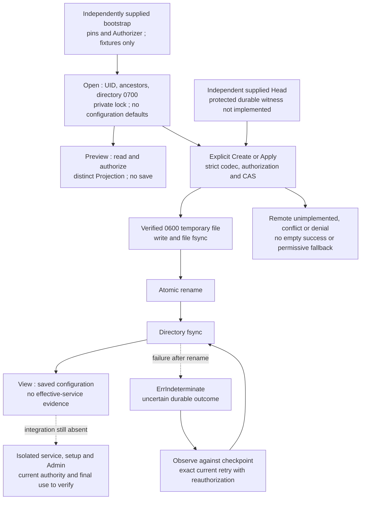

70 named tests/subtests pass in normal and race modes; targeted vet/build pass.
Three candidate counterexamples failed before correction: changed directory
permissions after Open, an unserializable date accepted by Preview, and umask
making a saved file unreadable. They remain in the [IA3c.2f-02a report](../plans/actions-confiance/verification-identites-agents-20261016/ia3-installation-config-20261017/RAPPORT-IA3c2f02a.md).
The fsync failure is locally injected; no hardware power loss is tested. Restoring
both file AND supplied Head removes rollback detection. The protected durable
witness, real OS boundaries, service, public adapters and UX remain open. The
service must distinguish new bootstrap from restoration; Create is not a reset
endpoint. Future remote support must preserve historical bytes and version rules,
not silently recompute the chain using a new codec.

## Local witness and coordinated recovery — IA3c.2f-02b

The package now provides `Coordinator`, opened with OpenCoordinated and explicit
configuration/witness paths, actual UID, pins and Authorizer. Equal, nested and
same-inode directories are rejected; existing Linux ownership, mode, link and
file-type checks are shared without copying another Store. Separate directories
do not establish separate administration or backup domains. This remains an
internal Go API without service, installer, CLI/HTTP or Admin integration.

`witness.json` has four exact canonical fields: `schema_version:1`, `pins`,
`committed` (confirmed Head) and `pending` (null or intent). Intent contains `entry`
(change, actor, at) and `target` (Head derived from the entry and pins). The change
base must equal committed; actor, time and schema are checked. Unknown, duplicate,
folded, null/missing, trailing and contradictory-target input is rejected. The
witness is local state protected by storage checks, not a signature or hardware
monotonic counter. Pins remain independently supplied.

| Coordinated operation | Actual behavior |
| --- | --- |
| Create | Explicit bootstrap only if both states are absent; durable intent before config, then confirmation; recognizes exact retry of initial event still current |
| Apply | Reserve config then witness without internal wait/retry; check confirmed Head, authorize, prepare intent, write config, confirm |
| Read | Compare config with committed, reject open intent, check both directory barriers before returning View |
| Preview | Same validation/authorization, no state write; reject pending; project genesis only when both states are absent |
| Recover | With pending, compare only exact base/target, reauthorize and sync intent before effect; already-confirmed state requires observation/barriers only |

Missing witness with existing config returns ErrWitnessMissing; it is never
reconstructed from config. Missing config outside genesis is denied. Divergent
Heads, even from coherent data, are rejected; restoring config OR witness alone
is detected. A raw Store call outside the protocol cannot advance the witness
and is rejected by Coordinator. The future service must consume Coordinator
without bypassing these comparisons.

Intent retains the exact entry and time. If config is still at base, apply that
entry after fresh authorization. If target is already visible, sync without a
second event or rewrite. Other history, a different request while pending, or
denied authority causes no implicit repair; intent is retained. Ordinary Read and
Preview remain closed with ErrPending. Errors return no partial View.

Visible confirmation with failed fsync remains uncertain: reread, compare and
sync both directories, or retry the exact current event with authorization.
Errors preserve ErrIndeterminate, the cause and stage (prepare witness / write
configuration / confirm witness or barrier). Preparation failure before rename
may leave both files absent: explicit bootstrap is then required, never inferred
success. Cancellation after intent and before config retains the pending decision;
later concurrent cancellation does not establish absence of mutation.

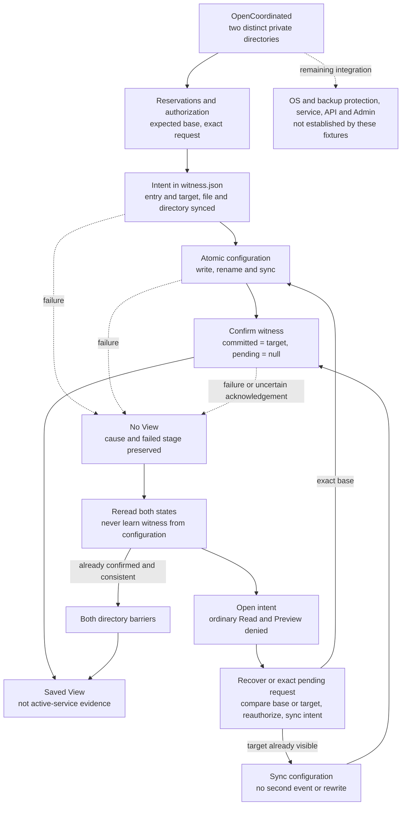

The previous 70 guards run in a final set of 101 named PASS results in normal/race
modes; targeted vet/build pass, with 12 stable inputs. A child fixture writes intent,
encounters a barrier fault and exits without Close; a fresh coordinator rebuilds
recovery from the files. This is not SIGKILL, power loss or UID separation evidence.
Same-inode bind mounts are checked in code but not mounted in these fixtures.
The [report](../plans/actions-confiance/verification-identites-agents-20261016/ia3-config-witness-20261017/RAPPORT-IA3c2f02b.md)
retains injected fault windows, the reproduced/corrected error-context defect,
sources and limits.

Restoring both stores together remains accepted in the preserved limitation case.
Host, backup and witness protection does not follow from a directory name. This
local kernel therefore closes neither F07 nor EP-06. No automatic intent abort is
provided: denied recovery or missing history keeps its cause/owner and blocks
progress. Restoration or migration must use an authorized operation still to be
designed, not private-state edits. Owners: operator for protection/identity,
Codex for the service and public flows. Remote mode remains rejected by the
current codec; no permissive fallback or new timeout/budget is added.


## Local control adapter IA3c.2f-03a — private and inactive

The engine now has a private adapter that receives a Linux SOCK_SEQPACKET packet,
attributes each message using SCM_CREDENTIALS and SCM_PIDFD, and exclusively uses
the configuration/witness coordinator. It reuses the IA2 channel; a PID in JSON
or the identity of the connection creator does not replace the kernel-attributed
sender. Configure the channel before releasing the sender. No listener, CLI
command, HTTP route, account or system service is created; the running server's
binary is not replaced.

The initial 03a prototype used schema 1. Since 03b the canonical request uses
schema 2 with challenge and independent pins, described below; old version 1 is
rejected. read requires change:null; preview, create and apply require the existing
strict Change. Client actors, dates, unknown/duplicate/case-folded fields and
noncanonical bytes are rejected.

Trusted bootstrap supplies paths, owner, pins and the authority controller
independently of project data. This controller receives the attributed message
and an owned copy of the exact request; it authenticates, authorizes the operation
and holds its revocation serialization throughout execution. Even read requires
this control. The returned principal must equal the pinned human. The mutation
request is checked again under the coordinator's reservations; the client cannot
choose the time. Test callbacks implement neither OIDC authentication, current
delegation nor real provider confinement.

| Operation | Adapter effect |
| --- | --- |
| read | Read a confirmed View only after authorization |
| preview | Project without writing config.json or witness.json; this is not saved state |
| create | Explicit bootstrap according to both stores, without choosing authority from the request |
| apply | Current CAS and reauthorized exact pending request recovery; current-event retry creates no extra event |

It does not expose request-free Recover: the operator can resume the exact Change
through apply. Pending state, conflict or missing history triggers no automatic
reset or reconstruction. An authority controller that omits execution, swallows
its error, executes twice or retains execution after returning cannot manufacture
unchecked success: omitted/late execution is denied, errors preserved and a second
effect prevented. Failure after successful effect retains an uncertain outcome;
it does not undo a write. The controller must execute synchronously and maintain
its protections; these guards do not replace its implementation or independent
verification.

Replies contain schema_version, request_digest, operation, view, projection and
error, with null
for absent results. Errors expose no result; only limited codes cross the channel:
invalid_request, denied, conflict, busy, pending, not_configured, indeterminate or
unavailable. Original Go causes remain service-side, without sending private
paths. Truncated packets or invalid ancillary metadata are rejected before storage
access, without a business reply.

Losing acknowledgement after a successful write returns an uncertain service-side
error without rollback. Retry the same request, EventID and base for reauthorized
observation without an extra event. The owner supplies the transport buffer and
manages the connection; replies beyond socket capabilities fail without implicit
chunking. No extra timeout, retry, volume or concurrency policy is introduced.
Cancellation alone does not interrupt a blocked receive; the owner must close its
connection. The eventual service must make that management observable.

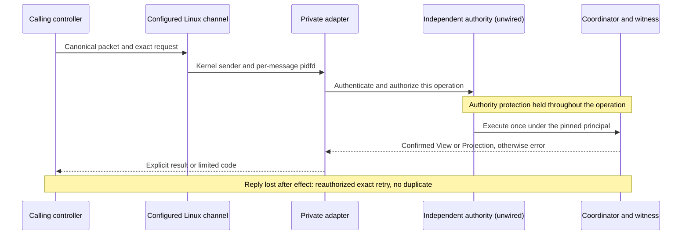

The [adapter report](../plans/actions-confiance/verification-identites-agents-20261016/ia3-local-service-20261017/RAPPORT-IA3c2f03a.md)
binds checks to source and retains their limits. The child exchange attributes the
actual sending process under the same fixture account. It proves neither account
separation, an active protected service nor service authentication by a public
client. EP-01/04/05/07, F01–F07 and public admission remain open. Before activation:
designate the initial human, provide real authority control, protect files, keys
and account, establish the service peer client-side and verify confinement, then
wire commands, installation and FR/EN Admin. Remote mode remains planned; no
permissive fallback.

The workflow checker also uses -timeout 0 for its context test: the inherited
30-second global watchdog was removed because no timing contract justified it.
This method check does not measure product performance.

The same checker now requires JSON run/pass events for the named test and package
completion; an empty selector, skip or incomplete evidence can no longer produce
OK. Controlled Go-output doubles and the actual check are distinct proofs, both
retained in the adapter report.


## Local client IA3c.2f-03b — service peer and reply checked in fixtures

The private client completes the control adapter; it installs no service. Its
constructor receives installation pins, expected UID and an independently held
server pidfd from trusted bootstrap. It duplicates and holds that descriptor. It
never opens it from a PID in a reply or learns its trust root or principal from
the service. Each reply is attributed using the same Linux channel as requests;
its UID and process object are compared with these independent inputs before
interpreting the business result.

The comparison uses the pidfd device/inode on pidfs under 64-bit Linux. Filesystem
type is checked; ordinary files, older anonymous-inode pidfds and 32-bit builds
are rejected without numeric-PID fallback. The object identifies a process within
the current host boot, not a persistent identity or its executable. This proves
neither confinement nor human identity; executing different code in the same
process still requires protection. The kernel contract is checked against
[Linux v6.17 pidfs](https://raw.githubusercontent.com/torvalds/linux/v6.17/fs/pidfs.c).

Transport moves explicitly to schema 2. Persisted configuration, journal and head
digests retain schema 1; no history is reset. The client generates a fresh random
32-byte challenge for each new exchange and includes expected pins in the request.
The service compares them with its own before authority control; equality grants
no right. Replies carry request_digest, domain-separated SHA-256 with
`swarm-installation-control-v2` over the complete canonical request bytes: challenge,
pins, operation and exact Change. Version 1 packets are rejected even if attributed
to the correct process.

| Envelope | Exact version 2 fields |
| --- | --- |
| Request | schema_version, challenge, pins, operation, change |
| Reply | schema_version, request_digest, operation, view, projection, error |

After process verification the client rejects wrong version, operation or request
digest, noncanonical/unknown fields, missing results, mixed View/Projection,
unknown error codes and errors accompanied by data. enrollmentconfig provides
ValidateView/ValidateProjection, sharing schema, full history, recomputed head
and base/replay checks with storage. The client compares result pins and the last
Change against its request. None of these checks turns desired configuration into
an agent capability or an active service.

The client owns its connection and duplicated pidfd; one exchange is admitted,
then both are closed. The launcher's original descriptor remains independently
owned. Cancellation before send means nothing was sent; after a mutation attempt,
unattributed, truncated or lost replies produce no result and an uncertain outcome.
An authenticated business error remains its explicit refusal. Cancellation closes
the client's own connection to interrupt send/receive, without a fixed deadline
or automatic retry. Retry the same business EventID/base on a new channel with a
fresh challenge and renewed service authorization.

The size fixture reduces only its socket send buffer and reads SO_SNDBUF back to
construct a reply beyond the observed capacity. It must observe EMSGSIZE rather
than a timeout; an already committed effect is observed through exact retry without
an extra event. This experiment sets no product volume policy. Oversized replies
remain a packet-transport limitation with no implicit chunking: pagination or
another framing protocol must be designed before exposing arbitrary histories in
a public flow. The owner also supplies the receive buffer; truncated prefixes are
rejected rather than interpreted as valid replies.

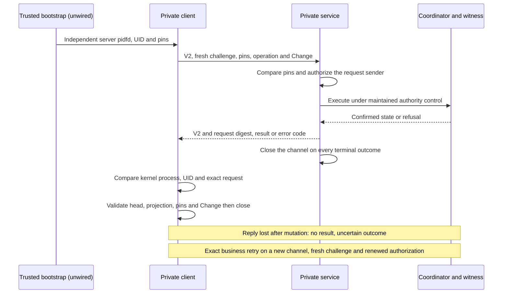

The [client report](../plans/actions-confiance/verification-identites-agents-20261016/ia3-local-client-20261017/RAPPORT-IA3c2f03b.md)
retains results and evidence conditions. Public bootstrap supplying the independent
pidfd, human authority, separate account, confinement and Admin remain unwired.
Fixture-verified clients do not close EP-01/04/05/07, F01–F07, IA3 or overall
acceptance. No permissive local/remote fallback.


The service channel is also owned for one exchange and closed on success, refusal
or error; a second serve is rejected. The EMSGSIZE guard no longer closes the
socket on its behalf: it directly observes POLLHUP without waiting (zero-time
poll), then the client exchange observes channel termination. This fixes possible
waiting after an unsent reply without inventing a timeout. unavailable remains a
general service-unavailability error; it does not establish a storage failure.
Both pre-fix counterexamples and their recovery are retained.

The channel must come from trusted bootstrap and be delivered to the expected
service without descriptor leakage; this client verifies the reply sender after
sending its request. This check alone proves neither the recipient before send
nor confidentiality. An unestablished socket path does not replace that
precondition; public bootstrap must prove delivery or establish the service
before sensitive content. This remains open with account and descriptor
protection under EP-07.

Challenge encoding is canonical unpadded base64url representing exactly 32 bytes.
The digest is lowercase hexadecimal SHA-256 over the prefix
`swarm-installation-control-v2\x00request\x00` followed by the canonical request;
each `\x00` represents one NUL byte. Canonical format is defined by the shared Go
codec, without claiming JSON.stringify produces identical bytes. A future client
in another language must verify this encoding, including escaping, or consume
the codec through the Go adapter. Such interoperability has not been verified.

## Private handoff IA3c.2f-03c — proof before business content

The internal `runAgentIdentityConfigProcess` launcher consumes a fresh command
of the current image, pinned by descriptor through `pinTrustFixedHelperImage`.
Its trusted caller explicitly supplies arguments, environment, expected service
UID and public pins; project data cannot choose the program or authority.
Implicit environment, preexisting ExtraFiles, an already started command, Cancel,
WaitDelay and preconfigured PidFD are rejected. Other system attributes are
preserved. This component has no CLI entry or installed service;
`acceptAgentIdentityConfigLaunch` is called by a test helper.

Two private SOCK_SEQPACKET socketpairs enable PASSCRED/PASSPIDFD before exec:
one for startup and one for business requests. The parent passes FDs 3 (business),
4 (startup), 5 (independent parent pidfd) and 6 (current image). The child's pidfd
is returned atomically through SysProcAttr.PidFD/CLONE_PIDFD; the parent never
reopens a numeric child PID. Each message's 64-bit pidfs token and UID are checked
against independently held objects on both sides. The Linux prerequisites of
client 03b apply here too.

Startup **version 1**, strict canonical format: schema_version, purpose,
challenge, pins_digest. Fresh 32-byte challenge, unpadded base64url; pins_digest
is lowercase hexadecimal SHA-256 over `swarm-installation-startup-v1\x00pins\x00`
followed by canonical Go JSON pins. Both `\x00` sequences denote NUL bytes.
All three messages hello, ready and release must match the challenge and expected
digest. The child learns the challenge from the attributed parent but compares
pins against its own source. The parent checks ready against its own child pidfd
and pins before release and before any business request. The child admits the
business channel only after an exact, attributed release. The startup buffer is
derived from the longest valid frame of this fixed format, not a business limit.

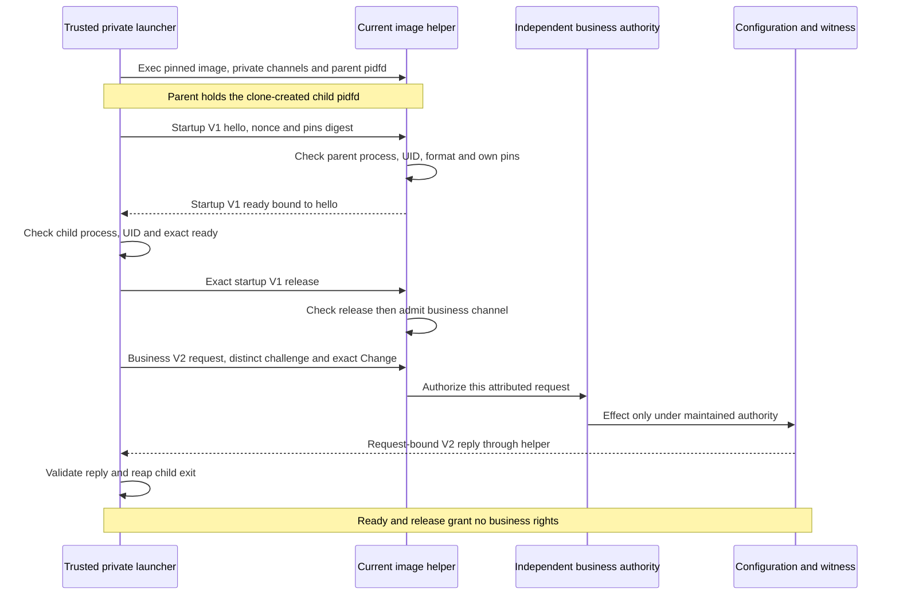

The parent's inherited FD copies close after exec. The helper verifies that its
image FD matches its executable, adopts sockets with CLOEXEC and closes originals,
the startup channel and parent pidfd. The client keeps a duplicated pidfd through
the exchange; the launcher holds the original through Wait, closes it and
invalidates its number in Cmd. Cancellation closes owned channels, sends SIGKILL
through this child's pidfd only and reaps Wait: no numeric PID lookup, group
signal, automatic timer or retry. Standard streams and image code remain trusted:
a caller-supplied writer that blocks can also block Go's collection.

Success requires both a valid business reply **and** child exit zero. An attributed
business refusal remains a refusal even after ready. Nonzero exit after a valid
mutation reply retains the process error, returns no result and ErrIndeterminate;
history is never reset. The 03b rules apply after a mutation attempt without a
valid reply. A startup failure before business send does not claim a mutation
was attempted.

The [03c report](../plans/actions-confiance/verification-identites-agents-20261016/ia3-local-launch-20261017/RAPPORT-IA3c2f03c.md)
binds checks to exact sources. Evidence concerns two fixture processes under the
same account. It establishes neither confidentiality, a separate system account,
protection from ptrace/root or a compromised bootstrap leaking descriptors, nor
human identity, delegation or public admission. Business transport remains V2,
storage V1. EP-07 remains partial pending protected bootstrap, confinement and
actual activation; F01–F07 and overall acceptance remain open.

This one-shot child helper does not replace a persistent service lifecycle.
A pidfd grants neither account-switching rights nor permission to signal another
UID. Public integration must establish who can launch/supervise the separate
account: protected privileged bootstrap or an authenticated service/broker, with
verified rights and collection. Do not run the whole cockpit with privileges to
obtain this property. Design this integration after designating the authority
source, then verify the chosen actual flow.

## Bootstrap precheck IA3c.2f-03d

`swarm identity bootstrap-check SHA256_DIGEST --input /absolute/path/bootstrap.json --json`
performs a read-only local check before opening any project. `--root`, `--server`,
stdin and activation operations are not accepted bootstrap sources. The shared
`internal/enrollmentbootstrap` package provides Encode, Decode and Load; its data
is not an authority capability.

The canonical V1 manifest contains schema_version, pins (installation_digest,
authority_public_key, bootstrap_principal), service_uid, controller_uid,
configuration_directory and witness_directory. Pins use existing validation;
a declared human and public key establish neither human login nor approval.
The declared UIDs must differ, and service_uid must match the checking process's
effective UID. This does not prove agents actually use controller_uid.

The expected lowercase hexadecimal SHA-256 digest comes from independently
approved, protected installation control. Computing it from the file to accept
and checking against that value does not establish approval. The file is opened
without following links: regular file, service owner, mode 0600, one link only.
Its parent and configuration/witness directories use the same
`enrollmentconfig.OpenPrivateDirectory` boundary as storage: effective UID,
symlink-free traversal, root/service-owned ancestors without group/other writes
(root sticky directories such as /tmp excepted), final directory 0700. The three
paths must be distinct and non-nested; handles must not identify the same inode.
Root and host administrators remain trusted.

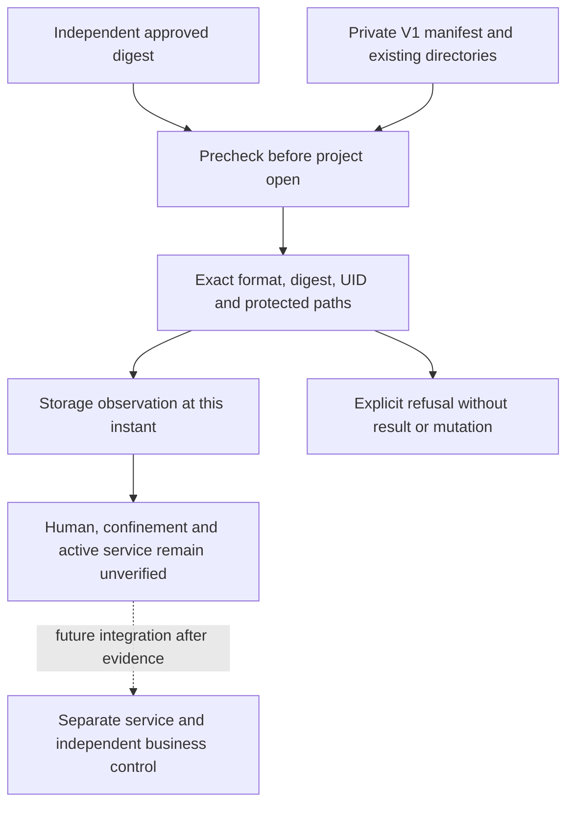

The result exposes bootstrap_digest, bootstrap and storage_verified=true;
human_authentication_verified, confinement_verified and service_started remain
false. It creates no directory, lock, key, account, journal, session or service.
Refusal returns no result. Handles close; future consumers must revalidate paths
at use rather than treat this observation as permission. Mutable configuration
and its history are separate from this manifest; root migration is not implemented
here. The protected service, human source, confinement and Admin remain open.


## Rust current-authority control core — PAEA increment26

`swarm_enrollment_authority::control` now composes the native signed journal with
Linux `swarm_enrollment_config::store::Coordinator`. This is a library API with
no listener, human session provider or consumer in the normal CLI profile.
`bootstrap-check` does not activate it. Earlier transport contracts above do not
prove that their Rust implementation exists.

Protected startup must independently supply public pins, project, private storage
paths, owner and `Binding`: enrollment ID/generation, exact human principal, plan
scope and trust revision. `Startup` checks consistency, not its producer's
identity. Requests, cockpit cookies and matching UIDs cannot establish this trust.

`BoundJournal` opens an existing WAL journal, checks its signed history and keeps
the actual connection. It neither recreates databases nor reopens their pathname
per operation. NOFOLLOW covers the final component only; protected ancestors and
bootstrap remain external prerequisites. A moved database may be refused by
SQLite; never turn this into a reopen or empty success. Binding to the opened
object does not provide confinement or resist owner/root restoration of both
configuration and witness.

Each `execute` checks the actual current head, revocation, canonical document,
exact generation/context, service-clock validity and an existing signed
`effect.execute` permission with this exact resource:
`enrollment-config/<installation_digest>/<read|preview|create|apply>`.
These four operation discriminators are protocol constants. No implicit grant,
execution ceiling, delay or retry policy is added. Grants persist in signed
journal entries; no new Admin execution policy is introduced. Reads and replays
also require their exact permission. Delegable ceilings are not consumed here.

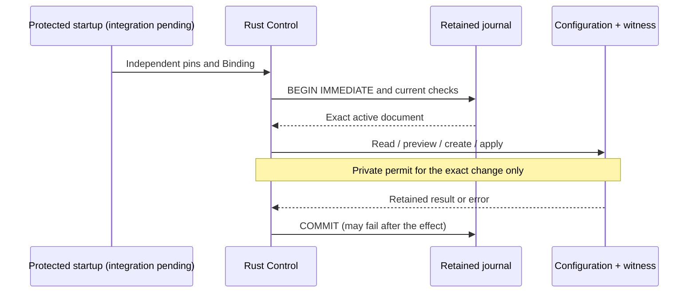

The authority reservation lasts through storage return and authority COMMIT.
Local contention returns Busy immediately, without hidden waiting/retries. A
revocation that wins first refuses use; a revoke competing with a reserved use
is refused and needs explicit resumption after that use. Wall-clock expiry is
checked before storage; it is not atomic with filesystem writes.

Preview does not publish configuration. Create/apply retain the existing
two-directory intent protocol. An exact EventID/base/content replay is authorized
again and creates no duplicate. No raw recover/reset/adopt command is exposed.
Pending witness state requires the same authorized change; read does not hide it.
Existing path, flush, close and storage failures keep their original causes.

Every failed mutating invocation conservatively leaves the effect UNKNOWN.
An Err does not establish absence of publication. If authority fails after
storage, `AfterStorage` keeps both the authority cause and the complete storage
result, including a secondary failure. Use authorized readback and/or exact-event
recovery, never a different replacement action. A revoked grant requires another
independently authorized controller before recovery. Explicit close refuses
contention, closes authority/configuration/witness and preserves secondary
cleanup failures; Drop alone proves no successful close.

Maintained recipe: `tools/verification/recipes/paea-control-core.json`.
[Increment26 results and limits](plans/actions-confiance/paea/INCREMENT-26.md).
Real isolated storage tests use explicit test-only hooks, separately from the
normal build without `test-fixtures`. Authenticated transport, actual human
identity, service account, confinement, service installation, PA-03 and E2/E3
acceptance remain open. No additional global invariant is claimed.


## Control declaration v2 and native PAEA27 startup preflight

Bootstrap v1 and the reply from `identity bootstrap-check` remain unchanged;
options follow shared37a validation. The closed
`swarm_enrollment_bootstrap::ControlDocument` v2 contains `schema_version:2`,
`installation` (complete v1), `journal_path`, `project_context_digest`,
`authority_head` (sequence/digest), `enrollment_id`, `generation`, `scope` and
`trust_configuration_revision`. Its expected principal comes from installation
pins, never an operation's actor field.

Generation is positive and no greater than the checkpoint sequence. Bootstrap,
configuration, witness and journal roots are distinct: clean absolute paths,
no linked/writable ancestors (except root-owned sticky ancestors), service-owned
0700directories and 0600regular single-link files. The loader rejects ambiguous
or noncanonical JSON, missing/unsafe paths and special files; it explicitly closes
all handles and retains secondary failures. It creates no data.

The declaration digest and checkpoint must come from independent approved control
outside the agent channel. Hashing the same untrusted file or declaring human
labels establishes no trust. `authority_head` is an independent expectation,
never automatically learned from that journal. Changed history makes it stale;
recovery requires an authorized current checkpoint, preserving history.

```sh
swarm-rust identity control-check SHA256_DIGEST --input /protected/directory/control.json --json --lang en
```

The command loads pinned v2 data, opens the existing signed journal with the
retained26connection and verifies exact head, current non-revocation, canonical
record, generation/principal/project/scope/trust binding and service-clock dates
under its reservation. It shares the actual core's validators. Every refusal is
nonzero; none becomes an empty success or a freshly adopted checkpoint. Authority
COMMIT/close precede serialization. Output/write/flush errors retain their cause.
No hidden grant, deadline/retry or execution policy is added.

The v1report includes `bootstrap_digest`, the v2`declaration`, `checked_at`,
`current_enrollment_verified:true`, and false values for human authentication,
confinement, request authorization and service start. This dated observation is
not a transferable permit. No project or Coordinator/configuration/witness is
opened or created by the CLI check; SQLite may manage WAL/SHM sidecars. Non-default runtime
options, stdin, output files and extra commands are refused before this flow.

`swarm_enrollment_authority::startup::open` also provides the real Control plus
declared checkpoint for future service integration after the same protected load.
It may create Coordinator lockfiles but creates no configuration, grant, human
session or listener. Subsequent execute still checks current authority and exact
permission. The CLI check never calls this factory. Path checks and retained
connections do not defend against root or agents sharing the service UID/access;
actual confinement and independent pin provenance remain prerequisites.

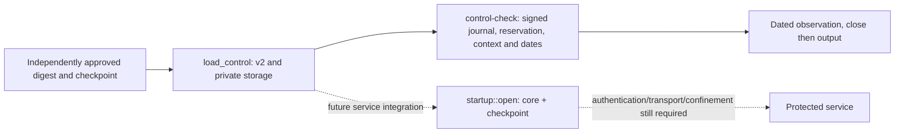

Personal local enrollment with one-time independent bootstrap, authenticated
transport, actual service account, confinement and PA-03 remain open. No HTTP/Admin
endpoint or screen is added. The binary's FR/EN evolution notes describe only this
preflight. Recipe: `tools/verification/recipes/paea-control-startup.json`;
[increment27evidence and RETEX](plans/actions-confiance/paea/INCREMENT-27.md).


Verify local delivery from the actual running process and served binary identity
(version, commit, SHA), then select its matching effective profile and archived
sources. Latest prepared build state may belong to a parallel delivery not yet
activated; that file alone never establishes the running binary. Replay the
affected flow using the actual normal binary without fixture features.


## Personal verifier and secret-knowledge proof PAEA28

`swarm_enrollment_authority::credentials` supplies the future local account's
cryptographic contract, without creating an account/listener. `create` takes an
installation, stable human principal, positive generation, explicit parameters
and borrowed secret bytes. OS entropy supplies a32byte salt; RustCrypto Argon2id
v19 derives32bytes. A closed canonical v1Record persists context, algorithm,
memoryKiB/passes/parallelism, canonical base64url salt and verifier. Debug redacts
this sensitive material; encode/decode refuse ambiguity/substitutions.

No implicit KDF costs: consumers persist their choice and use the same
`Parameters::validate` algorithm/representation check. It is not a security
recommendation; algorithm-valid low costs do not establish secure policy. Future
installation/Admin/API/CLI must manage identical values before exposing a
service.28 opens no password endpoint and introduces no lifetime/retry/attempt
policy. `fingerprint` hashes `swarm-personal-credential-v1` NUL canonical JSON.
Its expected value must be independently approved, never learned from the record.

`verify` checks exact pin/installation/principal/generation before Argon2 work,
then compares derived bytes in constant time. Password mismatch refuses;
entropy/algorithm/allocation/framing failures retain typed causes with redacted
public categories. Its opaque borrowed, non-cloneable/non-serializable Proof
establishes knowledge of that exact record's secret only, not current/revoked
account status, actual human presence, a session or business authority.

Temporary output and the owned working allocation use Zeroizing guards on
success/error. Resolved Argon2 source shows its zeroize feature alone does not
wipe its internal allocated workspace, so28 supplies its own guarded allocation
to `hash_password_into_with_memory`. This does not establish erasure of every
compiler/OS/stack/dump copy. Borrowed password memory remains its owner's duty;
there is no normalization/truncation. One-time independent bootstrap, protected
current/revocable storage, authenticated transport, separate service account and
pre-effect authority remain required. [Evidence28](plans/actions-confiance/paea/INCREMENT-28.md),
recipe `tools/verification/recipes/paea-personal-credentials.json`.


## Transactional personal bootstrap PAEA29

`personal::Source` composes28credential checking with an existing signed journal
on a retained connection. Protected startup selects public pins, journal context,
installation/stable human/generation (`Expected`) and independent checkpoints,
never a request actor or first caller. It creates no journal or paths. Future
deployment must protect storage/private keys and bootstrap delivery.

Closed canonical v1Bootstrap stores context, explicit KDF costs and SHA256 of
`swarm-personal-bootstrap-v1` NUL installationhex64 secret32. The fresh random32byte
installation secret must be independently delivered outside the agent channel;
this API proves neither generation nor delivery. Fixed protocol IDs
`personal-bootstrap-v1`/`personal-account-v1` live in a personal journal distinct
from business grants. `prepare` checks active bootstrap/checkpoint/secret/context/
signing key, derives verifier data and signs revoke-bootstrap+enroll-account;
it mutates nothing. Opaque private Prepared holds exact signed bytes for protected
durable recovery; its next head is only a prediction.

`enroll` uses `BoundJournal::apply_batch` to validate the complete signed chain,
CAS and atomically commit both events. A refused second write rolls back the first;
exact terminal replay does not duplicate history. Conflicting proposals/stale
heads/consumed bootstrap refuse. Account revocation never reopens bootstrap.
Apply failure means UNKNOWN until authorized exact replay/readback, never reset.
`with_authenticated` checks the active signed account and independent credential
pin/password, retaining its reservation through callback and COMMIT. No actor field
or implicit grant. Refusal never calls back; business Err remains distinct, and
authority failure afterward retains the entire success/error in UseError::AfterUse
with effect uncertainty. Consumers must traverse outcome and Error::Joined's
secondary authority branch, not only source(). SQL rollback undoes no external effect.

Mandatory reservation order: **personal account → business grants → configuration**.
No source reentry/writer wait in callbacks. Concurrent revocation is Busy during
use, succeeds after release, then prevents authentication. No hidden retry/queue/
lifetime/batch policy; i64sequence bounds are technical. Existing single-event
base/frame/closed/cancellation error precedence is preserved and tested.

No session, socket/HTTP, OS account, enrollment screen or business right is created.
Protected roots/ancestors, independently retained pins/checkpoints/proposals/key,
KDF installation/Admin/API/CLI settings, authenticated transport and confinement
remain prerequisites. Secret knowledge does not prove human consent/presence.
[Evidence29](plans/actions-confiance/paea/INCREMENT-29.md),
recipe `tools/verification/recipes/paea-personal-bootstrap.json`.


## Restorable personal proposal PAEA30

`Source::encode_prepared` produces sensitive canonical v1bytes with exactly
schema_version, independent base head and changes (two base64url original signed
events). No password or installation secret is included. Base64 is not encryption;
keep verifier data in PAEA32protected durable intent/checkpoint storage, never
logs/public exports. Codec performs no file IO. `restore_prepared` rejects
ambiguous/noncanonical JSON, versions, wrong key/project/chain/signature, event
order/operation/IDs and noncanonical or differently bound credentials. It uses
Source's existing independent pins, never roots/principals learned from the file.
A signature represents protected signing-authority approval of exact bytes, not
a fresh installation-secret check or human decision. No salt/secret/signature is
regenerated. Exact shape is revoke bootstrap then enroll account.

`BoundJournal::preview_batch` validates cryptographic data without SQLite/lock or
current-state observation, even after connection close. BatchPreview exposes only
a predicted_head, not an applied result. Positive witness under a held writer
precedes fault cases. enroll still performs actual CAS/irreversible-state checks;
restored replay never reopens bootstrap or duplicates the account. Credential/
proposal base64 failures retain concrete DecodeError with safe public categories,
without secrets in Debug/Display.

```mermaid
flowchart LR
  P["Exact proposal after initial proof"] --> E["encode_prepared: private bytes"]
  E -. "PAEA32library" .-> W["Protected durable intent/checkpoint"]
  W -. "PAEA32library" .-> R["restore_prepared: independent root/exact shape"]
  E --> R
  R --> V["BatchPreview: prediction, no current state observed"]
  V --> A["enroll: CAS and atomic real journal batch"]
  A -. "PAEA32library" .-> W
```

The codec supplies recovery representation only and performs no IO. PAEA32adds
atomic storage/fsync/checkpoint recovery above it; startup34/36 is connected,
transport/Admin/UX and actual service activation remain required. Local proof is not activation.
KDF parameters remain explicit/shared; no lifetime/retry/volume policy added.
Two events are a bootstrap operation invariant, not a generic batch ceiling.
[Evidence30](plans/actions-confiance/paea/INCREMENT-30.md),
recipe `tools/verification/recipes/paea-personal-proposal.json`.


## Atomic private documents PAEA31 — qualified library included locally

`swarm_enrollment_config::store::documents::Documents` opens an existing0700
actual-effective-UID directory, retains directory/lock descriptors and creates
only private-documents.lock (0600,regular,single-link,NOFOLLOW). Use a dedicated
directory. Immediate mutex/flock, no queue/retry/deadline. No identity/root/schema
or human authority inferred. Internal ASCII names start alphanumeric, followed by
alphanumeric/dot/underscore/hyphen; never paths, lock/hidden temp names reserved.
Filesystem representation limits remain typed IO errors, not an operator cap.
Reservation read preserves missing/error; create uses NOREPLACE; replace requires
exact expected bytes under cooperative exclusion. Renaming the directory path
never redirects its retained descriptor. Lock dev/inode must match its current
name; substitution refuses instead of splitting exclusion. This also protects the
configuration Store/Coordinator after a distinct reproducer. Cancellation, modes,
links/hardlinks/types and explicit close errors are checked. This does not defend
against root/noncooperating same-UID writers; separate service UID/confinement remain.
Shared IO writes a private same-directory temp, fsync/close, rename then directory
fsync, never truncating originals. WriteError retains primary/cleanup cause and
Publication: NotAttempted (rename not called), Unknown (attempt without success
ack), Visible (rename ack only), Durable (directory fsync ack). Cleanup may fail
after Durable. Err alone never proves absence of effects. Retain exact proposal
bytes for authorized recovery; sync follows authorized readback, never root adoption.
Acknowledgements describe local filesystem responses, not universal hardware durability.
Explicit finish returns release errors separately from already known outcomes.
Drop retains release failures for close and forbids reuse; poison refuses. close
is immediate/Busy-aware and never grants renewed data authority. Release file
reservation before personal SQLite authority and external business effects.
No OS confinement or defense against restoring all witnesses is established.
Permanent paea-private-documents recipe checks private IO, actual NOREPLACE and
Store/Coordinator/Control regressions; current named assertions/counts are maintained
in its manifest. ENOSPC/partial/sync/close/unlock hooks only
in disposable fixtures, absent from the normal profile. [State31](plans/actions-confiance/paea/INCREMENT-31.md).
Personal coordinator32uses this primitive; startup34/36 is connected, transport remains required;
internal-library inclusion alone is not an active protected service.


## Durable personal coordinator PAEA32 — locally verified library

personal::coordinator::Coordinator owns Source and dedicated Documents; new has no
IO/adoption. Paired explicit cancellation has no timer/preemptive rollback.
initialize requires an independent positive bootstrap head, real signed active
context check and absent-only checkpoint creation. No first-caller/shared password
or DB-learned root. Internal API does not provision OS protection/deliver human
secret/start a service. Closed canonical v1checkpoint binds independent install,
principal,generation,key,project,head and optional credential pin/exact pending
signed intent, with explicit nulls. enroll validates/proves/prepares, fsyncs intent
BEFORE atomic journal apply, then fsyncs confirmed account checkpoint. No business
callback under FS reservation. recover only restores protected exact signed intent,
fsyncs/replays CAS and confirms, without new password/salt/signature. Confirmed
account recovery reads real current signed state at protected head/pin. Missing,
corrupt,bad-pending,divergence refuse; no DB head adoption/reset/automatic retry.
CommitError.progress retains independent intent/checkpoint publication phases and
journal NotAttempted/Unknown/Acknowledged/Observed. Observed is successful current
read, not new apply. Acknowledgement survives later confirmation/unlock failure.
Safe diagnostics redact heads,verifiers,paths,business outcomes; typed primary and
secondary cleanup branches remain. with_authenticated validates committed witness,
fsyncs the validated checkpoint and releases/checks file cleanup BEFORE fresh held journal/password authority and
business use. AfterUse retains success/failure outcome after authority failure.
close attempts both owners, retains both errors; one may close while another Busy,
never resetting authority. Dedicated files/journal still require protected startup;
no same-UID/root rollback defense or OS confinement is claimed.

```mermaid
flowchart LR
  B["Independent bootstrap head"] --> I["Exact signed intent + private fsync"]
  I --> J["Atomic bootstrap revocation / account creation"]
  J --> C["Account checkpoint + private fsync"]
  I --> R["Exact recovery under independent pins"]
  R --> J
  C --> F["Read checkpoint / fsync / release FS and check cleanup"]
  F --> A["Current journal + password held through use"]
```

Permanent paea-personal-coordinator recipe expects32tests/5steps:9new scenarios
(including3actual subprocess exits, valid control before each),6credentials,3codec,
5Source,9control. Exit73is a fixture abrupt-exit protocol, not product policy or
power-loss simulation. Phase hooks absent normal profile. Of31's43tests,34cover unchanged config code;
9control tests run again in32. New personal composition is qualified separately.
[State32](plans/actions-confiance/paea/INCREMENT-32.md). Transport/Admin/UX, protected
provisioning/service UID/confinement and actual human enrollment/E2/E3 remain.
Internal library does not establish active endpoint or human journey.


## Held personal account / business grant composition PAEA33 — locally verified library

authenticated_control::AuthenticatedControl owns both preopened kernels. execute
accepts context,expected business CAS head,borrowed password and existing Request,
never caller actor/proof. Its context cancels personal/business/config consumers,
starts no timer/deadline/retry and never rolls back an external effect. Personal
checkpoint fsync/release precedes actual password/current-account verification;
account remains held through current business grant, configuration effect and
both authority completions. Crate-private execute_from_current_personal requires
the trusted composition to hold its configured protected account already.
Credential Proof is exact-record knowledge only; public create/verify never become
an authority admission endpoint. installation_digest getter is data, not a grant.
Principal OR installation mismatch refuses before business IO. Actual signed grant
still owns project/scope/rights. Account and business generations are distinct,
validated with7/1fixture. Outcome retains complete inner business Result and outer
personal UseError: AfterUse may retain AfterStorage and its own storage result/cause.
Inspect all layers; never empty success or no-effect inference. Control Debug now
redacts private retained responses like Display while preserving structured data.
CloseError keeps both independent/possibly partial close branches safely.

```mermaid
flowchart LR
  F["Validate private checkpoint + fsync / release"] --> P["Current account + password, held"]
  P --> B["Exact principal and installation"]
  B --> G["Current business grant, held"]
  G --> C["Configuration / witness / result"]
  C --> GB["Business authority completion + retained result"]
  GB --> PB["Personal authority completion + retained result"]
```

Personal/business journals must differ and come from protected startup; new does
not validate OS custody/physical roots. Startup34/36 validates these roots and keys;
transport/protected-profile routing remains required, with keys outside agents. Raw Control stays a low-level library, never an
exposed profile bypass. No listener/session/confinement/actual human or protected
existing public route is established by compiling this wrapper. [State33](plans/actions-confiance/paea/INCREMENT-33.md),
permanent paea-authenticated-control recipe expects39tests/5steps.


## Composite v3 declaration PAEA34 — canonical codec

AuthenticatedDocument has schema_version3, unchanged v2control and explicit personal
authority_public_key,project_context_digest,journal_path,checkpoint_directory,
generation,bootstrap_head. Personal install/principal derives protected installation.
Bootstrap head is initial independent provisioning input, never adopted current head.
Positive account/grant generations differ; personal signing context differs from
business project, protected-key reuse allowed. Five declared storage roots cannot
overlap. Closed canonical codec refuses other versions, ambiguity/null/unknowns,
never v1/v2fallback. Binding retains shared typed Pins refusal as document category.
No secret/privatekey/KDFdefault or IO. Physical loader and source opening are implemented below; personal service
remains required. [State34](plans/actions-confiance/paea/INCREMENT-34.md).


## Two-source opening PAEA34 — internal API

load_authenticated reuses v1/v2shared IO: independent exact SHA256pin, closed codec,
actual-service-euid private ancestors/roots,0700dirs/0600regular single-link files,
NOFOLLOW and dev/inode comparisons on all retained directories. Five storage roots
and bootstrap parent differ. Trusted Rust accessors select layout, never JSON code.
Both journal metadata files are inspected without SQLite/lock creation/history
validation. Every acquired FD explicitly closes, preserving read/stat/close causes
and secondary errors. Actual FD alias guard is not hostile-mount/OS confinement proof.
authenticated_startup::open(ctx,path,pin) loads that declaration, resolves independent
inputs, opens personal Source+Documents/Coordinator then business Control.33wrapper
owns successful objects with expected business head from document. Actual retained
SQLite connections/directories serve later operations, no per-request actor/root.
Opens may create private lockfiles/SQLiteWAL/SHM; readonly metadata loader does not.
No checkpoint/account initialization, database-head adoption, private key, listener
or human session. Documents failure explicitly closes Source; Control failure closes
personal Coordinator. Error retains primary and source_cleanup/coordinator_cleanup
branches; safe Display/Debug redact private data. No reset. Disposable post-close EIO
hook only in test-fixtures feature, explicitly forwarding config's same fixture flag;
normal profile must remain fixture-free. Lifecycle/provisioning/transport/confinement
and legacy route closure still required before protected activation.

```mermaid
flowchart LR
  D["Pinned v3declaration"] --> L["Shared loader: 6dirs / 2files"]
  L --> P["Retained personal Source + witness"]
  P --> B["Retained business Control"]
  B --> A["Authenticated wrapper33"]
  P -. "later failure: close and retain causes" .-> E["Structured error / explicit recovery"]
  B -. "later failure" .-> E
```

[State/evidence34](plans/actions-confiance/paea/INCREMENT-34.md), permanent
paea-authenticated-bootstrap and paea-authenticated-startup recipes.


## Personal signing key — PAEA35 internal loader

`protected_signer::load(path, expected_public_key)` reads exactly32 raw Ed25519
seed bytes from independently protected startup input. No create/write or
request-selected path/pin. Shared loader walks every existing ancestor without
symlinks, requires root/service ownership and no group/other writes except
root-sticky ancestors; final parent actualeuid0700. File must be regular0600,
single-link, NOFOLLOW/NONBLOCK; retained FD/current name checked again after
read, and derived public key must match the independent pin.

Owned seed and extra-byte buffer use Zeroizing; dalek zeroize feature explicitly
required. Wrapper has no Clone/Serialize/seed export/public arbitrary-signing API.
It remains a snapshot despite later file changes; consumers still require current
account, rights and journal. Compiler/OS copies, swap/cache and OS confinement
are not proven. All acquired descriptors close before success; failed close
refuses/discards key while retaining independent Error::Joined cleanup causes.
Safe Display/Debug; source() is primary only, inspect cleanup branches too.
No empty fallback, retry, deadline or volume policy;32bytes is seed format.
Unit-only faults always perform real closes. Permanent paea-protected-signer
recipe: file/key and two-source startup tests (current counts in maintained manifests). Service, actual human enrollment
and password rotation/recovery remain separate work.
[State/evidence35](plans/actions-confiance/paea/INCREMENT-35.md).


## Owned personal lifecycle — PAEA36

`authenticated_startup::open_lifecycle(ctx,path,pin,signer_path)` loads pinnedv3
once. Seed path is independent protected startup input, never a request field.
Expected public key comes from validated document; private loader runs before
source opens can create lockfiles/WAL/SHM. Shared open_document retains all partial
cleanup causes. Later failure drops owned signer. No implicit account/checkpoint,
secret or listener. PersonalLifecycle owns control,signer,initial personal/business
heads with crate-private constructor. initialize(ctx) takes no client head;
enroll(ctx,secret,password) uses actual installation proof and owned key, durable
signed intent before consumption and confirmation. recover(ctx) takes no newsecret,
password,seed/head and replays exact protected signed bytes only. execute keeps
current account/grant through effect with pinned business CAS. Authority changes
require refreshed protected input/reopen, never database-head adoption.

CommitError/Progress/Outcome retain publication,journal and known/uncertain effects.
Consuming close(self) attempts both closes and drops key even on error; every close
cause remains structured. Diagnose then explicitly reopen protected state, no reset
or implicit compensation. Borrowed secret erasure remains caller responsibility.
Injected close test performs real close and retains prior effect after reopen;
compiler/OS copies are not proven erased.

```mermaid
flowchart TD
  D["Pinned v3 declaration"] --> K["Load private key bound to expected public key"]
  K --> O["Open personal and business sources"]
  O --> L["Owning PersonalLifecycle"]
  L --> I["initialize: independent initial head"]
  L --> E["enroll: borrowed proof and password"]
  E --> J["Durable intent → journal → checkpoint"]
  L --> R["recover: exact signed intent"]
  L --> X["execute: held account and grant"]
  L --> C["Consuming close: both closes then key drop"]
```

Permanent paea-personal-lifecycle recipe covers cold startup,authority/key checks,
three durable phases and actual process-exit recovery, isolated fixtures only.
Older manifests keep current counts without rewriting historical proofs. Transport,
enrollment UX,actual human,separate OS UID/confinement and password rotation/recovery
remain necessary. No new operator policy.
[State36](plans/actions-confiance/paea/INCREMENT-36.md).


## CLI identity options — correction37a

Executable identity checks accept --input,--json,--lang once each. Project/service
and unknown options refuse in parse before bootstrap IO, including --root .,default
phase and empty task/output. Duplicates refuse even with equal values; --lang=fr
and --lang fr are one option. Public help stays nonexecuting. No RootStore/service.
Parser retains option names only, never values, instead of merely comparing final
values to defaults. No operator policy/limit; other command consumers unchanged.
Parser failures remain plain even with --json, runtime refusals retain existing
JSONdiagnostics. Actual142reproducer followed by corrected integration guard.
Permanent paea-identity-options recipe covers bootstrap and pure private-worker
helper without actual setsid/Agent. Personal enrollment CLI37b is locally qualified below.
[State37](plans/actions-confiance/paea/INCREMENT-37.md).


## Personal enrollment CLI — 37b, local qualification

Native identity personal-init|personal-enroll|personal-recover PIN_SHA256
PRIVATE_SEED_PATH --input PINNED_V3_BOOTSTRAP [--json] [--lang en] uses owned
PersonalLifecycle. Operator prerequisites: independently pinned declaration,
signed journals, private key/offline installation proof and private service-UID
roots. Initial installer,separate UID,service/enrollment UX remain distinct work;
no actual human enrolled here. No RootStore/project/business request authorized.
Business generation equals its next enrollment sequence; personal generation is
an independent expected-record label, exercised as personal7/business1.

Init creates only absent checkpoint at pinnedinitialhead; enroll consumes actual
proof once using startup-owned key; recover replays exact protected intent or
confirms current account without new password/salt/signature. Init/recover never
read/lock stdin. Enrollment requires nonterminal binary stdin, no interactiveprompt:
exact ASCII swarm-personal-enrollment-v1 followed by LF,32raw proof bytes,exact
nonempty password throughEOF. No hex/JSON/trim/normalization. Existing16MiBnative
transport bound includes header/proof, one extra sentinel, no new operator policy.
Single pre-reserved Zeroizing allocation, no secret-bearing reallocations; EINTR
continues bytes only. Caller owns borrowed FD/stream and any stdio/OS/compiler
copies; abrupt process termination not covered by owned-buffer erasure.

JSONreport v1 follows schemas/paea/personal-lifecycle-cli-v1.schema.json: operation,
result,intent/journal/checkpoint,sequence without private digest,close state; human/
service/confinement assertions false. Operation errors emit phase report then
nonzero diagnostic; parse/input/startup failures have no phase stdout. Runtime
--json diagnostics, parser errorsplain; FR/ENmessages/common machine vocabulary.
All operation outcomes close both sources/dropkey; secretbuffer dropped before
close/output. Encode/write/flush failures retain knownreport and earlierfailure/
close tree. Safe diagnostics traverse secondary/customIO without private text.
Failed never implies no effect; successful recover says current_verified without
inferring replay versus existing-account observation. Actualnative fixtures cover
singleaccount/recovery,badproof/key/frame,EISDIRinput,transportbound andENOSPCstdout
after real fixtureaccountcreation. [State37](plans/actions-confiance/paea/INCREMENT-37.md).


```mermaid
flowchart TD
  A["Closed identity arguments"] --> B["Enrollment: nonterminal binary stdin"]
  A --> P["Init or recover: no stdin"]
  B --> F["Bounded frame: borrowed proof and password"]
  F --> S["Pinned startup and owned private key"]
  P --> S
  S --> L["PersonalLifecycle"]
  L --> O["Initialize / single enrollment / exact recovery"]
  O --> R["Known phase report, including errors"]
  R --> C["Wipe buffer, close both sources, drop key"]
  C --> W["Encode then write and flush"]
  W --> J["Phase JSON and safe diagnostics"]
  W -. "output failure: result retained" .-> E["Structured error with report and secondary causes"]
```


## Initial provisioning material — PAEA38

provisioning::prepare accepts an explicit closed canonical Request: installation,
clean absolute root, distinct service/controller UIDs, complete business grant,
distinct personal context, positive personal generation and KDF parameters.
Human grant generation1 is the actual initial business sequence; no default right,
KDF cost, duration or UID. Operator approval/authority remains a prerequisite.
This library slice adds no CLI command, route, service or settings screen.

Validation precedes one kernel96byte entropy draw: two distinct Ed25519seeds and
one raw32proof, no retry/deterministic fallback. Equal keys refuse. Two exact signed
initial proposals start at Head::default: business grant and personal bootstrap
with proof commitment/explicit KDF. No account/password created. declaration derives
expected sequence1/SHA256(signed event bytes) heads per Journal::apply, never reads
or adopts database heads. Real isolated journal tests compare both applied heads.
Logical layout: configuration,configuration-witness,business/journal.sqlite,
personal/journal.sqlite,personal-witness; future publisher adds bootstrap/startup.json
and bootstrap/personal.seed. Names establish no physical protection or OS boundary.

encode_private returns guarded private operator bytes, never for agent or personal
service storage: exact ASCII swarm-initial-provisioning-v1 plus LF, business seed32,
personal seed32,proof32,then exact canonical Request JSON through EOF. No MAC,
encryption/authentication; independent protected pin/delivery still required.
decode_private restores exact proposals/declaration without entropy or IO; does
not reset any journal/file. Unknown/null/ambiguous/noncanonical/truncated frames
refuse without fallback. Prepared has no Clone/Serialize, redactedDebug. Dalekkeys,
proof,temporaryseed copies and privateoutput buffers zeroize; one reservation before
secret copies, no secret-bearing growth. Borrowedcaller/compiler/OS/runtime copies
and abrupt exit are outside this claim.

write_personal_seed delivers only the personal key to a private installer sink,
never the business key. write_installation_proof delivers proof to an independent
operator sink, not actual human-receipt evidence. Borrowed sinks may retain partial
or complete bytes after write/flush error; typed causes retained, redacted ordinary
diagnostics. Caller owns close/fsync/publication. Core material functions open/create no FD,file,journal or permission. Protected publication/recovery, installer CLI, Admin KDF
settings, transport/UX,separateUID/confinement remain required.
[Plan/evidence38](plans/actions-confiance/paea/INCREMENT-38.md).


```mermaid
flowchart TD
 R["Explicit operator decisions"] --> V["Validate before entropy"]
 V --> K["One draw: two distinct keys + proof"]
 K --> E["Two signed base0 proposals"]
 K --> P["Private operator package: both keys"]
 P --> D["Exact decode without fresh entropy"]
 D --> E
 E --> B["Expected declaration: exact event-byte heads"]
 P -. "next39, unimplemented" .-> I["Protected publication and recovery"]
 E -.-> I
 B -.-> I
 I -.-> S["Service: personal key only"]
 K --> H["Proof to independent sink: human receipt unverified"]
```

Sink errors retain OutputPhase: WriteUnknown keeps delivered quantity unknown;
WrittenFlushFailed confirms all32bytes acknowledged before failedflush. Neither
close/fsync/durability nor actual human receipt is established.


## Guarded private read and write precheck — PAEA39

Documents::Reservation::read_private is separate from historical Vec read. It
returns PrivateBytes without Clone/Serialize, with redactedDebug and explicit
as_bytes borrow; no schema/pin/authentication/authority/freshness inferred. Missing
remains NotConfigured, never empty fallback; an actual zero-length file is valid
empty data. Validate name/retainedreservation before NOFOLLOW/CLOEXEC/NONBLOCK
regular0600singlelink owner-file open. Current name must match retaineddev/inode.
Actualstat-size plus one sentinel, checked usizeconversion/allocation, one guarded
reservation before any secret read; no operator cutoff or secret-bearing growth.
Growth/truncation Conflict, EINTR byte continuation only, cancellation between reads
and at completion, no timeout/syscallpreemption. Recheck name/inode,size,mtime/ctime,
reservation afterEOF. Actualexplicitclose and independent cleanupcauses retained;
close/latecheck failure drops bytes rather than returning them. Atime can change;
Err does not imply no filesystem observation sideeffect. HostilesameUID/root,
rollback/snapshots,borrowed/compiler/OS/runtime copies are outside this protection.

create/replace also use this path to inspect old content before Exists/exactCAS,
so an existing key package is not read into a growing unguarded Vec on refusal.
Existing31atomicpublication/phases/cleanup remain. Historical nonsecret read keeps
its original interface without an erasure promise. This does not authenticate38's
private package or create human authority.Protected service-file publication/recovery and
interfaces remain required. [Plan/evidence39](plans/actions-confiance/paea/INCREMENT-39.md).


```mermaid
flowchart TD
 R["Reservation: retained directory and lock"] --> N["Open private name without links"]
 N --> S["Stat and name: same inode, actual size"]
 S --> B["Reserve guarded buffer: size + sentinel"]
 B --> L["Read without growth, check cancellation"]
 L --> V["Exact EOF, unchanged name/inode and metadata"]
 V --> C["Close file, retain every cause"]
 C --> P["PrivateBytes: explicit borrow, redacted Debug"]
 P --> W["Caller read or Exists / exactCAS write precheck"]
 L -. "refusal" .-> E["Refuse bytes: buffer wiped, one close handled, causes retained"]
 V -. "refusal" .-> E
 C -. "failure" .-> E
```


## Immutable operator package — PAEA40

provisioning::repository::seal consumes Prepared into guarded private Seal bytes,
noClone/Serialize, redactedDebug. Pin is exactSHA256 data known before IO; caller
must independently protect/persist it BEFOREeffects. Canonical lowercasehex only,
never learned from file, no rights/human inference. PackageStore::new owns already
opened descriptor-bound Documents, no IO or physicalservice-separation proof.
Use dedicated private0700operator storage, never hand clones to agents. Package
contains businesskey: never personalservice storage. No service layout/journal/
OSaccount/endpoint created; actual separation remains41prerequisite.

create only absent singleton initial-provisioning-v1.bin via NOREPLACE, using held
Seal bytes. Safe existing files evenidentical refuseExists; unsafe objects retain their refusal; noadoption/reset/rotation/newentropy.
CommitError retains actual NotAttempted/Unknown/Visible/Durable plus typedcause.
Always finish reservation; unlockfailure cannot erase knownpublication. Primary/
secondarycauses retained separately, ordinaryDebug/Display redacted. load takes
externalPin, guardedread39, constanttime digestcomparison then exact38decode.
ReadObservation NotAttempted(package read, not absenceofearlierIO),ReadUnknown
(possiblypartialattempt),BytesRead,PinMatched,Decoded survives error. Late release
failure drops/withholds decoded material. Matchingpin on invalidframe refuses
afterPinMatched, nofallback. Successfulload implies no fsync/durability/freshness/
humanreceipt;41must explicitly establish verifiedmaterialdurability after uncertain
publication before installation effects. close consumesowner and keeps actual
Documentserrors, never deletes/resets package. No sameUID/root confinement or
borrowed/compiler/OScopywipe claim. [Plan/evidence40](plans/actions-confiance/paea/INCREMENT-40.md).


```mermaid
flowchart TD
 M["Prepared"] --> S["Seal: guarded private bytes"]
 S --> P["Pin known before IO"]
 P -. "caller prerequisite" .-> I["Independently protect and retain pin"]
 S --> C["create: singleton NOREPLACE"]
 C --> F["Private file or refusal retaining actual phase"]
 I --> L["load: reserved read_private"]
 F --> L
 L --> V["Compare pin then exact decode"]
 V --> R["Finish reservation once"]
 R --> A["Material returned: observation, no implicit durability"]
 R -. "failure" .-> E["Drop material, retain observation and causes"]
```


## Explicit pinned durable reread — PAEA41

Documents::Reservation::read_private_durable(name,expectedSHA256) is separate from
observational read_private. Canonical name/pin before IO, same guarded nongrowing
read39, exactEOF/stablemetadata and constanttimeSHA256 before fsync. Wrongpin never
syncs. Then heldfileFDfsync and retaineddirectoryfsync with file still open, final
name/inode/metadata/cancellation checks, oneclose. Borrowed/compiler/OScopies and
universal hardware durability remain outside this claim. DurableReadError separates
ReadValidation NotAttempted/ReadUnknown/BytesRead/PinMatched from ReadDurability
NotAcknowledged/FileAcknowledged/DirectoryAcknowledged. Lateclose/cancel/decode
cannot erase acknowledged FS effects; private data still dropped on anyerror.
Primary/independentclose causes remain structured includingJoined. Technical
observations, no new operatorpolicy/default/KDF/timeouts/retry/rights.

PackageStore::load_durable explicitly chooses this path; externalpin, exact38decode,
explicitrelease then keys onlyon completesuccess. ReadError also retains durability
afterdecode/release refusal: pinnedbutmalformed bytes may be DirectoryAcknowledged
yet refused without material. Primarypinrefusal throughclosewrappers retains
operator-package-pin; no pin/bytes in diagnostics. Historical load stays plain,
noimplicitfsync/ack. Success acknowledges localFS, nothumanconsent/freshness/OS
confinement/powerloss survival. Sharedstorage change requalifies oldreader/writes/
Control/coordinator/operator package with targetedchecks.39manifestnowexpects8unit
cases, original7/51proofs preserved.42actualservicefile/journalpublication/physical
vaultseparation remains; no installer/endpoint/OSaccount here.
[Plan/evidence41](plans/actions-confiance/paea/INCREMENT-41.md).


```mermaid
flowchart TD
 P["Canonical external pin"] --> R["Exact guarded read, EOF and metadata"]
 R --> V["Expected digest verified before sync"]
 V --> F["Held-file fsync: FileAcknowledged"]
 F --> D["Directory fsync, file FD still open: DirectoryAcknowledged"]
 D --> C["Recheck, close once"]
 C --> K["Exact material decode, finish reservation"]
 K --> O["Return material only after complete success"]
 F -. "later error" .-> E["Refuse keys, retain validation and known acknowledgement"]
 D -.-> E
 C -.-> E
 K -.-> E
```


## Personal-service-only handoff — PAEA42

`provisioning::service_artifact::from_prepared` extracts the personal seed, v3
declaration and two already signed initial events. The business seed and initial
proof stay in the operator package. `ServiceArtifact` has no Clone or Serialize,
redacts diagnostics and zeroizes its seed/private encoding on drop. Borrowed,
compiler and OS copies remain outside that erasure guarantee.

Exact format: `swarm-service-installation-v1\n`, 32 personal-seed bytes, then
three u64 big endian length/content frames: declaration, business event, personal
event. Exact EOF and checked lengths/additions; no new operator volume policy.
Encoding reserves memory before copying the seed. Retain the expected SHA256
independently before handoff; `decode` checks that canonical pin before parsing.
The bytes are private but unencrypted.

The closed v3 validator checks the declaration. The personal public key must
match the seed; business generation and initial head sequences equal 1; event
digests match exact bytes. All five storage paths follow the fixed initial layout
under one root other than `/`. These are initial protocol constraints, not proof
of actual ownership, freshness or human decisions.

Events remain opaque to the codec. An altered signature can decode as data under
a new consistent pin, but the real journal refuses it. The test then applies the
valid event at base zero to that same journal, proving recovery after refusal.
Publisher43 applies events through the real journals and check their
authority contracts before publishing the final name. Seed sink errors preserve
the original cause and write/flush phase; an error does not imply no bytes written.
This codec creates no file, service, account or grant.
[Plan and evidence42](plans/actions-confiance/paea/INCREMENT-42.md).

```mermaid
flowchart TD
 O["Protected operator package"] --> E["Extract service material only"]
 E --> A["Personal seed + declaration + signed events"]
 A --> P["Retain pin independently before handoff"]
 A --> D["Pinned decode: framing and bindings verified"]
 P --> D
 D --> J["Next: real journals and authority checks"]
 J --> F["Protected final-name publication: still pending"]
 O -. "stay outside service" .-> S["Business seed and initial proof"]
```


## Initial private-root publication — PAEA43 (local dev168 delivery)

`provisioning::service_installation::install(ctx, artifact, pin, mode)` accepts42
service-only material and an independently retained expected pin. Declared service
UID must equal actual euid. An existing0700owned parent passes shared nofollow
ancestor validation. No OS account or separation from the agent domain is created.

`Create` refuses any existing final or staging root. The sibling stage is
`<final-name>.paea-stage-v1`, with six0700children: identity, business, personal,
configuration, configuration-witness, personal-witness. Held descriptors and
name/inode rechecks bind the tree; immediate flock excludes cooperating installers.
The declaration's identity directory stays separate from all five storage roots,
preserving the existing protected loader's overlap refusal.

A canonical intent at the stage root binds42pin and destination before creating
or repairing any of the six children or journal files. Opening may create only
its technical lock before that verification. Documents
publishes0600intent, personal seed and final/staging declarations. Exact expected
pins are checked before fsync. Metadata reservations finish and close before
personal authority acquisition. Stage-name durability is acknowledged only after
intent verification, never merely from opening an existing directory.

`ResumeStage` keeps material and pin unchanged, requires exact existing bytes and
may create missing files after intent verification. Without intent, only an empty
stage (apart from the installer's own lock) may resume. Unexplained DB/data refuses.
No automatic deletion/reset of partial roots or unknown files. A closed inventory
allows only initial protocol files, known locks and SQLite sidecars. Existing DB,
WAL and SHM must be owned0600regular single-link files before SQLite opens them.

Real journals apply signed events from base zero; only exact last-event sequence1
replay is accepted. No DB head is adopted. Existing `startup::check` verifies the
current business grant; new `PersonalLifecycle::check_bootstrap` uses the existing
personal semantic/context check at the startup-pinned initial head. No checkpoint,
account or password is initialized. This point-in-time check transfers no business
permit. Staging declarations change only protected paths, never keys, contexts,
generations, rights or signed events.

After kernel close and file/directory fsync, Linux NOREPLACE publishes the whole
root. Parent fsync acknowledges the final name. `Failure.progress` separates stage,
intent, journal attempts/acks and final NotAttempted/Unknown/Visible/Durable state.
Errors after rename retain Visible; errors after acknowledgement retain Durable.
All independent close/release causes survive. Safe diagnostics omit seed, pin,
paths and nested private IO text.

`RecoverPublished` creates no missing file and replays no journal. It checks exact
immutable material and current initial sources, then explicitly reacknowledges
existing files/directories. Journal `Observed` differs from a new `Acknowledged`.
Advanced, enrolled or revoked state refuses this initial-only recovery; never reset
to sequence1. The running service owns its normal recovery. Returned private paths
and expected declaration pin are startup data; retain the pin before service start.
No listener, human authentication, OS privilege/confinement or public installer
CLI/API/UX is supplied by this library. Borrowed/compiler/OS copies and privileged
same-UID actors remain outside its custody/erasure guarantee.
[Plan and evidence43](plans/actions-confiance/paea/INCREMENT-43.md).

```mermaid
flowchart TD
 A["Artifact42 + independent pin + actual euid"] --> S["Exclusive private staging root"]
 S --> I["Exact durable intent before journals"]
 I --> X["Create or complete the six held children"]
 X --> F["Personal seed and exact declarations"]
 F --> J["Real journals: signature, base zero, exact replay"]
 J --> V["Current grant and personal bootstrap checked"]
 V --> C["Close kernels; fsync files and directories"]
 C --> R["Root NOREPLACE rename: Visible"]
 R --> D["Parent fsync: Durable"]
 R -. "error" .-> E["Retain visible effect; explicit published recovery"]
 I -. "interruption" .-> P["Stage resume under same material and pin"]
 P --> F
```


## Initial installation CLI — PAEA44 (local dev168 delivery)

`identity service-install SHA256 --input /private/path/service-v1.bin --json`
selects43Create. `service-resume` selects ResumeStage and `service-reconcile`
RecoverPublished; no automatic fallback after refusal. Only unique input/json/lang
options are accepted; forbidden project flags refuse before input IO even with
default values. Input must be absolute; stdin/`-` refuse. Documents basename grammar
is ASCII alphanumeric first, followed by alphanumeric/dot/hyphen/underscore. Folder
paths use existing protected checks, without symlink-following canonicalization.

An independent canonical expected pin is checked before parent IO. Existing0700
parent and0600single-link file owned by actualeuid, nofollow/heldname identity;
private exact read checks pin before fsync, then42codec decoding. Keys/buffers stay
withheld until reservation finish and store close both succeed. Late failures drop
decoded material while retaining causes and validation/durability/decoded phases.
Opening may create an input technical lock; input bytes/target are not overwritten.

Closed `swarm-service-installation-cli-v1` reports result/stage/intent/journals/final
publication. Successful startup contains private bootstrap/seed paths and expected
bootstrap pin derived from independently pinned input, never learned from installed
storage. This is protected operator output to retain before service start; never
seed/password/installationproof. Failed operations have null startup. Later encode/
write/flush errors retain the known report and previous failure tree, including
already Durable effects. stderr projects only safe categories/phases; Debug/message
omit paths/pins. `human_presence_verified`/`service_started`/`confinement_verified` stay
false. No account/listener/RootStore/provider is created or used. Startup data feeds
existing37personal-init/enroll/recover.43initial-only reconciliation refuses advanced
accounts without reset. Physical acknowledgement is not human/OS/business authority.
[Plan44](plans/actions-confiance/paea/INCREMENT-44.md) and
[report schema](../../schemas/paea/service-installation-cli-v1.schema.json).


```mermaid
flowchart TD
 O["Operator: independent pin and private42artifact"] --> L["Private read: pin before fsync; exact decode"]
 L --> C["Finish and close input before returning material"]
 C --> A["Explicit install, stage resume or initial reconciliation"]
 A --> P["43publisher: retained phases and explicit owner closes"]
 P --> Z["Drop private material before output"]
 Z --> R["Observed report; private startup on success"]
 R -. "write/flush refuses" .-> E["Keep known report and earlier failures"]
 R --> S["Operator retains expected pin before personal-init/enroll"]
```


## Observed Linux prerequisites —45

The [read-only Linux observer](PAEA-LINUX-PREREQUISITES.md) distinguishes file
availability from verified launch. Self-mapped unshare/bwrap retain same-host-UID
private-file access, so they do not establish required separation. Uidmap is missing
and sudo needs local authentication. No UID allocation, hostpolicy change or weaker
protection; protected launch/service/human verification remain open.

## Private requests and personal service core — PAEA46

`service_request` is data framing for the future service, in a distinct binary
domain; it never reinterprets Go `installation-control-v2`. Decoding neither
admits a peer nor grants permission. The transport must receive a complete
`Zeroizing<Vec<u8>>`, protect its copies and admit the actual controller before
any dispatch.

| Part, in order | Exact contract |
| --- | --- |
| Header | ASCII `swarm-personal-service-request-v1` followed by LF |
| Target | 64ASCII canonical SHA256 bytes of the expected bootstrap declaration |
| Correlation | 32client-supplied bytes, no freshness implied |
| Operation | 1init,2enroll,3recover,4read,5preview,6create,7apply |
| Change length | u64 big-endian length of the following public bytes only |
| Change | empty for1…4; existing canonical codec for5…7, no actor/time/grant |
| Secrets | none for1/3; raw32 proof then nonempty password for2; nonempty password for4…7 through exact packet end |

Password NUL/LF bytes remain exact. Decoded secrets borrow the guarded buffer,
with no secret allocation or normalization. Encoding reserves the complete
capacity with checked arithmetic before the first secret copy, then never grows
that storage. The transport must specify its actual technical packet bound;
this codec adds no operator ceiling, deadline or retry. Debug/ordinary errors
omit contents/target/challenge/sizes; allocation/configuration causes remain
typed. Prior copies, kernel buffers and abrupt termination are outside erasure
claims.

The challenge is correlation, not uniqueness or a session. No public hash of a
password-bearing packet is produced: that would provide a fast password oracle
bypassing derivation cost. The future transport must bind its result to public
request data and an authenticated channel without exposing a secret hash.

`personal_service::Service::open` owns the actual lifecycle from independent
startup paths/pin and protected signing snapshot. It initializes no account or
listener and establishes no publication durability: retain the installer's
acknowledgement before first use. `dispatch(&mut self,…)` compares the target to
that startup pin before any operation and calls only explicit existing methods.
Read/preview/create/apply recheck current personal account and business authority
through commitment. Init/enroll/recover are explicit operator operations requiring
actual controller admission by the future channel. No actor, personal/business
head, path, clock or key is request-selectable; configuration CAS remains in the
existing Change.

Reply preserves complete typed outcomes: CommitError phases or nested control
Result/AfterUse branches. Successful routing is not business success. Consuming
close attempts both sources and drops/zeroizes the signer even on refusal, with
all causes inspectable. Mutable serialization covers this owner only; existing
transactions/reservations remain necessary. No automatic replay/fallback/reset,
granted right or human acceptance.

This internal Rust core does not prove a public service path. Attributed channel,
distinct UIDs, confinement, physical recovery after account advancement, Admin
and UX remain to connect and verify. [Plan46](plans/actions-confiance/paea/INCREMENT-46.md).

## Service responses and send errors — PAEA47

Reply now retains the validated opcode and request_digest: SHA256 over domain
`swarm-personal-service-public-request-v1` followed by NUL, then the exact public
prefix (header/target/challenge/opcode/length/Change). Proof/password are excluded;
changing only secrets therefore leaves this binding unchanged. It proves no
knowledge. The client must generate fresh correlation, authenticate the actual
sender and compare the independently expected request before interpreting data.
No fast password hash or authority token is exported.

`service_response::Observation` is closed canonical JSON schema1/domain
`swarm-personal-service-response-v1`. The [frame schema](../../schemas/paea/personal-service-response-v1.schema.json)
covers framing only; existing validate_view/validate_projection must still verify
configuration semantics/history, followed by expected-request binding. The48consumer below adds data validation; no public channel is activated.

Fields are opcode, public digest, base64url challenge, completed, failure_layers,
intent/journal/checkpoint phases, sequence without private digest,
configuration_effect_unknown and optional known View/Projection. Init success
acknowledges only checkpoint; enroll acknowledges intent/journal/checkpoint;
recover success says current_verified without claiming new apply or known intent.
CommitError retains exact phases. personal/business/personal_after_use/
business_after_storage preserve failure layers. Known View may coexist with
completed=false and conservative uncertainty; it is not overall acceptance.

Consuming send retains complete Reply and Observation in Sent or SendError. A
successful write/flush never discards original operation errors or implies business
success. Encode refusal precedes IO; WriteUnknown may include partial/full write;
WrittenFlushFailed retains write_all success, not peer receipt. No effect retry or
rollback. source() describes output cause only: consumers must also traverse
Reply.outcome and every independent branch. Debug/Display omit payload, identity,
binding and raw IO text.

```mermaid
flowchart LR
  P["Guarded packet; admitted peer required"] --> R["Closed request, public digest excluding secrets"]
  R --> S["Service: pinned target then current lifecycle"]
  S --> T["Reply: outcome and every typed cause"]
  T --> O["Observation: phases, known result, failure layers"]
  O --> W["Encode then write and flush"]
  T --> K["Reply retained in Sent or SendError"]
  W --> K
  K -. "Attributed channel, UID and client still to verify" .-> C["Future protected client"]
```

Nested/invalid-encode tests attach explicitly synthetic faults to a real fixture
mutation response; they do not prove an actual distributed transaction fault.
Channel authentication, OS separation, public delivery and global acceptance
remain open. [Plan47](plans/actions-confiance/paea/INCREMENT-47.md).

## Request-bound response consumer — PAEA48

`service_response::consumer::decode` completes data validation. Its caller must
already authenticate the actual peer and supply the expected Request plus
configuration pins from the same independent protected installation. None are
learned from the response.

Reject unknown/duplicate/noncanonical frames; compare version, opcode, exact
challenge and public-prefix digest. Then validate verdict/failure layers/personal
phases and exclusive result kind. Successful control requires its expected result;
a sole personal AfterUse necessarily retains a successful inner business result,
so dropping it refuses even with completed=false. Other errors may retain durable
phases or known results without becoming successful. Sequence positivity matches
the actual journal observation.

Reuse existing validate_view/validate_projection for complete history, actor,
recomputed head, values and base/replay. Compare independent pins and exact final
Change for preview/create/apply; a different valid configuration is insufficient.
Read validates history/pins without claiming mutation; projection is not saved
state.

Private-constructor BoundResponse has no Deserialize and establishes these data
checks only. Raw Observation can deserialize as untrusted data, never implying
those checks. The wrapper proves neither sender, freshness, password knowledge,
current grant, independent effect observation nor confinement. Service-side
revocation/current-authority checks still govern commitment. No IO, mutation,
retry or volume policy added.

```mermaid
flowchart LR
  A["Peer admission: external prerequisite"] --> B["Closed canonical response"]
  B --> C["Expected Request: opcode, challenge, public digest"]
  C --> D["Coherent verdict, phases and result"]
  D --> E["Existing configuration validators"]
  E --> F["Independent pins, exact Change and base/replay"]
  F --> G["BoundResponse: point-in-time checked data"]
```

Semantic rejection fixtures reencode the typed observation in canonical field
order before the targeted change. Generic JSON reordering would otherwise reject
too early and mask the intended contract. The dropped AfterUse known-View case
actually failed before correction after a valid witness; originals retained. This
was a defect in the new unreleased consumer, not historical47producer behavior
(which already retained the View). [Plan48](plans/actions-confiance/paea/INCREMENT-48.md).

## Native operator call — PAEA49

```sh
swarm-rust identity service-call BOOTSTRAP_SHA256 ABSOLUTE_PERSONAL_SEED --input ABSOLUTE_BOOTSTRAP --json --lang en
```

This is a local operator command, not a listener or authenticated human/peer.
Startup paths/pin are independent protected operator inputs. No RootStore or
request-learned actor/grant/head/clock/key/business path. Retain actual installer
durability acknowledgement before first use.

Stdin receives the complete46binary packet toEOF; no proof/password in argv/env.
Terminal stdin refuses before reading to avoid echo. Do not type secrets into a
terminal or construct shell argv containing them. No safe interactive input form
yet: the future controller/UX must own its secret channel. Shared personal-enroll
reader keeps the same16MiB+sentinel technical command bound, not a KDF/operator/
time policy; full guarded allocation precedes reads, no secret reallocation.
The existing37Frame storage contract stays unchanged.

Only unique input/json/lang options, including rejecting forbidden default-valued
flags. Pure shape/pin/absolute paths before IO, decode/compare target before
bootstrap/signer/journal opening. Dispatch once, drop/erase packet, consume close,
then output. No reset/adoption/implicit recovery/retry.

Stdout is canonical47Observation. completed describes the operation only: later
close/write/flush refusal yields nonzero and retains the known result even with
completed=true. Safe diagnostics expose phases/close only, no payload/pin/challenge/
paths/raw IO text. Exit failure proves no absence of effects; inspect known state
before explicit resumption.

Cause traversal follows Reply.outcome, CommitError, AfterUse.outcome and
AfterStorage.storage plus both independent closes, even through customIO wrappers.
Send errors retain the original operation; source() alone is insufficient.48bound
consumer is a library for the future actually admitted client; this local producer
route is not an authenticated transport client.

Tests use real isolated installation/journals, with separately frozen synthetic
material helper. Its explicit prepare-control mode grants4configuration permissions,
without changing other modes or actual rights. Adapter close errors are synthetic,
distinct from existing actual lifecycle-close tests. PTY/devfull are real child
processes; no OSaccount/human/daemon/live mission created. Default production and
fixture profiles remain separate.

```mermaid
flowchart LR
 A["Shape and flags, then TTY refusal"] --> B["Guarded stdin, complete packet"]
 B --> C["Compare target before protected startup"]
 C --> D["Service: one explicit dispatch"]
 D --> E["Drop secret packet"]
 E --> F["Close both sources and signer"]
 F --> G["Observation then write and flush"]
 G --> H["Reply and closes retained on failure"]
```

[Plan49](plans/actions-confiance/paea/INCREMENT-49.md).

## Linux credentials: raw representation before validation — PAEA50

Common linux_peer_credentials::read uses Nix0.30.1 SO_PEERCRED with raw integer
libc::ucred fields. Reject PID<=0 and invalid UID/GID sentinels before using the
PID or reading a grant. Actual syscall failure preserves its Errno; invalid data
returns linux-peer-credentials-invalid without manufacturing errno0. Safe
projection keeps this distinction through custom IO wrappers without exposing
private credential values.

An [upstream Rustix report](https://github.com/bytecodealliance/rustix/issues/1698)
and installed1.1.5source show UCred.pid is a nonzero Pid despite valid kernelPID0.
A connected witness then isolated user/PID/mount namespace confirmed invisible
connection creatorPID0 with visible immediate parent. Old175refused all3gates
before grant but reported bogus errno0; no Root/effect or successful exploit
observed. Nix raw fields let this boundary reject without constructing an invalid
strong PID.

Planning/task-validation/review gates use the common getter; existing UID/PDEATH,
grant/source/owner/freshness/current-right checks remain required. The cfgtest
review SDK helper also uses it, distinct from complete functional SDK acceptance.
Socket feature adds memoffset/autocfg without changing existing lockfile versions.
No authority/deadline/retry/operator policy/account/host namespace/configuration
default changes, and no unsafe added to the repository.

SO_PEERCRED describes the connection creator/establishment, not each actual
message sender, executed image, grant or human. This correction does not replace
SCM_CREDENTIALS/SCM_PIDFD, held pidfds, admission or confinement for the personal
channel. Installed wrapper limitations remain to solve without declared-PID or
connection-identity fallback. [Plan50](plans/actions-confiance/paea/INCREMENT-50.md).

## Personal channel boundary — PAEA51, library without a listener

`swarm-linux-identity-channel` receives an AF_UNIX/SOCK_SEQPACKET packet with Linux
SCM_CREDENTIALS and SCM_PIDFD. It uniquely owns the kernel-returned pidfd and opens
PID/mount namespace objects through its ioctls, never by reopening `/proc/<pid>`.
Wrong socket type, absent options, empty/truncated payload or controls, nonpositive
PID, unknown controls and unexpected SCM_RIGHTS refuse. Known received FDs are
owned before refusal, including MSG_CTRUNC; explicit close causes stay separately
available. Drop is emergency cleanup, not a successful-close receipt.

The caller supplies an initialized Zeroizing buffer; its length is transport
capacity, not a hidden execution policy. Ancillary capacity is the exact expected
two-control Linux envelope. Unexpected rights may truncate it; delivered FDs are
closed and Linux closes undelivered excess descriptors. No automatic deadline or
retry. Pre-receive refusal does not dequeue; post-receive failure may consume a
packet. Effect requests still require the existing recovery contract.

FFI is an **explicit isolated exception** in this new crate's `src/kernel.rs`:
getsockopt/setsockopt/recvmsg, initialized buffer views, ownership transfer of
kernel-returned FDs and namespace ioctls. Types/constants use locked libc 0.2.186;
missing SCM_PIDFD=0x04 is checked against retained Linux 6.17 headers. Other Swarm
crates keep forbid(unsafe_code). This does not automatically establish memory
safety; bounds, ownership and cleanup contracts receive a byte-bound review.

Credentials describe the kernel-checked subject under Linux privilege rules. An
unprivileged forged PID is refused in the test, not a proof for every privileged
sender. A child using a parent-created connection is observed as its own message
subject; held-pidfd namespace operations refuse after exit. Independent admission
must still verify expected UID/domain, image, mandate and current rights. Transport,
namespace equality and pidfd alone grant none of them.

Nine Rust cases and two native fixture journeys are verified with witnesses, FD
counts and recovery. Strict Rustdoc passes separately after a comment repair;
the original aggregate failure remains. The test-fixtures example is distinct
from the normal server. No public consumer exists yet: no daemon, distinct UID,
human session or global conformance is activated. [Plan51](plans/actions-confiance/paea/INCREMENT-51.md).

```mermaid
flowchart LR
 A["Borrowed socket, verified options"] --> B["recvmsg, initialized guarded buffers"]
 B --> C["Own kernel-received descriptors"]
 C --> D{"Complete packet, expected controls?"}
 D -->|Refuse| E["Explicit closes, retain all causes"]
 D -->|Valid| F["Packet owns subject pidfd"]
 F --> G["Namespaces via pidfd, data only"]
 G --> H["Namespaces: explicit close"]
 F --> I["Packet: explicit close"]
 F -. "Future integration" .-> J["Independent admission then service"]
```

## Retained controller role and exact packet borrow — PAEA52

Pinned v3startup now carries its controller_uid into the lifecycle and service
from the same bootstrap read. Service::controller_uid observes immutable declared
role data, not packet input/current journal/OS-account discovery. Installation
changes still require a new protected declaration/reopen. This role is not current
business authority or human evidence.

Service::controller_namespaces compares the kernel packet subject UID to that role
without decoding payload or executing a business operation. Mismatch refuses before
namespace lookup. Matching subjects yield namespaces through the held pidfd; caller
owns packet/namespace custody through independent admission and explicit closes.
Equality, a namespace handle or this method alone is not a permit. Concrete
admission and dispatch integration remain open.

Packet::guarded_data lends the exact Zeroizing allocation to the existing decoder.
After a valid receive, unused initialized reserve is wiped and length trimmed,
without copying/reallocating secrets; pidfd remains owned during the borrow.
Refusals retain the full buffer through erasure. Tests assert allocation address,
capacity, exact null/newline bytes and an empty-secret-tail operation; reserve bytes
cannot become part of a password.

Service fixtures use a different synthetic controller UID. The actual wrong-role
kernel-subject refusal and unchanged checkpoint are proved, not a successful
controller under a real second UID. Operator-core positives, valid library namespace
observations and this refusal remain distinct. No listener/session/frontend or
confinement is activated. [Plan52](plans/actions-confiance/paea/INCREMENT-52.md).

```mermaid
flowchart LR
 B["Protected bootstrap, same pinned read"] --> L["Lifecycle then Service: retained UID role"]
 L --> P["controller_namespaces: UID precondition"]
 K["Kernel Packet, held pidfd"] --> P
 P -->|Mismatch| E["Refuse, no business use"]
 P -->|Match| N["Held namespaces, data only"]
 K --> G["Exact Zeroizing borrow, no copy"]
 G --> R["Existing request decoder"]
 N -. "Future integration" .-> A["Independent admission then dispatch"]
 R -. "Future integration" .-> A
```

### UID representation — increment 53

Go/Rust bootstrap codecs and initial provisioning reject `4294967295` for
either role before generating material. This is Linux’s invalid UID marker,
not an operator ceiling. Roles remain distinct; `0` and `4294967294` are valid
representations without proving an account, authority or actual separation.
Fixture data select a valid partner even under UID0; no account is created.

Older declarations containing the invalid marker now refuse. Existing private
files and identities are never rewritten or reset. Recovery requires explicitly
authorized valid configuration; migration of advanced physical state and channel
integration remain open. Increment 53 records evidence and limitations.

### Public initial request preflight — increment 54

`swarm-rust identity provisioning-check SHA256_DIGEST --input
/private-path/request.json --json` validates explicitly pinned canonical initial
request data. Parent0700/current effective UID, regular0600 file with no symlink
or extra hardlink; shared Documents checks retained descriptors. The request’s
service/controller UID never selects the reader’s storage owner.

Verify the independent pin before file/directory fsync, apply the shared request
codec, then finish reservation and close input handles before returning a report.
Any late refusal withholds the Request while retaining validation/local durability
and independent cleanup causes. Reading can create its private lock and update
atime; no package, target, journal or mandate is published. A hash learned from
received bytes is not made independent by this command.

```mermaid
flowchart LR
  P["Private path and independent pin"] --> R["Protected read ; pin then fsync"]
  R --> V["Canonical request codec ; no entropy"]
  V --> C["Finish reservation and close owners"]
  C --> O["Data validation report"]
  R --> E["Refusal ; retain observations and causes"]
  V --> E
  C --> E
  O --> S["Write and flush ; validation retained on error"]
```

Closed `swarm-provisioning-request-cli-v1` reports the supplied pin, declared
UIDs, request_validated=true and local input_durability=directory_acknowledged.
provisioning_started, human_authentication_verified, current_authority_verified,
service_started and confinement_verified stay false. No actual account, current
mandate/expiry, human approval or durability beyond this read is verified; no
secrets, service preparation or installation.

Bad pin/canonical request/UID/file/extra flag refuses without target effects.
Only unique input/json/lang flags are admitted. Partial output or flush refusal
is failure; safe diagnostics retain known validation, while received bytes and
their persistence remain the caller’s responsibility. Restore valid data and an
independent pin before explicit retry. Operator package generation/publication/
recovery still needs integration; protected reading/export is described below.
Preflight grants nothing.

Input basenames also follow the technical Documents grammar: first character
ASCII alphanumeric, then ASCII alphanumeric, dot, hyphen or underscore.
`private-documents.lock` is reserved for the lock and cannot be an input document.
This naming contract is not operator policy; `request.json` is an example.

### Operator package and private service export — increment55

`identity operator-check PIN --input PRIVATE_OPERATOR_DIRECTORY --json` reads
immutable initial-provisioning-v1.bin under an independent expected pin, fsyncs
file/directory and closes the store. Declared controller UID must match actual
effective reader UID in its kernel view, not account/human/namespace/current
authority authentication. Late cleanup refusal withholds usable keys.

`identity service-export PIN PRIVATE_OUTPUT --input PRIVATE_OPERATOR_DIRECTORY
--json` derives only the service artifact. Its expected pin is computed from the
protected package before target writes and also returned by operator-check,
never learned from output. Business seed/proof are absent from the service
artifact; package keys drop before target opening. NOREPLACE creates one private
file in an existing controller-owned0700 directory; no mkdir/chmod/chown or
directory copy. Other same-directory private files are neither copied nor replaced.

`identity service-export-reconcile PIN PRIVATE_OUTPUT --input
PRIVATE_OPERATOR_DIRECTORY --json` derives the same expected bytes/pin again,
reads/verifies/fsyncs matching output without new entropy. Repeat create refuses
even equal files; explicit reconcile only observes. Different/unsafe output
remains untouched and refused. Output/close errors retain actual NotAttempted/
Unknown/Visible/Durable publication and independent read/ack causes.

Closed swarm-operator-package-cli-v1 separates semantic result, this operation’s
publication and output read/ack. NotAttempted does not mean no prior file.
Transport failure remains overall failure even after complete JSON then failed
flush. Pins are explicit private caller output; no seed/proof/path/grant in
reports or ordinary diagnostics. Human/current authority/service installation/
startup/actual UID separation/confinement remain unverified by these operations.

Output remains controller-owned. Protected transfer of only artifact bytes to
a service-owned input then service-install is separate. Never hand the operator
package or copy its directory to service. Initial package generation with an
independently retained pin, human enrollment and channel still need integration.

Precision: export never regenerates keys or proof. Shared atomic publication
still draws entropy for a private temporary filename. Refusal precedes output
publication; explicit retry keeps identical package-derived artifact bytes and
does not regenerate private key/proof material.

The public `provisioning::operator_handoff::run` kernel owns private reads,
actual euid matching and deterministic handoff. CLI owns grammar/output and
preserves kernel causes after transport failure. Callers cannot select the UID.

```mermaid
flowchart LR
 P["Private package + independent pin"] --> K["Kernel: durable read + actual euid"]
 K --> C["Verified source close"]
 C --> D["Deterministic artifact; drop business key and proof"]
 D --> Q{"Explicit operation"}
 Q -->|operator-check| R["Secret-free report; no authority granted"]
 Q -->|service-export| W["Private NOREPLACE create"]
 Q -->|service-export-reconcile| V["Read under derived pin; acknowledge"]
 W --> E["Known result/publication; original causes retained"]
 V --> E
 E --> R
 R --> O["CLI: serialize, write, flush; retain every failure"]
```

### Durable private-anchor reading — increment56 in progress

`Reservation::read_trusted_private_durable` requires an already protected LOCATOR
from the caller. It acknowledges file/directory and closes the file through the
same private guards, without inventing an independent digest. Errors retain
BytesRead, never PinMatched, and known acknowledgements. Caller must still validate
the anchor record, finish reservation and close Documents before using it. This
never replaces a pinned read of received package data; locator trust, current
authority and rollback are not established. Canonical immutable anchor persistence
and public initial creation remain to be integrated.

`provisioning::checkpoint` defines closed canonical `swarm-operator-anchor-v1`
(schema_version,protocol,request_pin,package_pin). No seed/proof; both pins are
private metadata, never authority. Operator protects the locator separately from
received package bytes. `create` uses NOREPLACE, preserves publication/all causes
and finishes/closes before returning. Future initial creation must await Durable
without error before package publication. `load` reads/acknowledges this already
protected locator, checks canonical bytes and expected request pin, finishes/closes
before usable return. Late close refuses with decoded/ack facts retained. An
orphan anchor permits no implicit regeneration. JSON schema covers shape; Rust
codec additionally enforces exact member order/bytes. Hex64 is representation size.

`identity checkpoint-check REQUEST_PIN --input ABSOLUTE_PRIVATE_ANCHOR --json`
checks/reacknowledges an already protected anchor. Expected request pin is given
independently; package pin comes from the record, never package bytes read here.
Actual euid/private modes/links/name are checked and owners close before report.
This command does not verify trust provenance of caller-selected locator;
`locator_trust_verified:false` says so explicitly. Closed report
`swarm-operator-anchor-cli-v1` separates bytes_read/ack/decode from always false
current-authority/human/distinctUID/package-read/material/install claims. Pins
are explicit private output. Write/flush refusal retains completed read facts
and remains failure without reread/regeneration. Only unique input/json/lang
flags; no Root or package opened/created.

```mermaid
flowchart TB
 A["Caller-protected locator: precondition"] --> R["Private read + file/directory fsync; BytesRead"]
 R --> C["Canonical record + expected request pin"]
 C --> X["Finish/close; late failure withholds record"]
 X --> O["CLI report; locator trust/human/authority unproved"]
 P["Already known Seal pin + request pin"] --> W["Immutable NOREPLACE anchor; publication retained"]
 W --> D["Successful finish/close; Durable"]
 D -. "next-stage precondition" .-> F["Initial package creation: unimplemented"]
```

Preparation57:repository/checkpoint share real reads/publication via private borrowed-reservation helpers. Helpers do not reserve/release/close; callers own complete cleanup and must withhold usable data after refused closure. Existing interfaces retain validation-before-reservation and refusal/publication/read/ack/cause behavior. No trust or policy is introduced by this extraction.

### Initial creation under durable intent — increment57 qualifying

initial_creation accepts strict canonical Request bytes and independent digest,
checking digest/decode/actual controller euid before target IO. Existing private
operator/anchor directories have immediate nonblocking reservations. Any existing
package/anchor/intent refuses before generation. `ANCHOR.intent` is immutable
canonical `swarm-initial-provisioning-intent-v1` (schema_version,protocol,request_pin),
no key/approval. Durable before generation; after preparation, anchor pin must be
Durable BEFORE private package bytes. Persist package under both reservations,
then finish/close all owners. Late cleanup remains failure while retaining pinned
material/effects for reconciliation. A local known-record writer need not follow
the same close-before-use order as an untrusted decoded anchor reader.

Reconciliation closes anchor reader before independently pinned package read,
checks exact canonical Request and closes/drops every key before metadata return.
No fresh generation/publication. Orphan intent refuses implicit regeneration;
history-preserving operator remediation remains undefined. Temp-name randomness
is distinct from key/proof generation. No human/current authority/account/service/
installation Root created or proven.

`identity initial-create REQUEST_PIN OPERATOR_DIRECTORY PRIVATE_ANCHOR --input
PRIVATE_REQUEST --json`, then initial-reconcile with same arguments, shares the
existing canonical private reader closed before core. Both target directories
are already private/existing; no mkdir/chmod/chown. Closed
`swarm-initial-creation-cli-v1` reports completed CORE result, explicit private
pins and separate publication/read/ack/generation facts. CLI write/flush can still
fail after core completion. Read fields denote explicit validation/decode phases,
not absence-only probes, which may observe/reject existing bytes and change atime.
NotAttempted never asserts zero filesystem observation.

After effect/error preserve files and use initial-reconcile; no implicit new
create. Orphan intent remains refused without regeneration/reset/destructive
abandonment. No seed/proof/path/grant in reports/ordinary diagnostics; no service
account/Root/startup/human/real UID separation/confinement/current authority proven.
Digest matching does not establish trust provenance of the chosen anchor locator.

```mermaid
flowchart TB
 A["Private canonical Request + independent pin; source closed"] --> B["Check pin/euid; two immediate private reservations"]
 B --> C{"Explicit operation"}
 C -->|initial-create| D["Refuse every existing slot"]
 D --> I["Immutable Durable intent before generation"]
 I --> G["Prepare once; private Seal"]
 G --> P["Durable pin anchor"]
 P --> W["NOREPLACE package under both reservations"]
 W --> F["Drop Seal; finish/close all custodians"]
 C -->|initial-reconcile| R["Read intent/anchor; close anchor reader"]
 R --> K["Pinned package; exact Request match"]
 K --> E["Drop keys; finish/close"]
 F --> O["Metadata or failure with known effects/causes"]
 E --> O
 R -. "orphan intent" .-> X["Retain refusal; no regeneration or deletion"]
```


### Actual packet bound to a retained domain — increment58

`Namespaces::same_domain` compares BOTH mount and PID kernel objects using
fstat(dev,ino) on retained owned descriptors. Nix fs is explicitly declared in
the normal dependency, without relying on test feature unification. Request
bytes cannot supply an independent expected PID/path/inode/UID. The caller must
approve the expected domain independently of the first untrusted caller and
retain its handles; this API does not prove that approval.

`Service::dispatch_controller_packet` borrows Packet and expected domain; checks
retained bootstrap UID, kernel-subject pidfd namespaces, both object identities,
then decodes the guarded buffer and calls existing dispatch. Observed handles
remain open during use and explicitly close afterwards. Late close refusal
retains the ENTIRE Reply and cause. Caller still closes Packet and expected
anchor after return. No listener, first-caller adoption, image/confinement/human
approval, mandate or retry policy; current rights remain in existing control.

`controller_packet::Error` exposes cause, cleanup and reply; `error_branches`
retains nested business errors and AfterUse.outcome beyond source() alone.
Pre-dispatch refusal invents no Reply; absent Reply never proves rollback.
This library does not validate anchor approval, install a daemon or prove actual
business success under two separate UIDs.

Handles retain the observed objects without freezing the peer: namespace changes or exit remain possible afterwards. This point-in-time comparison establishes no freshness lease or prevention of setns/unshare.


```mermaid
flowchart TD
 P["Guarded kernel Packet + domain approved elsewhere"] --> U["Subject UID = retained bootstrap role"]
 U --> N["Subject namespaces through retained pidfd"]
 N --> D["Compare BOTH mount and PID objects"]
 D --> R["Decode guarded buffer without copying"]
 R --> B["Existing dispatch: target and current authority"]
 B --> C["Close observed namespaces after use"]
 C --> O["Complete Reply OR error retaining Reply and cleanup"]
 U -->|refusal| E["No business use, no invented reply"]
 D -->|refusal| E
 R -->|refusal| E
 N -->|ioctl refusal| E
 B -->|target refusal| E
 E --> F["Close acquired handles"]
 O --> A["Caller closes Packet and expected anchor"]
 F --> A
```

Library flow only; domain approval, daemon and actual distinct-UID business
success remain unproven. Point-in-time comparison without freezing the peer.


### Spawned retained controller process — increment59

`ProcessAnchor::capture_child` accepts the launcher's existing Child, never a
request-selected PID. try_wait refuses observed/reaped termination, then pidfd_open
captures the kernel object. Caller must prevent external reaping/SIGCHLD auto-reap
during this window: not atomic CLONE_PIDFD creation, and std Child alone proves
no such custody. No first-packet adoption. Capture never creates, signals, kills
or restarts the child.

Identity requires pidfs and a full64bit inode representation on held descriptors;
old anon_inode/incomplete32bit identity refuses without PID fallback. Poll ZERO
observes exit without waiting/retrying: technical nonblocking query, not execution
policy/watchdog. Peer may still exit/exec/change namespaces afterwards; no freeze,
lease, image/human approval or current rights inferred. Closing anchor closes
only its pidfd. Post-open refusal attempts close and preserves cleanup cause.

`Service::dispatch_spawned_controller_packet` adds an explicit requirement:
bootstrap UID before observing even the expected process; exact process object
versus kernel packet subject; then ALL namespace58/decode/target/current authority
and close checks. Matching process in wrong domain still refuses. Same UID,
namespace or connection creator never replaces expected process. Anchor/domain
must come from independently approved protected launch, not untrusted caller.
Privileged SCM_CREDENTIALS kernel semantics remain; no defense against a compromised
trusted OS is claimed.

Existing JSON/transport contract unchanged: anchors are not serializable, no new
schema or Admin policy. Daemon consumer, launcher custody, inter-UID inspection58
and independent approval remain open.


```mermaid
flowchart TD
 L["Existing Child: approval and reaper custody established elsewhere"] --> C["Nonatomic capture: try_wait then pidfd_open"]
 C --> T["pidfs + inode64 + immediate exit observation"]
 T --> A["Owned ProcessAnchor: no mandate"]
 P["Guarded kernel packet"] --> U["Retained bootstrap UID"]
 A --> M["Compare subject to expected process not observed exited"]
 U --> M
 M --> N["ALL58 checks: namespaces, decode, target, operation"]
 N --> R["Known Reply/effects retained with close errors"]
 M -->|refusal| E["Error, no business call, no invented Reply"]
 U -->|refusal| E
 R --> F["Caller closes packet and both anchors"]
 E --> F
 F --> O["Closing anchor only closes FD; no child kill/reap"]
```

Library flow without active daemon consumer. Launcher custody, cross-UID
permissions and actual business success under two accounts remain open.

## Exact human Biba bridge — G05.1 candidate

`AuthenticatedControl::with_trust_action` reuses its two retained current sources
for a Biba callback distinct from enrollment administration. Signed permission
binds a closed operation, root digest and request digest under `trust-action/...`;
`enrollment-config/...` never implies this permission. Borrowed identity cannot
be deserialized or cloned as authority. Business outcomes and after-use authority
errors remain separate. See the [consumer contract](BIBA-GOVERNANCE-RUST.md).
The RootStore consumer and single-prepared-intent transport are described below; this is neither a public identity
service nor qualified service-principal authentication.

Biba G05.2 now has a native RootStore consumer with current retained authority, exact permission/plan/revision and attributed evidence. The explicit G05.3 launcher can bind one prepared intent to the common human source; the normal server retains an absent source; see [the current Biba contract](BIBA-GOVERNANCE-RUST.md). No service authentication or global acceptance follows.
