# Internal agent identity and authority contract

17 October 2026 — [Français](../architecture/AGENT-IDENTITY-CONTRACT.md).
Scope: IA2.2 kernel, IA2.3a channel, IA2.3b durable source, IA3a plan binding,
IA3b human issuance, IA3c.1 receipts and the isolated IA3c.2a protocol. These
internal components are **not connected to launchers**.
The [IA1 findings](../plans/actions-confiance/verification-identites-agents-20261016/RAPPORT-IA1.md)
remain open. This contract adds no public endpoint, CLI command, Admin setting,
bootstrap mechanism or provider confinement.

## Responsibilities and current flow

The [IA2 semantic contract](../plans/actions-confiance/identites-agents-contrat-IA2.md)
defines the full target. The kernel evaluates data and returns a decision
receipt. A positive decision is not a reservation, human approval, attested
process or observed business effect.

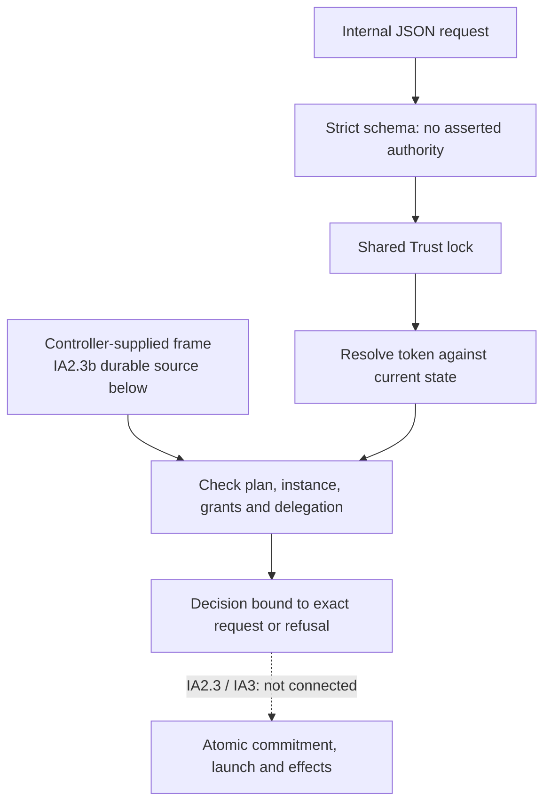

Trust supplies the issuer, external subject, `local`/`human`/`service` kind,
configuration revision and expiry. Local access is never promoted to a human,
and business roles (`requester`, `approver`, `admin`, `effect`) never implicitly
grant agent creation. A token alone does not establish an instance.

## Data and authority sources

Private types in `internal/engine/agent_identity_contract.go`:

| Type | Meaning |
| --- | --- |
| `agentIdentityPrincipal` | Separate local ID, kind, issuer and external subject; no credential or credential digest in attribution. |
| `agentIdentityActor` | Principal and optional controller-established instance. |
| `agentIdentityScope` | Work, persisted generation and recorded-contract digest. IA3a reads it from SQLite; this does not attest human adoption. |
| `agentIdentityGrant` | Issuer, holder, parent, scope, Trust revision, exact and delegable permissions, validity and revocation. |
| `agentIdentityInstance` | Instance, logical agent, principal, scope, grant and execution binding reference. Matching this reference is not process attestation. |
| `agentIdentitySnapshot` | Serializable schema 1, revision, grants and instances. Imports and backups remain data. |
| `agentIdentityRequest` | Schema 1, event, scope, grant, operation, resource and content digest. No author/approver/authority claim grants rights. |
| `agentIdentityDecision` | Project context, event, actor, request/snapshot digests, revisions and upper expiry bound. No implicit consumption or effect. |

`agentIdentityAuthority` is a private frame with no JSON-populatable fields:
canonical project root, current snapshot digest/revision, Trust revision, current plan and explicitly
recognized root grants. Its internal durable producer is described in IA2.3b;
protected permit/checkpoint issuers remain unconnected. Computing this frame from
the snapshot being checked would create circular authority. Historical IA2.2
tests use fixtures; IA2.3b reads persisted data under a controller checkpoint,
without deploying an external anchor.

Digests use lowercase hexadecimal SHA-256. IDs reuse `safeName`. Resources match
exactly, without wildcards or implicit path-prefix rules. Recognized operations
are `agent.create`, `memory.read`, `memory.summarize`, `memory.transmit`,
`tool.invoke`, `effect.execute`; their consumers are not connected by this change.
The kernel introduces no hidden operator timeout or execution ceiling.

Issuer and subject are opaque strings: brackets in an IPv6 issuer or a subject
are not treated as wildcards. Text validation rejects empty or invalid UTF-8
strings, control characters and surrounding whitespace; the `*?[]` restriction
applies only to permission resources.

The content digest must come from the actual proposal, parameters and resolved
context. Binding a receipt to the supplied digest does not prove that producer
or its correspondence with a later effect. These remain IA2.3/IA3 obligations.

## Checks and recovery

`decodeAgentIdentityRequest` rejects unknown/case-variant fields, duplicate keys
including nested and escaped duplicates, multiple documents, empty/null/invalid
input, asserted authority and wildcard permissions. The snapshot decoder also
rejects unknown fields, duplicate keys and absent objects.

`evaluateAgentIdentity` requires a caller verified at the evaluation instant, a
current private frame, a matching snapshot and the same scope. It checks holder,
instance binding, permission, dates, revocations and each delegation hop up to a
recognized root. Each child preserves scope, attenuates the parent's delegable
permissions and stays within its validity interval. An iterative traversal
detects cycles.

The consumer binds the caller to `Store.root`, canonicalized on opening. The
private frame must name that same root and the receipt includes a project-context
digest. Projects with identical fixture names and tokens cannot exchange frames
or receipts. This local check is not a durable cross-host project ID or proof of
OS account ownership. Root relocation or federation requires an explicit new
context and protected anchor in IA2.3.

A Trust configuration change invalidates old grants under this conservative
contract; renewal must be explicit. Reauthentication does not renew grants.
Decision expiry cannot exceed the caller's or any contributing grant's expiry.

`Store.evaluateAgentIdentityRequest` resolves and evaluates under the same Trust
lock. Reuse reauthenticates first, reevaluates, then compares the full receipt.
It never returns a cached result before authentication. The real clock is
sampled after lock acquisition; internal tests can inject a fixture clock, but
JSON cannot. This internal consumer has no runtime-agent caller path yet:
that requires the protected broker.

`validateAgentIdentityTransition` requires the next revision and retains all
historical records. Revocation cannot be cleared or moved; other fields of a
published grant/instance cannot be rewritten. A replacement needs a new ID.
This check neither authorizes nor publishes an update. The future writer must
validate against protected current state and atomically publish its new anchor.
No production storage writer uses this validator yet.

## Limits and required follow-up

Evidence is retained in the
[IA2.2 report](../plans/actions-confiance/verification-identites-agents-20261016/ia2-contract-kernel-20261017/RAPPORT-IA2.2.md).
Tests use isolated roots, simulated runtime bindings and local OIDC/service
issuers. They prove neither a real provider boundary nor independent review.
The cached-caller and cross-project frame regressions retain before/after evidence.

Remaining: protected bootstrap/frame/checkpoint issuers, admission commitment
lock order, runtime channel integration, prepared-content binding, exact
human approval, single consumption, start/revocation races, crash reconciliation
and **all** CLI/API/provider/memory consumers. Adding this evaluator does not make
Trust JSON and mission SQLite atomic. IDA-01–18 and the retrospective remain
required for overall qualification.

## IA2.3 channel experiment, separate from the kernel

The [17 October prototype](../plans/actions-confiance/verification-identites-agents-20261016/ia2-runtime-binding-20261017/RAPPORT-IA2.3-CANAL.md)
passes 13 local checks with two Linux sandboxes. The controller pins PID/mount
namespaces before execution and attributes each message using kernel credentials.
A connection copied from B to A retains peer B, but the message sender is A and
the claimed B identity is denied. Joining B with three copied namespace
descriptors is also denied. The user namespace changes during bootstrap and is
not assumed stable. This Python prototype is neither an integrated Go broker
nor an authority source; its registry and revocation are in memory. It does not
qualify the launchers.

## Go instance channel — IA2.3a

The receiver and binding registry are now implemented in
`agent_identity_channel_linux.go` and `agent_identity_runtime_linux.go`.
`Store.evaluateAgentIdentityMessage` connects them internally to IA2.2.
No server or launcher registers this path. The [IA2.3a report](../plans/actions-confiance/verification-identites-agents-20261016/ia2-go-channel-20261017/RAPPORT-IA2.3a.md)
records this slice's checks and limits.

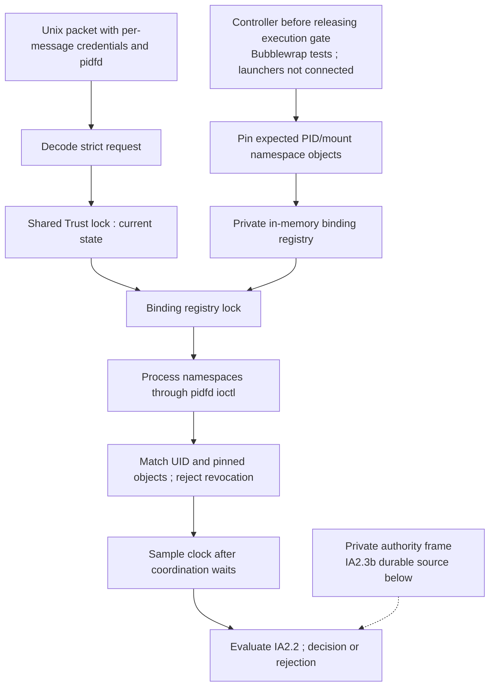

The controller calls `pin` using a gated launcher bootstrap and holds the resulting
PID/mount namespace descriptors. It rejects the host PID namespace, mismatching
references and reuse of an already reserved instance, binding or PID namespace.
A first worker message cannot populate this table. Process-private state does not
protect an unconfined controller account; a protected launcher/bootstrap remains
an integration obligation.

`configureAgentIdentityChannel` requires a Unix `SOCK_SEQPACKET` socket and enables
`SO_PASSCRED` and `SO_PASSPIDFD`. Reception requires credentials and exactly one
`SCM_PIDFD`. Namespaces are obtained from that descriptor, without reopening the
message's PID number. An exited sender is not reidentified by its number. The
connection peer does not determine message attribution. This identifies the
process/thread group represented by the mechanism, not each thread or executable
image. Missing kernel primitives fail closed, without a numeric fallback; only
the report's platform was executed.

The consumer supplies its transport buffer and deadline. No new operator ceiling
or timeout is introduced. Truncated packets, missing credentials and injected
file rights are rejected; received descriptors are closed on rejection. The
consumer closes an accepted message. Namespace pins remain held until registry
closure, including after revocation, to exclude reuse of historical references.
An empty registry after restart cannot adopt the first sender's authority.

Reception happens outside Trust. Evaluation takes the shared Trust lock, then
the registry lock, checks current revision/binding/UID/namespaces, samples real
time after those waits, and evaluates under both locks. Binding revocation and
registry closure are serialized with evaluation. This is not Trust/SQLite
commitment, single consumption or observed process termination. Authority frames
and snapshots used by the tests remain fixtures.

The runtime lock protects bindings, not maps in a snapshot supplied by another
component. IA2.3b provides its own current copy. Low-level IA2.2/IA2.3a consumers
still accepting caller-supplied snapshots/frames require their caller to preserve
ownership and freshness; they do not consult the durable registry. Public
operations must use the durable path.

## Durable source and recoverable publication — IA2.3b

The private registry is now produced from SQLite and an independent Trust head.
Version **36** added `agent_identity_snapshots` for versions and
`agent_identity_publications` for chained receipts. Migration backs up storage
and grants no authority to historical work. Inspection refuses implicit upgrades.
The [IA2.3b report](../plans/actions-confiance/verification-identites-agents-20261016/ia2-durable-authority-20261017/RAPPORT-IA2.3b.md)
binds sources, commands and results. Earlier sections describe the original
IA2.2/IA2.3a slices and their fixtures.

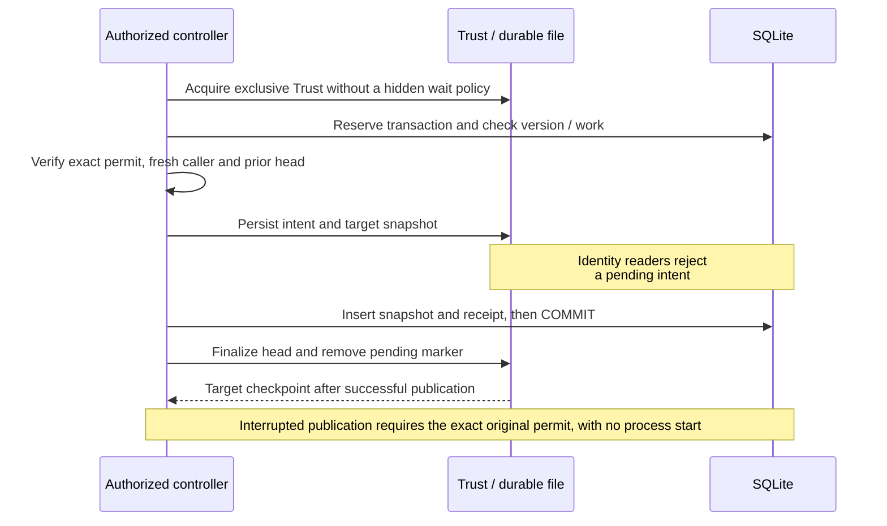

The head records project context, scope, snapshot revision/digest, Trust revision,
recognized roots, publishing principal, event and previous-head link. A private
`agentIdentityRegistryPermit` independently binds the exact content, scope and
approved roots. Normal publication resolves the current token under Trust after
waiting for SQLite and again before preparing the intent. Business roles or JSON
bodies do not mint this permit. IA3b adds the internal human producer below;
real enrollment and public integration remain open.

Publication takes a nonblocking exclusive Trust lock and reserves SQLite before
reading. It checks work existence, version, prior checkpoint, links, preserved
history and approved content. It persists an intent in Trust's
`agent_identity_authorities` before COMMIT, then publishes the new head. Failure
after intent or after COMMIT leaves an exact recovery to perform.
`recoverAgentIdentityRegistry` requires the original permit and snapshot; it
cannot prepare a new operation. Changed Trust configuration is preserved:
finalizing old history does not reactivate its rights.

`atomicWrite` now opens the parent before mutation, syncs the file, renames it,
then syncs the directory. Failure after rename means an uncertain result to
reconcile. Tests simulate neither power loss nor storage that lies about `fsync`.

Inspection requires a private current `agentIdentityRegistryCheckpoint` from
the controller, then checks the Trust head, receipt chain, snapshot and plan
in a read transaction before releasing its owned copy. Message consumer
`evaluateAgentIdentityRegistryMessage` likewise obtains source data from the
registry, not the message; since IA3a it reserves SQLite's writer through the
runtime decision, as described below. Real time is sampled after waits. These
paths neither consume a right nor start a business effect.

A checkpoint is never recomputed from an imported database or the same restored
files. Tests retain it outside the restored state and deploy no external witness.
If all files and an old witness are restored together, freshness is unproven.
Independent witness issuance/retention remains an open integration condition.
Scope is bound to the controller's permit and the IA3a recorded contract. Human
adoption attestation and exact creation membership still require integration. Go package privacy alone does not protect the host account,
control files or an arbitrary hostile SQLite image. F01–F07 remain open, together
with public admission, provider confinement, exact human approval,
reservation/start and memory rights.

## Binding to the current recorded plan contract — IA3a

`agent_identity_plan_linux.go` reads the work body/revision and
`agent_identity_plan_heads` in the same SQLite transaction as authority. It
requires a recorded `Work.Plans` plan or valid hierarchical planning. Classical
plan adoption, preparation conversion and hierarchical decisions feed this
common source. Recording data does not attest human approval or grant creation.

Projection **v1** retains definitions, instructions, owners, roles, dependencies,
hierarchy, budgets, profiles and unrecognized fields. It removes identified
result, status, attempt, review, lease, counter and integrated-candidate fields.
Memory selections remain inputs; their presence grants no usage right. Results,
framing and transmission still require separate permissions. Lists retain their
order; object keys are canonicalized recursively without rounding integers
through `float64`. Changing a retained field requires a new exact permit.

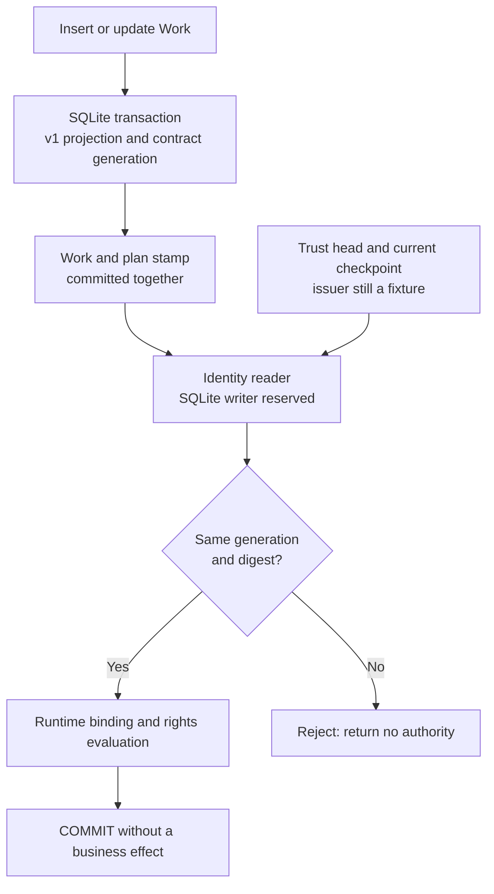

Current storage version **37** backs up storage, creates generation-1 initial
stamps and installs insert/update triggers on `works`. Contract changes advance
the generation in that transaction; identified runtime results preserve it.
Changing then reverting contents does not reactivate the previous scope,
including after reopening. Transaction rollback also rolls back its stamp. The
counter must remain a positive SQLite integer; technical overflow rejects the
entire update. It is not an operator resource limit.

Triggers call `swarm_identity_plan_digest_v1`, a pure function registered once
in the driver before connections open, and verify the prior stamp before
rewriting. Readers recompute the body digest and compare the stamp, projection
version and Trust-head scope. Missing plans return
`agent_identity_plan_unavailable`, different scopes `agent_identity_plan_mismatch`,
and missing/inconsistent stamps `agent_identity_plan_stamp_changed`. Normal
refusals prepare no intent, publish no rights and create no agent. A trigger
error rolls back the work write rather than yielding an empty success.

`readAgentIdentityNextPlanScope` is a read-only proposal of the observed scope
for a future permit. It requires an existing head's checkpoint, rejects pending
publication and never infers authority from imports. Normal publication compares
the permit against this same source after reserving SQLite, before preparing
an intent. Exact recovery may finish history prepared before a plan change;
normal reading still rejects that history. Instance decisions take shared Trust
→ SQLite writer reservation → current read → runtime lock → fresh time and pure
evaluation → COMMIT. The reservation prevents Work changes during the runtime
wait. This closed callback never reenters Store and the runtime methods called
do not access SQLite; future consumers must preserve that precondition. Any
error, including COMMIT failure, returns no positive decision. This serialization
has an unmeasured concurrency cost and implements neither consumption nor start.
The private component does not activate launcher admission.

Stamps/triggers enforce application integrity, not a boundary against a host
administrator or unconfined provider. Physically restoring all SQLite may
restore the old stamp as well. A checkpoint covering only an unchanged identity
head cannot attest freshness of a plan change not published in that head: the
future independent witness must also cover the plan watermark. Its issuer and
protection remain open, owned by Codex/operator. Creation membership, resolved
content, human approval, consumption and all public launchers still require
integration. F01–F07 and IDA classifications remain unchanged.

## Issue a permit from explicit human authority — IA3b

`mintAgentIdentityRegistryPermit` receives the full snapshot, token, previous
checkpoint, event and proposed roots. The controller separately supplies a
private `agentIdentityIssuerAuthority`: exact principal (local ID, `human` kind,
issuer and external subject), project, plan scope, Trust revision, enrollment
reference, exact permissions, delegable subset and validity interval. It explicitly
authorizes registry publication and limits its new root grants; neither an
`agent.create` permission alone nor an Admin role implies this authority.

This object is controller input, not configuration read from requested JSON. The
enrollment reference is checked syntactically; its digest alone proves no
enrollment. The protected service attesting, persisting, revoking and refreshing
this authority remains unconnected. Tests supply explicit fixture authority and
execute the OIDC protocol against a local signed-token provider; they qualify
neither an external human account nor a deployed enrollment service.

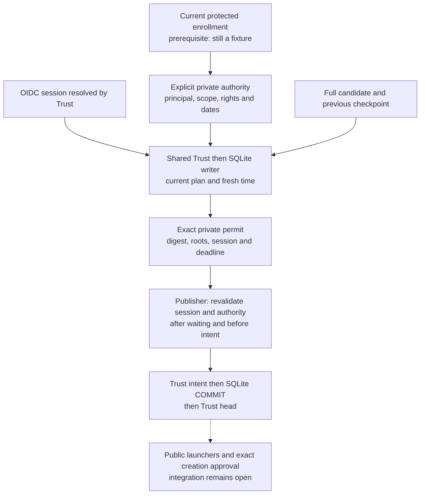

Issuance checks identity and authority under Trust before SQL or work lookup.
It then reserves the SQLite writer, reauthenticates after waiting and reads the
current plan and registry. Local sessions, workload services, instances, namesakes from
another issuer/subject and unenrolled identities are rejected. Importing data
does not grant authority. New roots, including unlisted ones, and activation
of previously unrecognized roots must respect the explicit issuer, permissions,
dates and delegation ceiling. History is preserved; issuance neither publishes
nor consumes rights.
Valid links do not attest that the named actor actually requested a delegation;
creation origin and receipt still require verification at admission.

The permit owns its lists and binds the full snapshot, roots, principal, project,
plan, Trust revision and event. Its private proof also binds the issuing session
and a deadline limited by enrollment and session expiry. Identity and authority
are checked again after reading history. Commit errors return a zero permit. No
raw token is retained in the permit or journal. No hidden duration or new setting
is added; dates are conditions of this controller-supplied authority.

Publication rechecks these conditions after reserving SQL and before durable
intent. A different session of the same human cannot reuse the permit; expiry
during a wait rejects publication without an intent or registry row.
`agent_identity_human_issuer_required` identifies a non-human caller;
`agent_identity_issuer_authority_required`, absent/incompatible authority;
`agent_identity_issuer_authority_stale`, stale dates/session; and
`agent_identity_issuer_ceiling_exceeded`, roots exceeding the grant. Correcting
a request requires explicit reissuance. Recovery after intent only completes
that exact historical decision; it may finalize after session expiry without
producing a new authorization.

The prior low-level API remains a private controller capability used by fixtures
without this human proof. This kernel therefore does not make every package
permit human or secure any existing public endpoint. The future public adapter
must require this producer and its protected enrollment source; no agent-supplied
flag selects a path. Out-of-process persistence/recovery of private capabilities
remains open. A cached authority does not prove current external non-revocation.
An OIDC session categorized as human proves neither physical human presence,
step-up authentication nor distinct human approval of a resolved creation. Those
criteria, the plan witness, F01–F07 and memory rights remain open.

Local recipe: `go test ./internal/engine -run '^TestAgentIdentityIssuer'
-count=1 -v -timeout=0`, then targeted registry and plan checks. Commands, frozen sources,
two original failing cases and outcomes are in the
[IA3b report](../plans/actions-confiance/verification-identites-agents-20261016/ia3-issuer-20261017/RAPPORT-IA3b.md).

## Preserve the human issuance receipt in history — IA3c.1

Human publication heads use format 2 and contain a version 1 `issuance_receipt`.
The head already binds the exact snapshot, roots, event and previous head; its
digest now also covers the receipt. The receipt retains the exact human
principal, project, plan, Trust revision, supplied enrollment reference,
authority permissions and dates, session digest and expiry, issuance time and
permit validity end. That end equals the minimum of both expirations. No raw
token is retained. Returned lists belong to their reader.

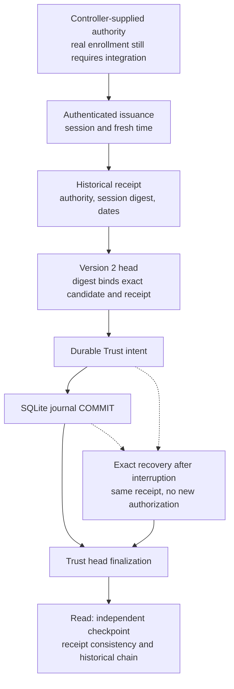

Format 2 requires a receipt; format 1 remains for the earlier private controller
capabilities without a receipt. Inconsistent combinations are rejected. Older
readers supporting only format 1 reject new heads; the SQLite schema remains 37.
The existing protocol stores the exact same receipt in the intent, journal and
final head, including after reopening and recovery at either durability boundary.
Historical reads validate dates at issuance time; reading an expired receipt
does not turn it into current authority.

This receipt is a controller-bound trace, not an independent signature or proof
of actual enrollment, external non-revocation or physical human presence. Reading
still requires an independently protected checkpoint. Restoring storage together
with its witness, or controlling the same UID without confinement, remains outside
the guarantee. The receipt cannot reconstruct a private permit or recover without
the original controller capability. Bootstrap, a witness covering the plan,
public admission, distinct human approval and memory rights remain open.

Verification results and limits are retained in the
[IA3c.1 report](../plans/actions-confiance/verification-identites-agents-20261016/ia3-issuance-receipt-20261017/RAPPORT-IA3c1.md).

## Authenticate replies from the future enrollment service — IA3c.2a

The isolated `internal/enrollmentproof` package implements a signed response
format without engine or network transport integration. `NewVerifier` receives
a controller-pinned public key and project digest; no response supplies its own
trusted key. `NewChallenge` generates a random 256-bit nonce and binds the key,
project and full request digest. `SignResponse` signs the envelope using Ed25519
and protocol/version domain separation; it makes no authorization decision.
Test private keys are ephemeral and local; no actual bootstrap is activated.

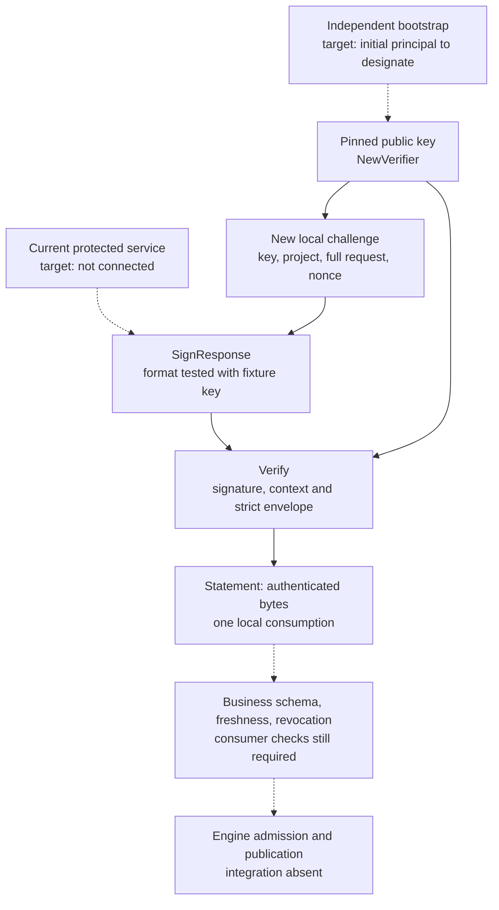

`Verify` requires the exact four string keys `protocol`, `challenge_digest`,
`payload` and `signature`. Duplicate, case-folded or unknown keys, null/non-string
values and trailing data are rejected. Payload and signature use canonical
unpadded base64url. Payload remains opaque: authenticating an empty string does
not establish enrollment or authority. `Statement.Payload()` returns a copy;
the consumer still needs schema, permission and current-source validation.
A signature provides no confidentiality.

A valid response consumes its local challenge exactly once under a mutex.
Value copies of its handle share the same internal consumption state.
Rejected responses do not consume it; a new request uses a new nonce. Concurrent
replays, changed project/request, rebinding a captured signature by rewriting its
digest, unpinned keys and foreign signature domains are rejected. JSON cannot
reconstruct challenge ownership. Its state is not durable and reserves no
publication or process start.

**Explicit limit:** a service may sign “active” and revoke before receipt or
application. That response can remain authentic; this package establishes no
freshness at final authorization. Neither signature, nonce nor historical receipt
replaces current-state validation and revocation linearization. No TTL, timeout,
business cap or operator setting is introduced. Ed25519/SHA-256 and nonce sizes
define the cryptographic format; they are not execution budgets.

The [target enrollment contract](../plans/actions-confiance/identites-agents-enrolement-IA3c2.md)
separates this verified module, missing guarantees and deployment decisions.
Isolated recipe: `go test ./internal/enrollmentproof -count=1 -timeout=0`, then
`-race` and `go vet` for this package. Results and limits are retained in the
[IA3c.2a report](../plans/actions-confiance/verification-identites-agents-20261016/ia3-enrollment-proof-20261017/RAPPORT-IA3c2a.md).

## Durable enrollment journal — IA3c.2b

`internal/enrollmentstate` adds a dedicated SQLite journal, isolated from the
engine. `Open` receives a controlled path, pinned public key and project digest.
Storage requires WAL and `BEGIN IMMEDIATE` transactions, with `synchronous=FULL`
on each connection. No private key is persisted and no actual service or system
account is created. This journal does not establish business authority: each
record body remains opaque bytes whose schema and permissions require validation
by the future adapter.

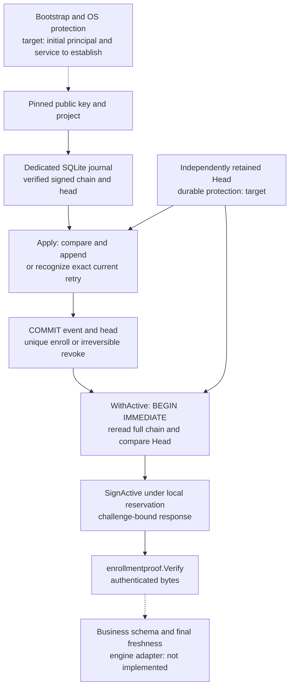

The `swarm-enrollment-change-v1` protocol requires canonical JSON with ten fields:
`protocol`, `authority_key_id`, `project_digest`, `sequence`, `previous`,
`operation`, `id`, `body`, `signature`. Ed25519 signs the protocol prefix, NUL,
`change`, NUL, then this JSON with an empty `signature`. `body` and `signature`
use canonical unpadded base64url. The head contains the sequence and SHA-256 of
the complete signed envelope. Unknown, duplicate, case-folded, null, wrongly
typed and noncanonical fields are rejected. IDs are opaque, never paths or SQL;
queries use parameters. Empty IDs, invalid UTF-8 and control characters are rejected.

`SignChange` signs a proposal only. `Apply` validates the key, project, entire
chain and expected head before appending an event. `enroll` creates an ID only
once; `revoke` requires an active ID and empty body. Revoked IDs stay in history
and cannot reactivate; another creation needs a new ID. An exact retry after
response loss succeeds only while that event is still the current head. A later
revocation prevents successful replay of an old enrollment. Event and head are
written in one transaction; storage errors never become successful empty results.

Each `WithActive` read reserves the writer before rereading the chain and holds
that reservation through its callback. A concurrent revocation cannot commit
during the callback; after revocation commits, active reads are rejected. The
callback must not reenter the journal, wait for another writer or perform
irreversible external effects: transaction completion may still fail afterwards.
`SignActive` returns signed bytes only after the transaction succeeds. Its
`ActiveReply` contains `schema_version: 1`, `head` (`sequence`, `digest`) and `record` (`id`, `body`,
encoded using JSON base64, and `enrolled_sequence`, the chain-derived creation
sequence). This reply can become stale as soon as the reservation
is released.

The controller must supply a `Head` retained independently of the journal/import.
Zero denotes explicitly authorized genesis only. Restoring a consistent old
journal is detected against a newer witness; restoring the witness too removes
that guarantee. This package does not persist the independent witness or solve
atomic transfer between the journal and an external witness. A lost response
can be recovered using the exact signed change; this does not establish
distributed recovery, effective termination or revocation delivery.

Errors distinguish context, head, invalid change, missing, previously enrolled
and revoked IDs; SQLite and cancellation errors preserve their cause. Contention
is surfaced immediately, without a busy timeout or automatic retry. WAL requires
a compatible local filesystem; its auxiliary files belong to the protected store,
not just the main database. Sequences are signed 64-bit SQLite/Go integers:
overflow is rejected as a representation limit, not an execution policy. No
duration, budget or business cap is introduced. Reads reconstruct the whole chain;
cost grows with history and large-scale performance has not been established.

Isolated recipe: `go test ./internal/enrollmentstate -count=1 -timeout=0`, then
`-race`, `go vet` and `go build` for this package. The
[IA3c.2b report](../plans/actions-confiance/verification-identites-agents-20261016/ia3-enrollment-state-20261017/RAPPORT-IA3c2b.md)
retains rejections, the original concurrent failure, correction and final evidence.
Reopening and injected transaction-error tests do not simulate hardware failure.
Protected service, durable external witness, human-authority schema, distributed
revocation/start and public admission remain open. F01–F07 and memory rights
have not been reclassified.

## Validate the authority document on both sides — IA3c.2c

`internal/enrollmentauthority` defines a human-authority document and local
producer/consumer. The generic journal keeps opaque bodies; this package refuses
to treat them as authority without a complete schema and independent expected
context. It returns validated data, never a private engine permit. No endpoint
or launcher imports this package.

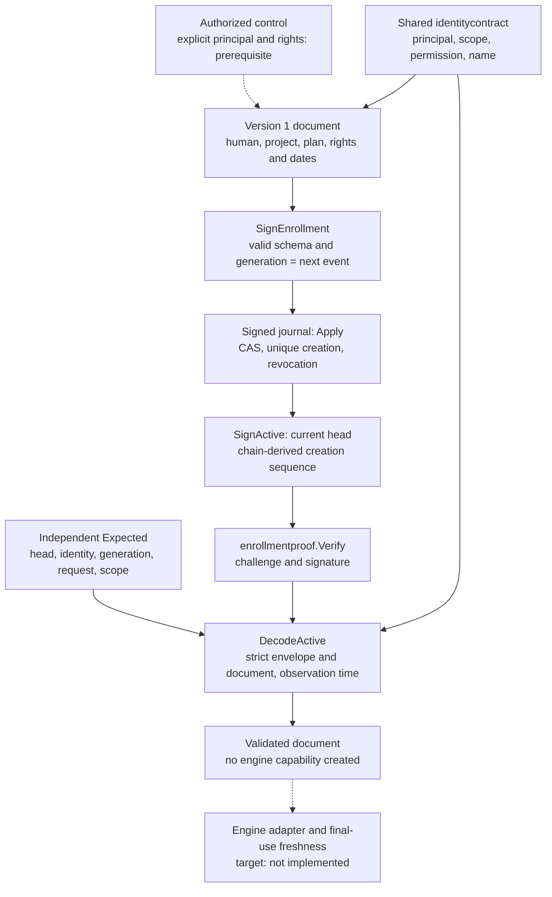

Version 1 requires eleven fields: `schema_version`, `enrollment_id`, `generation`,
`project_context_digest`, `principal`, `scope`, `trust_configuration_revision`,
`permissions`, `delegable`, `not_before`, `expires_at`. `principal` contains
`principal_id`, `principal_kind`, `issuer`, `subject`; `scope` contains `work_id`,
`plan_version`, `plan_digest`. Each permission has `operation` and `resource`.
Keys are exact and canonical JSON is the output of `Encode`, including declared
field order, UTC RFC3339Nano dates and `delegable: []` for an empty list. `Decode`
rejects omitted, null, duplicate, unknown, case-folded, wrongly typed or differently
encoded fields, including nested fields. Producers may supply other time zones:
`Encode` preserves their instants and writes UTC without inventing a duration.

`identitycontract` shares structures and validation with private engine types;
`safeName` delegates to it too. Existing JSON and rules are preserved: local ASCII
names of 1–100 bytes, positive plan versions and Trust revisions, lowercase hex
SHA-256 digests, exact resources without globs and six existing operations
(`agent.create`, `memory.read`, `memory.summarize`, `memory.transmit`, `tool.invoke`,
`effect.execute`). Existing name syntax does not apply to OIDC issuers/subjects:
these remain opaque and exactly compared, without URL, case or whitespace
normalization. Enrollment requires a valid `human` principal; neither `local`,
`service`, a business role nor a matching display name satisfies this condition.

Permissions must be nonempty, valid and unique. Delegable permissions must be
valid, unique and a subset of permissions. Both dates are explicit and
`not_before < expires_at`. The window includes its start and excludes expiry.
`Encode`/`Decode` validate structure without asserting validity now; `DecodeActive`
requires a controller-supplied observation time. That parameter is not evidence
of a fresh clock; the final adapter must supply it at the serialized decision.

`SignEnrollment` binds generation to `base.Sequence + 1`, the exact project and
document ID before signing. CAS still has to accept the append. The journal then
derives `Record.EnrolledSequence` from the verified `enroll` event, never from
its body. Generation remains stable when other enrollments or revocations advance
the current head. SQLite schema and existing signed events are unchanged; reads
reconstruct this field. Old reply envelopes without it fail the new strict
consumer; no existing engine client was connected to this isolated format.

`DecodeActive` receives an authenticated `Statement` and controller-supplied
`Expected`: current expected head, enrollment ID, generation, project, full
principal, full scope, Trust revision and request digest. It requires exact
agreement across the authenticated request, envelope, document and journal
creation sequence. A document signed through the opaque path with a declared
generation differing from its event is rejected. The complete engine request
covered by `request_digest` still needs an adapter (EP-02).

Errors distinguish invalid document, mismatched context and inactive window;
no partial document is returned. JSON alone can be structurally valid without
being authenticated; reconstruction grants no rights. An old `Statement` can
still pass with its old `Expected`: this check does not reread the service or
establish non-revocation at use time. No budget, TTL, timeout or new operator
setting is introduced.

Recipe: `go test ./internal/identitycontract ./internal/enrollmentauthority
./internal/enrollmentstate -count=1 -timeout=0`, then the same `-race` suite,
`go vet` and targeted compilation. Check private engine consumers separately
after extraction. The [IA3c.2c report](../plans/actions-confiance/verification-identites-agents-20261016/ia3-enrollment-authority-20261017/RAPPORT-IA3c2c.md)
retains results and limits. Actual enrollment, time source, durable independent
witness, final linearization, public admission, descendants and F01–F07 remain open.

## Bind the complete request to its challenge — IA3c.2d

`internal/enrollmentrequest` defines one purpose only:
`agent_identity_registry_publication`. It covers the complete candidate rather
than just its ID or a supplied digest. `Prepare` validates, encodes and owns
immutable data; it does not authenticate its source. `Decode` reconstructs data
from a canonical envelope without creating a private engine capability or proving
the declared identity.

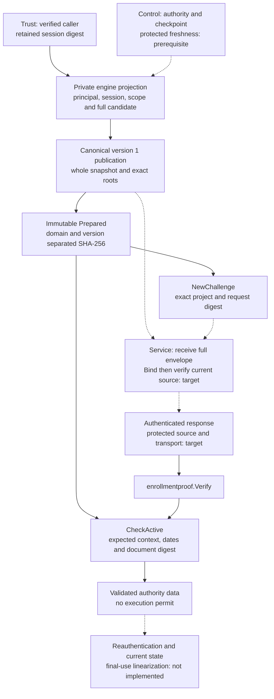

Version 1 `Publication` has sixteen required fields: `schema_version`, `purpose`,
`project_context_digest`, `principal`, `session_digest`, `session_verified_at`,
`session_expires_at`, `scope`, `trust_configuration_revision`, `enrollment`,
`event_id`, `snapshot_revision`, `snapshot_digest`, `snapshot`, `root_grants`,
`previous_registry_head_digest`. `enrollment` contains `id`, `generation`, `head`
(`sequence`, `digest`) and `document_digest`. Principal and scope reuse
`identitycontract`. The previous checkpoint is an explicit empty string only
for controller-supplied genesis; omission and null are rejected. Target enrollment
requires a positive generation, a covering head and the document digest.

Canonical JSON follows Go field order and writes UTC dates without inventing
a duration. `snapshot` carries the entire snapshot bytes as JSON base64;
`snapshot_digest` must be their exact SHA-256. This package checks a
JSON object without reimplementing the grant schema, transitions or publication
authorization. The engine projection applies its existing validators and uses
the full canonical snapshot JSON. Root order remains exact, as in the registry
head; no silent sorting or deduplication. Duplicate roots, invalid names,
noncanonical envelopes and unknown/duplicate fields, including nested envelope
fields, are rejected. Embedded snapshot semantics remain the engine's responsibility.

The request digest is SHA-256 of `swarm-enrollment-publication-request-v1`, NUL,
`request`, NUL, followed by the complete canonical envelope. It differs from
the snapshot digest alone and also covers the session reference/dates, expected
enrollment, exact authority document and two distinct checkpoints: enrollment
head and previous publication head. Changing any dimension changes the request;
a reply bound to the old request does not cover the new one. Purpose is fixed:
a different action needs an explicit contract rather than a free string reusing
this format.

`Prepared.Bytes()` and `Publication()` return owned copies. Go value copies of
the handle cannot modify its bytes or digest; JSON cannot reconstruct its private
fields. This preserves local consistency, not OS isolation. `Expected()` projects
authority-consumer context from those same bytes rather than maintaining a second
description. `NewChallenge` rejects a verifier for another project. A future
service must receive the full envelope and call `Bind` to compare project and
digest. `Bind` authenticates neither peer nor cryptographic envelope; these remain
obligations of `SignResponse`/`Verify` and protected control.

`CheckActive` checks the observed session window, complete expected context and
returned authority-document digest. Another authentic document for the same
ID/generation with different rights or ceilings is rejected. Session observation
is included and expiry excluded. A supplied time proves neither a fresh clock
nor an active session. No raw token is retained in the digest, which must never
be treated as an access credential itself.

In the engine, `resolveAgentIdentityCaller` now retains Trust's `TokenDigest`
in its private result. `prepareAgentIdentityEnrollmentRequest` therefore receives
no separate token to associate with that caller. It checks caller, authority,
scope, checkpoint, enrollment reference and snapshot using existing validators.
This pure function reads neither Trust nor SQLite; its future caller must resolve
and serialize current state. It does not replace permit issuance, checking new
ceilings against history, human approval or process start. Runtime callers without
a human session do not become issuers.

No endpoint, transport or deployed service consumes this format. Bytes and digests
prove neither human plan adoption, current non-revocation nor a unique effect.
Cost grows with candidate size; no transport cap, duration, TTL, budget or new
policy is introduced. Current source, final freshness, durable independent witness
and read-envelope versioning before external adoption remain open.

Recipe: `go test ./internal/enrollmentrequest -count=1 -timeout=0`, the same suite
with `-race`, then package `go vet` and `go build`. Check the private engine
projection and consumers separately. The [IA3c.2d report](../plans/actions-confiance/verification-identites-agents-20261016/ia3-enrollment-request-20261017/RAPPORT-IA3c2d.md)
retains commands, actual collection, sources and limits. No global F01–F07,
IDA or memory-rights PASS follows from these results.

## Explicit read-envelope version — IA3c.2e

`ActiveReply` is now versioned: `schema_version` must equal `1`
(`enrollmentstate.ActiveReplySchema`). It has three top-level fields:
`schema_version`, `head`, `record`. `SignActive` writes this version while holding
the journal reservation; the signature covers every byte, including the version.
This number describes the read envelope. It changes neither SQLite schema,
signed events, challenge, authority document nor complete request.

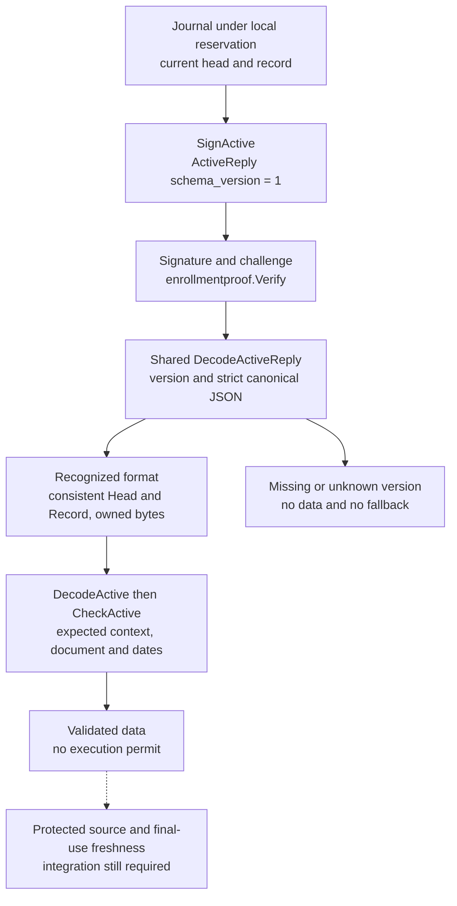

`enrollmentstate.DecodeActiveReply` is the single decoder for this envelope.
Missing, null, zero, negative, unknown or wrongly typed versions are rejected.
Unknown keys, duplicates, case aliases, omissions, noncanonical encoding and
trailing data are rejected. The head must be positive with a valid digest; the
creation sequence must be positive and covered by that head. IDs retain the
journal's opaque rules. `body` is a JSON base64 string, possibly empty, never
null. Empty opaque bytes remain valid journal data without becoming an authority
document.

`enrollmentauthority.DecodeActive` delegates envelope decoding to this shared
boundary before applying authority checks. Error chaining retains the cause:
an unsupported version remains detectable as `ErrReplyVersion` while also being
an `ErrDocument` for the consumer. Invalid shape yields `ErrReply`. No partial
data is returned; an authentic packet with an unknown version is still rejected.
Decoding alone does not verify a signature and must operate on an authenticated
Statement payload.

**Compatibility: explicit break of the prototype read format.** Unversioned
frames are rejected, without automatic retry in an older format. Producers and
consumers must explicitly select version 1; the only supported set is `{1}`.
No external client was connected. Real-peer negotiation and interoperability
still need verification before first external adoption (I2c-06 remains partial
at deployment). Historical replies and evidence are not rewritten; no journal
migration is needed. A correct version establishes neither freshness,
non-revocation nor action rights.

Recipe: `go test ./internal/enrollmentstate ./internal/enrollmentauthority
./internal/enrollmentrequest -count=1 -timeout=0`, the same suite with `-race`,
then `go vet` and targeted compilation. The [IA3c.2e report](../plans/actions-confiance/verification-identites-agents-20261016/ia3-enrollment-reply-20261017/RAPPORT-IA3c2e.md)
retains the unversioned counterexample, rejections, sources and limits. No TTL,
timeout, budget or new operator policy is introduced.

## Adopted boundary — local pilot, remote planned

User decision on 17 October 2026: a local service under a separate system account
with verified confinement for development and pilot use. An authority on a
separate machine with separate administration is planned for future installations,
including customer deployments. Customer demand remains a user hypothesis;
neither the service nor its configuration flow is delivered yet. The
[enrollment plan](../plans/actions-confiance/identites-agents-enrolement-IA3c2.md)
details initial setup, the Admin modal and criteria IA3c.2f-01 through -06.
Hosting is now decided; the initial human principal and activation remain open.

Local mode keeps the host kernel and administration in the trusted computing
base. Remote mode aims to withstand a compromised Swarm host, subject to separate
administration and the authority's own checks. The business contract remains
common: exact request, identity, delegation, current state and revocation.
Transport adapters replace none of these checks. Portability and migration
between real services remain unproven.

Initial setup must prepare the selected mode, followed by an Admin modal managing
protected, persistent and revisioned configuration. Setup, API, CLI and UX must
share validation; non-mutating preview, stale-revision rejection and preserved
history are required. Saved choice, applied configuration and observed evidence
remain distinct. No secrets in the browser, agent sources or project exports;
no root learned from the peer. The remote option must be labelled as planned
until implemented. Docker/native describes Swarm installation, not its authority's
security boundary.

Protecting the key and identifying a peer are insufficient: the authority must
check the exact request's rights and current state. SO_PEERCRED reports process
credentials, not a workflow role
([Linux unix(7)](https://man7.org/linux/man-pages/man7/unix.7.html)). A channel
accessible to an agent sharing the controller's UID may defeat the separation.
Unavailability cannot enable permissive fallback or automatic local failover.
Moving from local to remote will require an authorized migration preserving
evidence, consumption, reservations and checkpoints, with no implicit reset or
re-enrollment. Pilot use exempts none of these controls.

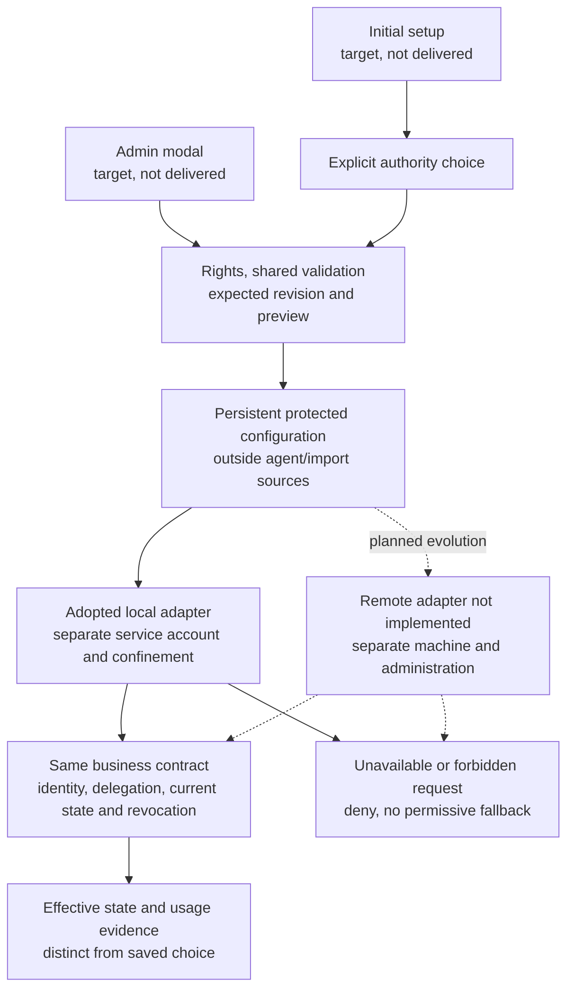

Verified scope of this increment: decision and documentation only. install.sh
supports Docker/native, compose.yaml defines only one Swarm service under the
operator's UID/GID, and trustRemoteOrigin accepts only an HTTP loopback origin
for Trust. None provides this new authority service or its remote adapter.
IA3c.2a through .2e modules retain their fixture evidence; F01–F07 and EP-01 through
EP-10 are not closed by this hosting decision. The [IA3c.2f report](../plans/actions-confiance/verification-identites-agents-20261016/ia3-deployment-choice-20261017/RAPPORT-IA3c2f.md)
links the decision, observed sources, rendered diagrams and documentation checks.

## Installation configuration kernel — IA3c.2f-02a

`internal/enrollmentconfig` now provides a strict format and Linux storage for
**desired configuration** of the local authority. No engine, CLI, HTTP, installer
or Admin adapter imports this package; no application setting is active. It
prepares IA3c.2f-02, which remains partial. Known mode `remote` returns ErrMode
without local fallback.

Bootstrap independently supplies `Pins`: `installation_digest` (lowercase SHA-256
hex), `authority_public_key` (32 Ed25519 bytes in unpadded base64url), and the exact
human `bootstrap_principal` from identitycontract. The opened file cannot supply
its own root. Ordinary changes cannot alter the principal or root; no private
key is a format field. Valid data establishes neither provenance nor OIDC login.

`Change` has exactly `schema_version:1`, `event_id`, `expected_head`, `values` and
`reason`. Values contain `mode:"local"` and an absolute canonical
`local_socket_path`. The 107-byte Linux bound is derived from sockaddr_un and
exposed as `LocalSocketPathMaxBytes`: a transport representation bound, unrelated
to time or budgets. Head has a **decimal uint64 string** `revision` and hex
`digest`; only genesis is `{"revision":"0","digest":""}`. Zero is not a current
revision. Clients must retain revision strings without JavaScript Number conversion.

EncodeChange/DecodeChange are the shared request boundary for future adapters.
Encode/Decode validate complete snapshots (`schema_version`, `pins`, `history`).
Each entry contains `change`, `actor`, `at`; its domain-separated SHA-256 hash is
bound to pins and the previous head in change. UTC timestamps, nonempty text IDs
and reasons, unique events and exact chaining are checked. Decoders require exact
canonical bytes: unknown/duplicate/folded/null/missing/wrong-type fields and
trailing input are rejected without partial results. This hash chain is not a
digital signature.

| Go operation | Expected input / result | Limit |
| --- | --- | --- |
| Open | Existing directory, actual expected UID, independent pins, non-nil Authorizer; storage handle | May initialize config.lock; creates neither config.json nor default values |
| Preview | Change and explicit observation time; Projection with base, proposed, current_event_replay | Reservation, complete validation and authorization; no configuration write or event |
| Create | Explicit genesis bootstrap; saved View | Never replaces existing configuration; recognizes only exact retry of an initial event still current |
| Apply | Change with expected head; saved View | Missing configuration denied; CAS, unique event and exact retry of current event only |
| Read | Independently supplied current Head; owned snapshot View | Rejects mismatching pins/head; never learns its witness from the opened file |

The final directory must belong to the process UID with exactly 0700 permissions.
Components are opened by descriptor without following symlinks. Ancestors belong
to root or the service and are not group/other writable, except root-owned sticky
directories such as /tmp. Lock and configuration must be regular 0600 files with
the same owner and one link. FIFOs, symlinks, extra hard links and open permissions
are rejected. Directory checks repeat at reservation and before persistence;
actual temporary-file permissions are checked without bypassing restrictive umask.
These checks do not confine agents sharing the service UID.

Nonblocking reservation returns ErrBusy without internal timer or retry.
Authorizer runs under reservation on owned copies; its human result must equal
the pinned principal. It must resolve authenticated authority rather than echo
a request field, and must not reenter the Store. Fixture callbacks establish no
real authentication. Read is an internal data API; its future transport must
authorize access as well.

Application writes a private temporary file, syncs it, atomically renames it
(without replacement during bootstrap), then syncs the directory. Failure after
rename returns ErrIndeterminate and no View: a mutation may already be visible.
Observe against an independent checkpoint, then retry the exact current event
with fresh authorization and another durability barrier, without adding history.
Stale revision gives ErrConflict; changed/reused/historical events give ErrEvent.
ErrPath/ErrFormat/ErrVersion/ErrPins/ErrHead distinguish other rejections.
Authorization errors preserve their cause via errors.Is; cancellation observed before
entering persistence rejects writes. After that point, concurrent cancellation
does not prove absence of mutation: observe the current result. Lack of progress grants no retry authority.

Preview validates the same representation as application for the same inputs,
including time. Actual application time may change the digest: proposed preview
Head is never evidence of a completed write. Revisions order events; timestamps
are not an expiration policy. No history/volume cap, timeout or budget is added.

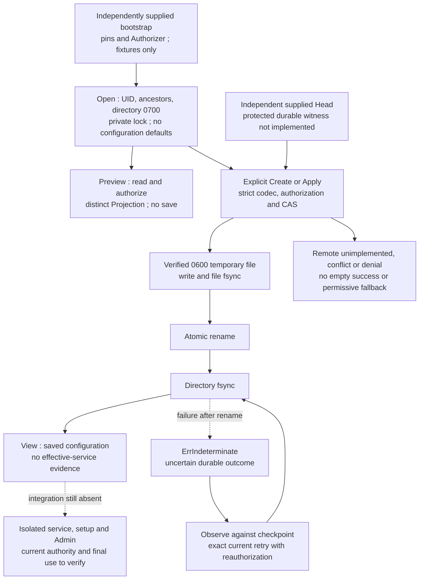

70 named tests/subtests pass in normal and race modes; targeted vet/build pass.
Three candidate counterexamples failed before correction: changed directory
permissions after Open, an unserializable date accepted by Preview, and umask
making a saved file unreadable. They remain in the [IA3c.2f-02a report](../plans/actions-confiance/verification-identites-agents-20261016/ia3-installation-config-20261017/RAPPORT-IA3c2f02a.md).
The fsync failure is locally injected; no hardware power loss is tested. Restoring
both file AND supplied Head removes rollback detection. The protected durable
witness, real OS boundaries, service, public adapters and UX remain open. The
service must distinguish new bootstrap from restoration; Create is not a reset
endpoint. Future remote support must preserve historical bytes and version rules,
not silently recompute the chain using a new codec.

## Local witness and coordinated recovery — IA3c.2f-02b

The package now provides `Coordinator`, opened with OpenCoordinated and explicit
configuration/witness paths, actual UID, pins and Authorizer. Equal, nested and
same-inode directories are rejected; existing Linux ownership, mode, link and
file-type checks are shared without copying another Store. Separate directories
do not establish separate administration or backup domains. This remains an
internal Go API without service, installer, CLI/HTTP or Admin integration.

`witness.json` has four exact canonical fields: `schema_version:1`, `pins`,
`committed` (confirmed Head) and `pending` (null or intent). Intent contains `entry`
(change, actor, at) and `target` (Head derived from the entry and pins). The change
base must equal committed; actor, time and schema are checked. Unknown, duplicate,
folded, null/missing, trailing and contradictory-target input is rejected. The
witness is local state protected by storage checks, not a signature or hardware
monotonic counter. Pins remain independently supplied.

| Coordinated operation | Actual behavior |
| --- | --- |
| Create | Explicit bootstrap only if both states are absent; durable intent before config, then confirmation; recognizes exact retry of initial event still current |
| Apply | Reserve config then witness without internal wait/retry; check confirmed Head, authorize, prepare intent, write config, confirm |
| Read | Compare config with committed, reject open intent, check both directory barriers before returning View |
| Preview | Same validation/authorization, no state write; reject pending; project genesis only when both states are absent |
| Recover | With pending, compare only exact base/target, reauthorize and sync intent before effect; already-confirmed state requires observation/barriers only |

Missing witness with existing config returns ErrWitnessMissing; it is never
reconstructed from config. Missing config outside genesis is denied. Divergent
Heads, even from coherent data, are rejected; restoring config OR witness alone
is detected. A raw Store call outside the protocol cannot advance the witness
and is rejected by Coordinator. The future service must consume Coordinator
without bypassing these comparisons.

Intent retains the exact entry and time. If config is still at base, apply that
entry after fresh authorization. If target is already visible, sync without a
second event or rewrite. Other history, a different request while pending, or
denied authority causes no implicit repair; intent is retained. Ordinary Read and
Preview remain closed with ErrPending. Errors return no partial View.

Visible confirmation with failed fsync remains uncertain: reread, compare and
sync both directories, or retry the exact current event with authorization.
Errors preserve ErrIndeterminate, the cause and stage (prepare witness / write
configuration / confirm witness or barrier). Preparation failure before rename
may leave both files absent: explicit bootstrap is then required, never inferred
success. Cancellation after intent and before config retains the pending decision;
later concurrent cancellation does not establish absence of mutation.

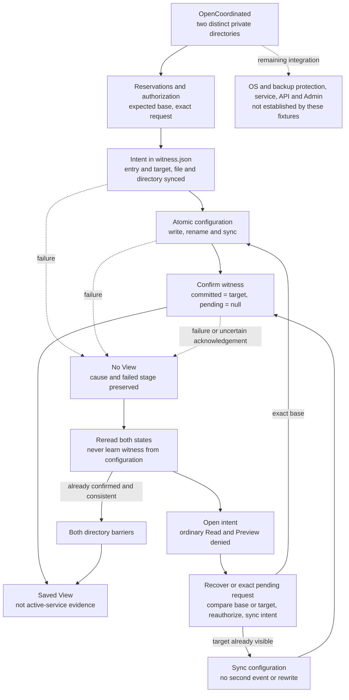

The previous 70 guards run in a final set of 101 named PASS results in normal/race
modes; targeted vet/build pass, with 12 stable inputs. A child fixture writes intent,
encounters a barrier fault and exits without Close; a fresh coordinator rebuilds
recovery from the files. This is not SIGKILL, power loss or UID separation evidence.
Same-inode bind mounts are checked in code but not mounted in these fixtures.
The [report](../plans/actions-confiance/verification-identites-agents-20261016/ia3-config-witness-20261017/RAPPORT-IA3c2f02b.md)
retains injected fault windows, the reproduced/corrected error-context defect,
sources and limits.

Restoring both stores together remains accepted in the preserved limitation case.
Host, backup and witness protection does not follow from a directory name. This
local kernel therefore closes neither F07 nor EP-06. No automatic intent abort is
provided: denied recovery or missing history keeps its cause/owner and blocks
progress. Restoration or migration must use an authorized operation still to be
designed, not private-state edits. Owners: operator for protection/identity,
Codex for the service and public flows. Remote mode remains rejected by the
current codec; no permissive fallback or new timeout/budget is added.

## Local control adapter IA3c.2f-03a — private and inactive

The engine now has a private adapter that receives a Linux SOCK_SEQPACKET packet,
attributes each message using SCM_CREDENTIALS and SCM_PIDFD, and exclusively uses
the configuration/witness coordinator. It reuses the IA2 channel; a PID in JSON
or the identity of the connection creator does not replace the kernel-attributed
sender. Configure the channel before releasing the sender. No listener, CLI
command, HTTP route, account or system service is created; the running server's
binary is not replaced.

The initial 03a prototype used schema 1. Since 03b the canonical request uses
schema 2 with challenge and independent pins, described below; old version 1 is
rejected. read requires change:null; preview, create and apply require the existing
strict Change. Client actors, dates, unknown/duplicate/case-folded fields and
noncanonical bytes are rejected.

Trusted bootstrap supplies paths, owner, pins and the authority controller
independently of project data. This controller receives the attributed message
and an owned copy of the exact request; it authenticates, authorizes the operation
and holds its revocation serialization throughout execution. Even read requires
this control. The returned principal must equal the pinned human. The mutation
request is checked again under the coordinator's reservations; the client cannot
choose the time. Test callbacks implement neither OIDC authentication, current
delegation nor real provider confinement.

| Operation | Adapter effect |
| --- | --- |
| read | Read a confirmed View only after authorization |
| preview | Project without writing config.json or witness.json; this is not saved state |
| create | Explicit bootstrap according to both stores, without choosing authority from the request |
| apply | Current CAS and reauthorized exact pending request recovery; current-event retry creates no extra event |

It does not expose request-free Recover: the operator can resume the exact Change
through apply. Pending state, conflict or missing history triggers no automatic
reset or reconstruction. An authority controller that omits execution, swallows
its error, executes twice or retains execution after returning cannot manufacture
unchecked success: omitted/late execution is denied, errors preserved and a second
effect prevented. Failure after successful effect retains an uncertain outcome;
it does not undo a write. The controller must execute synchronously and maintain
its protections; these guards do not replace its implementation or independent
verification.

Replies contain schema_version, request_digest, operation, view, projection and
error, with null
for absent results. Errors expose no result; only limited codes cross the channel:
invalid_request, denied, conflict, busy, pending, not_configured, indeterminate or
unavailable. Original Go causes remain service-side, without sending private
paths. Truncated packets or invalid ancillary metadata are rejected before storage
access, without a business reply.

Losing acknowledgement after a successful write returns an uncertain service-side
error without rollback. Retry the same request, EventID and base for reauthorized
observation without an extra event. The owner supplies the transport buffer and
manages the connection; replies beyond socket capabilities fail without implicit
chunking. No extra timeout, retry, volume or concurrency policy is introduced.
Cancellation alone does not interrupt a blocked receive; the owner must close its
connection. The eventual service must make that management observable.

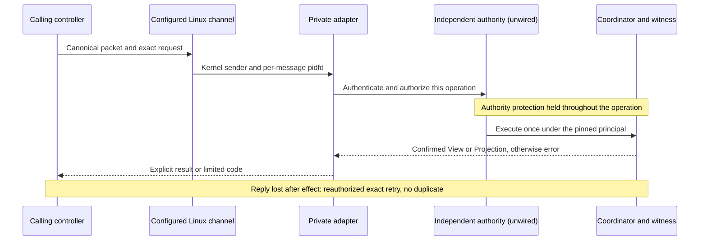

The [adapter report](../plans/actions-confiance/verification-identites-agents-20261016/ia3-local-service-20261017/RAPPORT-IA3c2f03a.md)
binds checks to source and retains their limits. The child exchange attributes the
actual sending process under the same fixture account. It proves neither account
separation, an active protected service nor service authentication by a public
client. EP-01/04/05/07, F01–F07 and public admission remain open. Before activation:
designate the initial human, provide real authority control, protect files, keys
and account, establish the service peer client-side and verify confinement, then
wire commands, installation and FR/EN Admin. Remote mode remains planned; no
permissive fallback.

The workflow checker also uses -timeout 0 for its context test: the inherited
30-second global watchdog was removed because no timing contract justified it.
This method check does not measure product performance.

The same checker now requires JSON run/pass events for the named test and package
completion; an empty selector, skip or incomplete evidence can no longer produce
OK. Controlled Go-output doubles and the actual check are distinct proofs, both
retained in the adapter report.

## Local client IA3c.2f-03b — service peer and reply checked in fixtures

The private client completes the control adapter; it installs no service. Its
constructor receives installation pins, expected UID and an independently held
server pidfd from trusted bootstrap. It duplicates and holds that descriptor. It
never opens it from a PID in a reply or learns its trust root or principal from
the service. Each reply is attributed using the same Linux channel as requests;
its UID and process object are compared with these independent inputs before
interpreting the business result.

The comparison uses the pidfd device/inode on pidfs under 64-bit Linux. Filesystem
type is checked; ordinary files, older anonymous-inode pidfds and 32-bit builds
are rejected without numeric-PID fallback. The object identifies a process within
the current host boot, not a persistent identity or its executable. This proves
neither confinement nor human identity; executing different code in the same
process still requires protection. The kernel contract is checked against
[Linux v6.17 pidfs](https://raw.githubusercontent.com/torvalds/linux/v6.17/fs/pidfs.c).

Transport moves explicitly to schema 2. Persisted configuration, journal and head
digests retain schema 1; no history is reset. The client generates a fresh random
32-byte challenge for each new exchange and includes expected pins in the request.
The service compares them with its own before authority control; equality grants
no right. Replies carry request_digest, domain-separated SHA-256 with
`swarm-installation-control-v2` over the complete canonical request bytes: challenge,
pins, operation and exact Change. Version 1 packets are rejected even if attributed
to the correct process.

| Envelope | Exact version 2 fields |
| --- | --- |
| Request | schema_version, challenge, pins, operation, change |
| Reply | schema_version, request_digest, operation, view, projection, error |

After process verification the client rejects wrong version, operation or request
digest, noncanonical/unknown fields, missing results, mixed View/Projection,
unknown error codes and errors accompanied by data. enrollmentconfig provides
ValidateView/ValidateProjection, sharing schema, full history, recomputed head
and base/replay checks with storage. The client compares result pins and the last
Change against its request. None of these checks turns desired configuration into
an agent capability or an active service.

The client owns its connection and duplicated pidfd; one exchange is admitted,
then both are closed. The launcher's original descriptor remains independently
owned. Cancellation before send means nothing was sent; after a mutation attempt,
unattributed, truncated or lost replies produce no result and an uncertain outcome.
An authenticated business error remains its explicit refusal. Cancellation closes
the client's own connection to interrupt send/receive, without a fixed deadline
or automatic retry. Retry the same business EventID/base on a new channel with a
fresh challenge and renewed service authorization.

The size fixture reduces only its socket send buffer and reads SO_SNDBUF back to
construct a reply beyond the observed capacity. It must observe EMSGSIZE rather
than a timeout; an already committed effect is observed through exact retry without
an extra event. This experiment sets no product volume policy. Oversized replies
remain a packet-transport limitation with no implicit chunking: pagination or
another framing protocol must be designed before exposing arbitrary histories in
a public flow. The owner also supplies the receive buffer; truncated prefixes are
rejected rather than interpreted as valid replies.

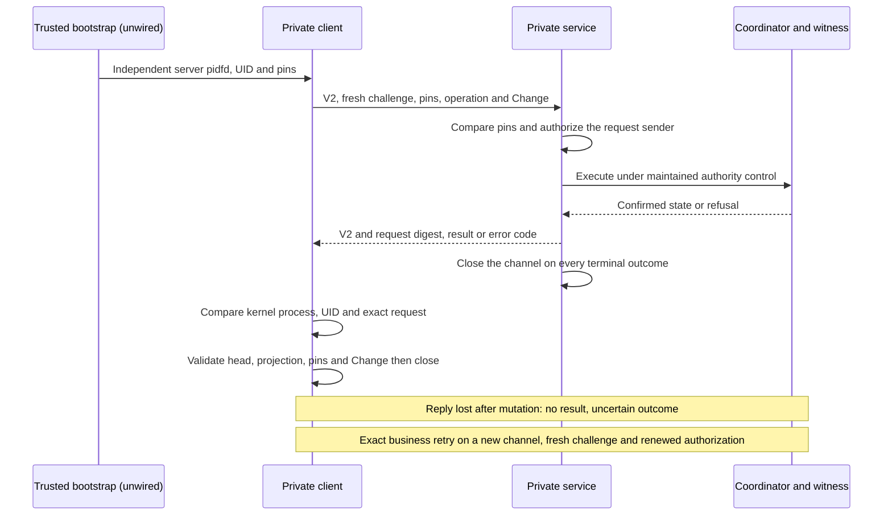

The [client report](../plans/actions-confiance/verification-identites-agents-20261016/ia3-local-client-20261017/RAPPORT-IA3c2f03b.md)
retains results and evidence conditions. Public bootstrap supplying the independent
pidfd, human authority, separate account, confinement and Admin remain unwired.
Fixture-verified clients do not close EP-01/04/05/07, F01–F07, IA3 or overall
acceptance. No permissive local/remote fallback.

The service channel is also owned for one exchange and closed on success, refusal
or error; a second serve is rejected. The EMSGSIZE guard no longer closes the
socket on its behalf: it directly observes POLLHUP without waiting (zero-time
poll), then the client exchange observes channel termination. This fixes possible
waiting after an unsent reply without inventing a timeout. unavailable remains a
general service-unavailability error; it does not establish a storage failure.
Both pre-fix counterexamples and their recovery are retained.

The channel must come from trusted bootstrap and be delivered to the expected
service without descriptor leakage; this client verifies the reply sender after
sending its request. This check alone proves neither the recipient before send
nor confidentiality. An unestablished socket path does not replace that
precondition; public bootstrap must prove delivery or establish the service
before sensitive content. This remains open with account and descriptor
protection under EP-07.

Challenge encoding is canonical unpadded base64url representing exactly 32 bytes.
The digest is lowercase hexadecimal SHA-256 over the prefix
`swarm-installation-control-v2\x00request\x00` followed by the canonical request;
each `\x00` represents one NUL byte. Canonical format is defined by the shared Go
codec, without claiming JSON.stringify produces identical bytes. A future client
in another language must verify this encoding, including escaping, or consume
the codec through the Go adapter. Such interoperability has not been verified.
