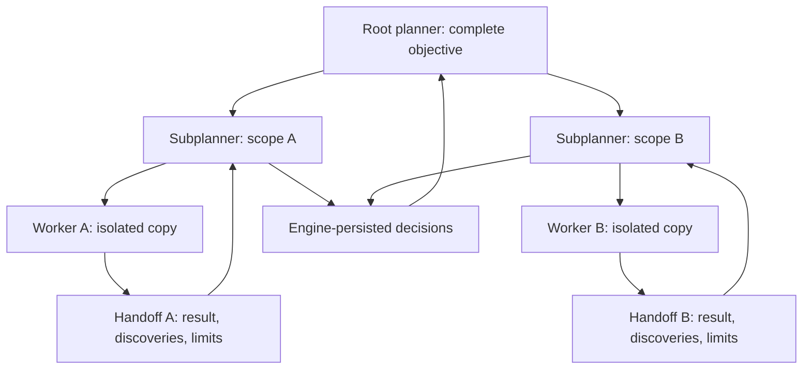
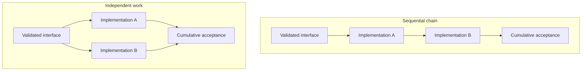
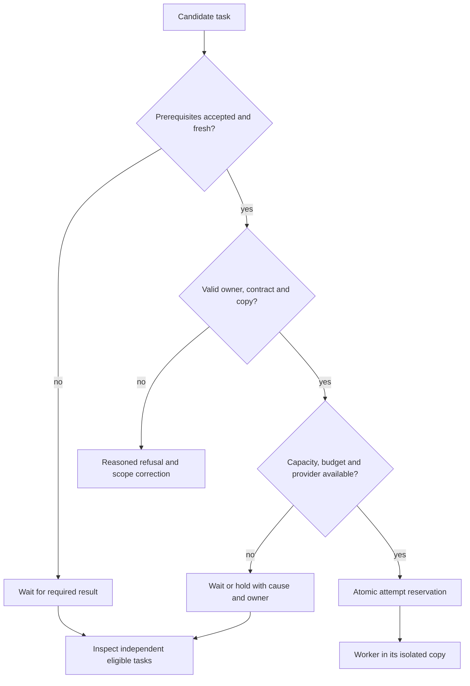
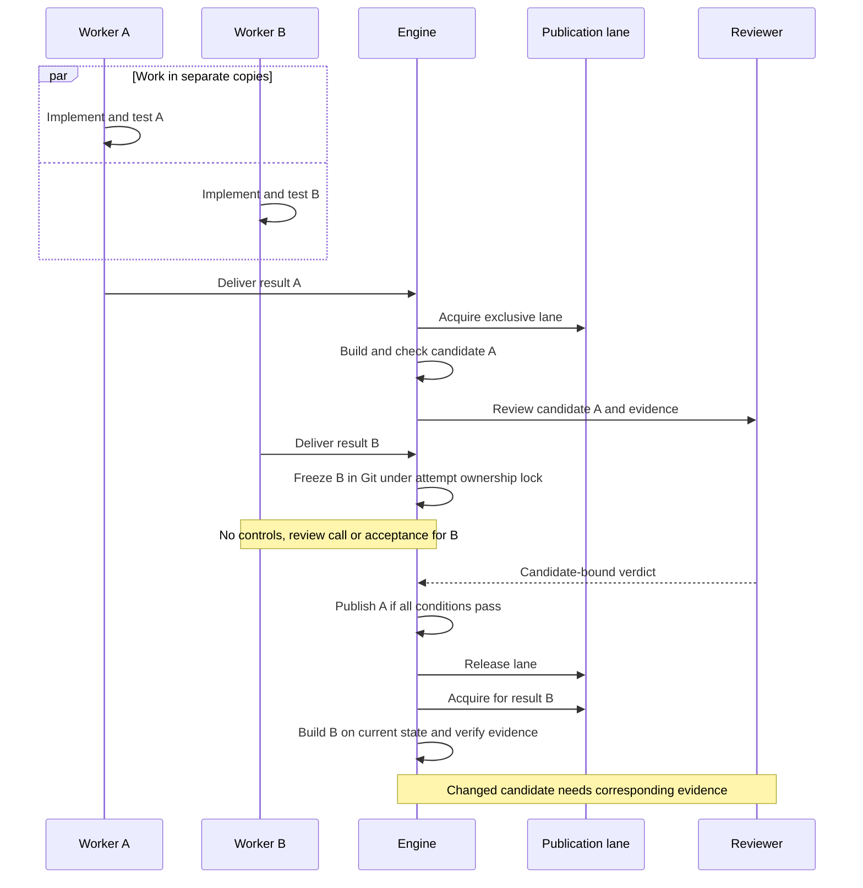
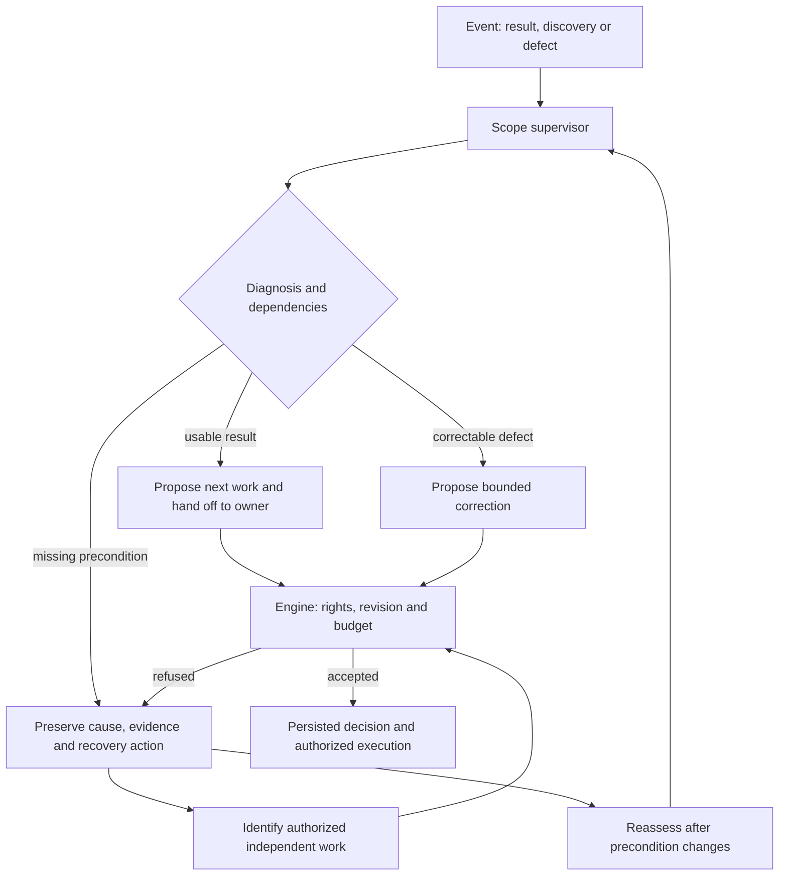
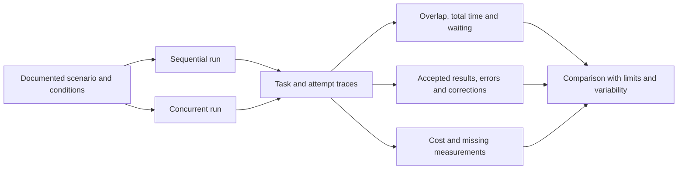

# Agent parallelism: needs, constraints and evidence

[Français](../architecture/AGENT-PARALLELISM.md)

## Scope and status

This contract complements the [Cursor contract](CURSOR-ENGINE-CONTRACT.md) and
[evolution plan](../architecture/CURSOR-ENGINE-EVOLUTION-20261010.md).
The adopted mission still has the chain T1 → T7. The
[recorded amendment](../publications/20261005-cursor-moteur/dossier-recherche/revisions/20261010-parallelisme-plan.md)
clarifies future handoffs without changing dependencies. **Target** diagrams
do not describe demonstrated behavior in this mission.

Concurrency means overlapping work lifetimes. Demonstrated parallelism requires
overlapping useful activity: two open processes, one waiting throughout, are
insufficient. Measure provider calls and local commands separately.

| Level | Eligible overlap | Condition | Evidence |
| --- | --- | --- | --- |
| Subplanning | Exploration of distinct scopes | Exact owner, dated inputs, atomic decisions | Simultaneous activations and persisted decisions |
| Production | Independent tasks | Available inputs, separate copies, explicit contracts | Useful activity and delivered results |
| Local verification | Tests in each copy | Separate resources and fixtures | Commands, outputs and intervals |
| Acceptance | Candidate checks, review and publication | Exact candidate and fresh evidence | Bound receipts/verdicts and measured waiting |

The current managed integration path has one exclusive publication lane per
mission. This table does not promise simultaneous reviews.

## Why parallelism is needed

Independent work need not wait for the slowest unrelated task. Bounded scope
owners distribute exploration and context; local failures leave independent
authorized actions visible. Dependencies and shared resources can remove any
throughput improvement. Agent count measures capacity; accepted deliveries
measure useful output.

**Target: distributed ownership and handoffs to the exact owner.** Arrows do
not authorize direct worker coordination.

Planners propose decomposition and reassess discoveries. The engine arbitrates
admission, ownership, freshness and transitions. Candidate review and global
cycle judgment retain different responsibilities.

## Necessary dependencies

Each dependency identifies its consumed interface, decision, data, verified
result or prerequisite effect. List order is insufficient. Distinguish result
dependencies, temporary resource exclusion and capacity.

**Design example, distinct from the mission:** after a shared interface is
validated, independent implementations can overlap; cumulative acceptance waits
for both results.

Graph changes preserve identities, requirements, budgets, attempts and history.
Record their reason, revision and affected contracts; check cycles, inputs,
ownership and conflicts. Old validation does not automatically cover amendments.
Current `task update` can amend `next` without launching or reaccepting work.
Definition edits are refused during active tasks; managed hierarchical contracts
add restrictions. T3 must demonstrate supported public adaptation and document
refusals. Direct database mutation is not a recovery path.

## Admission and policy

The ready graph frontier, slots, budgets, provider availability and resources
jointly bound useful concurrency. A task in a plan is not necessarily ready.

The diagram summarizes conditions; actual checks may share a transaction.
An unavailable prerequisite is not a worker failure.

| Constraint | Required treatment |
| --- | --- |
| Dependencies and freshness | Explicit contracts and admission checks |
| Scope ownership | Exclusive delegation and exact-owner handoff |
| Copies and test data | Per-attempt copy; separate databases, ports, services and temporary files |
| Revision, attempt and lease | Atomic stale-state refusal and reconciliation |
| Slots and provider | Persisted policies; visible quota and delay causes |
| Budgets and attempts | Shared atomic accounting, no refunds to force progress |
| Context and evidence | Complete originals, digests, visible limits and pre-call refusal |
| Publication | Current exclusive lane; measured optimization in T4 |

New policies must be persisted, exposed in Admin FR/EN and used by the engine,
with provenance and revision. Capacity does not require filling all slots.
T5 distinguishes policy from technical invariants; not every current limit is
already an Admin setting. Git copies separate files and references, not hostile
processes with the host account's permissions.

## Parallel production, exclusive publication

**Current source path:** `managedPublicationLane` has a nonblocking per-mission
lock. `integrateManagedAttempt` retains it through integration, checks, review
and publication; the Git lock is separate. Workers continue producing. Retaining
a result while waiting does not itself require another attempt or paid review.

The early retention path, `stageManagedResult`, freezes a completed worker's
result while another candidate is under review. It shares integration's identity,
attempt, authorization and pause guards, under the Git and attempt ownership
locks. `retainManagedResult` stores the immutable commit and report in the managed
repository without changing the business revision, accepting a task, running
controls or reserving review calls. Git lock contention remains a wait, rather
than becoming a result defect.

On replay, the engine uses that immutable commit even if the worker copy changed.
Once the publication lane is free, it builds the candidate on the current base,
handles conflicts and binds controls and review to that candidate. Early retention
improves handoff; it does not introduce simultaneous reviews or by itself prove
an overall throughput improvement.

T4 reduces waiting while preserving candidate/check/review/publication identity.
Removing the lock without an equivalent mechanism allows publication to invalidate
a review. File and interface conflicts require diagnosis, a coherent candidate
and corresponding evidence. A previous `PASS` alone is insufficient.

## Supervision and recovery

The scope supervisor interprets events, uses handoffs and proposes bounded
corrections. A timer alone cannot judge quality. Leases, silence detection and
termination protect against lost processes and duplicate effects; see the
[liveness policy](../architecture/PROVIDER-LIVENESS.md).

**Target: authorized independent work during a local wait.**

Provider outages are not fixed by adding agents. After restart, reconcile
processes, leases and observed effects before relaunch. Expired reservations do
not authorize duplicates or refunds. Independent tasks meet their own conditions.
Global closure needs fresh required evidence; this is not a barrier preventing
every independent production after each handoff.

## Measurement and failure cases

T6 compares the same objective, criteria and checks, documenting revision,
provider, model, resources and cache. Fix the protocol before comparison and
repeat runs to expose variability. Separate exploration, production, waiting,
checks, review and publication times.

Speedup is sequential time divided by concurrent time for comparable work.
Useful throughput counts accepted results per time unit. Report quality and
coverage too; more refused results are not a delivery improvement. Missing cost
remains unknown.

Required cases cover simultaneous independent tasks; a waiting consumer with
unrelated eligible work; stale concurrent decisions; common-file conflicts;
restart during reservation/handoff; quota, silence and stale proofs. Retain
identities, timestamps, candidates, counters, refusals and fresh checks/review.
Resume only after a relevant precondition changes.

T3 proves subplanner overlap and adaptation. T4 measures publication. T5 exposes
policy. T6 verifies in temporary roots. T7 observes real-provider behavior and
counts human interventions separately. Goroutine and declared-agent counts
cannot substitute for these results.

## References and inspection limits

The [traceability contract](TRACEABILITY.md) describes evidence, supervisor/engine
responsibilities and missing-evidence recovery with six Mermaid diagrams.

Both Cursor references remain. January describes planners, workers, subplanning
and cycle judgment; February describes a continuous hierarchy and owner handoffs.
Their evolution is not Swarm evidence. Consulted October 10, 2026:
[January](https://cursor.com/blog/scaling-agents),
[February](https://cursor.com/blog/self-driving-codebases).

Inspection covers `managed_publication_lane.go`, `managed_integration.go`, `managed_result_staging.go`,
`planning_runner.go`, `mission.go` and `task_definition.go` in `internal/engine`,
source HEAD `1169df70` with local changes. This is mechanism inspection, not a
throughput benchmark or autonomous acceptance run. Each managed candidate needs
its own integrated documentation and evidence.
