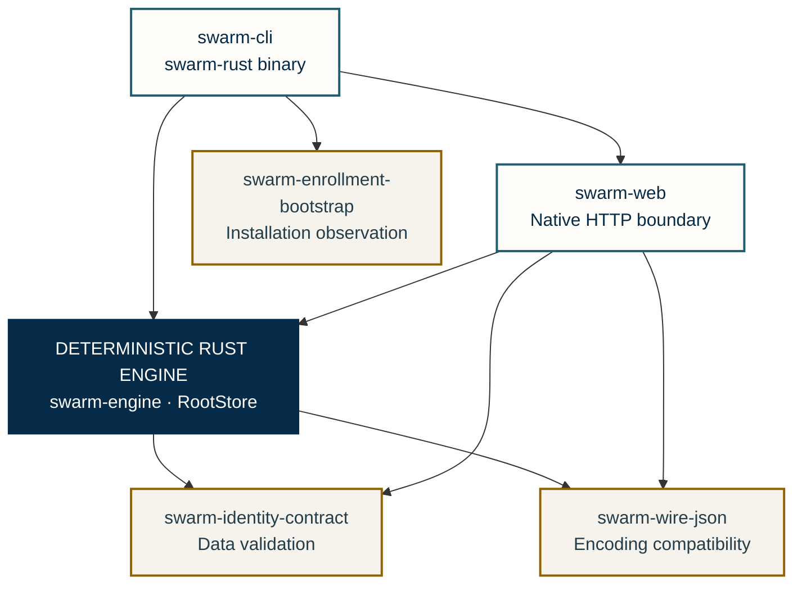

# Swarm internal architecture

Planning history has a [native read contract](NATIVE-PLANNING-HISTORY.md); recorded decisions are never executed by the reader.

Local consultation has a [native API/CLI contract](NATIVE-SESSION-VISIT.md),
with separate auxiliary receipts and recovery. [API JSON errors](NATIVE-HTTP-ERRORS.md)
distinguish invalid input from response failure. Evidence and limits remain in the migration plan.

[Français](../architecture/OVERVIEW.md) · [README](../../README.en.md) · [Diagram sources](../diagrams/CONTRACT-MAP.md)

Memory informs reasoning without granting authority. A signature can establish origin and integrity under its trust assumptions; it proves neither content truth nor safety. Complete views retain their objects, relationships and open integrations.

The **deterministic Rust engine** is Swarm’s core. These views are reconstructed
from internal contracts, retaining objects, owners, durable state and control
boundaries. They do not classify architecture by historical implementation
language: porting maturity is tracked in a separate matrix.

A block is a functional responsibility, not necessarily a service or crate.
Solid arrows express contract relationships. Dashed links identify an explicitly
future boundary or pending integration. Neither style substitutes for implementation
or qualification evidence.

## 1. Engine, orchestration and evidence chain

[Full-size SVG](../diagrams/architecture-overview-en.svg) · [PNG](../diagrams/architecture-overview-en.png) · [Mermaid source](../diagrams/architecture-overview-en.mmd)

The engine connects Work, requirements, plans, tasks, scopes, leases, events,
reservations, budgets, contexts, attempts and candidates. The root supervisor owns
the objective and cross-scope decisions; child owners handle their scopes. Global
cycle judgment and candidate review remain separate.

Launch requires eligibility, saved policy, reservations and frozen context.
Handoffs bind reports and originals to the Git candidate. The engine runs authorized
checks, prepares sources actually received by review, then rechecks rights, criteria
and freshness before acceptance. An anomaly returns to its owner rather than becoming
an empty success.

### Human validation and result policy

Human owners define rules and authority. A `human` policy may contain
preauthorized checks: success provides evidence, preserves the pending human
decision and does not release downstream work. Independent AI review does not
replace that decision. The `automatic` mode retains its checks and review;
acceptance still requires applicable evidence, the same candidate, criteria and
freshness.

The native controller preserves `pending_human`, `human-validation-required` and
manual gates/checks; it does not synthesize a quality gate from command PASS alone.
This validation contract remains separate from protected human authentication
and global identity integration, which are still open.

Sources: [human validation](ENGINE-ACCEPTANCE.md#checks-as-evidence-for-human-review),
[wiring139](RUST-MIGRATION.md#ordinary-tasks-and-human-validation--wiring139-under-qualification),
[native controller](../../rust/crates/swarm-engine/src/root_store/task_validation/gate.rs).

Sources: [AI/engine protocol](AGENT-ENGINE-PROTOCOL.md), [review evidence](REVIEW-EVIDENCE.md),
[traceability](TRACEABILITY.md), [cycles](JUDGMENT-CYCLES.md).

## 2. Identity, authority and final use

[Full-size SVG](../diagrams/identity-authority-en.svg) · [PNG](../diagrams/identity-authority-en.png) · [Mermaid source](../diagrams/identity-authority-en.mmd)

| Object / boundary | Contract to preserve |
| --- | --- |
| Human source | Adopted default personal local account, optional enterprise provider; bootstrap independent of first visitor and agents; journey still to integrate |
| Identities | Principal with issuer/subject/kind; actor; logical agent; instance; scope owner and historical author remain distinct |
| Authority | Current plan generation/digest, exact grants, delegable chain, dates and revocations; declared role grants no implicit `agent.create` |
| Enrollment | Independently pinned key, request/project-bound challenge, Ed25519 response and signed journal; signed bytes distinct from current rights |
| Publication | Exact private permit; SQLite snapshot and independent Trust head; intent, COMMIT, confirmation and recoverable publication |
| Configuration / transport | Consistent configuration and witness; attributed handshake, pinned image/process; UID is not business authorization |
| Request / effect | Exact operation, resource, source/recipient and content; Trust → SQLite → runtime ordering; approval, commit, reception and effect remain distinct |
| Before a plan | Explicit preparation authority required; no permissive rule based on an absent plan |

A local service under a separate account is the adopted pilot choice; a remote
authority is planned. These decisions establish neither service installation nor
an effective human source. Internal protocols, storage observations and receipts
do not close public admission and usage integration.

Sources: [identity and authority](AGENT-IDENTITY-CONTRACT.md),
[memory rights and preparation, FR](../plans/deepagents-integration/CONTRAT-USAGES-MEMOIRE.md).

## 3. Memory, received context and conversation

[Full-size SVG](../diagrams/memory-context-en.svg) · [PNG](../diagrams/memory-context-en.png) · [Mermaid source](../diagrams/memory-context-en.mmd)

| Swarm memory path | Objects and checks |
| --- | --- |
| Project knowledge | Verified lessons, fresh source, preview/admission, experience/procedure version, explicit selection, attributed replacement/withdrawal/import |
| Attempt context | Contract and methods, memory references, same-task history, extractive quotations, `prepared_context`, final prompt and SHA/size |
| Future instructions | `instruction_base`, attributed revisions, `revise-instructions`, rejection before reservation, `used_by_attempt` and reception history |
| Conversation | Durable turn start/end, session, usage and checkpoint; `answered` requires positive end confirmation, not merely exit 0 |
| Explicit resume | Read-only diagnosis, `checkpoint_sha256` and `facts_sha256`, reason and decision, preflight, new attempt in the same conversation |
| Usage rights | Owner/author/recipient distinct; reading permits neither summarizing nor transmitting; each source and destination binds authorized content |

Composition rechecks sources and capacity, then records context before launch.
A prepared receipt does not prove provider reception. Uncertain completion requires
reconciliation before replay. Withdrawal erases neither old prompts nor consumption;
import creates no local admission. The initial instruction is retained;
attributed supervisor additions are approved by default and rejectable before
reservation. This does not replace any human decision required for the result.
Native qualification of these paths is tracked
in the maturity matrix.

Sources: [project memory and dialogue](PROJECT-MEMORY.md),
[usage contract, FR](../plans/deepagents-integration/CONTRAT-USAGES-MEMOIRE.md),
[instruction revisions](INSTRUCTION-LEARNING.md).

## 4. Supervision, incidents and objective recovery

[Full-size SVG](../diagrams/run-supervision-en.svg) · [PNG](../diagrams/run-supervision-en.png) · [Mermaid source](../diagrams/run-supervision-en.mmd)

The engine distinguishes `elapsed_time`, `tool_wait`, `output_silence`,
`infrastructure` and `tool_failure`. Events retain scope, task, agent, attempt
and counters. Owner inboxes distinguish current and historical feedback; decisions
cite events actually received.

`planning decide` retains reason and decision after checking ownership, revision,
lease, generation, attempt, availability and budgets. Continue resets nothing.
Stop requires confirmation of the owned process ending before release. Signals
remain visible while an owner is unavailable; no supervisor or budget is invented.
Structured-inference limits remain separate from production observations. A
conductor ending does not establish that an already released worker has ended.

The loop is **incident received → owner diagnosis → authorized decision →
application → observed effect → recovery / review / learning**. A failed correction
returns to that loop; documenting an incident does not complete it. Process
supervision and candidate acceptance are separate: in `human` mode, checks and
review do not replace the required human validation.

Sources: [process supervision](RUN-SUPERVISION.md), [protocol](AGENT-ENGINE-PROTOCOL.md),
[call liveness](PROVIDER-LIVENESS.md), [instruction learning](INSTRUCTION-LEARNING.md).

## 5. Logs, telemetry, read views and evidence

[Full-size SVG](../diagrams/logs-observability-en.svg) · [PNG](../diagrams/logs-observability-en.png) · [Mermaid source](../diagrams/logs-observability-en.mmd)

| Source | Retention and consumption |
| --- | --- |
| Output / terminal | `agent_logs`, `terminal_events`, sequences/cursors and mission/attempt-bound reads; not a replayed command |
| Engine events | Attributed activity, incidents, decisions and receipts; current/history separation and safe causes |
| Calls and usage | Attempts and reservations; requested/observed and unknown/zero distinct; reservation does not imply invoice |
| Linux resources | Host, PID and starttime checked before measurement; unverifiable identity and absent data remain explicit |
| OTLP JSON | Active-agent-bound token, normalization, attributed rejections/series; separate `telemetry.db`; this normalizer stores no prompt/response |
| Console and live views | Read-only Monaco with text fallback; server/page filtering distinct; fingerprint SSE and explicit polling fallback |
| Export / acceptance | Original API response with scope/limitations; acceptance evidence requires originals, candidate, checks, review, human validation when required and freshness |

Read views decide neither process control nor acceptance. The chain must remain
reconstructible: objective, decision, owner, task, attempt, candidate, execution,
originals, review and applied decision. AC-02 security timeline and network lineage
are a future extension, separate from existing logs.

Sources: [console](LOG-CONSOLE.md), [call ledger](CALL-ACCOUNTING.md),
[traceability](TRACEABILITY.md), [native live/OTLP contract](RUST-MIGRATION.md).

## Native code organization

The [Cargo workspace](../../rust/Cargo.toml) contains ten crates. The graph shows
a **subset of Linux build dependencies** read from their manifests, not authorization
flow or a set of deployed services.

| Source | Role and limitation |
| --- | --- |
| [swarm-cli](../../rust/crates/swarm-cli/src/lib.rs) | Decode and render native commands; never call the Go engine |
| [swarm-web](../../rust/crates/swarm-web/src/lib.rs) | HTTP boundary, sessions and connected native routes; incomplete Go replacement |
| [swarm-engine](../../rust/crates/swarm-engine/src/lib.rs) | Models, transitions, planning, execution, supervision, checks and settings within the ported scope |
| [RootStore](../../rust/crates/swarm-engine/src/root_store.rs) | Project and persisted-settings access; neither human authentication nor permission to share a live Go root |
| [swarm-identity-contract](../../rust/crates/swarm-identity-contract/src/lib.rs) | Identity data validation; valid data does not authenticate a principal |
| [swarm-enrollment-proof](../../rust/crates/swarm-enrollment-proof/src/lib.rs) | Signed proofs compatible with the Go format; signing bytes grants no business rights |
| [swarm-enrollment-state](../../rust/crates/swarm-enrollment-state/src/lib.rs) | Native signed journal; trusted anchoring and freshness at final use remain separate obligations |
| [swarm-enrollment-authority](../../rust/crates/swarm-enrollment-authority/src/lib.rs) | Versioned authority documents; payloads are not execution capabilities |
| [swarm-enrollment-config](../../rust/crates/swarm-enrollment-config/src/lib.rs) | Installation configuration and protected local storage; no proof of an authenticated operator |
| [swarm-enrollment-bootstrap](../../rust/crates/swarm-enrollment-bootstrap/src/lib.rs) | Declaration and Linux observation; human labels, keys or distinct UIDs do not establish authority |
| [swarm-wire-json](../../rust/crates/swarm-wire-json/src/lib.rs) | Shared encoding behavior; each protocol retains its schema and canonicality rules |

Presentation assets live in `web/`, `frontend/` and `locales/`. CLI and HTTP
consume engine operations through their own input and output boundaries. Actual
served assets, build profile and exercised binary must be checked for each
delivery; testing workspace files alone does not establish their inclusion in
an executable.

## Rust maturity and product target

| Contract | Observed status and limits |
| --- | --- |
| Engine | `WorkEngine` and `RootStore` exist in `swarm-engine`; qualification is per journey, not a global cutover |
| Supervision | Worker, restart and planner → worker verified on CLI fixtures; complete role, review/validation and web coverage remain open |
| Result validation | Native controller preserves `human` mode and the pending human decision; local wiring139 evidence; global journey and protected authentication remain separate |
| Identity | Enrollment/configuration kernels and protocols exist; human source, installed service and final public use remain to qualify |
| Memory / context | Native context composition partially ported; managed field-guide memory is refused until its guard is ported; complete G8 and M20 usage enforcement remain open |
| Logs / telemetry | Native live and OTLP surfaces locally verified; this does not establish parity for every console and consumer |
| Global cycle | `continue`/`renew` verified in their native scope; current native `judge/end` remains refused |
| AC-02 security | Plan saved; A0–A7 not started; resume after migration/qualification and an explicit start request |

Operational sources also describe historical Go implementations. Language is
version/evidence information, not a Rust architectural subsystem name. The
[native sources](../../rust/crates/swarm-engine/src/project_context.rs), [active plan, FR](../plans/migration-rust/PLAN.md)
and [migration contract](RUST-MIGRATION.md) define status; these diagrams rerun
neither recipes nor providers.

The [product target, FR](../PRODUCT-ARCHITECTURE.md) retains two separable UX
applications, Projects and Business Processes. The [trusted actions architecture](ACTIONS-CONFIANCE.md)
and [AC-02 plan](plans/actions-confiance/securite-execution-apex.md) retain
confinement, network/secrets, menus and four visual references. This documentation
activates no service, confinement or real payment.
