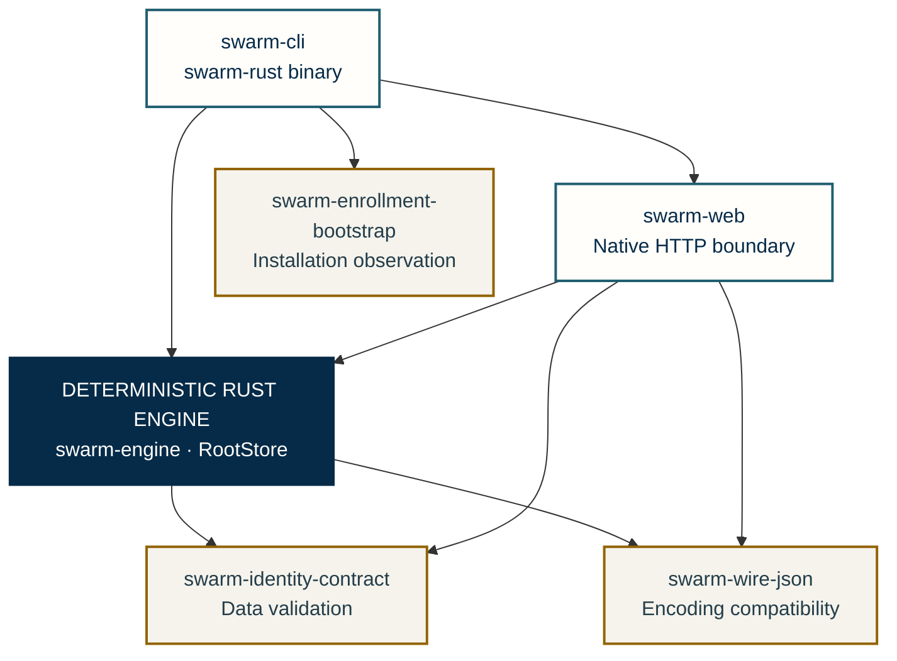

# Swarm internal architecture

Planning history has a [native read contract](NATIVE-PLANNING-HISTORY.md); recorded decisions are never executed by the reader.

Local consultation has a [native API/CLI contract](NATIVE-SESSION-VISIT.md),
with separate auxiliary receipts and recovery. [API JSON errors](NATIVE-HTTP-ERRORS.md)
distinguish invalid input from response failure. Evidence and limits remain in the migration plan.

[Français](../architecture/OVERVIEW.md) · [README](../../README.en.md) · [Diagram sources](../diagrams/CONTRACT-MAP.md)

Memory informs reasoning without granting authority. A signature can establish origin and integrity under its trust assumptions; it proves neither content truth nor safety. Complete views retain their objects, relationships and open integrations.

The **deterministic Rust engine** is Swarm’s core. These views are reconstructed
from internal contracts, retaining objects, owners, durable state and control
boundaries. They do not classify architecture by historical implementation
language: porting maturity is tracked in a separate matrix.

A block is a functional responsibility, not necessarily a service or crate.
Solid arrows express contract relationships. Dashed links identify an explicitly
future boundary or pending integration. Neither style substitutes for implementation
or qualification evidence.

## 1. Engine, orchestration and evidence chain

[Full-size SVG](../diagrams/architecture-overview-en.svg) · [PNG](../diagrams/architecture-overview-en.png) · [Mermaid source](../diagrams/architecture-overview-en.mmd)

The engine connects Work, requirements, plans, tasks, scopes, leases, events,
reservations, budgets, contexts, attempts and candidates. The root supervisor owns
the objective and cross-scope decisions; child owners handle their scopes. Global
cycle judgment and candidate review remain separate.

Launch requires eligibility, saved policy, reservations and frozen context.
Handoffs bind reports and originals to the Git candidate. The engine runs authorized
checks, prepares sources actually received by review, then rechecks rights, criteria
and freshness before acceptance. An anomaly returns to its owner rather than becoming
an empty success.

### 1.1 Multitasking within a mission

A Work holds the task DAG. Each node retains its scope, prerequisites, attempts
and validation policy. A dependency represents an expected outcome with its
applicable evidence. A finished process can therefore leave a successor waiting.
The startup transition checks task state and the freshness of required evidence
before it proposes a new attempt.

[SVG](../diagrams/mission-multitasking-en.svg) · [PNG](../diagrams/mission-multitasking-en.png) · [Mermaid](../diagrams/mission-multitasking-en.mmd)

| Stage | Producer and state | Gate |
| --- | --- | --- |
| Order | Engine, current Work revision and recorded priorities | The comparator sorts by descending priority, ascending longest-path depth and lexical ID. The graph and revision must match the projection. |
| Evaluate | Mission driver, worker selection | The engine filters supported states and profiles, then checks consent, prerequisites, recovery, cost, model and workspace. A task refusal can leave other candidates eligible for examination. |
| Register | Engine under the mission lease | Synchronization registers ready candidates in the FIFO queue. A task can wait before receiving a slot. [Synchronization](../../rust/crates/swarm-engine/src/mission_workspace_fifo.rs#L259-L330) |
| Admit | Native factory and engine, admission transaction | The engine rechecks revision, lease, controls, profile, slots and budget. The transaction binds the acquired turn, queued Agent, Work event and any applicable reservation. A recognized workspace conflict can leave a disjoint candidate eligible. Full capacity ends the Work’s pass. [Binding and writes](../../rust/crates/swarm-engine/src/agent_launch.rs#L1048-L1083) |
| Start | Technical Agent supervisor | The driver starts the admitted Agent and waits for its startup gate to clear before another admission. Authorized processes can run simultaneously in disjoint workspaces. |
| Validate the result | Worker, checks, independent review and responsible owner | Handoff identifies the candidate. Checks can leave review or a human decision pending. The successor becomes eligible once its own preconditions are satisfied. [Validation states](../../rust/crates/swarm-engine/src/root_store/task_validation/publication.rs#L181-L225) |

Slots count recorded active states per Work. Saved slots remain subject to
installation policy. When a reservation is required, the engine checks the
mission budget and records estimates, commitments and declared costs separately.
A plan attempt limit or per-task cost threshold can block a particular candidate.
The startup check is separate from result checks. The driver gives ready workers
priority before a new eligible planning activation.

**Observed scope.** The historical inert CLI recipe observed two workers with
simultaneous permission in disjoint workspaces, a waiting successor, and a
competing root decision retained. This evidence is bound to the recipe profile
and SHA. Capacity in real operating conditions, actual billed costs and general
role qualification remain open.

[Comparator](../../rust/crates/swarm-engine/src/mission_task_order.rs#L26) ·
[Candidates](../../rust/crates/swarm-engine/src/mission_candidates.rs) ·
[Dispatch and resources](../../rust/crates/swarm-engine/src/mission_worker_dispatch.rs) ·
[Driver](../../rust/crates/swarm-cli/src/mission_watch.rs) ·
[Slots](../../rust/crates/swarm-engine/src/mission_agent.rs) ·
[Budget](../../rust/crates/swarm-engine/src/financial_budget.rs) ·
[Inert parallel-worker check](../../tests/rust_mission_watch_parallel.py)

### 1.2 Concurrency across missions in one Root

The Rust server discovers consented automatic Work and can open a driver session
for each eligible mission. The mission lease governs session ownership. Each
Work applies its own slots and budget. Missions in the same Root share its
datastore workspace queue. A parent path and its child overlap. Disjoint sibling
paths can advance independently.

[SVG](../diagrams/mission-concurrency-en.svg) · [PNG](../diagrams/mission-concurrency-en.png) · [Mermaid](../diagrams/mission-concurrency-en.mmd)

A valid waiting turn keeps its place. A candidate whose workspace changes
rejoins at the tail. Earlier waiting or acquired turns block overlapping spaces.
Releasing an acquired turn requires its recorded owner and established
termination or cancellation. Loss of the driver lease alone leaves the
acquired turn in place. Admission also rechecks active Agent and
integration occupancy. On release and reevaluation, a mission can take the
resource when the remaining checks pass. Ordering applies to workspaces and
recorded turns. General mission fairness, a cross-Root scheduler and guaranteed
throughput remain outside qualification.

**Observed scope.** Rust tests with SQLite compare the diagnostic projection and
actual synchronization for new, moved and removed turns. They also verify
acquisition and disjoint workspaces. The [historical native FIFO 197](https://github.com/mo0ogly/swarm/blob/9e420d293eb78eeac7f6bbdd61f55e7dd2efe772/docs/plans/migration-rust/REPLAYS.md#L1145)
already exercised two Work objects with owned leases and concurrent
connections. P1.2 Web qualification with three missions confirmed B waiting,
C starting in a disjoint workspace and B resuming on its original turn. The qualification record describes the exercised windows and the limit
on recovery after preflight expiry. [P1.2 qualification](SAME-ROOT-FIFO-RECOVERY.md)

[Web discovery](../../rust/crates/swarm-cli/src/native_web/conductor.rs) ·
[Shared queue](../../rust/crates/swarm-engine/src/workspace_turn.rs) ·
[Synchronization and tests](../../rust/crates/swarm-engine/src/workspace_turn_write.rs) ·
[Cockpit diagnostics](TOKIO-ORCHESTRATION.md#automatic-startup-diagnostics-in-dispatch)

### 1.3 Refusal, interruption and recovery

A sub-orchestrator serves its scope and retains details of an authority refusal
concerning another scope. On the covered native path, the engine records the
refusal and a notice to the root orchestrator. The notice contains the scope and
the safe refusal code. The root owns the cross-scope decision. Planning in the child scope waits for the root’s recorded decision on the
notice, then repeats revision, authority, consent and budget checks.

[SVG](../diagrams/scope-refusal-recovery-en.svg) · [PNG](../diagrams/scope-refusal-recovery-en.png) · [Mermaid](../diagrams/scope-refusal-recovery-en.mmd)

| Situation | System response |
| --- | --- |
| Pause or withdrawn consent | The driver refuses new admission. Durable withdrawal survives an unpause. Previous reservations and attempts remain historical facts. |
| Preflight refusal | Dispatch can show the engine code at mission or task level. Once its owner addresses the cause, Refresh reads the diagnostic again. This read creates no attempt. |
| Interrupted admitted worker | Reconciliation examines the recorded Agent and its context. Authorized adoption or continuation preserves its identity. A permitted corrective attempt is a separate operation. |
| Uncertain outcome or publication | Retain the known effect, causes and original identifiers. Read back the recorded state before deciding how to resume. |

The historical inert child-refusal recipe proves escalation, waiting, a root
decision and recovery for that case. Worker recovery, authority escalation and
business completion have separate contracts and evidence.

[Native refusals](../../rust/crates/swarm-engine/src/planning_rejection.rs) ·
[Recovery selection](../../rust/crates/swarm-engine/src/root_store/planning_step.rs) ·
[Pause and withdrawal](../../rust/crates/swarm-engine/src/mission_control_write.rs) ·
[Continuation](../../rust/crates/swarm-engine/src/mission_worker_continuation.rs)

### Human validation and result policy

Human owners define rules and authority. A `human` policy may contain
preauthorized checks: success provides evidence, preserves the pending human
decision and does not release downstream work. Independent AI review does not
replace that decision. The `automatic` mode retains its checks and review;
acceptance still requires applicable evidence, the same candidate, criteria and
freshness.

The native controller preserves `pending_human`, `human-validation-required` and
manual gates/checks; it does not synthesize a quality gate from command PASS alone.
This validation contract remains separate from protected human authentication
and global identity integration, which are still open.

Sources: [human validation](ENGINE-ACCEPTANCE.md#checks-as-evidence-for-human-review),
[wiring139](RUST-MIGRATION.md#ordinary-tasks-and-human-validation--wiring139-under-qualification),
[native controller](../../rust/crates/swarm-engine/src/root_store/task_validation/gate.rs).

Sources: [AI/engine protocol](AGENT-ENGINE-PROTOCOL.md), [review evidence](REVIEW-EVIDENCE.md),
[traceability](TRACEABILITY.md), [cycles](JUDGMENT-CYCLES.md).

## 2. Identity, authority and final use

| Boundary | Code or retained observation |
| --- | --- |
| Agent, lease and Root | Automatic admission binds the Agent to the Work, lease generation, workspace turn and Root instance. Local process observations carry the PID, its start stamp and supervisor host. [Binding](../../rust/crates/swarm-engine/src/mission_agent.rs#L247-L283) · [Process identity](../../rust/crates/swarm-engine/src/supervisor_identity.rs#L115-L168) |
| Web session and Trust mandate | Enrolled bootstrap accepts a typed source for a prepared intent. Session, CSRF, current account and Biba gates are distinct. The G05.3 retrospective reports a local dev.225 run with fixture accounts on the explicitly enrolled path. [Web entry point](../../rust/crates/swarm-web/src/service.rs#L776-L797) · [G05.3 retrospective, FR](../plans/migration-rust/evidence/20261027-biba-governance-apex/RETEX-G05.3.md) |
| Preparation dialogue reader | When an admission receipt matches the recorded turn, the reader verifies the principal and applicable receipts, then checks clearance before returning the dialogue. The path without a matching receipt retains its historical read behavior. [Reader check](../../rust/crates/swarm-engine/src/root_store/preparation_dialogue.rs#L99-L208) |

See the [identity contract](AGENT-IDENTITY-CONTRACT.md) for individual journeys
and their status.

### 2.1 Integrity, confidentiality and confinement

| Boundary | Intended guarantee | Established scope |
| --- | --- | --- |
| Biba | Control integrity and promotion through policy and separation of duties | The Trust core defines levels, roles and use checks. Each integrated journey needs last-use proof. [Biba contract](BIBA-RUST.md) |
| Bell-LaPadula | Check classification, compartments and the reader’s clearance | The engine has policy, attribution and protected readers. End-to-end confidentiality and declassification remain open. [Scope and limits](BELL-LAPADULA.md) |
| Identity and mandate | Bind person, logical Agent, instance, operation and scope | The enrolled Web path accepts an attributed source for a prepared intent. Mandate and admission guards are specific to the journey. [Identity contract](AGENT-IDENTITY-CONTRACT.md) |
| Confinement | Limit a local process’s effects | Linux guards and the project contract define their own scope. Physical guarantees are separate from business policy and confidentiality. [Linux boundary](../../rust/crates/swarm-biba-linux/src/lib.rs) |

The [multitasking and security witnesses](#how-multitasking-evidence-relates-to-biba-and-belllapadula)
identify the decisions and effects observed at each boundary.

## 3. Memory, received context and conversation

[Full-size SVG](../diagrams/memory-context-en.svg) · [PNG](../diagrams/memory-context-en.png) · [Mermaid source](../diagrams/memory-context-en.mmd)

| Swarm memory path | Objects and checks |
| --- | --- |
| Project knowledge | Verified lessons, fresh source, preview/admission, experience/procedure version, explicit selection, attributed replacement/withdrawal/import |
| Attempt context | Contract and methods, memory references, same-task history, extractive quotations, `prepared_context`, final prompt and SHA/size |
| Future instructions | `instruction_base`, attributed revisions, `revise-instructions`, rejection before reservation, `used_by_attempt` and reception history |
| Conversation | Durable turn start/end, session, usage and checkpoint; `answered` requires positive end confirmation, not merely exit 0 |
| Explicit resume | Read-only diagnosis, `checkpoint_sha256` and `facts_sha256`, reason and decision, preflight, new attempt in the same conversation |
| Usage rights | Owner/author/recipient distinct; reading permits neither summarizing nor transmitting; each source and destination binds authorized content |

Composition rechecks sources and capacity, then records context before launch.
A prepared receipt does not prove provider reception. Uncertain completion requires
reconciliation before replay. Withdrawal erases neither old prompts nor consumption;
import creates no local admission. The initial instruction is retained;
attributed supervisor additions are approved by default and rejectable before
reservation. This does not replace any human decision required for the result.
Native qualification of these paths is tracked
in the maturity matrix.

Sources: [project memory and dialogue](PROJECT-MEMORY.md),
[usage contract, FR](../plans/deepagents-integration/CONTRAT-USAGES-MEMOIRE.md),
[instruction revisions](INSTRUCTION-LEARNING.md).

### 3.1 Graph and continuity

The mission graph projects the Work’s tasks, dependencies and scopes.
Graph Studio provides selection and read filters. Commands that change the
graph cross their own engine boundary. This graph makes no source-code indexing
claim. [Graph Studio](GRAPH-STUDIO.md)

When continuing a conversation or attempt, read back the context actually
received, its source references, the revision and the attempt’s identity.
An agent-facing projection can be smaller than the originals. Context contracts
define what is attributed, retained and presented. The contract requires separate rights at each
point of use for reading or transmitting a reference. Public M20 journey
qualification remains open. [M20 contract, FR](../plans/deepagents-integration/CONTRAT-USAGES-MEMOIRE.md)

## 4. Supervision, incidents and objective recovery

[Full-size SVG](../diagrams/run-supervision-en.svg) · [PNG](../diagrams/run-supervision-en.png) · [Mermaid source](../diagrams/run-supervision-en.mmd)

The engine distinguishes `elapsed_time`, `tool_wait`, `output_silence`,
`infrastructure` and `tool_failure`. Events retain scope, task, agent, attempt
and counters. Owner inboxes distinguish current and historical feedback; decisions
cite events actually received.

`planning decide` retains reason and decision after checking ownership, revision,
lease, generation, attempt, availability and budgets. Continue resets nothing.
Stop requires confirmation of the owned process ending before release. Signals
remain visible while an owner is unavailable; no supervisor or budget is invented.
Structured-inference limits remain separate from production observations. A
conductor ending does not establish that an already released worker has ended.

The loop is **incident received → owner diagnosis → authorized decision →
application → observed effect → recovery / review / learning**. A failed correction
returns to that loop; documenting an incident does not complete it. Process
supervision and candidate acceptance are separate: in `human` mode, checks and
review do not replace the required human validation.

Sources: [process supervision](RUN-SUPERVISION.md), [protocol](AGENT-ENGINE-PROTOCOL.md),
[call liveness](PROVIDER-LIVENESS.md), [instruction learning](INSTRUCTION-LEARNING.md).

## 5. Logs, telemetry, read views and evidence

| Source | Write and read path |
| --- | --- |
| Agent log | Admission writes a `command` entry. The native execution path writes `lifecycle` and `incident` entries, with distinct kinds for truncated messages. [Admission](../../rust/crates/swarm-engine/src/agent_launch.rs#L1067-L1084) · [Log writer](../../rust/crates/swarm-engine/src/agent_execution_store.rs#L50-L109) |
| Recorded terminal | The live reader requests log rows and terminal blocks with separate cursors. [Live reader](../../rust/crates/swarm-web/src/service/live.rs#L705-L727) |
| Provider telemetry | OTLP/HTTP ingestion verifies an exporter token and records normalized telemetry for the associated active subject: an Agent, review or planning call. [Ingestion](../../rust/crates/swarm-web/src/service/otel.rs#L126-L182) |
| Authority audit | The authority journal appends and synchronizes chained entries. Reads check the chain. This check covers the journal being read. [Writer and reader](../../rust/crates/swarm-authority/src/audit.rs#L174-L275) |

### 5.1 Historical reads, retention and audit

Protected `GET/HEAD /api/v1/logs` opens the Root read-only, checks its binding
and the Work–Agent association, then returns filtered rows ordered after the
cursor. The exact decimal extension preserves i64 sequences in the browser.
`retention_gap` compares the positive cursor with the first retained entry
for the Agent. The page-size setting can bound the response. Per-message BLP decisions remain
unestablished on this route.
[Route](../../rust/crates/swarm-web/src/service/log_query.rs#L46-L71) ·
[Engine reader](../../rust/crates/swarm-engine/src/root_store/log_query.rs#L47-L109) ·
[Web consumer](../../web/native-log-query.js#L13-L24) ·
[Pagination contract](NATIVE-LOG-QUERY.md)

## 6. Components, data flow and adapter boundaries

| Surface | Observed responsibility | Source and scope |
| --- | --- | --- |
| Cockpit and CLI | Select and declare intent, read state and errors, and report effects. The engine adjudicates changes at the supplied revision. | [CLI entry](../../rust/crates/swarm-cli/src/lib.rs) · [Native cockpit](COCKPIT-COMPATIBILITY.md) |
| Rust HTTP server | Admit the request, open the bound Root, invoke the engine, and retain errors and known effects. Readers can receive diagnostic codes that omit private data. | [Planning HTTP](NATIVE-PLANNING-HTTP.md) · [HTTP errors](NATIVE-HTTP-ERRORS.md) |
| Authority | The front end and engine each enforce their boundaries. A session or UID alone confers no business mandate. Protected operations reassess identity, rights or assertions under their contracts. | [Web request policy](../architecture/NATIVE-WEB-REQUEST-POLICY.md) · [Native authority](../../rust/crates/swarm-authority/src/lib.rs) |
| Root and storage | Engine snapshots and transactions cover their Root state. Mutations retain the event, revision and durable effect. Execution workspaces remain resources with identity and occupancy checks. | [RootStore](../../rust/crates/swarm-engine/src/root_store.rs) · [Evidence contract](../architecture/TRACEABILITY.md) |
| Providers | Resolution reads saved configuration, level, model and restrictions. Preflight and the execution boundary check applicable profile, workspace and permissions before running a separate process. | [Resolution](NATIVE-PROVIDER-RESOLUTION.md) · [Native launch](../../rust/crates/swarm-engine/src/agent_launch.rs) |
| IDE integration / MCP | Any future bridge needs its own interface contract, attribution, read and effect rights, and last-use proof. This document qualifies no delivered MCP runtime. | [Shared interface target](../PRODUCT-ARCHITECTURE.md) |

A command flow links attributed input, checks, transition and recorded outcome.
A read flow returns a projection and exposes its reason if it is degraded.
Startup diagnostics reuse candidate rules and FIFO order. Admission revalidates
the resource, after which technical execution and result evidence follow their
own contracts.

Provider resolution exposes the declared route and safe notices. The local
catalogue is a configuration source. Resolution qualifies neither account
availability nor the route actually executed. The native mission launch path
refuses selected API connections. Text preparation has an HTTP path using JSON
or SSE. The manual connection probe uses a separate JSON HTTP path.
Provider errors and waits follow [saved policies](NATIVE-PROVIDER-POLICIES.md) and the
[provider wait contract](NATIVE-PROVIDER-WAIT.md).

### 6.1 Interface contracts

| Caller and input | Producer and output | Refusal and recovery |
| --- | --- | --- |
| Dispatch cockpit, explicit Work and current read mode | The mission `launch-diagnostics` route returns revision, optional task and safe codes. | Invalid session, Work or observations surface as read failures. Refresh reads the state again. [Diagnostics](TOKIO-ORCHESTRATION.md#automatic-startup-diagnostics-in-dispatch) |
| CLI/API operator, operation, event ID and expected revision | The engine checks the mutation and returns its recorded or replayed outcome. | A revision conflict requires a new observation. A late error retains any recorded effect. [HTTP contract](NATIVE-PLANNING-HTTP.md) |
| Admin and adapter, provider, level, purpose and saved policy | The resolver returns the declared route. The controller produces an attempt after admission. | Missing profiles and routes outside policy can be refused. A diagnostic can inform a new authorized decision. [Resolution](NATIVE-PROVIDER-RESOLUTION.md) |
| Agent, attributed sources and current contract | Composition supplies the attempt context and reference. Candidates retain reports, originals and review decisions. | Withdrawn sources, stale evidence or uncertain effects require examining the evidence before resuming. [Memory](PROJECT-MEMORY.md) · [Acceptance, FR](../ENGINE-ACCEPTANCE.md) |
| Log reader, Work, Agent, filter and cursor | A protected page retains order, retention boundary and continuation indicator. | Invalid filters or cursors are refused. A retention gap requires reading with the retained boundary in view. [History](NATIVE-LOG-QUERY.md) |

## 7. Deployment, capacity and qualification

| Question | Reference point |
| --- | --- |
| Build | Identify the SHA, profile, effective features, embedded assets and executable digest. Fixture and production binaries each have their own identity. |
| Local installation | The [managed launcher](../../swarm.sh) builds, qualifies and restarts the identified service. The version API and dialog show provenance and release notes. |
| Storage | Health readings check the Root’s physical binding and current settings. Storage alerts alone establish no admission, permission or recovery decision. [Native health](NATIVE-RUNTIME-HEALTH.md) |
| Mission capacity | Slots, budget, provider restrictions and disjoint workspaces determine attainable parallelism. Transport limits and operator settings remain separate contracts. |
| Operations | Observe wait and run time, recovery, refusals, declared costs and missing evidence by Work, task and attempt. Bind every metric to source and coverage, and retain unknowns. |
| Maturity | Distinguish adopted contracts, code paths, results observed in fixtures or installed environments, and targets. Qualify runtime and parity of public views separately. |

Cross-Root capacity, fairness across missions, actual billed cost and
throughput under load require measurement before they can underpin an
operational commitment. Historical evidence retains its date and binary. New
evidence carries its own SHA. P0.1 updates documentation, maps and rendered
diagrams, without introducing a runtime rule.

### Reference and retained distinctions

The Agents-Orchestrator architecture provides an outline for interfaces,
runtimes, adapters, graphs, recovery and observability. Swarm describes its Rust
engine and interfaces here, with scope ownership, deterministic admission and
evidence before acceptance. Architecture, storage and integration differences
remain questions of contract, source and qualification. [Pinned reference](https://github.com/syntax-syndicate/Agents-Orchestrator/blob/fd1f2a75aca87907cd5e510a65516d120dfd7a3c/ARCHITECTURE.md) · [Active Rust plan](../plans/migration-rust/PLAN.md)

## 8. Mapping to the reference architecture

| Reference topic | Swarm documentation decision | Source and limit |
| --- | --- | --- |
| Overview and component layers | Present the Rust engine, interfaces, authority and processes by responsibility. | [Native code organization](#native-code-organization) · [Components and flow](#6-components-data-flow-and-adapter-boundaries) |
| Workflow engine and agentic team | Describe a Work and its scopes with admission, sub-orchestrators and evidence. Conversations and scoping decisions retain their own records. | [Multitasking](#11-multitasking-within-a-mission) · [Protocol](../architecture/AGENT-ENGINE-PROTOCOL.md) |
| Components and data flow | Map intent, bound Root, transition, receipt and read. Model calls cross a process boundary. | [Planning API](NATIVE-PLANNING-HTTP.md) · [Tokio orchestration](TOKIO-ORCHESTRATION.md) |
| Adapters, local models and alternatives | Document resolution, preflight, execution and return. Saved route restrictions remain in force at admission. | [Native resolution](NATIVE-PROVIDER-RESOLUTION.md) · [Wait and recovery](NATIVE-PROVIDER-WAIT.md). The reference’s model fallback suggestions confer no Swarm policy. |
| Graphs, scanner and dashboard | Document the task graph and the memory references it uses. The reference scanner and graph exports remain separate directions. | [Graph Studio](GRAPH-STUDIO.md) · [Memory](PROJECT-MEMORY.md). A code index would need separate qualification. |
| Collaboration, context and continuity | Distinguish instructions, receipt, conversations, attempts and recovery. Interrupted work retains the originals needed for reconciliation. | [Context](#3-memory-received-context-and-conversation) · [Supervision](#4-supervision-incidents-and-objective-recovery) |
| Security and confidentiality | Separate Biba, Bell-LaPadula, identity, mandate, confinement and observed effect. | [Security boundaries](#21-integrity-confidentiality-and-confinement). Partial protections retain their journey scope. |
| Observability and audit | Present logs, telemetry, call accounting, retention and evidence by producer. | [Logs and evidence](#5-logs-telemetry-read-views-and-evidence) · [Call accounting](../architecture/CALL-ACCOUNTING.md) |
| Deployment, performance and capacity | Distinguish local topology, recipes, installed binary, Work concurrency and Root resources. | [Capacity and qualification](#7-deployment-capacity-and-qualification). Cross-Root fairness and throughput remain open. |
| MCP and IDE interfaces | Keep interoperability as a target that needs an authority and observation contract. | [Shared API target](../PRODUCT-ARCHITECTURE.md). The reference MCP bridge belongs to that repository. |

The upstream code runs workflow steps in sequence and routes one Agentic
Team role per turn. The dashboard and MCP have their own entry points and
consume context stores or engines under their respective contracts. These
paths ground Swarm’s separate views of interfaces, coordination and execution
dependencies.
[Workflow loop](https://github.com/syntax-syndicate/Agents-Orchestrator/blob/fd1f2a75aca87907cd5e510a65516d120dfd7a3c/orchestrator/core/engine.py#L440-L516) ·
[Role turn loop](https://github.com/syntax-syndicate/Agents-Orchestrator/blob/fd1f2a75aca87907cd5e510a65516d120dfd7a3c/agentic_team/engine.py#L311-L373) ·
[Dashboard](https://github.com/syntax-syndicate/Agents-Orchestrator/blob/fd1f2a75aca87907cd5e510a65516d120dfd7a3c/context_dashboard/app.py#L44-L76) ·
[Engines called by MCP](https://github.com/syntax-syndicate/Agents-Orchestrator/blob/fd1f2a75aca87907cd5e510a65516d120dfd7a3c/mcp_server/engines.py#L22-L62)

### Evidence traceability

| Observation | Input and evidence | Scope |
| --- | --- | --- |
| Two workers and one dependency | [Inert recipe source](../../tests/rust_mission_watch_parallel.py) · [ORCH-04 evidence, FR](../plans/migration-rust/PLAN.md#preuves-du-candidat-local) | Two active admissions and disjoint workspaces. Test results establish neither sustained throughput nor task acceptance. |
| FIFO across two Work objects | [Historical native FIFO 197, FR](https://github.com/mo0ogly/swarm/blob/9e420d293eb78eeac7f6bbdd61f55e7dd2efe772/docs/plans/migration-rust/REPLAYS.md#L1145) covers owned leases, concurrent connections, refusal, release and recovery on the workspace. | Historical CLI and SDK profile, supplemented by current selector SQL tests. The Web P1.2 qualification is documented separately. [Three missions](SAME-ROOT-FIFO-RECOVERY.md) |
| Child refusal and recovery | [Plan and retained originals, FR](../plans/migration-rust/PLAN.md#remontée-des-refus-dautorité-et-reprise) · [Recipe](../../tools/verification/recipes/mission-watch-orchestration.json) · [Scenario](../../tests/rust_orchestration_scopes.py) | Original scenario result SHA-256 `b0f243ccffaf45054a3ec673046115aa62b45618bd8f7b8f3b3999f4da48948c` covers refusal, root notice, decision and resumption for one inert case. |
| Diagnostics and installation | [Contract and recipe](TOKIO-ORCHESTRATION.md#automatic-startup-diagnostics-in-dispatch) · [Diagnostics merge](https://github.com/mo0ogly/swarm/pull/46) | The fixture setup executable has SHA-256 `7ff1854fa341e8e52763e6f3156c66de5c8c1ac2294a544b8410b6e233b9e791`. The recipe HTTP server without a driver has SHA-256 `f924be23a3982a31e3aa1690f401ccb5b7388a9b529ce087962b40921e76d36b`. The installed image differs. Local `v0.1.1-dev.389` has SHA-256 `2fa03ed1ffe14d9243f681027085d0e6f61cbc018fd3c4102e85128f00a9567c`. Its active image was verified through the process and version API. On an isolated Root, this binary served the pause reason and its French and English rendering. The provider fault and recovery belong to the recipe without a driver. [Receipt index](../diagrams/README.md#reçus-de-qualification--qualification-receipts) |

### How multitasking evidence relates to Biba and Bell–LaPadula

| Witness | Established check | Security scope |
| --- | --- | --- |
| Two workers in one Work | Two starts in disjoint workspaces and a waiting successor. [ORCH-04, FR](../plans/migration-rust/PLAN.md#preuves-du-candidat-local) | Startup code invokes Linux confinement. ORCH-04 establishes parallel execution. The dedicated Biba fixture below establishes access refusals. [Final startup check](../../rust/crates/swarm-engine/src/native_provider_exec.rs#L197-L233) |
| Queue and recovery across Works | FIFO order, acquisition, release and reconciliation under the exercised guards. [P1.2 record](SAME-ROOT-FIFO-RECOVERY.md) | Turn identity and Agent–Root binding can correlate receipts. Workspace overlap establishes no Biba or BLP verdict. |
| Child refusal and recovery | A mandate refusal, root notice and recorded decision on the inert path described above. [Notice producer](../../rust/crates/swarm-engine/src/root_store/planning_rejection_feedback.rs#L179-L212) | The mandate refusal has its own contract. An integrity-level or clearance check on the notice remains unestablished. |
| Managed worker, Biba fixture | The `managed-fioclex-fresh` receipt records denied private reads and denied private, official and database writes, including a denial observed in a descendant. Image `909ae5d8…f03d`. [Receipt](../plans/actions-confiance/verification-biba-transverse-20261028/managed-fioclex-fresh/result.json) | Confinement evidence for this fixture. The receipt records `accepted:false` and carries no BLP verdict. |
| Preparation and dialogue, BLP evidence | Public diagnostic of attributed prompt sources in a fixture. The dialogue read verdict is conditional on a matching admission receipt. [Diagnostic receipt](../plans/actions-confiance/verification-blp/20261101-preparation-check-public-01/result.json) · [Dialogue read check](../../rust/crates/swarm-engine/src/root_store/preparation_dialogue.rs#L99-L208) | Scope is preparation and the covered read path. Worker traffic confidentiality and classification of its logs need per-journey evidence. |

Combined evidence must bind the same image and attempt to the subject, exact
object or version, policy, enforcement point, verdict and observed effect.
The witnesses above cover different boundaries.

## Native code organization

The [Cargo workspace](../../rust/Cargo.toml) lists 16 members. The graph shows
a **subset of Linux build dependencies** read from their manifests, not authorization
flow or a set of deployed services.

| Source | Role and limitation |
| --- | --- |
| [swarm-cli](../../rust/crates/swarm-cli/src/lib.rs) | Decode and render native commands; never call the Go engine |
| [swarm-web](../../rust/crates/swarm-web/src/lib.rs) | HTTP boundary, sessions and connected native routes; incomplete Go replacement |
| [swarm-engine](../../rust/crates/swarm-engine/src/lib.rs) | Models, transitions, planning, execution, supervision, checks and settings within the ported scope |
| [RootStore](../../rust/crates/swarm-engine/src/root_store.rs) | Project and persisted-settings access; neither human authentication nor permission to share a live Go root |
| [swarm-identity-contract](../../rust/crates/swarm-identity-contract/src/lib.rs) | Identity data validation; valid data does not authenticate a principal |
| [swarm-enrollment-proof](../../rust/crates/swarm-enrollment-proof/src/lib.rs) | Signed proofs compatible with the Go format; signing bytes grants no business rights |
| [swarm-enrollment-state](../../rust/crates/swarm-enrollment-state/src/lib.rs) | Native signed journal; trusted anchoring and freshness at final use remain separate obligations |
| [swarm-enrollment-authority](../../rust/crates/swarm-enrollment-authority/src/lib.rs) | Versioned authority documents; payloads are not execution capabilities |
| [swarm-enrollment-config](../../rust/crates/swarm-enrollment-config/src/lib.rs) | Installation configuration and protected local storage; no proof of an authenticated operator |
| [swarm-enrollment-bootstrap](../../rust/crates/swarm-enrollment-bootstrap/src/lib.rs) | Declaration and Linux observation; human labels, keys or distinct UIDs do not establish authority |
| [swarm-wire-json](../../rust/crates/swarm-wire-json/src/lib.rs) | Shared encoding behavior; each protocol retains its schema and canonicality rules |

Presentation assets live in `web/`, `frontend/` and `locales/`. CLI and HTTP
consume engine operations through their own input and output boundaries. Actual
served assets, build profile and exercised binary must be checked for each
delivery; testing workspace files alone does not establish their inclusion in
an executable.

## Rust maturity and product target

| Contract | Observed status and limits |
| --- | --- |
| Engine | `WorkEngine` and `RootStore` exist in `swarm-engine`; qualification is per journey, not a global cutover |
| Supervision | CLI fixtures cover worker priority, two overlapping executions and child → root escalation → recovery. The P1.2 Web journey covers three isolated missions in one Root. General role coverage remains open. |
| Queue across Work objects | The historical native 197 journey, SQLite tests and Web P1.2 cover overlap, FIFO and recovery in one Root. A pre-COMMIT crash retained B’s turn. Cross-Root scheduling remains open. |
| Cockpit read | The isolated HTTP recipe covers inert-provider failure and recovery in French and English. A separate check on the installed image covers the paused-mission diagnostic in both languages in an isolated Root. |
| Result validation | Native controller preserves `human` mode and the pending human decision; local wiring139 evidence; global journey and protected authentication remain separate |
| Identity | Agent–lease–Root binding in code; explicit web enrollment observed with fixture accounts (G05.3) |
| Memory / context | Native context composition partially ported; managed field-guide memory is refused until its guard is ported; complete G8 and M20 usage enforcement remain open |
| Logs / telemetry | Agent log writer, protected query and OTLP ingestion referenced in §5 |
| Global cycle | `continue`/`renew` verified in their native scope; current native `judge/end` remains refused |
| AC-02 security | Plan saved; A0–A7 not started; resume after migration/qualification and an explicit start request |

Operational sources also describe historical Go implementations. Language is
version/evidence information, not a Rust architectural subsystem name. The
[native sources](../../rust/crates/swarm-engine/src/project_context.rs), [active plan, FR](../plans/migration-rust/PLAN.md)
and [migration contract](RUST-MIGRATION.md) define status; these diagrams rerun
neither recipes nor providers.

The [product target, FR](../PRODUCT-ARCHITECTURE.md) retains two separable UX
applications, Projects and Business Processes. The [trusted actions architecture](ACTIONS-CONFIANCE.md)
and [AC-02 plan](plans/actions-confiance/securite-execution-apex.md) retain
confinement, network/secrets, menus and four visual references. This documentation
activates no service, confinement or real payment.
