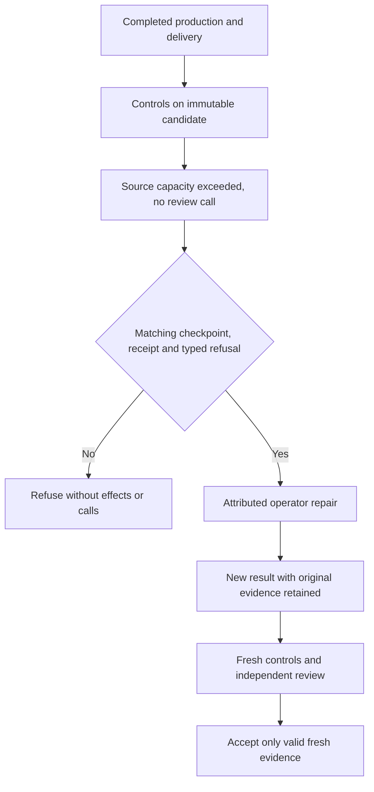
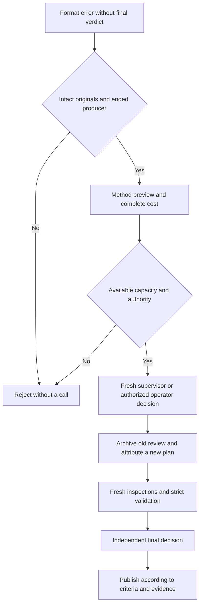
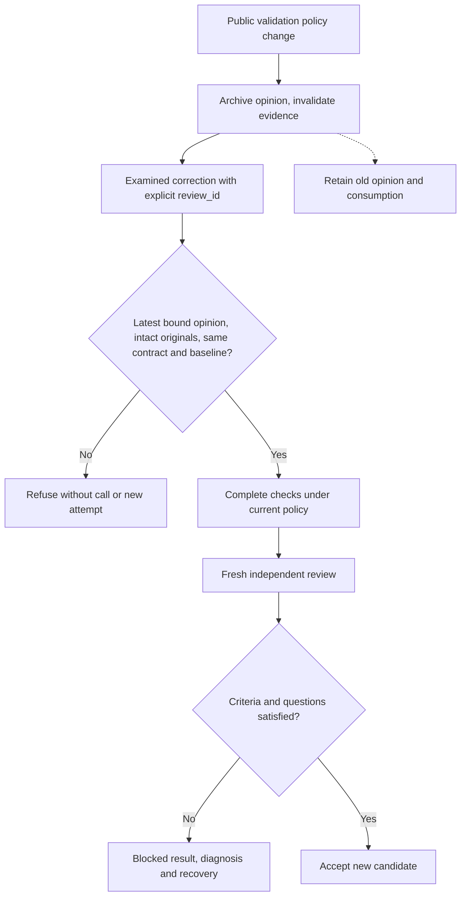

# Recover an exhausted task

## Historical opinion and new production

A new production attempt archives the previous opinion and prepares its own
review. A running or queued review blocks that transition. Consumed attempts
and review calls remain unchanged.

Older states may incorrectly retain a finished opinion from a previous attempt.
The current candidate's preflight remains available only when that opinion is
attributable to an earlier attempt on the same task. Inventory is read-only;
a validated retry archives the opinion atomically. Unknown, unfinished and
current-attempt opinions are never ignored.

In **Agent management**, a blocked card and its details offer **Authorize an
additional attempt** when the current allowance is exhausted. Enter a reason and
a concrete correction: missing sources, a verified precondition or partial work
to reuse. Repeating the same failed action does not resolve its cause.

Confirmation adds exactly one attempt, with a ceiling of three. It preserves
attempt history, reports, checks, independent opinions and tool budgets. The task
remains blocked and unaccepted. The launch form opens next and shows any remaining
conditions. Authorization itself never starts a provider. Escape or Close cancels
without changing the work. A stale form is rejected; close and reopen it.

The engine refuses this operation while an agent or review is running, while an
attempt remains available, or once three have been authorized. After three attempts, use the separate exceptional flow below. There is no
automatic increase in the attempt allowance.

## CLI equivalent

Read the current revision using `swarm --json work show WORK`, then create:

```json
{
  "schema_version": 1,
  "event_id": "unique-operator-decision",
  "expected_revision": 42,
  "task_id": "my-task",
  "reason": "Explicit decision after examining the failure",
  "recovery_instruction": "Supply missing candidate sources and rerun the same evidence checks."
}
```

```sh
swarm planning extend-attempt WORK --input recovery.json
```

This operator allowance does not modify the hierarchical requirements, dependencies
or owner. Replaying an `event_id` cannot grant another attempt. A stale revision is
rejected. The `task.attempt-extension` event records the reason and instructions.

## What a worker receives when retrying

The engine automatically prepares `.git/swarm-recovery.json` in the **new isolated
copy**. The worker prompt provides its location and SHA-256. CLI, web and conductor
launches use the same preparation. When the engine has recorded an immutable Git
result, an operator no longer needs to transfer its patch manually.

The packet binds the work, task, previous agent and attempt to the planner's
correction, failure reason and, when available, the full independent review and
its receipt. The receipt is read again and checked against its recorded digest.
The attributed Git result is fetched into the new copy under
`refs/swarm/recovery/previous`. The worker can inspect its report and changes with
`git show` and `git diff`, using the base and result commits in the JSON, without
reading or modifying the previous worker's files.

HEAD still starts at the current accepted candidate. The worker examines, reuses
and corrects relevant changes in its own copy and resolves any conflicts. The
rejected result is neither published nor applied automatically. The packet stays
in Git metadata, outside deliverable files. New checks, a delivery manifest and
independent review remain required against the new candidate.

If a failed or interrupted managed attempt has no submitted result, the engine
confirms process termination and freezes its retained sources in a separate Git
checkpoint at attempt settlement, even when no retry remains. The `attempt_ended`
event supplies its attributed manifest and digest to the owner. A preservation
failure remains in the blocker and event; the owner must reconcile the copy and
its attribution. The packet provides `checkpoint.commit`, `checkpoint.base_commit` and
`checkpoint.tree`; the same local reference exposes these sources. `result_commit`
remains absent: this checkpoint is not a verified delivery. The previous attempt’s
structured `diagnostic` is also supplied directly in the worker prompt so the
observed cause can be examined before spending more calls.

Historical attempts without confirmed termination retain an explicit limitation;
the engine does not claim to recover their files. Inconsistent attribution, a changed receipt or a
modified prepared packet prevents launch and preserves the copies. Packets are
limited to 512 KiB without truncation. Handoff preparation makes no AI call and
grants no additional attempt. It supports an authorized retry; it does not replace
the operator's decision when the attempt limit has been reached.

### Examine before rebuilding

In the newly attributed copy, first check `pwd` and
`git rev-parse --show-toplevel`. Read the packet from that Git root and use the
identifiers it actually contains:

```sh
cat .git/swarm-recovery.json
git ls-tree --name-only -r refs/swarm/recovery/previous
git diff --stat BASE_COMMIT refs/swarm/recovery/previous
git diff BASE_COMMIT refs/swarm/recovery/previous -- VERIFIED_PATH
```

`BASE_COMMIT` is `base_commit` for a submitted result or `checkpoint.base_commit`
for a checkpoint. `VERIFIED_PATH` comes from the Git inventory, not a guessed path.
Read a report with `git show` only after confirming it exists in that tree. Do not
search a neighbouring copy.

An existing checkpoint stays identical after the former copy changes. The shared
Git lock refuses a concurrent operation; after release, a fresh read must find
the same checkpoint. A reference without its manifest is incomplete evidence:
retain it and route attribution reconciliation to the operator without deleting
or overwriting the files.

### Choose recovery from the observed cause

| Observed fact | Useful action | Verifiable resumption condition |
| --- | --- | --- |
| Guessed file or interface absent | Inventory with `rg --files`, read producer and callers | Path and signature observed in the current copy |
| Wrong `workdir` | Use the verified current directory; omit the inherited parameter | Command actually starts in its attributed copy |
| Existing Go symbol declared again | Examine and reuse the compatible declaration | Compilation and named affected tests pass |
| Sandbox denies transport | Retain error, sources and dependency; route to owner | Required capability demonstrated in the intended check environment |
| Interrupted sources without delivery | Examine checkpoint and diagnostic | Sources readable in the new copy, cause received, checks still unvalidated |
| Exhausted attempts | Examine external repair or explicit operator authorization | Admissible public operation; no counters cleared |

This guidance reduces preparation mistakes; it does not intercept provider tools.
Compilation errors may still occur but must not become accepted deliveries.
Added instructions or checks in another environment do not establish autonomous
prevention. See the [diagnosis contract and limitations](AUTORECURSIVE-RECOVERY.md).

### Distinguish verification environments

A browser recipe must start a real local server and control a real browser.
Verify that capability in the intended environment before the recipe. Repeating
`validation`, `delivery` and the criterion after the same permission denial supplies
no new evidence; hand the blocker back to its owner.

Worker, operator and engine controller may have different permissions. Record who
ran each check, binary, revision and fixture. Operator success does not establish
worker capabilities. An authorized external repair may use that success through
the public flow below; it remains attributed to the operator and still requires
checks and independent review. Network denial never authorizes disabling checks
or implicitly widening permissions.

### Hand over ready sources without inventing local success

New managed attempts freeze `delivery_version: 2` and receive a version 2
manifest template. `outcome: ready` hands over sources and recipes for engine
checks when the producer environment cannot execute a control. Keep the criterion
`status: not_tested`, its reason, complete source paths and the authorized
automatic control IDs covering it. A known product failure remains `fail` and
blocks this handoff. `ready` preserves evidence and review context limits.

The engine executes all configured controls on the immutable candidate, then
obtains independent review. A failing control prevents review; an adverse review
prevents acceptance. Legacy version 1 attempts retain their contract: `complete`
requires actual local verification. A running attempt's frozen protocol is not
changed retroactively.

### Resume after an environment incident

A narrative claiming that the environment was corrected is insufficient. After
a structured environment diagnosis on a terminal attempt, preflight must be
`ready` with `verification: verified` using a configured probe in the actual
provider context. Every declared capability, including extras such as
`loopback_listen`, must be `verified`. A host-only `compatible/unverified` result
retains `environment_verification_required`, without another attempt or
reservation. The changed-precondition explanation is also required. An operator
stop does not erase an already observed structured environment failure.

The engine checks configured capabilities; it does not infer every resource a
recipe needs or certify an incorrectly configured probe. A local-server recipe
therefore needs its capability declared and actually checked in its intended
environment. Legacy first launches with optional preflight retain compatibility.

## Supply candidate sources to the independent reviewer

Files declared in `delivery.criteria[].evidence` are now supplied completely
from the tested candidate, even if unchanged; the report is already present.
The manifest below adds extra sources rather than enabling declared evidence.
See the [global contract and diagrams](REVIEW-EVIDENCE.md).

For managed Git integration, the producer may add
`docs/TASK-ID.review-context.json` inside the mission's repository subdirectory:

```json
{"version":1,"files":["managed_review.go","managed_review_test.go","tests/engine_acceptance.cjs"]}
```

File paths are relative to the repository root. The engine reads complete files
from the tested candidate commit, never a mutable checkout. Each source includes
its contents, path, Git blob and SHA-256 digest. Selecting files does not guarantee
sufficient evidence; a reviewer must still return unknown for unsupported criteria.

Limits: 8 KiB manifest; 24 distinct files; 96 KiB per file; 128 KiB combined sources;
192 KiB overall review context. Invalid paths, missing files, symlinks, binary
content and oversized input are rejected without truncation or a review call.
Without a manifest, declared delivery evidence is still supplied. Historical
attempts without either delivery or manifest retain diff/report/control receipts.
This is explicit context delivery, not general file watching or direct worker messaging.

## After three attempts: one explicit corrective authorization

**Prepare one corrective attempt** is available on the task card, recovery
diagnosis and task inspector. The editable proposal repeats the latest independent
rejection. Reading or cancelling it changes nothing and calls no AI. The proposal
does not establish that the review diagnosis is complete or accurate.

**Authorize this corrective attempt** grants exactly one fourth attempt. The
active conductor handles it when launch conditions permit. Pauses, dependencies,
workspace reservations, storage checks, budgets and reviewer availability still
apply. Acceptance requires checks and a new independent review of the corrected
candidate. History, criteria and previous verdicts remain intact.

The engine requires a blocked task with three used attempts, an independent
rejection of the latest attempt, an available reviewer budget, a new instruction,
a reason and explicit confirmation. Active task agents prevent authorization.
The atomic operation is idempotent; double clicks cannot add two attempts, and
stale forms are rejected. The `task.corrective-recovery` event and the task's
`corrective_recovery` record retain the actor, timestamp, revision, review,
attempt, reason and instruction. A fifth attempt cannot be granted through this
flow, including after task edits. Planners and page-assistant proposals cannot
authorize it; the local operator must do so. The local API/CLI remains within the
operator's trust boundary.

```json
{
  "schema_version": 1,
  "event_id": "unique-corrective-recovery",
  "expected_revision": 42,
  "task_id": "my-task",
  "review_id": "latest-review-id",
  "attempt_id": "latest-attempt-id",
  "confirm_recovery": true,
  "reason": "Targeted correction after reading the independent rejection",
  "recovery_instruction": "Correct the missing evidence identified in this review and rerun every check against the corrected candidate."
}
```

```sh
swarm planning authorize-recovery WORK --input corrective-recovery.json
```

Review this JSON before sending it: an active conductor may start the authorized
attempt. Tool, cost and reviewer budgets remain unchanged. Other tasks retain
their own allowances. Environment failures still require verified preconditions.

## Recovering an interrupted result without rewriting history

An execution limit takes precedence over earlier incidental tool errors. The engine
sends the owner a JSON interruption record under `.swarm/interruptions/`, including
the attempt identity, workspace, stop reason, counters and last observed action.
It is an engine observation, not a worker report or acceptance evidence, and does
not snapshot workspace files. Storage failures remain explicit.

Worker instructions identify one code workspace and require an early, regularly
updated report. These instructions are guidance, not an OS sandbox or a guarantee
that a provider will follow them.

For explicitly requested external repairs, an operator may finish the stopped
copy and submit one examined revision per attempt through `planning submit-recovered-result`.
The operation launches no worker and preserves the interrupted process, attempt
and budgets. The reviewer receipt identifies `external_repair` and its actor;
such a repair does not demonstrate autonomous completion.

A retained repair from a previous attempt does not prevent submission of the
current stopped attempt. The durable event preserves the old repair, review and
coordination; their Git references and receipts remain intact. The new submission
requires its own checks and a fresh review. Another implicit submission of the
same attempt remains rejected; correcting that result uses
`revise-recovered-result` and its attributed independent rejection, or the
verified no-call preflight described below.

After reviewing the diff and evidence, run `git add -A` and `git write-tree` in the
copy. Supply JSON with `schema_version: 1`, `event_id`, `expected_revision`,
`task_id`, `agent_id`, `attempt_id`, `confirm_recovery: true`, `result_tree` and
a meaningful `reason`. Changed files, active or replaced attempts, missing reports
and incomplete delivery declarations are rejected. `docs/TASK.delivery.json` is
mandatory even for legacy attempts.

Normal checks and independent review still cover the same candidate. A rejection
stays blocked; no fifth attempt is created. Replaying the same event uses the
recorded revision and does not repeat a rejected review. Another implicit submission
of the same attempt is refused. Review incidents use the existing explicit retry path.

Oversized review context can come from unchanged diff lines. Above 160 KiB of
serialized context, the engine uses three Git context lines instead of forty.
Every changed line, complete source file and receipt is retained. The final
192 KiB limit remains mandatory. Explicit replay of the same external submission
can resume this preflight failure only if no review of that attempt has started;
an existing review never triggers an implicit additional call.

### Correct a rejected result without restarting its producer

`planning revise-recovered-result` submits an explicitly examined external
correction tied to the latest `review_id` in `changes_requested`. Supply the
same fields as `submit-recovered-result`, plus that ID and the current revision.
The tree must differ from the rejected result and match the examined files.
The engine preserves the previous opinion, receipt and Git references. The new
candidate undergoes checks and review within the existing budget. No production
attempt or counter is reset. Replaying the same request does not consume another
review. This operation cannot replace an accepted task. External repair remains
recorded as an intervention, not autonomous production.

### Independent opinion format errors

A `pass` citation must be one exact contiguous excerpt from the supplied evidence.
Paraphrases and concatenated excerpts are rejected. The engine now preserves the
reviewer response, including rejected responses, in a private file bound to the
opinion (`reply_path`, `reply_sha256`) and identifies the offending task/criterion.
This file is not approval. Older opinions may have no preserved raw response.

After a demonstrated correction to the format or precondition, `planning
retry-review` allows an explicit retry within the existing budget. There is no
automatic paid retry. Receipts, contexts and reports are reread during inference
and before publication; changed evidence makes the opinion stale.

After `retry-review`, the conductor also resumes an external repair whose
producer remains interrupted. Only the explicitly submitted result awaiting
integration is resumed. Historical process state and attempts stay unchanged.
A rejected submission without an explicit retry triggers no new opinion.

### Oversized cumulative evidence

The context limit remains unchanged. After reducing only unchanged diff context,
the engine may omit a duplicate supplemental source when its entire newly added
file is already present byte-for-byte in the full diff with the same Git blob.
The diff, reports, receipts and every changed line remain present. Existing
modified files are never shortened. Context that still exceeds the limit is
rejected before a provider call; deduplication does not permit truncation.

### Latest attempt completed without a report

A task without a managed Git repository, blocked after three attempts, can also
show **Prepare one corrective attempt** when the conductor recorded that the latest
attempt produced no report. This operational failure is not an independent review.
Fix its cause before confirming a new instruction. The mission keeps its pause and
tool-call limit; only one fourth attempt is authorized. Its result must still pass
checks and independent review.

The CLI uses the same `planning authorize-recovery` operation and fields above,
replacing `review_id` with `"missing_report": true`. Keep the latest `attempt_id`,
`expected_revision`, `confirm_recovery`, `reason` and `recovery_instruction`.
Do not combine this cause with `review_id` or `result_commit`. The engine verifies
the recorded conductor refusal; the supplied boolean alone never proves that a
report is absent.

### Review stopped by its time limit

In the cockpit, **Review time limit** below the reviewer sets the duration of
future reviews to a positive duration, or `0` to inherit the project policy
configured in Admin, with a recorded reason. Saving preserves
used calls and their limit; it does not restart anything. After fixing the cause,
**Resume review** examines the existing result within the remaining budget, without
starting another worker.

### Complete a review that ended without a verdict

Selection-stage `unknown` is neither a confirmed product defect nor a transport
error. After examining original evidence, an external correction can submit a new
tree through `revise-recovered-result`, with `review_id`, `confirm_recovery: true`
and `confirm_review_unknown_correction: true`. The latter is an explicit choice
to correct missing evidence or sources, never acceptance. It requires a terminal,
attributed selection and intact journals, a blocked task and a changed tree.
Active reviews, stale revisions, tampered evidence and unchanged trees are refused
without mutation or additional spending. A complete delivery manifest remains
mandatory. Old opinions and receipts are preserved; the new candidate repeats
controls and independent review within existing budgets. This differs from
resuming the same candidate after an actual selection-capacity correction.

## Checks before independent review

For tasks with explicitly authorized automatic checks, the engine runs those
checks before the AI review. Successful checks produce an execution receipt
and leave the task awaiting review; they do not accept the task. The reviewer
receives the current engine receipt, including commands, exit codes and hashes,
and evaluates whether the checks actually cover the acceptance criteria.

After a favorable review, the engine reuses the current receipt without running
the commands again. Failed checks, stale evidence or a different attempt prevent
acceptance. An imported report or manual gate cannot replace an engine receipt.
Tasks using human review retain their existing workflow.

## Recovery and tool budgets

The last authorized tool may finish and its result is retained. Duration
thresholds send observations to the owner; they do not stop production. Additional calls remain prohibited; repetition and error
guards stay active. An interruption does not validate the work.

A new attempt receives a bounded summary of operations observed in the previous
attempt of the same task. This helps avoid repeating discovery, but does not
prove that those operations succeeded. Instructions specify exploration and
finalization milestones, reserving one fifth of the calls for checks and the
report. These milestones guide the model; the engine monitors the total cap.

## Observe a mission without execution caps

In **Administration**, select the **Mission** scope, load its ID and choose
**Execution mode → Observation — no execution caps**. Enter a reason, preview
and confirm. This explicit choice is available only for mission administration.

New workers, including retries, keep counting calls and results but are no
longer interrupted by tool-call, repetition, error, silence or duration caps.
The plan's attempt count no longer blocks their launch. Existing numeric
limits remain recorded for reference; `observation_mode: 1` means they do not
stop this execution. Already started attempts retain their original mode.

Dependencies, acceptance checks, exclusive workspace ownership, manual stops
and provider failures still apply. This mode resets nothing, accepts no result
and does not create unlimited automatic retries. Planning and review budgets
are separate. Select **Caps enabled** to end the experiment: subsequent launches
use the configured limits and the existing counters again.

The CLI uses the same operation: `swarm run-limits apply mission <id> -
--input change.json`, with `values.observation_mode` set to `1` (observation)
or `0` (caps enabled), an explicit `reason` and the expected revision. Include
the scope's other existing values in the change document.

## Explicit restart is separate from corrective recovery

The four-production limit of `authorize-recovery` remains in force. A separate
operator decision, `swarm planning restart-task`, can authorize exactly one new
production after examining the current result. This is neither an automatic fifth
attempt nor a counter reset. See the
[restart conditions and evidence bindings](ENGINE-RECOVERY.md#restarting-a-blocked-task).

### Correct a no-call preflight after interruption

An external repair may have complete delivery and pass controls, then fail
before any review because one context artifact is too large. Explicit
`planning revise-recovered-result` can correct that same stopped attempt
without `review_id`, since no opinion exists. Supply the current identities
and revision, `confirm_recovery`, a concrete reason and the examined new
`result_tree`; its tree must differ from the retained result.

The engine rereads the retained preflight: a known no-call cause, blocked task,
current agent/attempt, confirmed process exit, attributed result, and candidate
checkpoint/receipt matching the base, contract and controls. Tampering refuses
the correction before mutation. An arbitrary controller error grants no such
permission. Previous results, opinions where present, references and receipts
remain retained. Fresh controls and review cover the new candidate. Replay
grants no additional call, attempt or refund.

A large integrity manifest may use several complete files, each linked by
SHA-256 to its parent manifest. The harness reconstructs every input before
checking the aggregate digest. Packaging removes no evidence, raises no
limit and renews no historical acceptance.

Duration and silence thresholds remain observations with caps enabled as well.
Changing the mode affects execution caps and attempts; AI conduct decisions
retain their attribution.

## Correcting unpaid source-capacity refusals

A complete delivery with a bounded diff may still exceed the aggregate attached
source capacity. No review call is spent. The engine retains the immutable Git
result, prepared candidate and controls. Public `planning revise-recovered-result`
can correct the declared selection without creating another production or
claiming acceptance.

The engine verifies work, task, completed attempt, immutable result, contract,
previous candidate and matching checkpoint/control receipt. It rebuilds the
original context and recognizes only a typed capacity error matching the stored
refusal. Altered checkpoints, different failures, stale attempts or an existing
independent opinion grant no such authority. Ordinary review retries still
require a complete bounded context; only explicit repair can inspect the verified
checkpoint while source capacity remains exceeded.

Retain originals, remove only redundant declarations or create suitable pieces
with attribution and lineage. The new result runs fresh controls and independent
review; consumed attempts and budgets remain unchanged.



## Review reservation abandoned across restart

After acquiring the attempt ownership lock exclusively, the engine recognizes
a review left `running` by a previous conductor. It verifies originals and the
anchored journal, then marks only the final reservation without a durable result
`interrupted` in a new content-addressed journal. The initial journal, completed
inspections and spent calls are retained. Reconciliation makes no provider call
and grants no candidate acceptance.

The `review_fragment_interrupted` incident reaches `reviewer_runtime`. A fresh
`review-retry` decision can resume the same candidate within existing budgets;
an explicit external repair can supply a changed tree with
`revise-recovered-result` and `confirm_review_error_repair`. Both retain required
attribution, controls and validation. Altered originals, a live owner or an
incompatible client identity block recovery; operator narrative cannot bypass them.

For a deliberate stop, pause through the public operation, await durable call
settlement and subprocess exit, then stop the identified conductor. Stopping too
early can leave a reservation without a result; restart retains that uncertainty.

## Inspection contract change after an error

A format error without a final decision can adopt a new citation or finding
contract through an explicit complete restart. `planning recovery-preview`
checks originals, attribution, provider, model and required budget before any
call. A ready restart reports `method_restart_ready`; earlier inspections remain
history and cannot supply opinions under the new contract. `planning retry-review`
requires a fresh revision, rationale and `confirm_review_error_repair: true`, or
a fresh `review-retry` decision by the authorized supervisor. The operation spends
no call; the conductor subsequently runs the attributed review.

A negative business verdict, live reservation, altered original or insufficient
budget blocks this replacement. Correct that precondition through its public
operation before resuming; never erase spending or edit an original reply to make
it valid.

The preview body uses `task_id`:

```json
{"schema_version":1,"task_id":"TASK_ID"}
```

Send it to `swarm --root ROOT --json planning recovery-preview WORK_ID
--input request.json`. Preview neither replaces the owner decision nor restarts
the conductor.



The preview above covers inspections and complete method replacement. If a final
decision has already started, inspect its journal: explicit final recovery keeps
inspections and calls and still requires a fresh decision. Submitting a repaired
tree with `revise-recovered-result` requires an active mission and plan. After a
diagnostic pause, stop the identified conductor with no descendants, unpause
publicly, submit the result, then resume the conductor; this avoids rerunning the
old candidate during submission. A failed precondition grants no extra authority.

## Check the actual denial reason

New managed attempts receive delivery instructions to keep the scenario's other
fields valid, assert the expected reason and verify no business mutation. After
adding a mandatory field, revisit existing negative tests: a denial from another
guard can hide removal of the claimed protection. For a critical guard, controlled
removal in an isolated fixture must fail the named test. Keep the mutation out of
the delivered candidate and never alter a mission database for that check.

The prompt constructor and `ready` delivery checks verify local transmission
of this instruction. They do not yet demonstrate a new native worker applying
it; inspect the actual context and outcomes before claiming that effect.

## Correction after changing validation controls

A public `validation_policy` change archives the current opinion and invalidates
its controls. This must not strand a rejected result. `revise-recovered-result`
may name, through `review_id`, the last archived opinion for the same producer,
attempt and external repair. Business contract and baseline must still match;
originals, hashes, provider, method and eligible rejection are rechecked. Older,
unrelated, unfinished or altered opinions confer no recovery authority.

The operation still requires a fresh revision, a changed examined tree, a stopped
attributed copy and the applicable rejection confirmations. All controls run under
the current policy, followed by fresh independent review. The old opinion remains
historical; its checks and verdict do not accept the new candidate. Attempts and
consumption remain intact, apart from new calls actually executed.



Verify the path in an isolated fixture:

```sh
go test ./internal/engine -race -count=1 -v -run '^TestRecoveredResultCorrectionAfterPublicPolicyChange$'
```

This test previews and applies the public policy, submits a corrected tree and
checks the current-policy receipt, new candidate and fresh opinion. It rejects
an unrelated ID and altered receipt without spending a call and verifies replay
does not repeat review. Contract, baseline, producer, attempt and latest-opinion
variants are checked separately. A real mission additionally requires public
reception, checks, decision and observed effect; a fixture does not replace these
four proofs.
