# Recursive diagnosis and verified recovery

[Français](../architecture/AUTORECURSIVE-RECOVERY.md)

## Expected behavior

An agent should investigate and correct an actionable problem within its authority
without waiting for the user to repeat the request. Observe, diagnose, act within
scope, verify and reassess the original requirement. If its diagnosis, method,
handoff or verification fails, apply the same reasoning to that linked problem,
then return to the original objective. Recursion concerns reasoning and linked
problems; it does not automatically spawn agents, calls or attempts.

Read [traceability](TRACEABILITY.md), [review evidence](REVIEW-EVIDENCE.md) and
[parallelism](AGENT-PARALLELISM.md). This is a method and development contract,
not evidence that autonomous recovery has already been implemented or demonstrated.

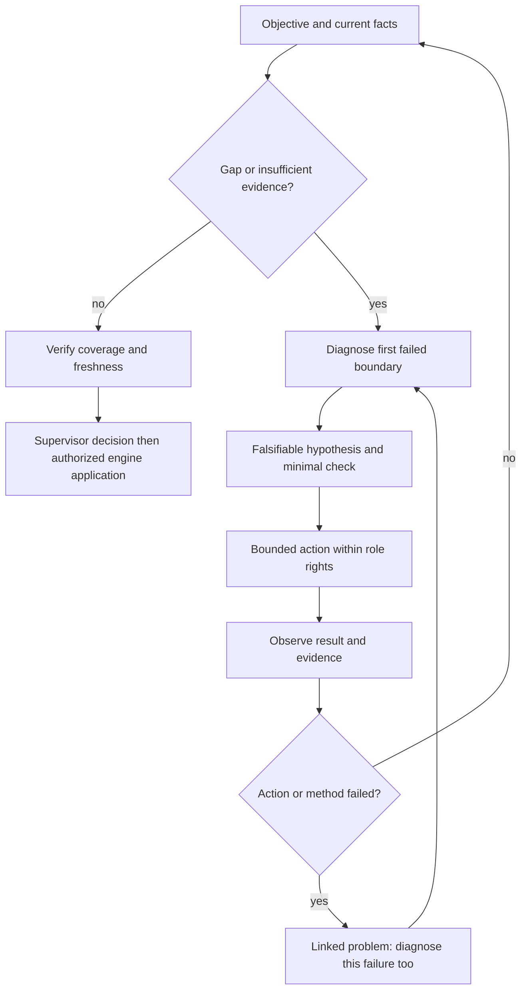

## Meaningful progress

Use existing reports and decisions to retain requirement, parent problem,
candidate, event, expected/observed outcome, demonstrated cause versus hypothesis,
owner, discriminating check, changed precondition and public-operation result.
Distinguish proposal, delivery, recorded decision and actual execution.

Progress requires relevant new evidence, a hypothesis eliminated, a corrected
precondition or an observed transition. Rewording the same diagnosis or adding
documents does not demonstrate operational recovery. The same candidate, inputs,
hypothesis and action do not justify another unchanged retry. Choose a different
discriminating check, escalate to the competent owner or retain a reasoned block.
Existing budgets and reservations apply; no new arbitrary iteration cutoff is added.

## Responsibilities

| Actor | Authorized role | Verification |
| --- | --- | --- |
| Worker | Diagnose and correct assigned work | Same scenario after correction, original output and attributed handoff |
| Sub-supervisor | Use feedback, link problems and decide within scope | Evidence/hypothesis, missing input and exact owner |
| Root | Resolve cross-scope and objective-level issues | Consider engine, rule and method faults; reassess coverage |
| Reviewer | Assess supplied originals | Separate result defect from missing evidence; no invented PASS |
| Deterministic engine | Supply facts; check rights/revisions/reservations; execute public operations | Attribution, unique effects, freshness and retained usage |
| Native operator agent | Continue authorized diagnosis and check its own handoffs | Checkout/runtime relationship, supplied context and public state; explicit intervention |

Tool-free planners propose supported operations and cannot claim to read absent
sources. Deterministic transitions do not supply semantic diagnosis. Operator
intervention must not be retrospectively attributed to autonomous supervision.

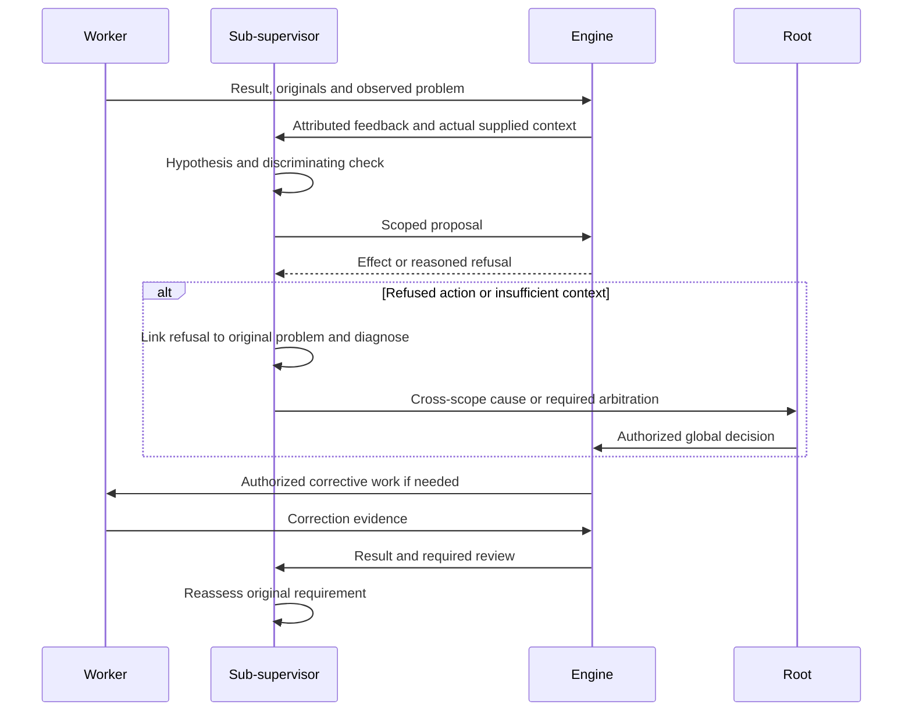

## Audit the method and handoff too

At each boundary, verify exact arguments/exit code, original attachment, supplied
projection, role rights, supported operation, persisted state and published
candidate. A path is not supplied content; an event is not demonstrated use;
process completion is not acceptance.

**Observed 10 October 2026:** operator instructions were appended after long
`next` fields. `planningContextLimit` supplies the first 1,000 characters;
`recoveryTaskFocus` retains 600. The recipient could miss the current diagnosis
and next action. Put a concise actionable summary first, retain details/history
and verify both projections. This does not prove the model read the summary.
These are inspected existing bounds, not new recommended defaults. T5 must
separate useful current summaries, complete sources and persisted policy settings
in API/CLI/Admin FR/EN. Increasing context arbitrarily does not fix attribution.

## Stopping and escalation

A status request or completed milestone does not close the objective: answer and
continue useful authorized work without another prompt. During native execution
or review, observe public state, do independent work and act on the result. Close
on verified completion, explicit stop/defer, or no useful authorized action with
cause, evidence, owner and a concrete resumption condition. Do not promise future
follow-up that has not been arranged. This grants no paid calls or recurring monitoring.

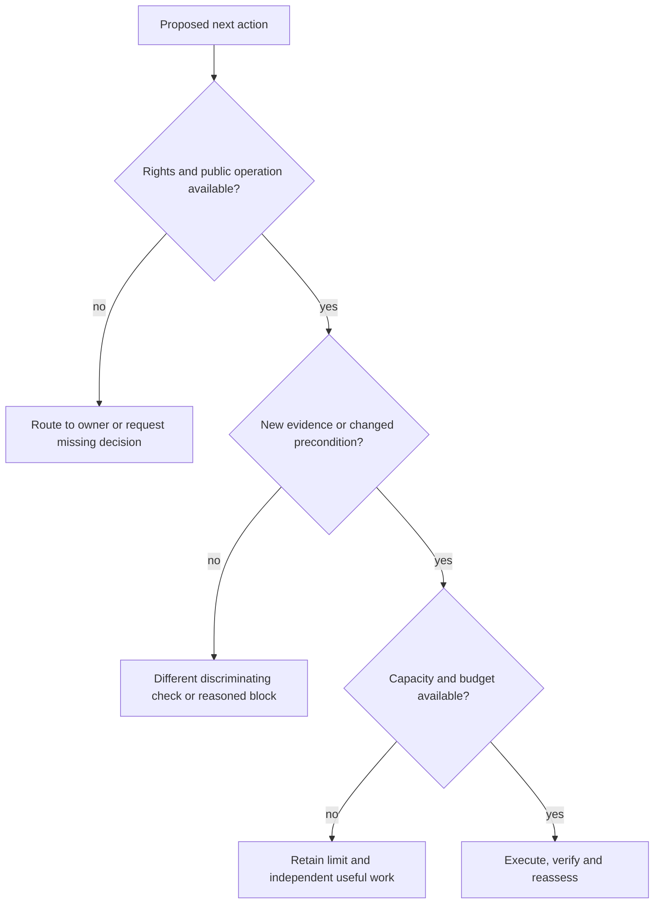

An active review protects its candidate: prepare corrections separately and wait
for its verdict before corresponding mutation. Retain external outages and budget
exhaustion visibly; continue authorized independent work. Ask the user only for
a required missing decision or authority with concrete options and a reason.
Do not outsource an already authorized diagnosis to the user.

## Cursor plan implementation

T3 verifies a discovery and refused first proposal handled by a sub-supervisor.
T4 verifies attributed recovery from incomplete handoff/control failure and return
to the original requirement without duplicate effects. T5 integrates APEX/replan
instructions, useful projections and public recovery; new policies persist in
Admin FR/EN. T6 covers incorrect diagnosis, absent source, engine/rule faults,
restart and concurrency, measuring evidence progress and cost. T7 demonstrates
actual use with a real provider, separating autonomy and operator intervention.

Use temporary roots to inject a known fault then a diagnostic or handoff error.
Verify new discriminating evidence, cause-appropriate action, recorded decision
and reassessment. An unchanged failure must not cascade into spending, tasks or
acceptance. Adding instructions alone does not demonstrate this behavior.

## Diagnosing time thresholds

Elapsed time does not establish lack of progress. Observation, delivery and owner decisions follow [the conduct contract](RUN-SUPERVISION.md). Missing decisions do not become automatic stops; authority, spending and history remain intact.

## Delivering a review correction

The 11 October diagnosis found a broken boundary: `review-retry` saved `Task.Next`
but the resumed reviewer did not receive that instruction. The correction captures
the decision, scope, received event, review, candidate, attempt, cause and instruction
in a separate `retry_directive`. New inspection, selection and final decision calls
receive this envelope before evidence. Journals retain the received directive and
prompt digest; a subsequent change to `Task.Next` cannot replace it.

The transaction checks attribution, authority, freshness, budget and input capacity
before any call. Original evidence and spent reservations are retained. Diagnostic
feedback for multiple defects on one artifact states the existing one-entry-per-failed-
artifact rule without inventing an opinion. Current readers preserve old journals
without directives. Strict journal decoding alone does not protect Work JSON:
an old process can ignore an unknown field and drop it on its next write.
Storage contract version 28 therefore creates a private backup without rewriting
work, events, revision or consumption. Non-migrating reads reject older storage;
each mutation checks the version under the writer reservation before decoding or
invoking callbacks. Older CLIs reject future versions when opening storage. Before
public migration through `swarm init`, the operator must stop older processes after
reconciliation and confirming no active actors; already-open older binaries cannot
retroactively acquire the new guard. Migration and stale-connection tests run only
in isolated roots.

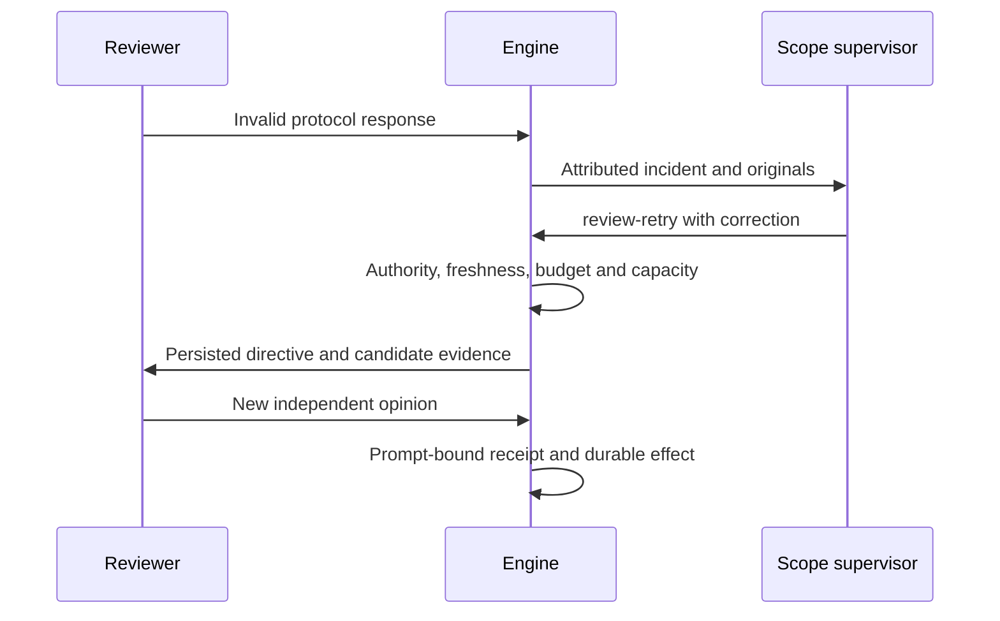

`TestPlanningReviewRetryDeliversSupervisorCorrectionAfterReopen` exercises this
chain using a provider subprocess double in an isolated store, including reopen,
actual receipt and durable final result. It proves neither real-model recovery nor
global incident handling. Method changes that create a fresh review and other
incident classes still require implementation and verification in T3–T7.
This regression cannot establish global completion.

## Adverse local opinion and whole-candidate decision

The journal retains a local `changes_requested` opinion without deciding for the
final reviewer. Remaining packets are inspected; selection and final review
receive original defects and an attributed question per artifact. Confirmation
or refutation requires relevant originals. Any unresolved finding prevents
acceptance. The engine checks coverage and quotations; semantic judgment belongs
to the reviewer and work direction to the supervisor. Fresh checks and publication
guards remain mandatory.

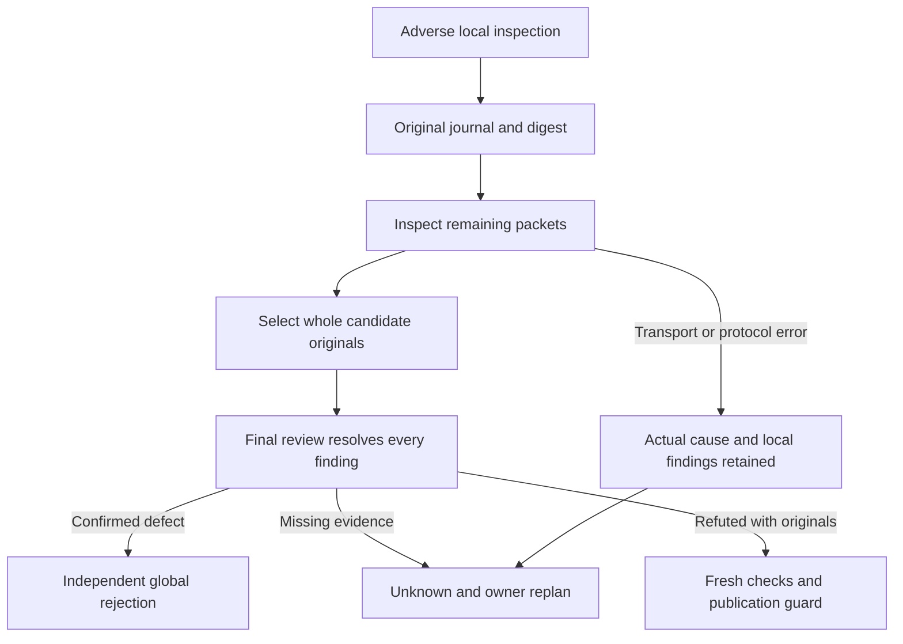

Isolated regressions cover final rejection, refutation using actually received
originals, interruption after a local opinion and retained spending/history.
They use a provider subprocess double; receipt and decisions by a real model in
the mission remain unproved. Acknowledging an incident does not mean its defect
was corrected; this separate recovery boundary remains tracked. No completed
global function is claimed.

## Acknowledgement retains the obligation to correct an incident

An operation-free decision acknowledges an event; it does not resolve its error.
When a fresh current public input produces another activation, the engine
separately supplies `unresolved_review_incidents`: acknowledged original events
whose protocol error remains current for the same task, attempt, candidate and
scope. Their prior decisions are preserved and never reintroduced in
`input_events`.

The persisted `unresolved_review_sources` receipt binds those exact identities.
`review-retry` requires that receipt, received fresh input, a new relevant
correction, intact proofs and current authority/budget. Semantic rejection, stale
events, foreign scopes and held tasks cannot use this path. The reminder alone
never wakes a scope or automatically retries an unchanged action. The supervisor
chooses the correction. Production reservations remain unchanged and the initial
acknowledgement remains immutable.

Storage contract 29 protects the new binding from v28 decoders that might discard
it. Public migration preserves mission bodies and creates a private backup;
stop old processes after verifying idle actors first. Each write checks the
version inside its transaction. Restart/migration are not recovery evidence:
verify actual receipt, decision and provider input, then the durable effect.

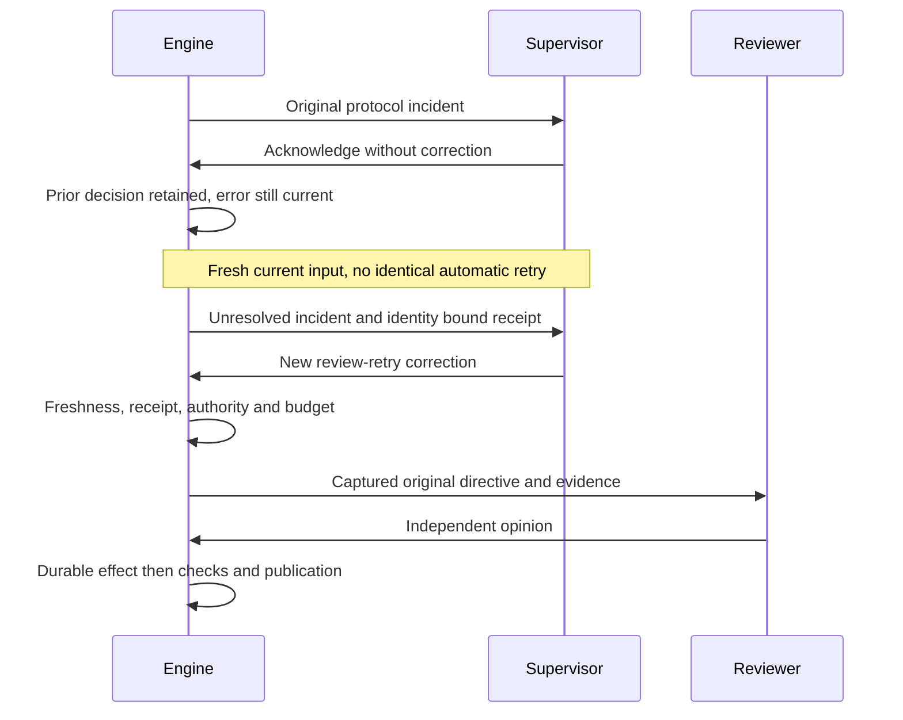

The isolated public regression covers acknowledgement, resume, reopen, fresh
receipt, decision, actual provider subprocess input and durable final opinion.
Stale/foreign identities, an unreceived candidate and migration are checked
separately. The provider is a double: real-model native recovery and completion
through RETEX remain unproved.

## Recovery after a local opinion and a later error

When a packet contains a completed adverse local opinion and a later call fails,
the actual failure remains `error`. Recovery preview and the public transaction
may reuse that opinion on the same intact plan without recharging or promoting
it into a global verdict. Only missing inspections and necessary final calls are
resumed. Interrupted reservations stay consumed and old journals stay immutable.
The final reviewer may confirm the defect; recovery never presumes success.
A completed semantic rejection does not become a resumable transport error.
Existing candidate, proof and budget guards remain mandatory.

Reply diagnostics also distinguish absent quotations from `v=inspected` with
nonempty `n`. For that mismatch they supply affected artifacts and require
`n=[]`, or `unknown` with a precise request. They never falsely label the original
quotation or prescribe a favorable opinion.

The isolated regression covers original local opinion→transport error→public
preview→authorized retry→reopen→selection and independent global rejection.
It checks original bytes and exact additional calls. Responses are doubles.
Native execution and other incident classes require separate evidence. Complete
suite failures remain retained; a strengthened historical assertion describes a
missing review instead of a nil panic without weakening quotation guards or
attributing an unobserved cause.

## Correct general evidence and capacity boundaries

A durable correction fixes the failing contract without mission, date or
incident-text exceptions. Native cases reproduce the cause; regressions also
cover different candidates, both supervisor levels, recovery and invalid inputs.

`review_evidence_inventory` reads the original context already admitted by review.
Recovery handoff admission limits do not apply to that context. Its dedicated
reader streams and authenticates the whole regular file, then authenticates the
complete decoded JSON stream through EOF again, bounded by the verified original
size. Changed digests, foreign candidates, trailing data and inconsistent sources
prevent attestation. Supervisors receive paths, Git objects, hashes and sizes;
original sources are never silently truncated.

On fresh admitted input, `acknowledged_current_review_evidence` retains read-only
originals of current `unknown`, `changes_requested` and `error` opinions for the
same task, attempt, result event and scope. Prior decisions and source inventories
remain attributed. This knowledge does not wake a scope, enter `input_events` or
create `review-retry` authority. Protocol recovery still requires the persisted
`unresolved_review_sources` receipt. Semantic rejection is not a protocol error.

Final evidence selection measures remaining space using validated, immutable
partial replies, including actual questions and findings. Speculative future
finding reserves still protect pre-call admission; after reception they cannot
hide available space. The complete final message is measured again against its
byte/token transport contract before spending. Genuinely oversized necessary
evidence remains `unknown`, without omission or automatic approval.

Final journal version 3 separates transport units: `selection_bytes_limit`
is UTF-8 bytes, while `selection_tokens_limit` and associated costs use the
plan's attributed tokenizer. Selection receives whole-original and JSON-envelope
costs in both units. These costs guide the proposal; exact final-message validation
remains mandatory before reservation. Existing transport margins remain distinct
from operator policy. This correction does not raise any model limit.

Versions 1 and 2 reconstruct their original prompts, replies and spending exactly.
Paid journals are never rewritten with new capacity. Version 2 measures received
inspections but conservatively treats each remaining token as one available byte,
which can underuse context. Unknown versions and prompts attributed to another
version are rejected. No mission storage field changes. Install the new engine
with no active internal call or producer before creating version 3 journals.

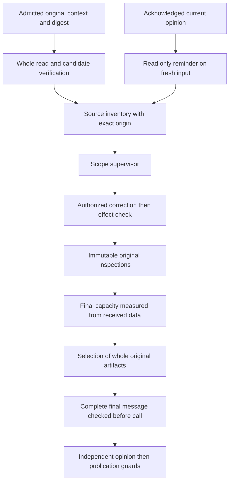

Isolated regressions reproduce both omissions for root and child supervisors,
reject stale/foreign origins and implicit retry authority, and cover large admitted
contexts and invalid files. Another test proves a whole artifact fits the actual
final message despite speculative-budget rejection. Real transport limits and
historical journals remain checked. Qualification is not evidence of autonomous
native recovery for every incident class or mission acceptance through RETEX.

## Restart historical selection after a verified capacity correction

`review_selection_capacity_changed` requires an attested version 1 or 2 final journal
ending at selection-stage `unknown`, with no final task verdict, all original
inspections reusable and a calculated capacity increase under the current contract.
Reason wording grants no authority. Candidate, contract, attempt, provider, model,
review method and evidence remain intact. Version 3 selection uncertainty
and final task uncertainty or rejection cannot use this route.

A fresh persisted delivery binds the exact original, including an acknowledged
result, and supplies before/after capacity. The owner proposes `review-retry`
with a new corrective instruction. At commit, the engine rechecks evidence,
authority, budget for two final calls and confirmed producer termination using
the existing transaction connection. Delivery cannot reacquire the database
connection it already holds. Projection and decision spend no reviewer calls.

The old journal, unknown result, acknowledgement and spending remain unchanged.
A new version 3 final journal receives the identified decision for selection and
the final reviewer, using immutable inspections without further production.
Operator recovery requires explicit confirmation through the public operation.
Changed evidence and unchanged preconditions remain refused. An independent
rejection remains a rejection; recovery creates no acceptance.

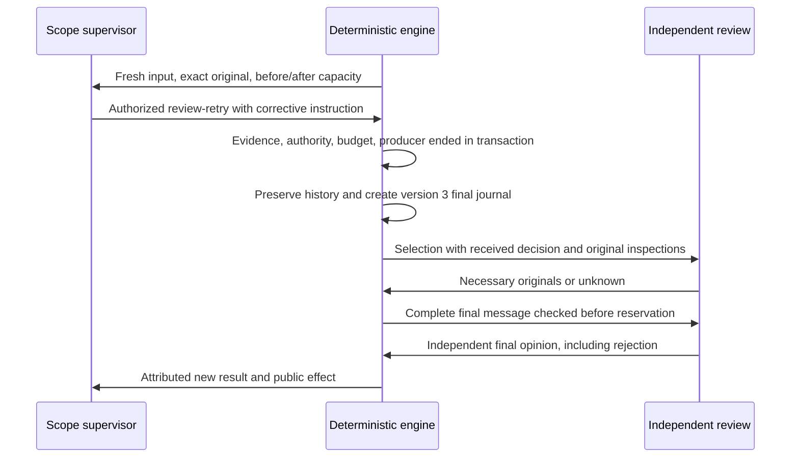

The regression follows delivery→decision→store reopen→two real simulated review
subprocesses→independent rejection for root and child supervision. Invalid ownership,
historical delivery, insufficient budget, active or still-live producers, replaced
proofs/model/contract/attempt and stale decisions remain refused. This recipe is
neither a real-model review nor native acceptance.

## Prevent recurrence in future tasks

Codex and Claude share the personal requirement for general corrections. Swarm
supervision and execution also receive it in their framing: preserve the original
counterexample, check variants and invalid inputs, transmit learning and verify
its effect. The supervisor uses authorized `revise-instructions` for future tasks;
users retain their rejection choice. Temporary measures remain explicitly temporary
and keep the underlying cause open. A durable correction requires non-regression
and observed delivery→decision→application→effect. The already-started review method
remains unchanged so its historical evidence stays verifiable.

## Resolve a question using the contract actually supplied

The final review message supplies each task's current contract: identifier, title,
deliverable and criteria. A question about scope or an assigned criterion can be
resolved with a literal quotation of these fields. Validation must recognize the
exact supplied JSON bytes, including escapes, without admitting producer, previous
review or inspection opinions.

A contract does not prove its implementation. Business `pass` validation still
requires visible candidate, report or control evidence. The projection allowed to
resolve that question remains separate and is never added to implementation
sources. Obsolete criteria, paraphrases and absent evidence remain refused.
Independent findings and outstanding questions retain their effect; there is no
implicit operator acceptance.

The counterexample retains the original JAN/FEB criterion quotation and exercises
French/English, quotes, special characters and a newline. Guards reject opinions,
obsolete contracts and invention; they also reject compliance based solely on a
contract. This local correction does not yet prove native recovery.

A whole selected source carries its text inside a JSON transport wrapper.
Quotation validation also recognizes the original bytes authenticated by that
wrapper's size and digest, consistently with local-defect line validation. It
preserves original kinds and boundaries: code and data remain literal; only existing
Markdown prose presentation allowances remain, outside fenced code. It never
consults an unselected source body. Regression coverage includes quotes, special characters, newlines and tabs,
and refuses a paraphrased or unsupplied version of the same text.

Joining report, code and JSON under one Markdown label would incorrectly allow
code reformatting or a quotation crossing two originals. Validation therefore
receives separate typed artifacts; regressions refuse both while preserving
allowed prose formatting. Worker framing retains evidence fields and role limits
while removing repeated wording; reviewer and supervisor framing stay unchanged,
without raising the limit or truncating methods.

## Qualify the resources actually embedded in the executable

Copying only an old manifest's paths can omit a `go:embed` resource required for
compilation. The current inventory therefore supplements historical inputs with
`go list -json .` and its `EmbedFiles`, then freezes their hashes. This covers
embedded configuration, schemas, instructions and web files without a second list
of assumed names. Historical manifests and results remain unchanged; a new
inventory does not renew their acceptance. Observed user inputs are not changes
attributed to the operator.

## Align finding states with their supplied schema

A native inspection can be rejected because its shape is contradictory: claiming
`inspected` while requesting additional originals. A valid anchor does not remove
that contradiction. Diagnostics distinguish an absent quotation from a state
incompatible with its needs; the engine never converts either into a favorable
opinion. Uncertainty remains `unknown`; defects still require their original and
reproduction.

New packets bind `finding_contract_version=1`, independently from plan, reuse and
input-budget versions. Their schema separates two shapes: `inspected` supplies
`v/r/e` without `n`; `unknown` or `fail` supplies `v/r/e/n`. Union definitions are
shared rather than repeated for each original. An absent marker preserves the
exact historical schema and prompt; valid historical findings remain readable
and authenticated against their original. Unknown markers are rejected. Parsing
also retains original-evidence guards and rejects contradictory legacy shapes
after transport.

[Anthropic documents](https://platform.claude.com/docs/en/build-with-claude/structured-outputs)
`anyOf`, local references and transformation of unsupported constraints. Structural
field omission avoids relying on `maxItems=0`. An independent JSON Schema oracle
checks the native counterexample, valid mixed states and invalid inputs. Local
validation does not establish provider behavior: reception of the new contract,
a fresh response and its native effect still require observation.

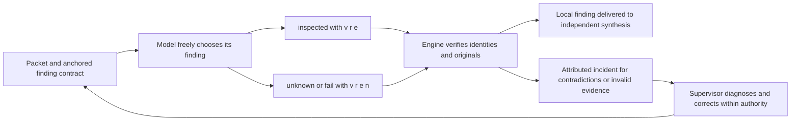

The same principle applies to supervisor decisions. The current schema separates
each operation kind: `review-retry`, `revise-instructions`, `continue-run`,
`stop-run` and `retry` offer only `kind/id/next`. A title or requirements added
to a review restart are rejected by structured generation, matching the existing
execution contract. `task`, `delegate`, `review-plan` and `close` retain their
own fields. Availability restrictions and received event identifiers remain
bound to the current batch; retries and closure gain no automatic authorization.
The complete older wire format remains readable as a historical representation.
The native counterexample and nine valid shapes are checked independently by
the schema oracle; only a newly received and applied decision establishes the
actual supervisor effect.

## Exact quotations with computed physical locations

A native finding quoted `+exit=1\n` exactly at the correct line; after trimming,
it contained7characters. The historical minimum8 rejected it with a misleading
absent-quotation message. Another finding quoted existing text but supplied the
wrong patch line. Original refusals remain preserved; correction never turns them
into accepted opinions.

The independent `defect_citation_contract_version=1` marker removes `line` from
new defect generation. The model supplies artifact, exact quotation, explanation,
reproduction and expectation. The engine authenticates the artifact, requires a
unique occurrence and computes then rechecks the physical line. It repairs no
bytes: whitespace, patch signs, line separators and Unicode remain original.
Short nonempty quotations are usable when unique; absent or ambiguous quotations
remain rejected. Ambiguity requires a more specific quote or an `unknown` finding.

An absent marker retains the historical schema, prompt and location requirements.
Length and location errors are now distinguished. An interrupted review under the
old contract requires an explicit complete restart: old findings, packets, journals
and consumed calls are retained, with no opinion reuse under the new contract.
Completed historical opinions keep their own contract. Reviewer/planner methods
are not rewritten. Computed location proves presence, never a business defect;
independent review and supervisor remain responsible for that assessment.

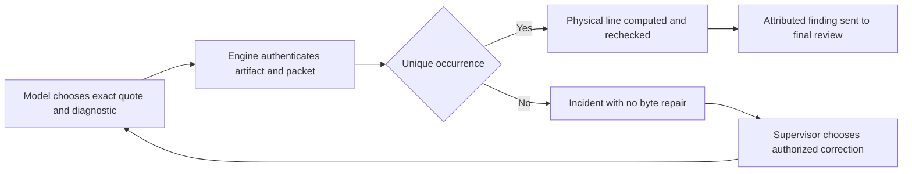

Under the new contract, one artifact may contain several distinct defects within
the existing total reserved capacity. Every claim retains its unique quotation,
cause, reproduction and expectation; an identical repeated claim is rejected.
The older one-defect-per-artifact restriction remains historical.

## Armed retries and separate pause controls

Mission pause (`paused`) and planning pause (`Planning.Paused`) are distinct
authorizations. A public retry can retain a result during maintenance; it must
start neither controls nor a review call while either pause remains active.
Settlement retains the `integrating` intent, evidence and consumption counters,
and the conductor reexamines it after resumption. A deliberate pause does not
become a candidate defect.

Example: the mission has resumed while planning remains paused. Previously, batch
review could spend a call, whereas fragment initialization rejected a stale
preparation and cancelled the armed intent. The shared integration gate now
retains the result in both cases. Once both pauses clear, the same candidate
undergoes controls and independent review; no production or acceptance is invented.

The regression uses the public `retry-review` POST, all three pause combinations,
two conductor passes, partial then full resumption, and a second settlement after
verdict. Its reviewer is a deterministic test subprocess: assertions on counters,
identity and preservation do not establish autonomy of a real provider.

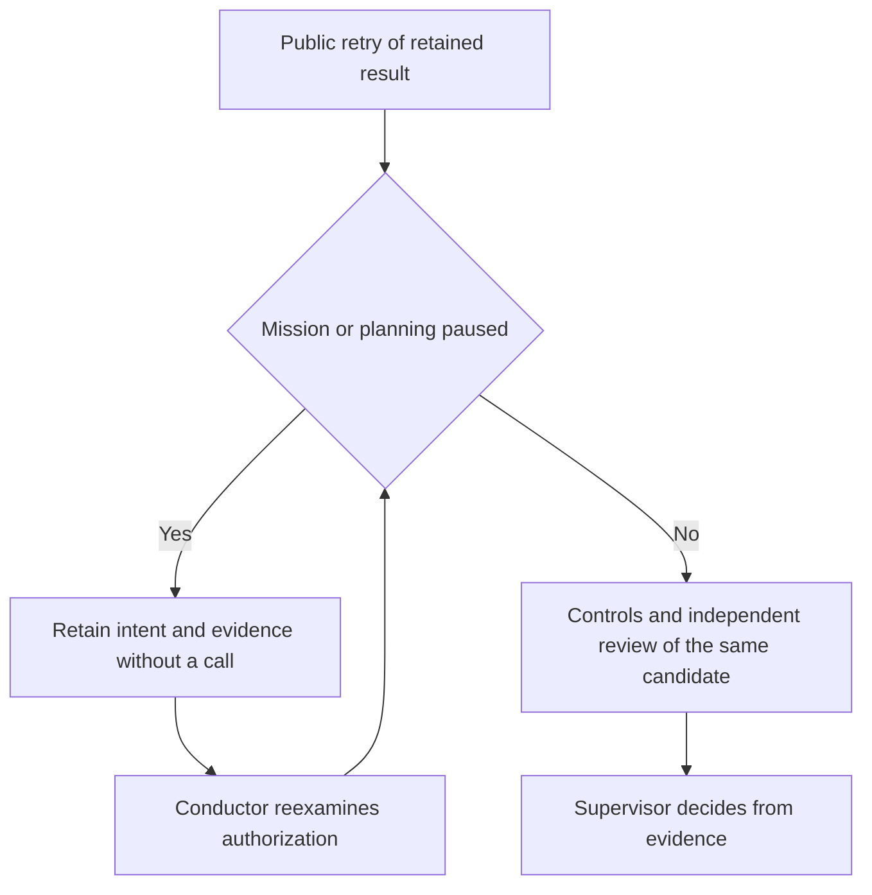

During installation, the operator reads both pause controls publicly and checks
the actual effect of resumption. HTTP200 or supervisor activation does not prove
that review restarted. This gate covers settlement entry; it does not establish
every concurrent race after admission. An existing incident or interrupted
review retains its explicit resumption condition.

## Retained-result controls with an explicit runtime allowance

Use the existing persisted Admin **role** scope, key `validation`, mission and
`tool_seconds` to configure deterministic control execution time. Without an
explicit duration, each approved control keeps its original timeout. Other agent
limit fields do not apply to this role. No new duration threshold is introduced.
Approved policy and criteria remain unchanged. Each receipt records the outer
allowance in `runtime_limits`.

For `go test`, a second explicit Admin **role** scope, key `validation-go-test`,
uses `tool_seconds` for the internal harness deadline. It must be strictly below
the explicitly configured outer allowance; their difference is the observable
startup and compilation margin. Without this second configuration, command arguments
remain unchanged. With it, the adapter replaces only `-timeout` or forwarded
`-test.timeout` after `-args`, or adds an absent Go deadline. Program, test selection,
business arguments, criteria and historical control stay unchanged. Receipt `command`
shows actual executed arguments; `command_runtime_limits` retains the internal
configuration revision and actor. Both configurations enter the reservation hash;
changing either invalidates the reservation. Other programs retain their arguments:
this adapter makes no claim about their internal deadlines.

Storage contract 31 fences this attributed receipt against older writers. Upgrade
uses the public CLI without rewriting existing works. The original T3 case, outer
180 seconds with `go test -timeout 25s`, explains why increasing only the outer
allowance was insufficient. Those values are historical observations, never new
engine defaults.

After an attributed control failure, public `planning retry-integration` can
resume the **same recovered result**, without another producer. Its request binds
work, task, agent, attempt, result, expected base and `confirm_recovery: true` to
an explicit allowance newer than the failure. Original diagnostics, refused
candidate, attempts and consumption remain intact. Stale binding, missing or
unchanged allowance and an existing review checkpoint are rejected. The budget
hash is checked during reservation and again before integration; a subsequent
change requires diagnosis and a new explicit request. Cumulative controls and the
required independent review run normally. Recovery supplies no favorable verdict
or acceptance.

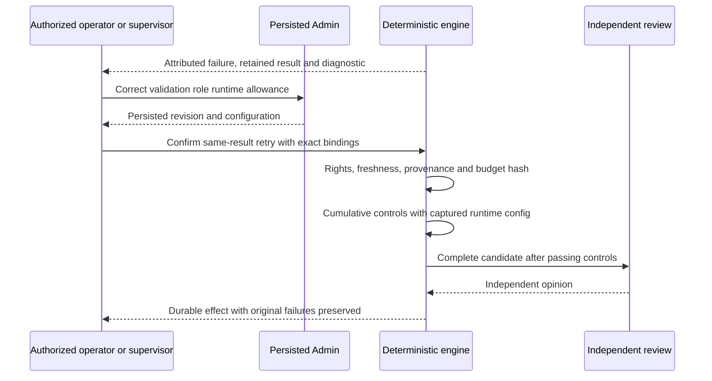

Infrastructure supervision is documented in [RUN-SUPERVISION.md](RUN-SUPERVISION.md). Control recovery alone does not establish autonomous real-model repair of the execution environment.

## Original failed-control evidence through a public read

Authenticated `GET /api/v1/control-diagnostic?work=…&task=…` returns the original
control linked to the currently blocked result: command, retained base64 output,
hash, exit status, timestamps, applied runtime allowance and capture bounds. It
accepts no arbitrary private path. The engine checks work, task, producer, attempt,
current conflict, approved command, retained candidate, hashes and read freshness.
Reading changes no work, spends no call and supplies no correction or acceptance.
Missing historical output remains missing; bounded capture is not represented as
complete original output beyond that bound.

A file reference alone does not deliver its contents to a tool-free supervisor.
An operator can inspect this public evidence then send diagnosis and originals
through an authorized handoff. This API alone does not establish automatic delivery
in every role context or autonomous real-model judgment.

### Inventory an unreviewable candidate without authorizing its review

Review preflight and recovery inventory serve different purposes. Binary changes
remain refused by a text-only reviewer and imply no verdict. `scope-preview` and
explicit correction preparation may inspect the retained candidate after checking
ended production, result attribution, checkpoint and every successful control.
The context is marked `inspection_only`; all paths, criteria and the evidence hash
remain present without a dropped binary, paid call or mutation. Altered receipts,
failed controls or replaced attribution are still rejected. Ordinary retry and
text-review batches keep their binary refusal. The owner chooses an explicit,
traceable scope repair or an appropriate review mode. Inventory is neither
acceptance nor visual examination; deferred work and its origins remain intact.

## Review retry after an already relayed handoff

`planning retry-review` queues the current immutable result for integration after
fresh public authorization and preflight. The conductor applies that intent even
when a completed agent has already relayed its handoff. Original relay history
remains intact; it is not sent again. Interrupted agents additionally need an
attributable recovered result. An older attempt cannot resume the current result.

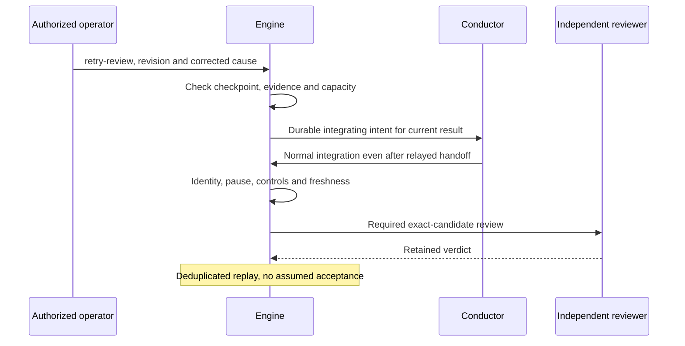

Mission **and** planning pause remain authoritative, including at publication.
Manual mode prevents new starts; it does not automatically settle ordinary
handoffs. An explicit public retry (`retry-review`, recovered-result repair,
`retry-integration`, or `requalify`) records local consent for one current result:
task, agent, attempt, result commit, accepted base and contract. Consent is tied
to the local mission permission and retained outside exported Work authority.
Revoking then reauthorizing a mission requires fresh result consent. Changed
result, base, contract or attempt invalidates consent. Other tasks retain their
own permissions; this operation raises neither autonomy nor budgets. The conductor
checks permission before execution and atomically at publication; fresh checks
and required independent review still apply. Publication
and review locks, checkpoints and reservations protect replay. The regression
`TestDurableCoordinatorExecutesAuthorizedReviewRetryAfterCompletedHandoff`
reproduces ignored intent, then checks application and a second replay without
another call. Its reviewer is deterministic, not a real provider; native effects
are recorded separately in the mission replan.

`TestManagedReviewRetryIsExplicitlyAuthorizedInManualMode` checks public recovery
without a new producer; `TestManagedManualSettlementRequiresFreshLocalResultSpecificConsent`
covers rejection without calls; `TestManagedPlanningPauseDuringReviewPreventsPublication`
pauses planning during a real fixture reviewer process. Ordinary, batch and
fragment reviews respect pause; spent reservations are never refunded. An unpaid
intent already queued may receive fresh public authorization after its complete
checkpoint has been verified.
