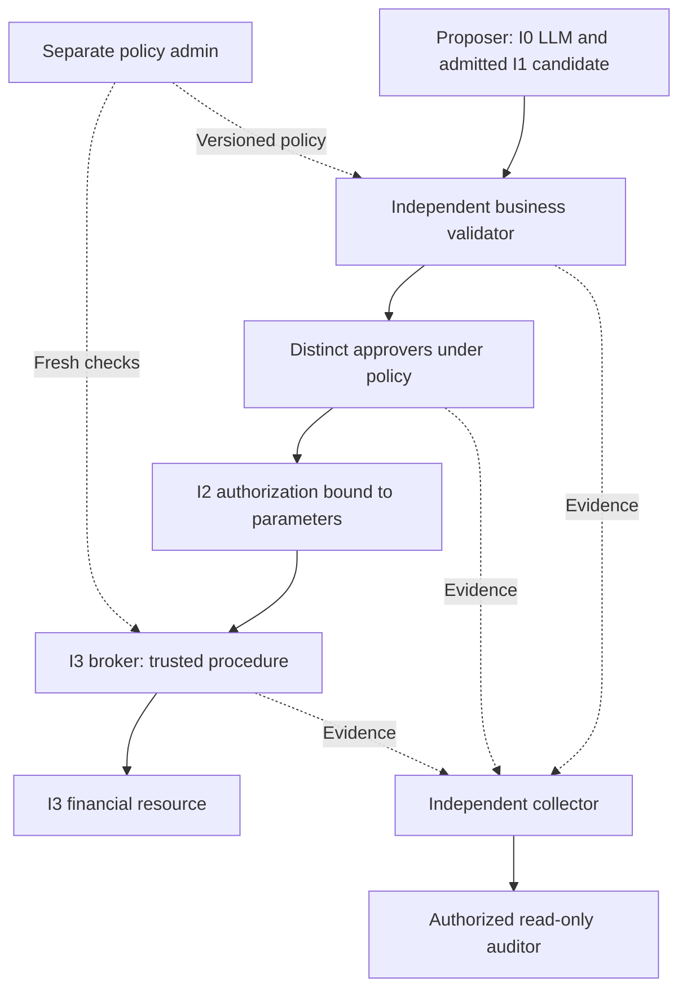
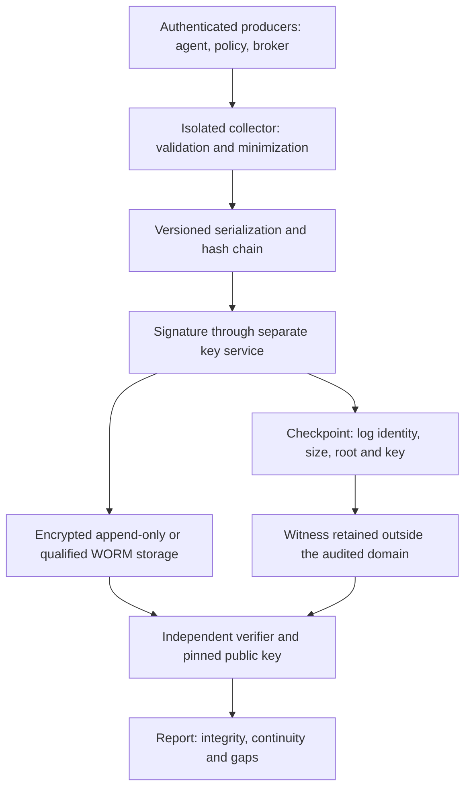

# Biba — separation of duties and audit evidence

[Rust candidate and Admin contract](BIBA-GOVERNANCE-RUST.md)

[Financial examples](BIBA-AGENTS.md) · [Rust contract](BIBA-RUST.md) ·
[Français](../architecture/BIBA-GOUVERNANCE-AUDIT.md)

This reference architecture extends the refund and supplier invoice examples.
It does not declare a real banking connector, WORM log or external signing
service installed in Swarm. Levels describe objects; the LLM remains I0.
A trusted procedure creates a validated decision without promoting the model.
An I3 write needs a privileged broker and a controlled procedure, not ordinary
I2 access to I3.

## Separate incompatible duties

Biba controls integrity flows; separation of duties is a complementary policy.
NIST AC-5 calls for identifying duties requiring separation and defining access
authorizations accordingly. The strict matrix below is an **example financial
policy**, not a universal requirement derived from Biba.
[NIST SP 800-53 Rev. 5, AC-5](https://nvlpubs.nist.gov/nistpubs/SpecialPublications/NIST.SP.800-53r5.pdf#page=63)

| Role | Function | Incompatibilities in this example |
| --- | --- | --- |
| Proposer | Prepare a proposal from I0 sources | Cannot validate, approve or pay |
| Business validator | Check references, matching, IBAN and duplicates | Cannot create the obligation, approve or execute |
| Approver | Authorize exact parameters under policy | Cannot change invoice, IBAN or rules, or pay |
| Executor | Revalidate and apply an action-bound authorization | Cannot decide, approve or modify the order |
| Policy admin | Administer thresholds, destinations and rules | Cannot authorize an operational transaction |
| Auditor | Examine authorized evidence and exceptions | Cannot modify transaction, policy or approval |

Example matrix for one transaction (`X` = forbidden combination):

| | Proposer | Validator | Approver | Executor | Admin |
| --- | --- | --- | --- | --- | --- |
| Proposer | — | X | X | X | X |
| Validator | X | — | X | X | X |
| Approver | X | X | — | X | X |
| Executor | X | X | X | — | X |
| Admin | X | X | X | X | — |

Under this policy, each pair of distinct operational roles is incompatible on
the same transaction. Multiple approvers must also be distinct. The invoice
creator or supplier-reference editor cannot approve the related payment.
Checks cover canonical principals, their accounts, delegations and initiating
principals: two identifiers or two agents controlled by one person do not prove
independence. Separate identities and processes reduce technical accumulation
of authority; they do not remove collusion risk.

The policy engine and broker check incompatibilities on assignment, approval
and immediately before the effect, under current authority. Delegation limits
permissions to the delegator's rights and the task; it never increases them.
A model-declared role grants no authority. “Approved” alone is insufficient:
content, scope, expiry, revision, separation and absence of a prior effect must
remain valid.
[OWASP — high-impact action controls](https://cheatsheetseries.owasp.org/cheatsheets/AI_Agent_Security_Cheat_Sheet.html#high-impact-action-integrity-controls)



Urgency does not waive incompatibilities. Use a recorded backup delegation,
justification and attributed review; otherwise queue the request. A new IBAN
needs independent out-of-band verification before readmission. A late conflict
closes execution; it does not give the LLM permission to rewrite its own
authorization. Retaining reads after write revocation depends on remaining
rights and Biba, never on an automatic fallback.

## Build a transactional evidence chain

Audit links who requested, proposed, checked, approved and executed, on which
objects and parameters, under which policy and with which outcome. The collector
authenticates producers and distinguishes their claims from its observations.
A model assertion is not evidence of independent validation.

| Illustrative event | Minimum information to link |
| --- | --- |
| `input.received` | Source, original reference and digest, analysis outcome |
| `llm.proposal` | Agent, observed model route/version, input and proposal digests; I0 output |
| `candidate.admitted` | Admission procedure, new I1 object, retained original |
| `policy.evaluation` | Policy/revision, rules, business references, verdict and reason |
| `approval.requested` | Exact action, required roles, expiry and bound parameters |
| `approval.granted` / `approval.denied` | Principal, delegation, attested authentication mechanism, decision |
| `execution.precheck` | Fresh authority, I2 artifact, digest, expiry and separation |
| `tool.invoked` | Service identity, authorized tool/destination, idempotency key and correlation |
| `tool.result` / `execution.reconciled` | Native receipt, known or unknown effect, state reread without duplication |
| `policy.violation` | Refused control, incident and attributed follow-up |
| `log.access` / `log.admin` | Read/export, retention, rotation or audit service changes |

These names form an illustrative schema, not events/APIs already exposed by
Swarm. Do not record internal model reasoning or treat its confidence score as
authorization. A model route does not establish its actual version; retain only
what the provider or execution attests.

Conceptual event excerpt: the digests below are placeholders, not valid evidence.
The final contract must define types, required fields, checks and preimages
before implementation.

```json
{
  "schema": "example.agent.audit.v1",
  "log_id": "finance-audit",
  "sequence": "4821",
  "event_type": "execution.precheck",
  "occurred_at": "2026-10-27T12:03:00Z",
  "recorded_at": "2026-10-27T12:03:00.120Z",
  "transaction_id": "PAY-2026-00931",
  "attempt_id": "attempt-2",
  "actor_id": "payment-broker@svc",
  "initiator_id": "requester@corp",
  "agent_id": "agent.invoice-reader@svc",
  "action_digest": "sha256:...",
  "policy_revision": "payments-v12",
  "authorization_id": "apr-5521",
  "decision": "allow",
  "evidence_refs": ["invoice:INV-2026-0412", "approval:apr-5521"],
  "result": "precheck-only"
}
```

A positive precheck does not establish payment. Intent must be durable before
the effect and then linked to the receipt. Audit failure before the effect
closes the operation when that evidence is required; after the effect, retain
the known or unknown outcome and reconcile. Never translate a publication error
into “no effect”. Missing sequences, duplicates, losses and recoveries must be visible.

Reconstruct a flow by `(log_id, sequence)`, with numeric sequence ordering,
linking transaction, attempt and digests. Timestamps alone establish neither
causal order nor replay absence; multiple logs need explicit causal references.
A join on invoice number alone could accept another payment's approval.

Investigation checks to express in the actually deployed schema:

```text
For each financial invocation:
  find authorization by transaction + action_digest + policy;
  verify tool, destination, identity, delegation and validity at execution;
  count required independent approvers, excluding refusals and revocations;
  compare approved/executed amount, currency, beneficiary, IBAN and documents;
  verify idempotency key, receipt and reconciliation of every unknown outcome.
```

Missing human approval is not necessarily a violation when policy permits a
controlled automatic decision. Missing valid authorization, role conflict,
changed digest or out-of-scope call does require an alert. Cryptographic failure,
a silent log or unexpected administration access also requires investigation;
alert volume alone establishes neither an attack nor collection completeness.

## Cryptographically protect the log

NIST AU-9 addresses unauthorized access, modification and deletion; its
enhancements include write-once media, separate storage and cryptographic
protection. Select them for the context; they do not automatically certify a log.
[NIST SP 800-53 Rev. 5, AU-9](https://nvlpubs.nist.gov/nistpubs/SpecialPublications/NIST.SP.800-53r5.pdf#page=101)



### Canonical bytes and chain

Define a versioned schema, UTF-8 encoding, types and canonical serialization,
such as JCS. Reject duplicate keys; represent integers beyond interoperable JSON
precision as canonical decimal strings. A “deterministic” Protobuf option alone
does not guarantee a stable canonical form across implementations and versions.
[RFC 8785](https://www.rfc-editor.org/rfc/rfc8785)
and [Protobuf limitations](https://protobuf.dev/programming-guides/serialization-not-canonical/).

Observed timestamps are fixed at creation and included in the authenticated
envelope: **nondeterministic at collection does not mean excluded from hashing**.
Document the clock, drift and uncertainty. Excluded fields are not protected;
a signed local time does not establish third-party time.

Example construction requiring a complete specification before use:

```text
p_i = SHA256(canonical(event_i))
h_i = SHA256(encode(domain, schema, log_id, epoch, sequence, h_previous, p_i))
signature_i = Sign(key, encode(signature_domain, log_id, epoch, sequence, h_i))
```

`encode` must be unambiguous (types, lengths, order), domains distinct, the
initial value defined and identifiers covered. Never include `entry_hash` in
its own preimage. An unauthenticated chain can be entirely recomputed. Even a
signed chain does not reveal a removed tail or old authentic export without
an expected size/root acquired separately.

### Merkle trees, signatures and witnesses

For large volumes, a Merkle tree provides logarithmic-size inclusion proofs.
A consistency proof relates two sizes/roots of the **same append-only tree**;
signing independent batch roots does not automatically provide that proof.
Certificate Transparency illustrates these mechanisms; its protocol is not
adopted here as a financial log.
[RFC 9162, section 2.1](https://www.rfc-editor.org/rfc/rfc9162#section-2.1)

Sign entries or checkpoints with a versioned algorithm and encoding (for
example Ed25519 or ECDSA), binding `log_id`, epoch, size, root, algorithm and key
identifier. Acquire the public key and checkpoint through a trusted channel
distinct from the bundle being verified. Preserve old public keys and their use
periods; define rotation, revocation, compromise and historical verification.
A signature alone establishes neither commercial truth nor legal nonrepudiation.

A nonexportable private key in HSM/KMS or a separate service reduces exposure;
its calls also require authorization and audit. A compromised service retaining
signing permission can sign falsehoods. An external witness helps detect rewrite
and rollback under its own independence assumption. A second account administered
by the same authority is not automatically independent. Third-party time remains
a separate option requiring justification.

### Storage, confidentiality and retention

Separate producer, collector, signer, retention administrator and verifier.
The agent must not rewrite or delete its evidence; the collector must also
control additions to prevent forged events. An append-only API does not protect
against a storage administrator. A WORM mechanism must demonstrate which actors
are actually excluded, locking mode, duration, exceptions and verifiable restoration.

Encrypt authenticated transports and data at rest under security policy; key,
nonce, access and backup management belong to the contract. Encryption does
not prove log completeness. Fingerprints of predictable IBANs or personal data
are not anonymization: dictionary guesses may recover them. Prefer opaque
references or keyed fingerprints under separate control when needed.

Keep useful details in a separate store with audited access, without unnecessary
credentials, tokens, sensitive prompts or raw content in the audit. An auditor
does not bypass Biba merely by being read-only: extraction must follow the
specified rights and trusted export procedure.

Retention duration, batch size/frequency, periodic verification and unavailability
response are **operator choices** to persist and expose with shared API/CLI/Admin
validation, not constants such as “five minutes”, “one thousand events” or
“once daily” copied from an example. Expiry does not authorize deletion; preserve
applicable protections and holds. This page adds no automatic archival or purge.

## Verify audit and recovery

The deployment recipe must cover a valid control before each fault injection:

| Check | Expected outcome |
| --- | --- |
| Alteration, reordering, internal omission, duplicate | Refusal with safe position and cause |
| Truncation or old signed bundle | Refusal against a separately acquired checkpoint |
| Wrong key, epoch or log | Refusal without trusting the bundle's supplied key as authority |
| Rotation, revocation, lost material | Explicit historical policy applied, never silent fallback |
| Failure before/after effect, recovery and replay | Outcome retained, receipt reread, no double payment |
| Full storage, unavailable collector | Visible loss/gap and response under persisted policy |
| Restoration and reopening | Bytes, sequences, signatures and witnesses remain verifiable |
| Audit read/export/admin | Attributed, restricted access that is itself audited |

The verifier checks bytes, signatures, links, inclusion/consistency where used,
independent checkpoint and expected business-flow completeness. Valid cryptographic
evidence does not prove that the producer sent every real event. Track counters,
losses and collection gaps. Auditing the audit must avoid infinite recursion:
a distinct plane records log access, with explicit policy for its own accesses.

## What Rust actually supports

`rust/crates/swarm-engine/src/trust/proof.rs` retains historical export v2,
originals and a schema-1 HMAC-SHA256 anchor over sequence/hash, verified with a
separately acquired 32-byte symmetric key. HMAC is not a public signature:
a verifier holding the key can also generate a MAC. Without an independently
expected checkpoint, an old authentic export does not establish freshness.
The current core is not turned here into a Merkle log, HSM/KMS or WORM store;
historical Go mechanisms do not establish their Rust port or activation. See
the [current technical contract](BIBA-RUST.md#persistence-policies-and-errors).

The APEX candidate adds role separation, attributed transaction audit and the
Rust public-signature contract described in the
[governance contract](BIBA-GOVERNANCE-RUST.md). Source presence does not establish
installation; the plan records results and remaining limits.
