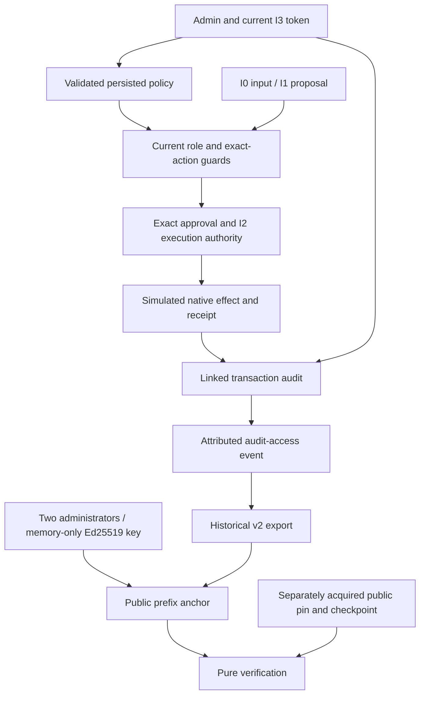
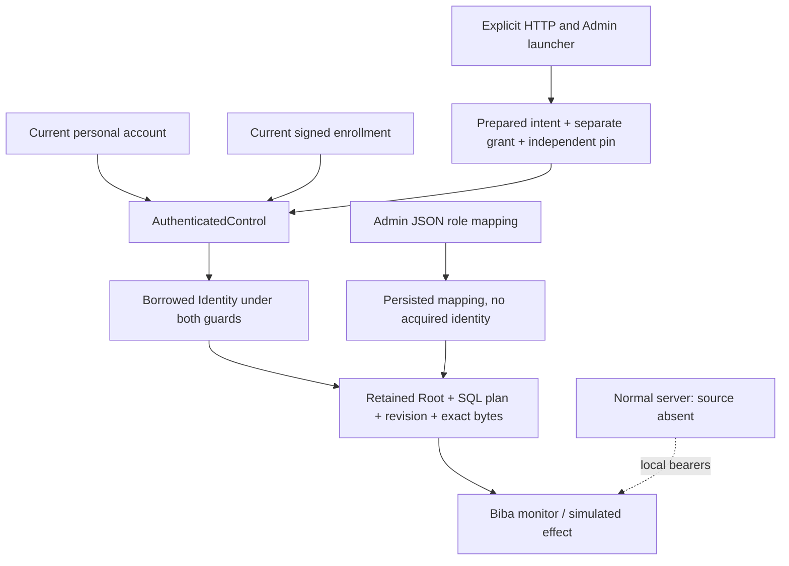
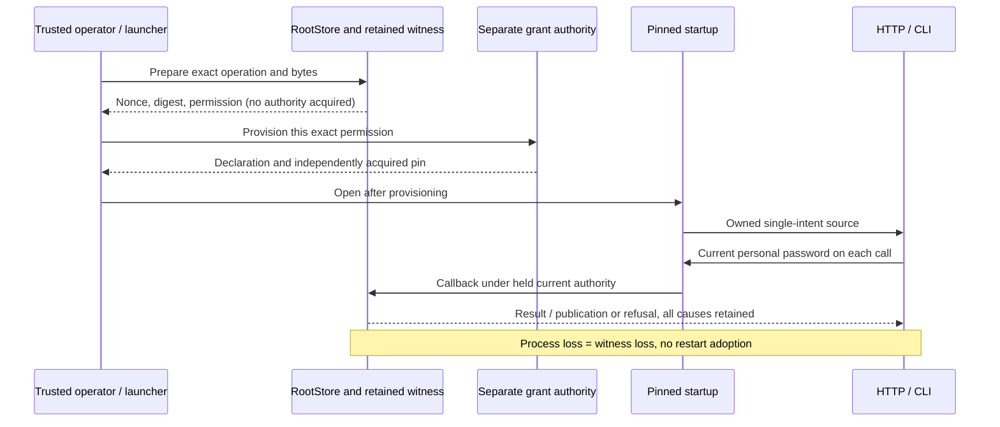

# Rust Biba governance — candidate contract

[Model and examples](BIBA-GOVERNANCE-AUDIT.md) · [Biba core](BIBA-RUST.md) ·
[Français](../architecture/BIBA-GOUVERNANCE-RUST.md)

This page describes the 27 October 2026 APEX candidate. Delivery is established
by the [plan and receipts](../plans/migration-rust/evidence/20261027-biba-governance-apex/PLAN.md),
not by this document. Effects remain simulated. General provider confinement,
external WORM storage and HSM/KMS are outside this increment's qualification.

## Policy and roles

`trust config-preview/config-apply`, the Trust API and Admin share validation.
After bootstrap, HTTP requires current I3/admin authority (local bearer, or current enrolled identity on the dedicated launcher) in addition to the native
session, Host/Origin and CSRF. The local operator CLI retains its existing route.
Complete proposals include the four historical policy fields and private identities.

Optional `role_separation` contains explicit `enabled`, `incompatible_roles`
(pairs of requester, approver, effect or admin), and `principals` (configured
subject to declared principal group). Pairs are symmetric, unique and cannot
contain the same role twice. An empty pair list explicitly adds no conflicts.
When enabled, every configured identity, including disabled identities, must
have a declared group. Names never establish human identity or independence.
Two subjects in one group conflict when they occupy an incompatible pair on
one transaction. These assertions cannot prove absence of collusion.

Omission preserves policy; null, unknown fields, duplicate keys, unknown roles
and incomplete enabled mappings refuse. Absence preserves historical hash bytes.
Checks precede admission, approval, effect and replay. Reconciliation reads an
existing effect. A fresh conflict records a denial without changing payment
state; an incompatible replay refuses without rewriting its original reply.
Admin supports pair selection, groups, preview, save and reopen. Refreshing the
subjects from the identity form does not copy tokens; private fields clear on close.

## Transaction audit

`trust audit-transaction --input query.json` and
`POST /api/v1/trust-actions?action=audit-transaction` accept only
`{"action_id":"stored-action-id"}`. Current I3/admin is required, including
`SWARM_TRUST_TOKEN` for the local CLI. The operation takes an exclusive reservation,
records `audit-access`, then returns a report. It changes neither action nor ledger.
An unwritable Root refuses rather than returning an unrecorded successful read.

The `trust-transaction-audit-v1` report distinguishes `chain_verified`,
`transaction_verified`, `complete` and `missing_evidence`. Completion requires a
known completed effect; pending and unknown results remain explicit. The original
mandate admission remains verifiable after revocation. `report_prefix_sequence`
identifies the prefix before this read. `audit_access` carries sequence, hash,
actor and exact report digest; `report_base64` retains those report bytes before
adding the access receipt. Compare this digest to the access event in a signed
export. Internal verification does not recursively log reads. This does not
qualify logging of all legacy routes or filesystem reads. Admin shows a summary
and collapsed technical details; missing links and errors remain visible.

## Public signing and key lifecycle

The existing `evidence_signing` block is now consumed: boolean `enabled` and
strictly positive integer `key_ttl_seconds`, even when disabled. Projection defaults
are disabled/86400 seconds. The 9223372036-second technical maximum preserves Go's
duration representation; zero does not mean unlimited. Omission or a null block
preserves the value. This permits on-demand prefix signing, not per-entry signatures.

A persistent service exposes these Admin/API and RootStore operations:

1. `evidence-key-prepare`: current I3/admin, one candidate, fresh memory-only private
   material, no private import/file.
2. `evidence-key-activate`: another current administrator and exact candidate/registry
   revision; declared principal separation also applies when enabled.
3. Rotation retires the former key, preserves its historical period and drops its
   private material.
4. `evidence-key-revoke`: attributed emergency revocation, even with signing disabled.
5. `public-anchor`: signs the current prefix under the active current-configuration
   key, within its validity period and only while private material is available.

Key changes require `schema_version:1`, `event_id`, `expected_registry_revision`,
`reason`, and `key_id` for activation/revocation. The public registry and decisions
persist and bind to the audit chain. Replay returns current public lifecycle;
it cannot reconstruct a lost private key. Memory availability differs from status.

Retained directory and SQLite descriptors bind keys to the opened Root instance
and prevent inode reuse while held. Preparation makes the process non-dumpable
and does not reverse this restriction. Seeds and keys zeroize on release. This
does not qualify swap, privileged tracing or general agent confinement. Restart,
expiration and configuration revision close signing without HMAC fallback. Stale
capabilities are removed when the process next observes this Root. Revoke an
unusable candidate before preparing another; there is no automatic regeneration.
A separate local CLI process cannot retain signing material for the next invocation:
use the persistent Admin/API service for this lifecycle; CLI also provides pure
verification and configuration. A reopened registry does not prove key availability.

## Independent verification and exact bytes

`public-anchor` takes `{}` and returns `trust-public-anchor-bundle-v1` with
`anchor`, `anchor_base64`, `export_base64`. Unpadded base64url preserves exact JSON
bytes, integers and historical raw contexts. Do not reorder or round those contexts.
Historical export v2 and schema-1 HMAC anchors retain their contracts.

`trust public-verify --input verification.json` works without Root or network.
Supply `export`, `anchor`, an independently acquired `trusted_key`, and optionally
`trusted_checkpoint:{anchor,trusted_key}` acquired separately. Omission produces
`checkpoint_verified:false`; null and incomplete checkpoints refuse. Rotation may
use different trusted keys for current and checkpoint anchors. Truncation and
divergence from that prefix refuse. Caller-supplied trust inputs do not establish
their own independence; copying them from an attacker-controlled bundle is unsafe.
Admin deliberately never autofills the public pin from the signed bundle.

The separate schema-1 domain is `swarm-rust-public-evidence-v1`. Ed25519 signs the
shared Go-compatible codec's typed object in this order: `domain`, `schema_version`,
`key_id`, `registry_revision`, `configuration_revision`, `sequence`, `hash`,
`export_digest`, `signed_at`. Signature is excluded from its preimage. Export digest
covers the complete typed v2 export and referenced originals. This is neither JCS
nor the historical Go public-anchor contract. Strict new decoding rejects duplicate
JSON keys at every depth and invalid Unicode without historical Go replacement.

Pins must be coherent, non-weak, activated and valid at signed time. Retired pins
verify in their historical interval; revoked pins refuse. An old offline pin
cannot learn later revocation. See [RFC8032](https://www.rfc-editor.org/rfc/rfc8032)
and [dalek 2.2.0 strict verification](https://docs.rs/ed25519-dalek/2.2.0/ed25519_dalek/struct.VerifyingKey.html#method.verify_strict).
These primitives prove neither cryptographic certification, third-party time,
physical immutability nor completeness of business collection.

## Architecture

The I2 decision authorizes a controlled broker path; it does not turn an I1
proposal into an arbitrary I3 writer. Group policy, exact approval and execution
authority are complementary controls. Real provider confinement is not established.

Reconciliation checks the receipt and current authority; participant separation
for the effect is established by the historical commit. Later group changes
must neither create another effect nor prevent authorized readback.

A missing target in a new command produces the ordinary attributed business
denial; a cached reply cannot replace absent current context. Revocation belongs
to the opened Root registry and does not remove another instance’s private key.
A copied registry never inherits that material. Actual local close failures
remain errors rather than successful empty results.

## Common identity integration

The normal HTTP server uses local Trust bearers. The explicit G05.3 launcher can bind the common source to one prepared intent. The native
`AuthenticatedControl::with_trust_action` callback reuses the current personal
account and signed enrollment. It creates no account. Its borrowed Identity is
neither cloneable nor deserializable and exists only under both held reservations.
Copied Principal/Head data grants no later authority. This kernel authenticates
humans; accepting a service data type proves no service integration. The groups
in role_separation.principals remain administrator declarations.

An identity declares subject, integrity and roles, plus either a local token or
an exact enrollment_principal (principal_id, human principal_kind, issuer,
subject). The latter prohibits every local token. Duplicate principal IDs and
issuer/subject aliases refuse. Mappings persist and appear in Admin, but do not
prove current authentication. Disablement and revision are rechecked natively.

`trust_enrollment_request` retains physical datastore descriptors and derives a
fresh binding for the exact signed effect.execute permission
`trust-action/<root-digest>/<operation>/<request-digest>`. No wildcard or
enrollment-config permission matches. Keep the witness through provisioning/use
and explicitly close it. Restart does not authorize adopting its old request.

`trust_as_enrolled` matches witness, operation and raw bytes, reserves the current
SQL plan with its recognized recorded projection (no conversion), checks scope,
revision and expiry, then uses the existing Biba transitions. Roles, exact
approval, mandate and idempotence still apply. New evidence records the actual
principal and current enrollment head. Legacy local contexts omit the new field
and retain their encoding; enrollment contexts require the current verifier.

Inspect Use.authority and Use.action independently, including personal AfterUse
errors. Late completion/expiry failures can coexist with a recorded result.
Never infer rollback or retry automatically. Panic promises no result; poisoned
guards fail closed and require exact business recovery.

The first native fixture verifies attribution, replay and refusal without
mutation. Broader checks and delivery are linked in the plan. Admin explicitly
shows the effective capability: absent on the normal server, or one bound intent through the explicit launcher. This is neither a second account
service, OS isolation nor global acceptance. The trust-identity-bridge recipe
covers ten startup tests and the anti-JSON doc-test; trust_enrollment tests
cover the Root consumer.

Additional SDK check: `tests/rust_trust_enrollment_sdk.py --profile BUILD_PROFILE --fixture-deps FIXTURE_DEPS_CACHE --output FRESH_EVIDENCE`. It compiles the financial test against library artifacts declared by that profile and retains current library hashes plus before/after sources. It does not manufacture an absent historical library hash or replace the executed-binary recipe.

### Shared invocation for the transport integration in progress

`Operation::parse` accepts only the thirteen signed operation names; aliases,
whitespace, historical reads and direct writes refuse.
`RootStore::call_trust_as_enrolled` composes the existing consumer with the held
personal/business guards. `TrustEnrollmentCallError` retains the complete action
result after completion failure, known publication and independent causes.
Consumers must traverse `branches()` and never infer rollback from an error.
These APIs neither provision rights nor bind an HTTP server source on their own.
Their verification and delivery remain tracked in G05.3 separately from the
running instance.

G05.3 binds one prepared intent per trusted launcher: `trust enrollment-call
OPERATION ABSOLUTE_DECLARATION --input REQUEST` or `trust enrollment-serve
OPERATION ABSOLUTE_DECLARATION [ADDRESS] --input REQUEST`. The public JSONL
`trust-enrollment-prepared` event exposes the exact permission to provision
separately, without issuing it. The process retains the witness throughout.
Private stdin then carries `swarm-trust-source-v1\n`, the 64-character SHA256
pin, `\n`, and the password for `enrollment-call` only, until EOF. Server mode
accepts no startup password: each call supplies `Authorization: Enrollment`
followed by unpadded base64url password bytes. Only the existing administered
loopback transport is provided. This server launches no mission conductor;
HTTP never selects declaration paths or pins.

Preparation has no queue, implicit deadline or restart adoption. A new instance
requires a new retained witness and exact grant. Saved transport policy still
applies. HTTP header/runtime copies are outside any OS memory-erasure claim.
The transport and real-browser checks are retained in G05.3, separately from real-source activation. HTTP200 business denials are displayed as recorded refusals; a failed readback preserves the received decision without automatic retry. G05.3 records actual verification
and installed versions separately.

The enrolled-action button is resynchronized after every local action and respects the current in-flight gesture. An absent, unknown or out-of-scope source stays unavailable after success or error in another form. This update changes neither the prepared operation nor private fields and never supplies server authority.

Local delivery: reusing an unchanged candidate also requires its retained qualification evidence. Missing proof requires a fresh build; incoherent proof refuses. A binary file alone does not establish a qualified reinstall.
