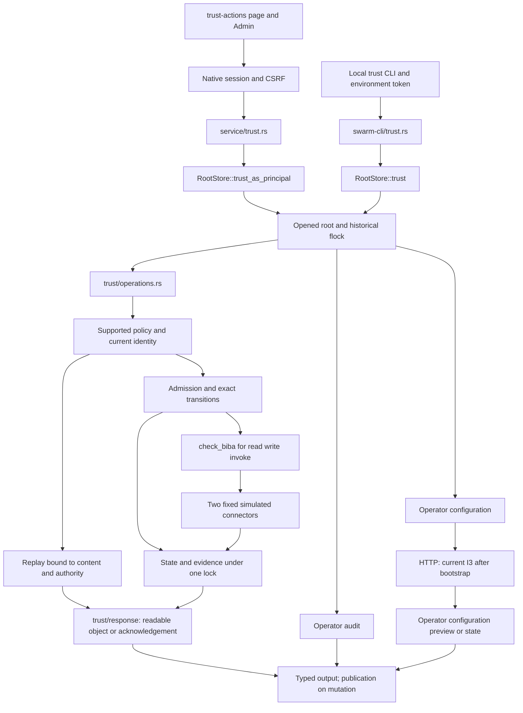
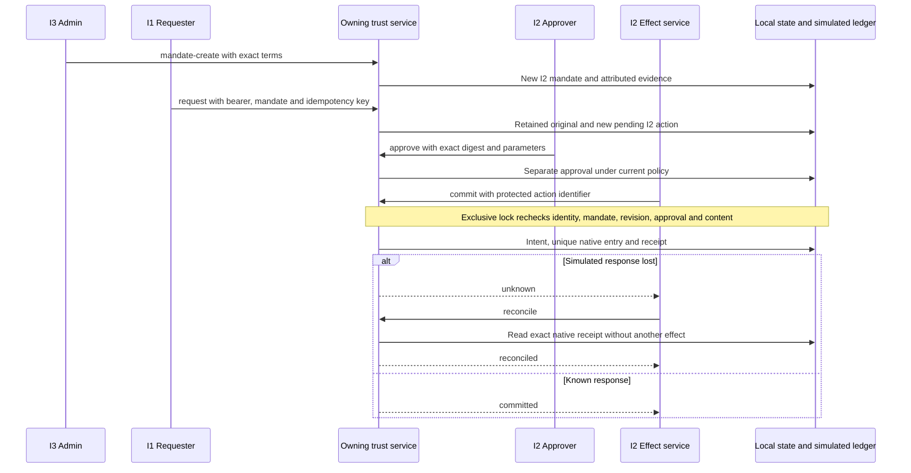
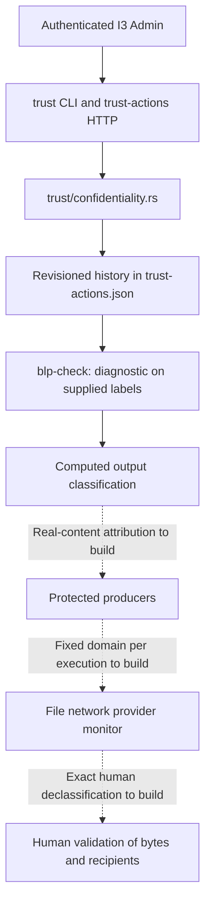
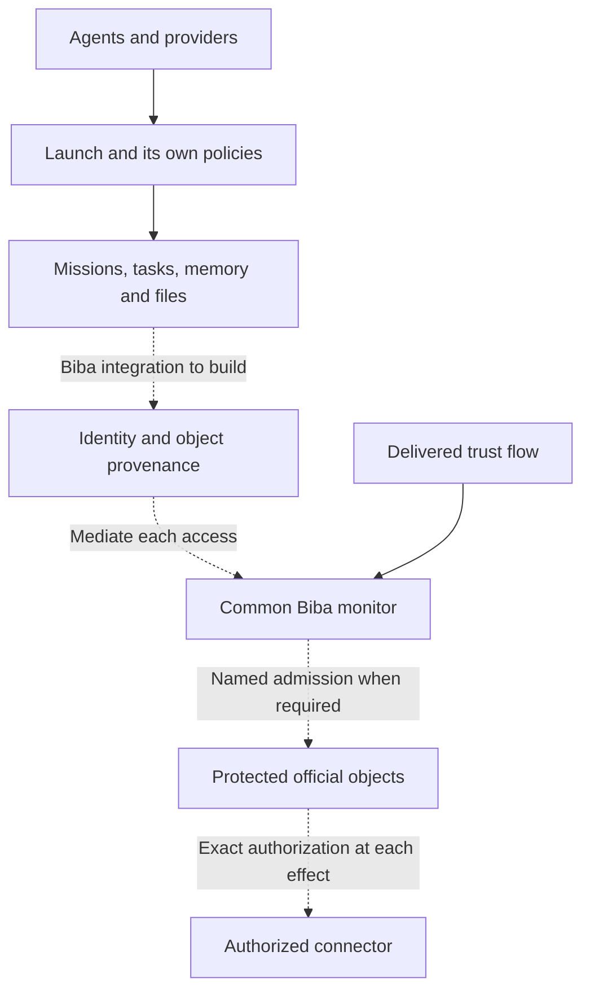
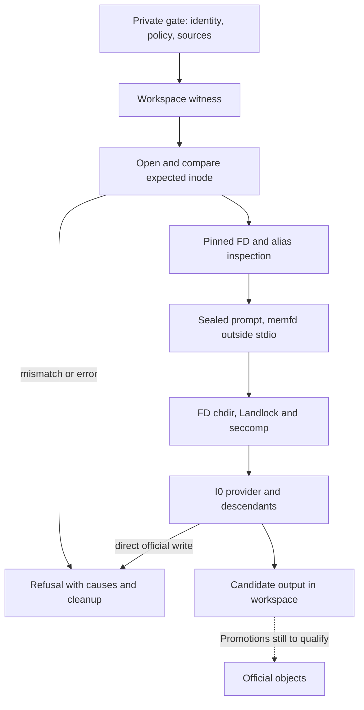
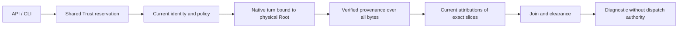
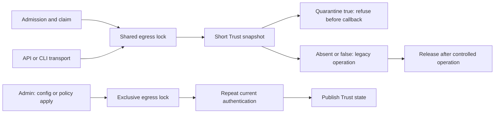
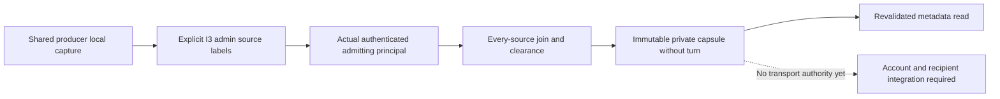
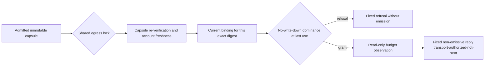

# Rust Biba — architecture and technical contract

[Bell-LaPadula: available capabilities and limits](BELL-LAPADULA.md).

Biba is Swarm’s reference integrity rule, confirmed by the user on 26 October
2026. This is the target requirement; current integration covers the local
`trust` core, not every Rust mission. This page describes inspected producers
and consumers without presenting target behavior as delivered functionality.
[Operator guide](actions-confiance-rust.md) ·
[Français](../architecture/BIBA-RUST.md) ·
[dated audit](../plans/migration-rust/evidence/20261026-biba-integration-audit/PLAN.md).

## Model and trust boundary

For an introduction, the distinction from Bell–LaPadula, and customer refund
and supplier invoice examples, see [Biba and AI agents](BIBA-AGENTS.md).
Their diagrams describe a reference architecture, distinct from the simulated
connectors implemented below.

[Separation of duties and audit evidence](BIBA-GOVERNANCE-AUDIT.md) extends that
target, including limits of hash chains, signatures and independent witnesses;
it does not extend the mechanisms delivered by this page.

The contract selects strict Biba with four ordered levels I0–I3. For ordinary
access, `check_biba` permits reading when subject ≤ object, and writing/invoking
when subject ≥ target. This is integrity control, separate from confidentiality,
authentication and Linux confinement. Historical reference: K. J. Biba,
[MTR-3153, 1975](https://seclab.cs.ucdavis.edu/projects/history/papers/biba75.pdf);
the [CERIAS record for the 1977 revision](https://www.cerias.purdue.edu/apps/reports_and_papers/view/2834/)
identifies ESD-TR-76-372. The levels and procedures below are Swarm’s contract,
not external certification.

| Boundary | Actual authority | Limit |
| --- | --- | --- |
| Local CLI / configuration | operator owning the opened root | no business authority derived from `actor` |
| HTTP / configuration | native session, Host/Origin, CSRF and bound root | operator cookie is separate from business bearer |
| Business command | current identity found by stored token digest | supplied `actor` / `integrity` grant no rights |
| Official I2 object | admitted mandate, action, approval and simulated effect | fixed protocol labels, not client classification |
| Business reads | I2 `read-object`, I1 `read-original` | cross the read monitor |
| Operator audit | `show`, `export`, `anchor` | outside the business principal’s read monitor |

Admissions are named trusted procedures: I3 creates a new I2 mandate; an
authenticated request within its terms creates a new pending I2 action. Original
bytes and digest remain retained. This never raises the requester’s level or
permits I1 to invoke an I2 effect directly. Configuration and operator audit are
part of the trusted base; an operator session must not be handed to an agent
expected to be isolated using only its business token.

After root bootstrap, HTTP preview/apply now require a current I3/admin identity under lock, before replay. Local operator CLI remains a separate recovery path. The cookie remains operator authority for other routes: this increment does not qualify global native isolation.

## Implemented integration

**27 October increment**: business returns and historical replays cross `trust/response.rs`. I1/I2 may read an I2 object; I3 receives only a named `trust-status-ack-v1` acknowledgement (identifier and closed state, no parameters or original). This neither relabels the object nor grants authority. Status is not approval or acceptance evidence. Publication and late errors remain attributed. See increment evidence to distinguish source, verified candidate and installed version.



Producers: `swarm-engine/src/biba.rs`, `trust_types.rs`, `trust/command.rs`,
`trust/config.rs`, `trust/operations.rs`, `trust/proof.rs`,
`root_store/trust_store.rs`. Entry points: `swarm-cli/src/trust.rs` and
`swarm-web/src/service/trust.rs`, under `rust/crates/`. Served UI:
`web/trust-native.html`, `.js`, `.css` and embedded i18n assets. The pure guard
alone does not mediate every engine access.

## Admission, approval and effect



A role alone is insufficient: `approve` requires an authorized I2 write and,
when configured, a subject separate from the requester; `commit` requires an
authorized I2 invocation. The level comparison also permits I3, subject to the
required roles. A configuration revision makes earlier mandates stale.
Revocation prevents a new effect; reconciliation may still inspect an existing
effect and does not undo it. Replay returns a historical result to the same
current authority; it does not establish a fresh mandate admission.

The closed version1 connectors are `local-ledger-simulation` and
`local-access-simulation`, sharing the idempotency domain. The latter writes a
simulated access ledger, not OS permissions. No arbitrary provider, executable,
URL or real payment is executed.

## Persistence, policies and errors

Schema1 state lives in `.swarm/trust-actions.json`, including base64 original
bytes; the lock is `trust-actions.lock` and the separate HMAC key is
`trust-actions-proof.key`. The root is bound to its opened instance. Writes use
atomic storage primitives; late close/output errors preserve
`trust_publication`. An error therefore does not prove absence of effect:
inspect the same action and reconcile when needed. Missing key material is
never silently regenerated for configured history. Pending Go initialization
refuses mutation, without an automatic recovery implementation here.

The four policies, units, bounds and zero semantics are listed in the
[guide](actions-confiance-rust.md#public-contract). They follow configuration →
validation → revisioned preview/application → Admin/CLI/API → transitions.
Retention is recorded without purge in this core. Representation bounds
(8MiB state, 16MiB command, 32-byte key) remain separate from operator choices.
Recognized activation of an unported advanced policy refuses operations.
`trust/extensions.rs` rejects unknown names, wrong types and duplicate policy
keys. Configuration cannot edit an unported block: omission/null preserve it;
only identical compact bytes of an existing block may be resubmitted. Historical
inactive blocks remain readable without rewriting, subject to structural checks.
This closes the audit cases without claiming a full port of nested business
validation or its consumers. The 26 October audit remains unchanged.

A business denial returns `state:denied`, attributed evidence and no change to
mandates/actions/effects. Format, authentication and conflicts remain distinct
errors (CLI2/4/3, HTTP400/403/409 by cause). Pure `verify` takes a v2 export,
schema1 HMAC anchor and separately acquired key. Verification establishes neither
third-party time, protection against the same UID nor independent acceptance.

## Bell-LaPadula confidentiality — delivered administration, undelivered control

Confidentiality separate from Biba integrity, independent and combinable: a
classification is an ordered level plus compartments; reading requires the
clearance to dominate the source, output requires a destination dominating the
fixed execution domain. The `swarm-confidentiality` crate holds these pure data
contracts, with no private content in diagnostics. Verified (unit and
integration tests dated 31 October 2026): validation and dominance/join, fixed
domain bound to the policy revision, revisioned persisted history with
controlled replays, refusal of unknown subjects and catalogs that relabel
history. Not verified: attribution of real content, file/network/provider
mediation, exact human declassification — hence `runtime_enforced:false` and
`runtime_authorized:false`, kept in every response.



Solid edges: verified, non-authorizing administration and diagnostics.
Dotted edges: labeled target, no active control. Responses carry
`runtime_enforced:false`; connecting real producers and consumers is the
activation criterion, never flipping the flags to true. Tracking and criteria:
[BLP-APEX](../plans/actions-confiance/BLP-APEX.md); evidence:
`docs/plans/actions-confiance/verification-blp/`.

## Cross-cutting Biba target — integration not delivered



Dotted edges are a target, not active controls. Inspection of
`agent_launch::prepare`, `agent_launch_preflight` and `mission_start` establishes
their own policy/revision/provider checks, without binding to `trust` Biba
identities and objects. Agents access files according to OS permissions; the
application monitor does not intercept those accesses. Before qualifying Biba
across Swarm, inventory and connect reads, writes, commands, memory,
imports/restores, effects and direct bypass paths.

Observable integration criterion: a low fixture identity cannot write an
official object, invoke a higher effect or pass an unendorsed output as a
protected decision; a high identity cannot read a lower original through a
business read. Denials are attributed without protected effects, including
after replay, withdrawal and restart. Admission creates a new object linked to
its original under named authority. Paths outside the monitor remain gaps even
when the pure guard’s tests pass.

## Reproducible verification and limits

Existing guards live in `tests/rust_trust_biba_unit.py`,
`tests/rust_trust_biba.py`, `tests/rust_trust_biba_ui.cjs`; manifest:
`tools/verification/recipes/trust-biba-rust.json`. Separate current source/test
profile results, the actual production binary and its served embedded bytes.
Concurrent workspace edits prevent automatically treating these as identical.
Installed English catalogue bytes may differ from the workspace catalogue:
retain the byte-comparison refusal and check actual rendered labels separately.

Dated audit results:
`docs/plans/migration-rust/evidence/20261026-biba-integration-audit/`.
Earlier porting results remain historical; neither bounded reuse, this document
nor its diagrams establish global conformance.

## Transversal Linux boundary — candidate in progress

The [BT01–BT05 plan](../plans/actions-confiance/BIBA-TRANSVERSE-APEX.md) retains
proofs, refusals and open criteria. Sources connect agent, planner, reviewer and
CLI preparation to `native_provider_exec`. Failures refuse before exec without
an unconfined fallback; no privilege is increased.

The gate supplies the expected workspace inode. `Sandbox::prepare_bound` opens
and pins that inode before inspection; Landlock rules and `fchdir` use the same
FD. Replacement refuses. Every descriptor this crate holds lives above 2
(`biba-path-repin` otherwise): the caller owns 0–2 and may reassign them (stdin
dup2) while the profile lives, which would otherwise close a pinned low FD
behind the crate's back. The Landlock ruleset FD is pinned at creation
(otherwise `landlock_restrict_self` refuses `EBADFD`, stage `biba-restrict`). CLI preparation observes its private working directory
after checking parent and token; that directory lives under `<Root>/preparation-cli/`,
never under `/tmp` (operator interdiction of 31 October 2026: no project data in
the system temporary area) nor under `.swarm` (both Biba overlap guards remain
applicable). Transfer of the parent's original FD remains unqualified.

Tool-free output lives under `.swarm/biba-i0/planning/<claim_id>` or
`.swarm/biba-i0/reviewer/<event_id>`. The engine opens these relative to its owned
private directory; rechecks never create them. Persisted host scope binds path
and inode. Output remains I0 and never grants authority.



The profile requires Linux/Landlock ABI6 and a single-threaded helper without
privileged capabilities. There is no fallback. FIOCLEX only sets CLOEXEC; the
memfd is relocated outside 0/1/2 before stdin attachment. Non-stdio descriptors
become CLOEXEC. Keyring syscalls are denied. These invariants introduce no new
operator setting.

`tools/verification/recipes/biba-linux-boundary.json` verifies the native profile,
its refusals and an actual injected inode swap. `tests/rust_biba_stdin_transport.py`
compares real sources in a sparse adapter, not the normal engine profile. The
plan separately retains public journeys on their exact images. Compilation does
not install anything.

Limits: reads outside the private Root and Internet networking are not confined
by this profile; it is not a general vault. It cannot freeze an outside unconfined
same-UID writer or privileged mounts. Other control launchers, HTTP/SSE, memory,
imports and promotions remain open. Changed planner/reviewer journeys, transversal
Admin UX, final candidate review and installation also remain open. Global Biba
is not qualified.

## BLP attribution: a new policy does not declassify

`blp-object-attribute` binds an explicit classification to the canonical digest
and project path under current BLP and Trust revisions. The I3/admin actor must
also have clearance for that label. A second attribution of the same object in
one revision remains refused; the same exact event can replay while current.

Across revisions the new classification must dominate every earlier attribution
for that digest/project: equal/higher level and all previous compartments retained.
Lowering, removing or replacing compartments refuses `blp-declassification-required`
before publication, without journal mutation. Admin clearance or a new policy
revision never substitutes for BLP-06 human consent. Equal/stricter renewal works.

History reads enforce the same invariant. An already-recorded decrease yields
`trust-proof-integrity`, safe cause `blp-attribution-history-downgrade`, before
protected projection. It is neither automatically repaired nor silently served
with a higher replacement label. Preserve originals; never edit a live journal.
An inconsistent historical record requires authorized evidence-preserving recovery
(no repair command is delivered here). The control operator owns that recovery;
declassification requires the future BLP-06 contract.

Scope: persisted PAEA attributions and connected readers. Digest/path alone proves
neither physical source-file identity nor copy lineage. Complete preparation-source
classification and transversal file/network/provider mediation remain pending.
See the [BLP plan](plans/actions-confiance/BLP-APEX.md).

### Explicit attribution through public interfaces

`swarm-rust trust blp-object-attribute --root ROOT --input INTENT.json --json`
(identity in `SWARM_TRUST_TOKEN`) and
`POST /api/v1/trust-actions?action=blp-object-attribute` (session, Host, Origin,
CSRF, then `Authorization: Bearer …`) share the existing engine producer.
A current, appropriately cleared I3/admin supplies `schema_version:1`, `event_id`,
BLP `expected_revision`, `expected_trust_revision`, `canonical_digest`
(64 lowercase hexadecimal characters), absolute UTF-8 `project_path`,
`classification:{level,compartments}` and nonempty `reason`. Both revisions come
from `blp-show`, never guessed values.

The producer checks authority and dominance before publication: identical events
replay without rewriting; a different event for the same object/revision, stale
revisions and downgrades refuse. Readers recompute their actual object's digest
and consult current policy: supplying a digest establishes neither source bytes,
physical lineage nor declassification authority. Admin configures policy but has
no object-attribution form yet. This adds no implicit preparation-source labels
or transversal control. Publication/close failures retain known outcome; reread
before retrying an uncertain result.

### Preparation-source diagnostic

`swarm-rust trust blp-preparation-check --root ROOT --input CHECK.json --json`
uses `SWARM_TRUST_TOKEN`. Equivalent API:
`POST /api/v1/trust-actions?action=blp-preparation-check`, behind the usual
session, Host, Origin and CSRF protections plus separate Trust authentication.
The strict body contains `schema_version:1`, `expected_revision` (BLP revision),
`preparation_id` and `turn_id`. It accepts no classification, identity or
destination. The readonly diagnostic binds the physical Root and keeps the
Trust reservation across the SQL observation.

The consumer rereads the private native prompt and verifies complete provenance.
Every transmitted slice needs a current control attribution for its exact SHA-256
and this project's exact absolute path: instructions, project context, optional
contract, nine JSON values and all JSON framing. `blp-object-attribute` remains
the I3 Admin attribution producer; source names and clearance never invent labels.
Structured values are attributed together at this stage, without their individual
files/elements. A raw document attribution does not cover its JSON-escaped
representation. Operators must establish digests from the actual recorded slices;
this increment provides no inventory screen.

Success returns only authenticated actor, BLP revision, prompt digest, part count
and joined classification (maximum level, union of compartments), with
`diagnostic_only:true` and `runtime_authorized:false`. Clearance must dominate the
join. No prompt text is returned. Unknown/disabled identity refuses authorization
before row lookup. Missing/stale policy, missing historical provenance, wrong
parent/Root, unattributed source or insufficient clearance explicitly refuses.
An altered prompt refuses `preparation-prompt-provenance-invalid`. Storage, SQL,
rollback and close failures retain causes; no refusal becomes empty success.
The reservation grants no future authority.

Recovery: correct the request/revision or explicitly attribute missing slices
under the current policy, then repeat the observation. Never rewrite historical
rows to manufacture provenance. Policy renewal requires current attributions.
This diagnostic does not protect sending or bind its principal/destination and
leaves `runtime_enforced:false`; mediation and output inheritance remain open.



Any refusal stops this flow; no edge reaches a provider. The reservation protects
this observation rather than a later use.

HTTP distinguishes 400 (invalid intent), 403 (identity/clearance), 404 (missing turn)
and 409 (missing/stale policy, unattributed source, absent historical provenance
or wrong parent). An ungranted principal refuses before turn lookup. Incoherent
provenance, incompatible private Root and storage/rollback/close failures remain
server errors; client status never masks their cause. The operation explicitly
refuses outside Linux (501), without runtime evidence on those platforms.

## Explicit preparation-send quarantine

Delivered locally in version299 and verified against inert receivers: boolean policy field
`preparation_quarantine` persists through blp-policy-preview/apply and is editable
in Admin policy JSON. Absent/false retains legacy behavior/encoding, not an
authorized classified-send mode. Null, strings and numbers refuse. True blocks
new sends (including replay), pending claims and controlled API/CLI transport:
`blp-preparation-quarantined` (send HTTP403). Capability exposes
`preparation_quarantined`; transversal `runtime_enforced:false` remains truthful.

A dedicated shared preparation-egress reservation covers admission/claim and actual transport. The Trust snapshot lock is released before IO, leaving unrelated business writes available.
Exclusive policy apply waits for engaged emission to finish; it does not cancel
it. Operators can stop the turn or use existing configured provider deadlines.
No new whole-operation timeout, attempt or cap. Invalid/unreadable state refuses
instead of becoming disabled. Stale authority cannot lift recorded quarantine;
explicit lifting requires current policy/control revisions.

Finalizing a refusal before an attempt releases only its unstarted reservation,
never refunds an estimated attempt. If operation succeeds but releasing its lock
fails, preparation-egress-operation-completed and cleanup cause remain visible;
recorded admission also retains its receipt. A late error never proves absence
of contact/remote effect. This lock does not classify sources, inherit response
labels or confine direct access/descendants outside controlled transports.



This diagram describes quarantine only; the legacy branch does not check a
classified domain. Old binaries and direct access do not participate in this protocol.

## Attribution from a captured preparation source

`blp-preparation-attribute` selects a recorded prompt slice using `preparation_id`,
`turn_id`, `expected_turn_revision` (the DTO's `source_revision`) and zero-based
`source_index`. The body also requires `schema_version:1`, `event_id`, BLP
`expected_revision`, `expected_trust_revision`, an explicit `classification` and
nonempty `reason`. Caller-supplied digest, path or actor fields are rejected.
Example body (replace identifiers, revisions and classification with observed
values and an explicit operator decision; these names are not a shipped catalog):

```json
{"schema_version":1,"event_id":"source-classification-1","expected_revision":1,"expected_trust_revision":1,"preparation_id":"PREPARATION","turn_id":"TURN","expected_turn_revision":2,"source_index":0,"classification":{"level":"confidential","compartments":[]},"reason":"Explicit classification decision"}
```

API/CLI share the mutating Trust operation, requiring an authenticated I3/admin
cleared for the chosen label, checked before row lookup. The engine verifies the
parent, revision, native Root instance and complete provenance, then obtains the
slice digest and opened Root path itself. Existing attribution uniqueness,
monotonicity, journal and replay rules apply. The capture selector participates
in event identity; a changed index, turn or reason cannot replay. Identical byte
slices are one object: a second attribution event refuses even for the same label.

The result adds `producer_captured:true`, preparation/turn IDs, `turn_revision`
(the source_revision as a string), `source_index` and `source_count` to the usual
attribution. It returns no prompt text and provides no visual slice inventory.
Classification remains explicit per slice, including instructions, null values
and framing; missing labels never become public. After attributing every distinct
digest, `blp-preparation-check` can check their join. Historical turns without
provenance refuse without silent migration.

HTTP refusals: malformed intent/label400, identity/role/clearance403, missing
turn/index404, parent/revisions/policy/conflict409. Corrupt provenance, mismatched
Root instance and storage/cleanup failures remain server errors. Source-read or
validation failure publishes no attribution; late publication errors retain the
existing Trust effect semantics. This post-capture control attribution does not
establish admission-time classification, durable physical lineage, allowed
classified egress, output inheritance or protection of every result reader.
Quarantine and `runtime_enforced:false` retain their current meaning.

Post-capture classification neither suspends a provider nor retracts bytes already
sent. This operation does not change preparation_quarantine; explicit quarantine
policy remains the delivered emission block. Successful attribution implies no
recipient authorization.


## Immutable pre-transport admission

Three Linux API/CLI operations reuse current Trust authentication:

| Operation | Contract |
| --- | --- |
| `blp-preparation-input-attribute` | Cleared I3/admin explicitly chooses a label and assembled prompt slice index; engine-derived digest/path, canonical uniqueness/monotonicity |
| `blp-preparation-admit` | Actual authenticated principal, including a non-admin, must dominate the join of EVERY currently attributed slice; no supplied actor/output label |
| `blp-preparation-admission-show` | Metadata only for the current authenticated owner under still-current recorded policy/Root; Admin does not impersonate the owner |

Admission input: `schema_version:1`, `event_id`, BLP `expected_revision`,
`expected_trust_revision`, and `intent`, the existing `prepare send` intention
(version, preparation/revision, provider, capability_hash, message, context/target,
optional level/policy_hash according to its protocol). Schematic example:

```json
{"schema_version":1,"event_id":"domain-1","expected_revision":1,"expected_trust_revision":1,"intent":{"version":1,"event_id":"unsent-intent","preparation_id":"OBSERVED_ID","expected_revision":2,"provider":"CONFIGURED_PROVIDER","capability_hash":"OBSERVED_HASH","message":"Text to classify","context_mode":"full"}}
```

Pre-admission attribution adds zero-based `source_index`, explicit
`classification` and nonempty `reason`. Each index is captured by the SAME
historical send producer under SQL/settings and material Root snapshots. Capture
creates no turn, reserves no budget and contacts no provider. Existing preparation
activation, limits, source/capability freshness, active-turn and contention checks
apply; no new ceiling/deadline. Role, origin, empty values or maximum clearance
never imply a label. Instructions, null values, JSON framing and history also
require attribution. Identical slices are one object: a second event refuses409
instead of overwriting its label. Missing slice index refuses404.

Admission fixes the actual principal and combined prompt classification before
any possible emission by this path. Unknown sources, insufficient clearance,
stale authority and changed intent under the same event refuse without a capsule.
Private create-only `.swarm/blp-admission-HASH.receipt` records complete captured
bytes/provenance, routing metadata without credentials, observed physical Root,
policy revisions/digest and principal. Native framing checks observed extent/SHA
before allocation; its format is neither an operator cap nor authenticated authority.

Output: `admission_id`, `principal`, preparation/source revision, Trust/BLP
revisions, `prompt_sha256`, `source_count`, `output_classification`,
`state:admitted-no-transport`, `runtime_authorized:false`, `runtime_enforced:false`.
Never prompt/key/gate bytes. Metadata read input contains only `schema_version`,
`admission_id`, `expected_revision`, `expected_trust_revision`. Replay retains the
fixed bytes/domain without recapturing history or reserving costs. Changed context
requires explicit source attribution and a new admission event. A new policy never
refreshes an old capsule implicitly: readmit from currently attributed sources.

`admission-recorded`/`admission-replayed` publication is separate from a Trust
business event and does not rewrite the policy journal. Post-rename sync failure
retains `admission-durability-unknown`; late Root/release/output failures retain
known effects. Err therefore never proves capsule absence. Before publication,
refusals create no capsule/turn/reservation. This increment executes or purges no
capsule; retirement/migration need explicit future history-preserving contracts.

Legacy workers/readers do not enumerate these capsules; an ID does not create a
`PreparationTurn`. The domain covers prompt bytes, not provider credentials or
all trusted-engine memory. It authorizes no recipient/transport/descendant or
future output read. Upstream producer labels still do not automatically inherit
through all transformations. Legacy sending retains its current policy; quarantine
can remain active during local classification/admission. HTTP refusals separate
invalid intent400, authority403, absent object/index404, conflicts409; stored
capsule/provenance/Root corruption and IO remain500. Same-UID confinement, backup
rollback resistance, OS mediation and independent acceptance are unproven. No
real data is automatically reclassified.



Capsule reads/replay do not recapture the parent or establish current provider/
execution-settings freshness. They prove the immutable observation and current
read authority only; future transport must check those preconditions and actual
rights/budgets.

## Recipient binding and last-use transport

Two Linux API/CLI operations extend the immutable admission to account/endpoint
control, without emitting:

| Operation | Contract |
| --- | --- |
| `blp-preparation-destination-attribute` | Privileged administrator records a destination label for the exact account/endpoint of an `api-` connection: name `api-`+catalogue id, mandatory echo of `base_url` and `model` taken from the current connection, config digest recomputed by the Root (never caller-supplied), key never an input |
| `blp-preparation-transport` | The principal owning an admitted capsule observes a go/no-go decision at last use, under the shared egress lock, without emitting |

The binding records `{policy_revision, provider_name, digest, label, base_url,
model}` in the current policy Entry. It is re-recordable (last write wins, like
a slice attribution) and disappears with the Entry: every `blp-policy-apply`
wipes bindings just like attributions. The canonical digest is
`hash(hash(ai-connections.json) ‖ 0 ‖ hash(providers.json)) ‖ 0 ‖
settings_digest` — the same one the intent admission requires for an `api-`
provider: the binding therefore covers exactly the account/endpoint/capability
pair the capsule references.

The transport decision fully re-verifies the capsule under the egress lock
(current principal, instance, Trust/BLP revisions, policy digest, per-source
join with their bytes, rebuilt output label), then checks freshness since
admission: connection present/enabled with unchanged `base_url`/`model`,
unchanged `provider_source`, unchanged settings digest (otherwise
`blp-transport-connection-changed`, `blp-transport-provider-source-changed`,
`blp-transport-settings-changed`). The current binding must match the exact
digest (`blp-destination-not-attributed` otherwise) and its label must dominate
the output label at last use (`blp-access-denied`, no-write-down). Read-only
budget observation keeps the existing codes
(`preparation-budget-exhausted`, `work-budget-exhausted`).

The fixed reply carries `decision:granted|refused`,
`state:transport-authorized-not-sent`, `runtime_authorized:false`,
`runtime_enforced:false`, the principal, the destination (`connection` =
catalogue id, `provider` = `api-` name, label, `base_url`, `model`, digest) and
`source_count`. It never returns the key or an emission authority. The transport
body carries `schema_version:1`, `admission_id`, `expected_revision` BLP,
`expected_trust_revision` and the `connection`/`expected_base_url`/
`expected_model` echo; it carries no `event_id` — the capsule is the
observation's idempotence key, a replay returns the identical decision with no
new effect. The destination echo is checked against the connection actually
loaded under the lock (`blp-destination-echo-mismatch`, `blp-transport-invalid`
otherwise).

HTTP refusals distinguish grammar400, missing object404
(`blp-destination-not-attributed`, unknown admission), freshness409,
authority403, corruption/IO500. The binding goes through the existing
`blp-object-attribute` producer: `recorded`/`replayed` publication, a
`blp-attribution` journal entry, exact-once uniqueness per
(digest, project, revision) and the anti-declassification guard inherited as
is. The transport decision has no publication at all: a pure observation, with
no state or journal write. No legacy send path is modified: existing workers
ignore these capsules and bindings. The decision does not engage the real
transport, inherits no results, confines no descendants and authorizes no
emission; the real account/endpoint still cannot be read, and independent
acceptance is not established. No real data is classified.



Re-recording a binding or renewing the policy invalidates previous
observations; replaying an admitted capsule does not recapture the binding.
Coexistence with the explicit quarantine stays the admission's: enabling local
quarantine during classification does not change this contract.

## Worker emission gate at last use

The Rust worker's Api branch (`_prepare_turn` in
`swarm-cli/src/preparation_worker.rs`) now applies the decision before any
classified emission, through
`RootStore::preparation_worker_transport_gate(id, token, base_url, model)`,
executed inside the shared egress reservation the worker already holds
(`with_preparation_egress`) and called before the request is built: no socket
opens without a decision.

**Turn custody.** A private accessor `gated_turn(root, id, token)` re-reads
the row under `with_material_read` and requires exactly the `running` state
left by the claim, token equal to SHA256 of the native nonce, and PID/stamp/
host equal to `SupervisorIdentity::current()`
(`preparation-worker-registration-mismatch` otherwise), then unchanged root
(`preparation-root-instance-changed`). It exposes
`TurnCustody{turn, request_level, settings_digest}` without ever exposing
prompt, provenance or nonce. The worker holds no principal: identity comes
from the re-verified admission receipt.

**Legacy path intact.** The scan looks through `names()` for names of exact
grammar `blp-admission-{64 lowercase hex}.receipt`. Zero match on the triple
(preparation_id, provider, request_hash) → `Ok(())` before any Trust-state
read: turns without admission pay nothing. A validly-formatted candidate
that is unreadable or undecodable refuses with a typed code
(`blp-admission-not-found`, `blp-admission-record-invalid`): never a silent
pass.

**request_hash covers event_id.** The send's canonical hash covers the
`event_id`: two distinct events produce distinct hashes. An admission receipt
therefore matches only the turn emitted for the SAME event_id (same
preparation_id, same provider) — the admission→turn binding is per event,
not merely per preparation.

**Decision at last use.** With ≥1 match: short Trust reservation (after the
scan, never before), re-read of the current Entry, then for each receipt a
full `preparation_admission::verify` (receipt's principal, schema, identity
digest, instance, revisions, policy digest, per-source join, output label);
captured `settings_digest` freshness (`blp-transport-settings-changed`),
destination resolution from the turn's `provider` with mandatory echo of the
worker's actual `base_url`/`model` (`blp-destination-echo-mismatch`) —
closing the claim→send TOCTOU —, attribution for the current destination
digest (`blp-destination-not-attributed`), no-write-down re-derived through
`ExecutionDomain::prepare` under CURRENT policy toward the destination label
(`blp-access-denied`), read-only budget observation. The gate contacts
nothing, reserves nothing in SQL and writes nothing; lock order is egress
(already held) → material read → scan → short Trust reservation → close.

Verification: integration test `preparation_worker_transport.rs`
(bootstrap admission→claimed-then-finished legacy turn→claimed bound turn;
token refusal, unattributed destination, wrong base_url echo, wrong model
echo; exact pass with zero gate reservations; SQL reservation count
before/after) and permanent recipe
`tools/verification/recipes/blp-preparation-worker-gate.json` (gate, neighbor
suites `preparation_calls`/`preparation_transport`, compilation
`cargo check -p swarm-cli`). Verified ordering constraints: attribution must
precede any send (else `preparation-turn-active`), the gate requires the
claim, one active turn per preparation. Scope: the worker's Api branch; the
CLI path keeps its own egress control. BF-16 (result inheritance) and
OS/descendant confinement remain open; not activated in production, not
accepted, Bell-LaPadula not declared finished.
