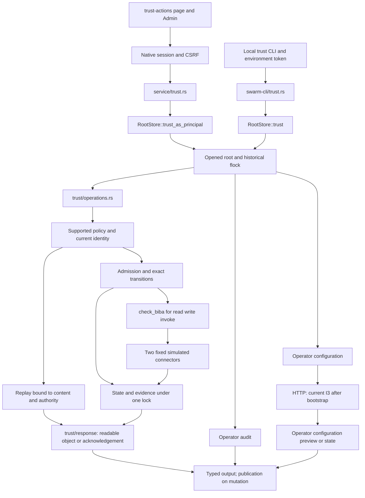
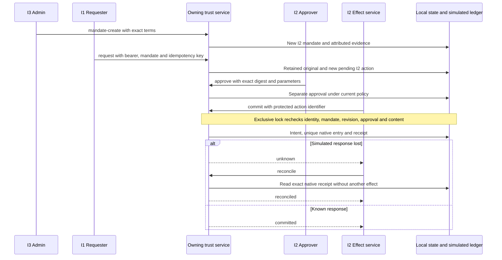
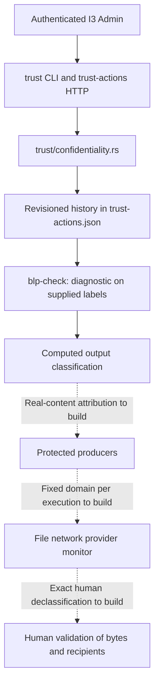
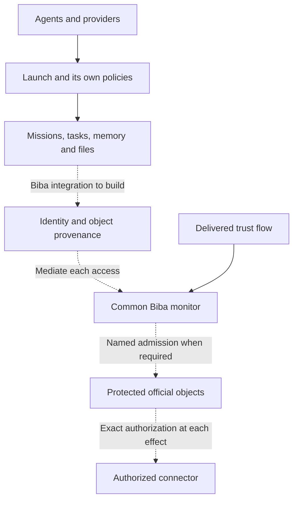
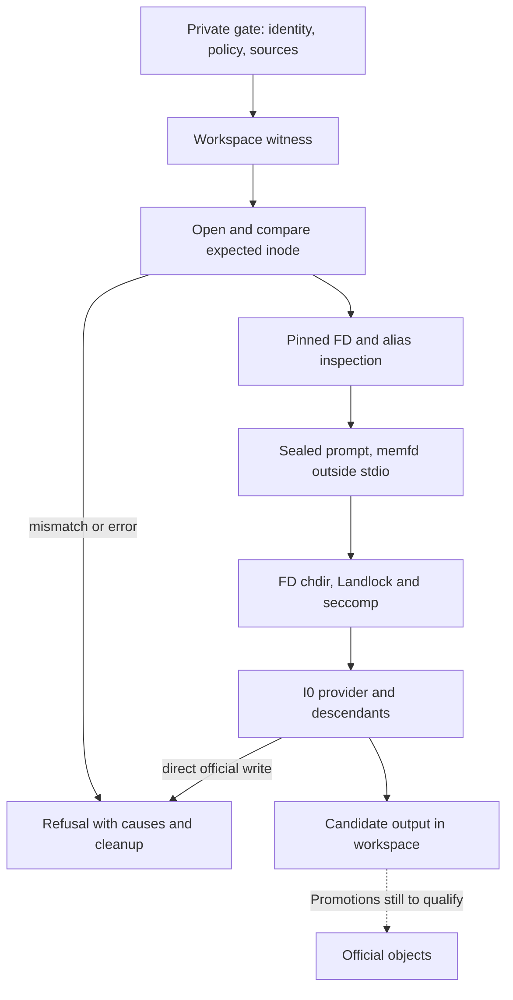
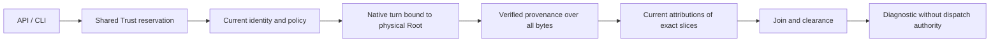

# Rust Biba — architecture and technical contract

Biba is Swarm’s reference integrity rule, confirmed by the user on 26 October
2026. This is the target requirement; current integration covers the local
`trust` core, not every Rust mission. This page describes inspected producers
and consumers without presenting target behavior as delivered functionality.
[Operator guide](actions-confiance-rust.md) ·
[Français](../architecture/BIBA-RUST.md) ·
[dated audit](../plans/migration-rust/evidence/20261026-biba-integration-audit/PLAN.md).

## Model and trust boundary

For an introduction, the distinction from Bell–LaPadula, and customer refund
and supplier invoice examples, see [Biba and AI agents](BIBA-AGENTS.md).
Their diagrams describe a reference architecture, distinct from the simulated
connectors implemented below.

[Separation of duties and audit evidence](BIBA-GOVERNANCE-AUDIT.md) extends that
target, including limits of hash chains, signatures and independent witnesses;
it does not extend the mechanisms delivered by this page.

The contract selects strict Biba with four ordered levels I0–I3. For ordinary
access, `check_biba` permits reading when subject ≤ object, and writing/invoking
when subject ≥ target. This is integrity control, separate from confidentiality,
authentication and Linux confinement. Historical reference: K. J. Biba,
[MTR-3153, 1975](https://seclab.cs.ucdavis.edu/projects/history/papers/biba75.pdf);
the [CERIAS record for the 1977 revision](https://www.cerias.purdue.edu/apps/reports_and_papers/view/2834/)
identifies ESD-TR-76-372. The levels and procedures below are Swarm’s contract,
not external certification.

| Boundary | Actual authority | Limit |
| --- | --- | --- |
| Local CLI / configuration | operator owning the opened root | no business authority derived from `actor` |
| HTTP / configuration | native session, Host/Origin, CSRF and bound root | operator cookie is separate from business bearer |
| Business command | current identity found by stored token digest | supplied `actor` / `integrity` grant no rights |
| Official I2 object | admitted mandate, action, approval and simulated effect | fixed protocol labels, not client classification |
| Business reads | I2 `read-object`, I1 `read-original` | cross the read monitor |
| Operator audit | `show`, `export`, `anchor` | outside the business principal’s read monitor |

Admissions are named trusted procedures: I3 creates a new I2 mandate; an
authenticated request within its terms creates a new pending I2 action. Original
bytes and digest remain retained. This never raises the requester’s level or
permits I1 to invoke an I2 effect directly. Configuration and operator audit are
part of the trusted base; an operator session must not be handed to an agent
expected to be isolated using only its business token.

After root bootstrap, HTTP preview/apply now require a current I3/admin identity under lock, before replay. Local operator CLI remains a separate recovery path. The cookie remains operator authority for other routes: this increment does not qualify global native isolation.

## Implemented integration

**27 October increment**: business returns and historical replays cross `trust/response.rs`. I1/I2 may read an I2 object; I3 receives only a named `trust-status-ack-v1` acknowledgement (identifier and closed state, no parameters or original). This neither relabels the object nor grants authority. Status is not approval or acceptance evidence. Publication and late errors remain attributed. See increment evidence to distinguish source, verified candidate and installed version.

Producers: `swarm-engine/src/biba.rs`, `trust_types.rs`, `trust/command.rs`,
`trust/config.rs`, `trust/operations.rs`, `trust/proof.rs`,
`root_store/trust_store.rs`. Entry points: `swarm-cli/src/trust.rs` and
`swarm-web/src/service/trust.rs`, under `rust/crates/`. Served UI:
`web/trust-native.html`, `.js`, `.css` and embedded i18n assets. The pure guard
alone does not mediate every engine access.

## Admission, approval and effect

A role alone is insufficient: `approve` requires an authorized I2 write and,
when configured, a subject separate from the requester; `commit` requires an
authorized I2 invocation. The level comparison also permits I3, subject to the
required roles. A configuration revision makes earlier mandates stale.
Revocation prevents a new effect; reconciliation may still inspect an existing
effect and does not undo it. Replay returns a historical result to the same
current authority; it does not establish a fresh mandate admission.

The closed version1 connectors are `local-ledger-simulation` and
`local-access-simulation`, sharing the idempotency domain. The latter writes a
simulated access ledger, not OS permissions. No arbitrary provider, executable,
URL or real payment is executed.

## Persistence, policies and errors

Schema1 state lives in `.swarm/trust-actions.json`, including base64 original
bytes; the lock is `trust-actions.lock` and the separate HMAC key is
`trust-actions-proof.key`. The root is bound to its opened instance. Writes use
atomic storage primitives; late close/output errors preserve
`trust_publication`. An error therefore does not prove absence of effect:
inspect the same action and reconcile when needed. Missing key material is
never silently regenerated for configured history. Pending Go initialization
refuses mutation, without an automatic recovery implementation here.

The four policies, units, bounds and zero semantics are listed in the
[guide](actions-confiance-rust.md#public-contract). They follow configuration →
validation → revisioned preview/application → Admin/CLI/API → transitions.
Retention is recorded without purge in this core. Representation bounds
(8MiB state, 16MiB command, 32-byte key) remain separate from operator choices.
Recognized activation of an unported advanced policy refuses operations.
`trust/extensions.rs` rejects unknown names, wrong types and duplicate policy
keys. Configuration cannot edit an unported block: omission/null preserve it;
only identical compact bytes of an existing block may be resubmitted. Historical
inactive blocks remain readable without rewriting, subject to structural checks.
This closes the audit cases without claiming a full port of nested business
validation or its consumers. The 26 October audit remains unchanged.

A business denial returns `state:denied`, attributed evidence and no change to
mandates/actions/effects. Format, authentication and conflicts remain distinct
errors (CLI2/4/3, HTTP400/403/409 by cause). Pure `verify` takes a v2 export,
schema1 HMAC anchor and separately acquired key. Verification establishes neither
third-party time, protection against the same UID nor independent acceptance.

## Bell-LaPadula confidentiality — delivered administration, undelivered control

Confidentiality separate from Biba integrity, independent and combinable: a
classification is an ordered level plus compartments; reading requires the
clearance to dominate the source, output requires a destination dominating the
fixed execution domain. The `swarm-confidentiality` crate holds these pure data
contracts, with no private content in diagnostics. Verified (unit and
integration tests dated 31 October 2026): validation and dominance/join, fixed
domain bound to the policy revision, revisioned persisted history with
controlled replays, refusal of unknown subjects and catalogs that relabel
history. Not verified: attribution of real content, file/network/provider
mediation, exact human declassification — hence `runtime_enforced:false` and
`runtime_authorized:false`, kept in every response.

Solid edges: verified, non-authorizing administration and diagnostics.
Dotted edges: labeled target, no active control. Responses carry
`runtime_enforced:false`; connecting real producers and consumers is the
activation criterion, never flipping the flags to true. Tracking and criteria:
[BLP-APEX](../plans/actions-confiance/BLP-APEX.md); evidence:
`docs/plans/actions-confiance/verification-blp/`.

## Cross-cutting Biba target — integration not delivered

Dotted edges are a target, not active controls. Inspection of
`agent_launch::prepare`, `agent_launch_preflight` and `mission_start` establishes
their own policy/revision/provider checks, without binding to `trust` Biba
identities and objects. Agents access files according to OS permissions; the
application monitor does not intercept those accesses. Before qualifying Biba
across Swarm, inventory and connect reads, writes, commands, memory,
imports/restores, effects and direct bypass paths.

Observable integration criterion: a low fixture identity cannot write an
official object, invoke a higher effect or pass an unendorsed output as a
protected decision; a high identity cannot read a lower original through a
business read. Denials are attributed without protected effects, including
after replay, withdrawal and restart. Admission creates a new object linked to
its original under named authority. Paths outside the monitor remain gaps even
when the pure guard’s tests pass.

## Reproducible verification and limits

Existing guards live in `tests/rust_trust_biba_unit.py`,
`tests/rust_trust_biba.py`, `tests/rust_trust_biba_ui.cjs`; manifest:
`tools/verification/recipes/trust-biba-rust.json`. Separate current source/test
profile results, the actual production binary and its served embedded bytes.
Concurrent workspace edits prevent automatically treating these as identical.
Installed English catalogue bytes may differ from the workspace catalogue:
retain the byte-comparison refusal and check actual rendered labels separately.

Dated audit results:
`docs/plans/migration-rust/evidence/20261026-biba-integration-audit/`.
Earlier porting results remain historical; neither bounded reuse, this document
nor its diagrams establish global conformance.

## Transversal Linux boundary — candidate in progress

The [BT01–BT05 plan](../plans/actions-confiance/BIBA-TRANSVERSE-APEX.md) retains
proofs, refusals and open criteria. Sources connect agent, planner, reviewer and
CLI preparation to `native_provider_exec`. Failures refuse before exec without
an unconfined fallback; no privilege is increased.

The gate supplies the expected workspace inode. `Sandbox::prepare_bound` opens
and pins that inode before inspection; Landlock rules and `fchdir` use the same
FD. Replacement refuses. Every descriptor this crate holds lives above 2
(`biba-path-repin` otherwise): the caller owns 0–2 and may reassign them (stdin
dup2) while the profile lives, which would otherwise close a pinned low FD
behind the crate's back. The Landlock ruleset FD is pinned at creation
(otherwise `landlock_restrict_self` refuses `EBADFD`, stage `biba-restrict`). CLI preparation observes its private working directory
after checking parent and token; that directory lives under `<Root>/preparation-cli/`,
never under `/tmp` (operator interdiction of 31 October 2026: no project data in
the system temporary area) nor under `.swarm` (both Biba overlap guards remain
applicable). Transfer of the parent's original FD remains unqualified.

Tool-free output lives under `.swarm/biba-i0/planning/<claim_id>` or
`.swarm/biba-i0/reviewer/<event_id>`. The engine opens these relative to its owned
private directory; rechecks never create them. Persisted host scope binds path
and inode. Output remains I0 and never grants authority.

The profile requires Linux/Landlock ABI6 and a single-threaded helper without
privileged capabilities. There is no fallback. FIOCLEX only sets CLOEXEC; the
memfd is relocated outside 0/1/2 before stdin attachment. Non-stdio descriptors
become CLOEXEC. Keyring syscalls are denied. These invariants introduce no new
operator setting.

`tools/verification/recipes/biba-linux-boundary.json` verifies the native profile,
its refusals and an actual injected inode swap. `tests/rust_biba_stdin_transport.py`
compares real sources in a sparse adapter, not the normal engine profile. The
plan separately retains public journeys on their exact images. Compilation does
not install anything.

Limits: reads outside the private Root and Internet networking are not confined
by this profile; it is not a general vault. It cannot freeze an outside unconfined
same-UID writer or privileged mounts. Other control launchers, HTTP/SSE, memory,
imports and promotions remain open. Changed planner/reviewer journeys, transversal
Admin UX, final candidate review and installation also remain open. Global Biba
is not qualified.

## BLP attribution: a new policy does not declassify

`blp-object-attribute` binds an explicit classification to the canonical digest
and project path under current BLP and Trust revisions. The I3/admin actor must
also have clearance for that label. A second attribution of the same object in
one revision remains refused; the same exact event can replay while current.

Across revisions the new classification must dominate every earlier attribution
for that digest/project: equal/higher level and all previous compartments retained.
Lowering, removing or replacing compartments refuses `blp-declassification-required`
before publication, without journal mutation. Admin clearance or a new policy
revision never substitutes for BLP-06 human consent. Equal/stricter renewal works.

History reads enforce the same invariant. An already-recorded decrease yields
`trust-proof-integrity`, safe cause `blp-attribution-history-downgrade`, before
protected projection. It is neither automatically repaired nor silently served
with a higher replacement label. Preserve originals; never edit a live journal.
An inconsistent historical record requires authorized evidence-preserving recovery
(no repair command is delivered here). The control operator owns that recovery;
declassification requires the future BLP-06 contract.

Scope: persisted PAEA attributions and connected readers. Digest/path alone proves
neither physical source-file identity nor copy lineage. Complete preparation-source
classification and transversal file/network/provider mediation remain pending.
See the [BLP plan](plans/actions-confiance/BLP-APEX.md).

### Explicit attribution through public interfaces

`swarm-rust trust blp-object-attribute --root ROOT --input INTENT.json --json`
(identity in `SWARM_TRUST_TOKEN`) and
`POST /api/v1/trust-actions?action=blp-object-attribute` (session, Host, Origin,
CSRF, then `Authorization: Bearer …`) share the existing engine producer.
A current, appropriately cleared I3/admin supplies `schema_version:1`, `event_id`,
BLP `expected_revision`, `expected_trust_revision`, `canonical_digest`
(64 lowercase hexadecimal characters), absolute UTF-8 `project_path`,
`classification:{level,compartments}` and nonempty `reason`. Both revisions come
from `blp-show`, never guessed values.

The producer checks authority and dominance before publication: identical events
replay without rewriting; a different event for the same object/revision, stale
revisions and downgrades refuse. Readers recompute their actual object's digest
and consult current policy: supplying a digest establishes neither source bytes,
physical lineage nor declassification authority. Admin configures policy but has
no object-attribution form yet. This adds no implicit preparation-source labels
or transversal control. Publication/close failures retain known outcome; reread
before retrying an uncertain result.

### Preparation-source diagnostic

`swarm-rust trust blp-preparation-check --root ROOT --input CHECK.json --json`
uses `SWARM_TRUST_TOKEN`. Equivalent API:
`POST /api/v1/trust-actions?action=blp-preparation-check`, behind the usual
session, Host, Origin and CSRF protections plus separate Trust authentication.
The strict body contains `schema_version:1`, `expected_revision` (BLP revision),
`preparation_id` and `turn_id`. It accepts no classification, identity or
destination. The readonly diagnostic binds the physical Root and keeps the
Trust reservation across the SQL observation.

The consumer rereads the private native prompt and verifies complete provenance.
Every transmitted slice needs a current control attribution for its exact SHA-256
and this project's exact absolute path: instructions, project context, optional
contract, nine JSON values and all JSON framing. `blp-object-attribute` remains
the I3 Admin attribution producer; source names and clearance never invent labels.
Structured values are attributed together at this stage, without their individual
files/elements. A raw document attribution does not cover its JSON-escaped
representation. Operators must establish digests from the actual recorded slices;
this increment provides no inventory screen.

Success returns only authenticated actor, BLP revision, prompt digest, part count
and joined classification (maximum level, union of compartments), with
`diagnostic_only:true` and `runtime_authorized:false`. Clearance must dominate the
join. No prompt text is returned. Unknown/disabled identity refuses authorization
before row lookup. Missing/stale policy, missing historical provenance, wrong
parent/Root, unattributed source or insufficient clearance explicitly refuses.
An altered prompt refuses `preparation-prompt-provenance-invalid`. Storage, SQL,
rollback and close failures retain causes; no refusal becomes empty success.
The reservation grants no future authority.

Recovery: correct the request/revision or explicitly attribute missing slices
under the current policy, then repeat the observation. Never rewrite historical
rows to manufacture provenance. Policy renewal requires current attributions.
This diagnostic does not protect sending or bind its principal/destination and
leaves `runtime_enforced:false`; mediation and output inheritance remain open.

Any refusal stops this flow; no edge reaches a provider. The reservation protects
this observation rather than a later use.

HTTP distinguishes 400 (invalid intent), 403 (identity/clearance), 404 (missing turn)
and 409 (missing/stale policy, unattributed source, absent historical provenance
or wrong parent). An ungranted principal refuses before turn lookup. Incoherent
provenance, incompatible private Root and storage/rollback/close failures remain
server errors; client status never masks their cause. The operation explicitly
refuses outside Linux (501), without runtime evidence on those platforms.
