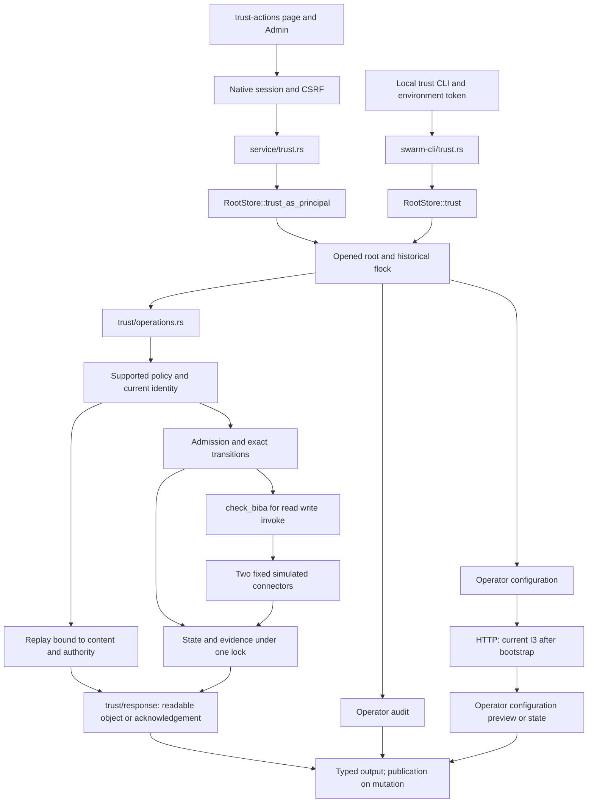
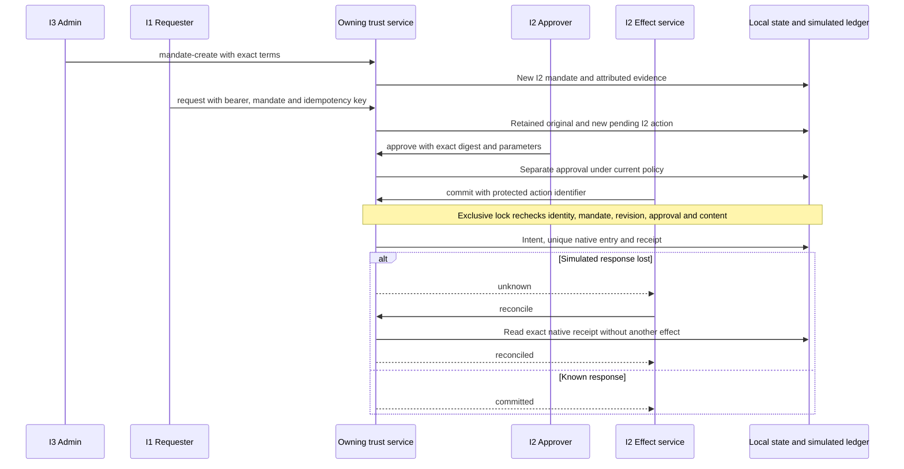
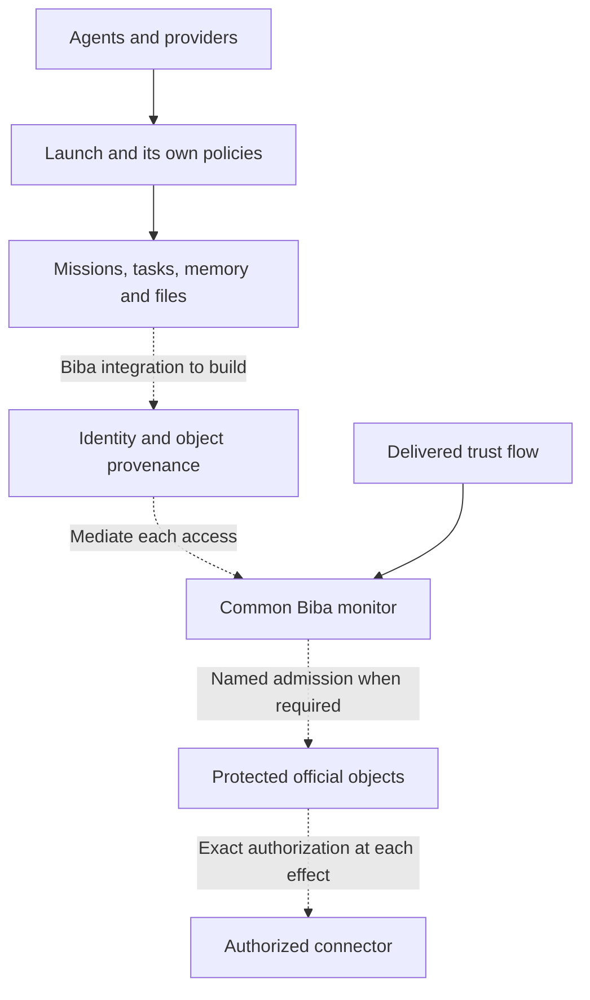

# Rust Biba — architecture and technical contract

Biba is Swarm’s reference integrity rule, confirmed by the user on 26 October
2026. This is the target requirement; current integration covers the local
`trust` core, not every Rust mission. This page describes inspected producers
and consumers without presenting target behavior as delivered functionality.
[Operator guide](actions-confiance-rust.md) ·
[Français](../architecture/BIBA-RUST.md) ·
[dated audit](../plans/migration-rust/evidence/20261026-biba-integration-audit/PLAN.md).

## Model and trust boundary

For an introduction, the distinction from Bell–LaPadula, and customer refund
and supplier invoice examples, see [Biba and AI agents](BIBA-AGENTS.md).
Their diagrams describe a reference architecture, distinct from the simulated
connectors implemented below.

[Separation of duties and audit evidence](BIBA-GOVERNANCE-AUDIT.md) extends that
target, including limits of hash chains, signatures and independent witnesses;
it does not extend the mechanisms delivered by this page.

The contract selects strict Biba with four ordered levels I0–I3. For ordinary
access, `check_biba` permits reading when subject ≤ object, and writing/invoking
when subject ≥ target. This is integrity control, separate from confidentiality,
authentication and Linux confinement. Historical reference: K. J. Biba,
[MTR-3153, 1975](https://seclab.cs.ucdavis.edu/projects/history/papers/biba75.pdf);
the [CERIAS record for the 1977 revision](https://www.cerias.purdue.edu/apps/reports_and_papers/view/2834/)
identifies ESD-TR-76-372. The levels and procedures below are Swarm’s contract,
not external certification.

| Boundary | Actual authority | Limit |
| --- | --- | --- |
| Local CLI / configuration | operator owning the opened root | no business authority derived from `actor` |
| HTTP / configuration | native session, Host/Origin, CSRF and bound root | operator cookie is separate from business bearer |
| Business command | current identity found by stored token digest | supplied `actor` / `integrity` grant no rights |
| Official I2 object | admitted mandate, action, approval and simulated effect | fixed protocol labels, not client classification |
| Business reads | I2 `read-object`, I1 `read-original` | cross the read monitor |
| Operator audit | `show`, `export`, `anchor` | outside the business principal’s read monitor |

Admissions are named trusted procedures: I3 creates a new I2 mandate; an
authenticated request within its terms creates a new pending I2 action. Original
bytes and digest remain retained. This never raises the requester’s level or
permits I1 to invoke an I2 effect directly. Configuration and operator audit are
part of the trusted base; an operator session must not be handed to an agent
expected to be isolated using only its business token.

After root bootstrap, HTTP preview/apply now require a current I3/admin identity under lock, before replay. Local operator CLI remains a separate recovery path. The cookie remains operator authority for other routes: this increment does not qualify global native isolation.

## Implemented integration

**27 October increment**: business returns and historical replays cross `trust/response.rs`. I1/I2 may read an I2 object; I3 receives only a named `trust-status-ack-v1` acknowledgement (identifier and closed state, no parameters or original). This neither relabels the object nor grants authority. Status is not approval or acceptance evidence. Publication and late errors remain attributed. See increment evidence to distinguish source, verified candidate and installed version.

Producers: `swarm-engine/src/biba.rs`, `trust_types.rs`, `trust/command.rs`,
`trust/config.rs`, `trust/operations.rs`, `trust/proof.rs`,
`root_store/trust_store.rs`. Entry points: `swarm-cli/src/trust.rs` and
`swarm-web/src/service/trust.rs`, under `rust/crates/`. Served UI:
`web/trust-native.html`, `.js`, `.css` and embedded i18n assets. The pure guard
alone does not mediate every engine access.

## Admission, approval and effect

A role alone is insufficient: `approve` requires an authorized I2 write and,
when configured, a subject separate from the requester; `commit` requires an
authorized I2 invocation. The level comparison also permits I3, subject to the
required roles. A configuration revision makes earlier mandates stale.
Revocation prevents a new effect; reconciliation may still inspect an existing
effect and does not undo it. Replay returns a historical result to the same
current authority; it does not establish a fresh mandate admission.

The closed version1 connectors are `local-ledger-simulation` and
`local-access-simulation`, sharing the idempotency domain. The latter writes a
simulated access ledger, not OS permissions. No arbitrary provider, executable,
URL or real payment is executed.

## Persistence, policies and errors

Schema1 state lives in `.swarm/trust-actions.json`, including base64 original
bytes; the lock is `trust-actions.lock` and the separate HMAC key is
`trust-actions-proof.key`. The root is bound to its opened instance. Writes use
atomic storage primitives; late close/output errors preserve
`trust_publication`. An error therefore does not prove absence of effect:
inspect the same action and reconcile when needed. Missing key material is
never silently regenerated for configured history. Pending Go initialization
refuses mutation, without an automatic recovery implementation here.

The four policies, units, bounds and zero semantics are listed in the
[guide](actions-confiance-rust.md#public-contract). They follow configuration →
validation → revisioned preview/application → Admin/CLI/API → transitions.
Retention is recorded without purge in this core. Representation bounds
(8MiB state, 16MiB command, 32-byte key) remain separate from operator choices.
Recognized activation of an unported advanced policy refuses operations.
`trust/extensions.rs` rejects unknown names, wrong types and duplicate policy
keys. Configuration cannot edit an unported block: omission/null preserve it;
only identical compact bytes of an existing block may be resubmitted. Historical
inactive blocks remain readable without rewriting, subject to structural checks.
This closes the audit cases without claiming a full port of nested business
validation or its consumers. The 26 October audit remains unchanged.

A business denial returns `state:denied`, attributed evidence and no change to
mandates/actions/effects. Format, authentication and conflicts remain distinct
errors (CLI2/4/3, HTTP400/403/409 by cause). Pure `verify` takes a v2 export,
schema1 HMAC anchor and separately acquired key. Verification establishes neither
third-party time, protection against the same UID nor independent acceptance.

## Cross-cutting Biba target — integration not delivered

Dotted edges are a target, not active controls. Inspection of
`agent_launch::prepare`, `agent_launch_preflight` and `mission_start` establishes
their own policy/revision/provider checks, without binding to `trust` Biba
identities and objects. Agents access files according to OS permissions; the
application monitor does not intercept those accesses. Before qualifying Biba
across Swarm, inventory and connect reads, writes, commands, memory,
imports/restores, effects and direct bypass paths.

Observable integration criterion: a low fixture identity cannot write an
official object, invoke a higher effect or pass an unendorsed output as a
protected decision; a high identity cannot read a lower original through a
business read. Denials are attributed without protected effects, including
after replay, withdrawal and restart. Admission creates a new object linked to
its original under named authority. Paths outside the monitor remain gaps even
when the pure guard’s tests pass.

## Reproducible verification and limits

Existing guards live in `tests/rust_trust_biba_unit.py`,
`tests/rust_trust_biba.py`, `tests/rust_trust_biba_ui.cjs`; manifest:
`tools/verification/recipes/trust-biba-rust.json`. Separate current source/test
profile results, the actual production binary and its served embedded bytes.
Concurrent workspace edits prevent automatically treating these as identical.
Installed English catalogue bytes may differ from the workspace catalogue:
retain the byte-comparison refusal and check actual rendered labels separately.

Dated audit results:
`docs/plans/migration-rust/evidence/20261026-biba-integration-audit/`.
Earlier porting results remain historical; neither bounded reuse, this document
nor its diagrams establish global conformance.
