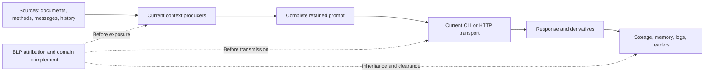

# Bell-LaPadula — Rust source and transmission inventory

[Français](../architecture/BLP-FLOWS.md) ·
[Source-bound inventory](../architecture/blp-flow-inventory.json) ·
[BLP plan](plans/actions-confiance/BLP-APEX.md) ·
[PAEA reassessment](plans/actions-confiance/paea/BLP-REASSESSMENT-20261031.md).

## State and scope

BLP-01, October31: **24 documented flows, 43 anchors in 41 source files**,
reviewed at current producer/consumer boundaries. The JSON records exposed
material, producer, recipient, existing controls, owner, missing packages and
required observable per flow, with complete source hashes/anchor lines. Changes
require review. All 24 runtime BLP criteria remain OPEN; this is not an exhaustive
inventory of dynamic behavior.

The permanent blp-flow-inventory recipe passes two steps and five checker tests
actually execute. They establish inventory freshness/refusal/recovery, **not
prevention of disclosure**. No provider, live data, account or security setting
changes. No product-executable behavior changes: build, installation and release
notes are therefore not required for this increment.

## Inventoried boundaries

| Flows | Sources → recipients | Required integration |
|---|---|---|
| BF-01–04 | Project profile, memory, local/embedded methods, excerpts and history → context | Attribute all versions/copies, including instructions; path/secret guards establish no classification |
| BF-05 | Documents, adopted brief, history, current message and methods → retained complete prompt | Produce fixed domain from every input, without missing-source or implicit-public fallback |
| BF-06–08 | CLI preparation, HTTP JSON/SSE and manual probe → effective provider/configuration | Bind bytes/account/destination/key use at engagement; fixed probe text does not make its key public |
| BF-09–13 | Worker, planner, reviewer and validation → programs/descendants | Keep existing authorizations; control argv, environment, stdin and workspace |
| BF-14–15 | Indirect reads, SDK/cache/network and telemetry → host/services | Actual dynamic inventory/mediation, including metadata and exporter variables |
| BF-16–18 | Responses/proposals, logs/transcripts, archives/recovery → storage/readers | Inherit confidentiality, current read checks and export control; truncating/summarizing is no declassification |
| BF-19 | Supplied PAEA proposal/context → pure reports/CLI/API | Serialized labels remain claims; protected attribution must not change historical v1 preimages |
| BF-20–22 | Git source/pack/ref or settlement/ledger → other stores/receipts | Pack transfer discloses before ref publication; effect authority and confidentiality are cumulative |
| BF-23–24 | Preview/agreements, originals/evidence/audit → operator/verifier/archives | Reader clearance, distinct declassification right and protection of evidence itself |



Solid edges are inspected flows without BLP guarantees; dotted edges are target
controls that still require implementation and qualification.

## Threats and assumptions

- User/model/document contents and PAEA context fields cannot self-attribute
  provenance, clearance or declassification rights. Equal-level incompatible
  compartments remain forbidden; supervisor roles grant no universal read.
- Retain current freshness, opened-root, effect-permission, Biba and I0 confinement
  mechanisms. They establish no confidentiality clearance and must not be disabled
  to make a BLP scenario work.
- The inspected Linux profile restricts writes/private authority but allows reads
  outside the private root; denying AF_UNIX is not Internet confinement. SDKs may
  access files, caches, account configuration and services outside the prompt.
  Observe these before making BF-14 claims.
- Configured endpoint alone does not establish full destination: bind account,
  resolution, any proxy/routing path and actual connection or refuse explicitly.
  No private ambient-proxy configuration was inspected/tested; its effect remains
  to be qualified.
- Privileged host and operators holding control authority are trusted. External
  unconfined same-UID writers, covert channels and a compromised kernel are outside
  this application inventory.
- Failure after transmission may retain known/unknown disclosure. Stop, revocation
  and reconciliation recall no previously sent bytes.

## Chosen BLP-03/04/05 integration — target, not implemented here

Reuse actual context producers and the existing monitor with protected attribution
separate from public DTOs. Neither trusting SourceRef labels nor checking only
the final prompt while forgetting history/program access is sufficient.

1. Under current authority, a resolver binds actual object/version/bytes, persisted
   classification and opened project. Explicit legacy admission preserves history;
   unknown inputs never become public.
2. Assembly retains lineage for profile, embedded/local instructions, documents,
   excerpts, history, message and response contract. Produce a fixed domain and
   lineage for the exact complete prompt.
3. CLI/HTTP consume producer-created results with an authenticated principal and
   current policy at engagement. A free string or blp-check diagnostic is no
   transmission capability.
4. Responses/derivatives/evidence/errors inherit the exposed domain. Reauthorize
   read/transmission and mediate indirect paths. Domain change requires a fresh
   execution.
5. Lowering requires BLP-06: new copy, established human identity, specific right
   and exact bytes/recipients/target classification/revision approval. Existing
   Git agreements grant no such right.

First integration journey: BF-05 → BF-07 → BF-16 (HTTP preparation) using an owned
local fixture server, no paid provider. Require legitimate read/transmission,
unknown source, incompatible compartment, post-preparation mutation, revocation
before send, lost response and inheritance across recovery. A receiving oracle
checks actual bytes and no transmission on refusal. Other paths remain required;
no transversal confidentiality claim while they are open.

## Recipe, errors and recovery

```sh
python3 tools/paea/check_blp_inventory.py --inventory docs/architecture/blp-flow-inventory.json
python3 tools/verification/recipe.py run --recipe tools/verification/recipes/blp-flow-inventory.json --output NEW_DIRECTORY
python3 tools/verification/recipe.py verify --evidence NEW_DIRECTORY
```

The checker never refreshes hashes. Changed sources/anchors refuse; reread the
producer/consumer contract, assess the change and explicitly revise the inventory.
Ambiguous JSON, unknown references, escaping paths, incomplete contracts and a
runtime_enforced:true claim also refuse. Success establishes freshness of reviewed
declarations only; an undeclared new channel can escape this check.

Increment review: counts are observations, not limits. Schema1, BF IDs and hash
format are representation contracts, not operator policy. Checker/tests are
documented; IO causes propagate to library callers, CLI uses safe codes without
private content. The graph grants nothing. Evidence remains under
docs/plans/actions-confiance/verification-blp/20261031-flow-inventory-01/.
BLP-01 stays partial for dynamic channels; BLP-RET-01/02/03 remain open.
