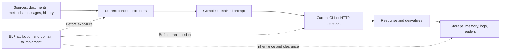

# Bell-LaPadula — Rust source and transmission inventory

[Bell-LaPadula: existing implementation and interfaces](BELL-LAPADULA.md).

[Français](../architecture/BLP-FLOWS.md) ·
[Source-bound inventory](../architecture/blp-flow-inventory.json) ·
[BLP plan](plans/actions-confiance/BLP-APEX.md) ·
[PAEA reassessment](plans/actions-confiance/paea/BLP-REASSESSMENT-20261031.md).

## State and scope

BLP-01, 1 November revision: **25 documented flows, 50 anchors in 46 source files**,
reviewed at current producer/consumer boundaries. The JSON records exposed
material, producer, recipient, existing controls, owner, missing packages and
required observable per flow, with complete source hashes/anchor lines. Changes
require review. All 25 runtime BLP criteria remain OPEN; this is not an exhaustive
inventory of dynamic behavior.

The permanent blp-flow-inventory recipe passes two steps and five checker tests
actually execute. They establish inventory freshness/refusal/recovery, **not
prevention of disclosure**. No provider, live data, account or security setting
changes. In that initial inventory-only increment, no product-executable behavior changed: build, installation and release
notes are therefore not required for this increment.

## Inventoried boundaries

| Flows | Sources → recipients | Required integration |
|---|---|---|
| BF-01–04 | Project profile, memory, local/embedded methods, excerpts and history → context | Attribute all versions/copies, including instructions; path/secret guards establish no classification |
| BF-05 | Documents, adopted brief, history, current message and methods → retained complete prompt | Produce fixed domain from every input, without missing-source or implicit-public fallback |
| BF-06–08 | CLI preparation, HTTP JSON/SSE and manual probe → effective provider/configuration | Bind bytes/account/destination/key use at engagement; fixed probe text does not make its key public |
| BF-09–13 | Worker, planner, reviewer and validation → programs/descendants | Keep existing authorizations; control argv, environment, stdin and workspace |
| BF-14–15 | Indirect reads, SDK/cache/network and telemetry → host/services | Actual dynamic inventory/mediation, including metadata and exporter variables |
| BF-16–18 | Responses/proposals, logs/transcripts, archives/recovery → storage/readers | Inherit confidentiality, current read checks and export control; truncating/summarizing is no declassification |
| BF-19 | Supplied PAEA proposal/context → pure reports/CLI/API | Serialized labels remain claims; protected attribution must not change historical v1 preimages |
| BF-20–22 | Git source/pack/ref or settlement/ledger → other stores/receipts | Pack transfer discloses before ref publication; effect authority and confidentiality are cumulative |
| BF-23–24 | Preview/agreements, originals/evidence/audit → operator/verifier/archives | Reader clearance, distinct declassification right and protection of evidence itself |
| BF-25 | Recorded-prompt diagnostic → CLI/HTTP | Current attribution of every slice and caller clearance; no send ticket or output-medium control |



Solid edges are inspected flows without BLP guarantees; dotted edges are target
controls that still require implementation and qualification.

## Threats and assumptions

- User/model/document contents and PAEA context fields cannot self-attribute
  provenance, clearance or declassification rights. Equal-level incompatible
  compartments remain forbidden; supervisor roles grant no universal read.
- Retain current freshness, opened-root, effect-permission, Biba and I0 confinement
  mechanisms. They establish no confidentiality clearance and must not be disabled
  to make a BLP scenario work.
- The inspected Linux profile restricts writes/private authority but allows reads
  outside the private root; denying AF_UNIX is not Internet confinement. SDKs may
  access files, caches, account configuration and services outside the prompt.
  Observe these before making BF-14 claims.
- Configured endpoint alone does not establish full destination: bind account,
  resolution, any proxy/routing path and actual connection or refuse explicitly.
  No private ambient-proxy configuration was inspected/tested; its effect remains
  to be qualified.
- Privileged host and operators holding control authority are trusted. External
  unconfined same-UID writers, covert channels and a compromised kernel are outside
  this application inventory.
- Failure after transmission may retain known/unknown disclosure. Stop, revocation
  and reconciliation recall no previously sent bytes.

## Chosen BLP-03/04/05 integration — target, not implemented here

Reuse actual context producers and the existing monitor with protected attribution
separate from public DTOs. Neither trusting SourceRef labels nor checking only
the final prompt while forgetting history/program access is sufficient.

1. Under current authority, a resolver binds actual object/version/bytes, persisted
   classification and opened project. Explicit legacy admission preserves history;
   unknown inputs never become public.
2. Assembly retains lineage for profile, embedded/local instructions, documents,
   excerpts, history, message and response contract. Produce a fixed domain and
   lineage for the exact complete prompt.
3. CLI/HTTP consume producer-created results with an authenticated principal and
   current policy at engagement. A free string or blp-check diagnostic is no
   transmission capability.
4. Responses/derivatives/evidence/errors inherit the exposed domain. Reauthorize
   read/transmission and mediate indirect paths. Domain change requires a fresh
   execution.
5. Lowering requires BLP-06: new copy, established human identity, specific right
   and exact bytes/recipients/target classification/revision approval. Existing
   Git agreements grant no such right.

First integration journey: BF-05 → BF-07 → BF-16 (HTTP preparation) using an owned
local fixture server, no paid provider. Require legitimate read/transmission,
unknown source, incompatible compartment, post-preparation mutation, revocation
before send, lost response and inheritance across recovery. A receiving oracle
checks actual bytes and no transmission on refusal. Other paths remain required;
no transversal confidentiality claim while they are open.

## Recipe, errors and recovery

```sh
python3 tools/paea/check_blp_inventory.py --inventory docs/architecture/blp-flow-inventory.json
python3 tools/verification/recipe.py run --recipe tools/verification/recipes/blp-flow-inventory.json --output NEW_DIRECTORY
python3 tools/verification/recipe.py verify --evidence NEW_DIRECTORY
```

The checker never refreshes hashes. Changed sources/anchors refuse; reread the
producer/consumer contract, assess the change and explicitly revise the inventory.
Ambiguous JSON, unknown references, escaping paths, incomplete contracts and a
runtime_enforced:true claim also refuse. Success establishes freshness of reviewed
declarations only; an undeclared new channel can escape this check.

Increment review: counts are observations, not limits. Schema1, BF IDs and hash
format are representation contracts, not operator policy. Checker/tests are
documented; IO causes propagate to library callers, CLI uses safe codes without
private content. The graph grants nothing. Evidence remains under
docs/plans/actions-confiance/verification-blp/20261031-flow-inventory-01/.
BLP-01 stays partial for dynamic channels; BLP-RET-01/02/03 remain open.

## BLP-04 — preparation byte provenance (31 October increment)

`preparation_send` now uses `preparation_prompt::assemble`. A private manifest
covers every prompt byte in order without duplicating text: aggregate project
context, engine instructions, optional plan contract, JSON framing and each of
the nine data fields. These include documents, retained excerpts, adopted brief,
method, method sources, history, mode, omitted exchange count and current message.
Wire text remains identical to the previous assembly. Digests cover the actual
serialized JSON bytes. Aggregate inputs do not establish per-file/version labels.

New private native envelopes use v3 and require provenance. Historical v1/v2
remain readable without it; no provenance is retrospectively invented. Older
workers refuse v3. Native record reads used by dispatch, worker claim and replay
check digests, full coverage, UTF-8 boundaries and origin/JSON-key correspondence.
Missing/null v3 metadata refuses; inconsistent bytes yield
`preparation-prompt-provenance-invalid` before provider handoff. Public DTOs
continue to omit prompt, manifest and nonce.

This establishes observed-byte consistency, **not identity, classification or
disclosure authority**. A datastore writer can rewrite both bytes and digests;
authentic attribution remains pending. Preparation still lacks its authenticated
current BLP principal. No confidentiality domain, BLP sink check or response
inheritance is implemented. BF-05/07/16 and BLP-04 remain open;
`runtime_enforced:false` remains accurate.

Recipe: `tools/verification/recipes/blp-preparation-provenance.json` (assembler
and native-row consumer). The existing CLI recipe also checks coverage and the
digest against stdin actually received by an inert provider. Results and delivery
are retained in the [resumption record](plans/actions-confiance/BLP-PROVENANCE-20261031.md).

1 November revision: BF-23/24 include the PAEA reader and current-attribution
recheck. Policy renewal preserves prior levels/compartments; coverage remains
partial. Four drifted sources were reviewed (preview, presentation, Trust
dispatch, BLP module); unrelated source hashes were not refreshed.

### Revision: preparation-source diagnostic

BF-25 records `blp-preparation-check` output to CLI/HTTP: authenticated principal,
current control attributions for every slice, conservative join, typed refusals
and no mutation. It remains OPEN for physical source identity and actual recipient/
output-medium control; the diagnostic is no send ticket. BF-05 now distinguishes
this post-hoc observation from prompt admission. BF-16 explicitly records that
answers/proposals have no persisted BLP classification. Semantic review of three
changed engine files precedes updated anchors; five new anchors cover the
diagnostic/adapters. `20261101-preparation-flow-inventory-01` passes two steps and
five checker tests with verified integrity. Stale inventory refusal remains in
`20261101-preparation-flow-inventory-before-01`. Counts do not establish effective
BLP controls or independent acceptance.

### Revision: explicit preparation quarantine

BF-05/06/07 include current refusal at admission, claim and API/CLI transport. Four additional anchors track the dedicated egress lock and local/enrolled Trust mutations; the business lock is released before IO. The ten references whose sources changed were reread and refreshed. All 25 flows remain OPEN: optional quarantine establishes neither classified recipient authorization, result inheritance nor descendant confinement. New journey evidence is retained in the APEX plan.

BLP-04 adds the public blp-preparation-attribute producer: it selects a verified native
turn slice under cleared I3/admin authority without caller-supplied digest/path.
Two anchors bring the inventory to56; all25 flows remain OPEN. This post-capture
control establishes neither an admission-time fixed domain, recipient permission
nor output inheritance.

Pre-transport admission adds four BF-05 anchors (60 total): shared producer
without turn/reservation, explicit pre-admission source labels and immutable
capsule for the actual authenticated principal. All25 flows remain OPEN: no
allowed recipient/transport, output inheritance or general legacy-send/upstream
transformation protection is established.

### Revision: explicit destination binding and last-use transport decision

BF-05 and BF-07 add the explicit destination binding and last-use
`blp-preparation-transport` decision: a privileged administrator records a
destination label for the exact account/endpoint of an `api-` connection
(mandatory `base_url`/`model` echo, per-Root canonical digest, key never an
input), then the principal owning an admitted capsule can observe a go/no-go
decision under the shared egress lock: full capsule re-verification (principal,
instance, revisions, policy digest, per-source join, rebuilt output label),
connection/provider_source/settings freshness since admission, the current label
for that exact digest, no-write-down dominance at last use, and read-only budget
envelope observation. The reply is fixed and non-emissive
(`runtime_authorized:false`, `runtime_enforced:false`, state
`transport-authorized-not-sent`); no turn, reservation or provider IO is
produced, and no legacy path is modified. Typed refusals cover grammar
(`blp-transport-invalid`, `blp-destination-invalid`), echo
(`blp-destination-echo-mismatch`), missing attribution
(`blp-destination-not-attributed`), freshness
(`blp-transport-connection-changed|provider-source-changed|settings-changed`),
write-down (`blp-access-denied`) and budget
(`preparation-budget-exhausted|work-budget-exhausted`); the HTTP mapping
distinguishes 400/404/409/403/500. The surveillance grants neither emission
rights, OS confinement, nor result inheritance; BF-07 remains OPEN for the real
transport engagement, BF-05 for physical source identity.
