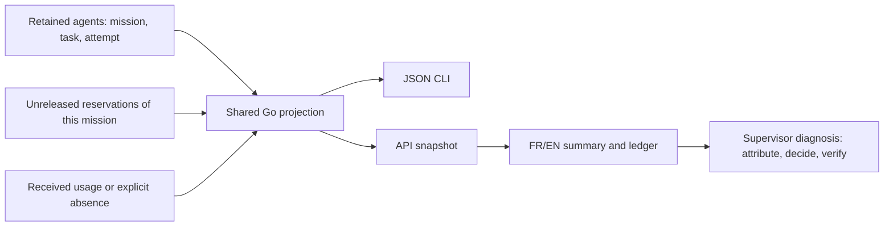

# Call, reservation and usage ledger

[Français](../architecture/CALL-ACCOUNTING.md)

The ledger attributes consumption and recovery to retained records. Aggregates
alone hide older attempts and missing measurements. It describes Swarm records,
not every internal provider inference and not an invoice.

`swarm --json mission spending WORK` and the public snapshot's `mission.spending`
share the Go projection. In **Overview**, open **Actions and history**, the call/cost
window and its detailed ledger. The budget view reuses the component. Disclosures
remember their state, render details on opening and do not duplicate rows when
reopened. Provider text is never interpreted as HTML.

| Field | Provenance and meaning |
| --- | --- |
| `calls[].id` | `agent/ID` for a producer attempt; `planning/ID` for a reservation |
| `record_type`, `kind`, `role` | Producer attempt or planning reservation; worker, planner or reviewer |
| `task`, `attempt`, `scope` | Retained attribution; worker scope comes from the task owner |
| `state`, `registered_at` | Recorded state/time, not evidence of inference submission |
| `provider`, `requested_model`, `observed_model` | Retained agent metadata when present; current configuration never replaces missing historical attribution |
| `usage` | Received measurement or explicit `null` |

Released reservations are excluded. Other reservations retain `estimated` or
`finished` state; finishing alone proves no billing. Historical reservation rows
do not retain per-call provider/model, so those fields remain unattributable.
Worker attempts may retain both requested and provider-reported model.

`spendingAgents` reads all retained attempts for this mission. The recent agent
panel keeps its 200-row slice; that slice no longer bounds accounting or its
aggregates. Deleted retention data cannot be reconstructed. Read/render volume
can grow with history: there is no silent truncation or new operator ceiling.

Received usage requires `input_tokens` and `output_tokens`, including explicit
zero. `null`, including surrounding whitespace, means missing. Partial objects,
invalid types or negative tokens/cache/cost cause a read error, never successful
empty data or invented zero.

Example: `100 / 25`, `cached_input_tokens:40`, no cost means 100 raw input tokens,
25 output tokens, 40 declared cached input tokens and unknown cost. Do not add 40
to 100. Explicit `provider_reported_cost_usd:0` differs from an absent field;
it is provider-reported zero, not a verified free invoice. Cache fields remain
optional and separate. No local price is applied to reconstruct missing billing.

Retries count distinct retained attempts per task beyond the first, with a
minimum equal to retained explicit `Agent.Previous` links. Historical links
without a known attempt remain counted; repeated attempt IDs are not new retries.
This is neither an inference count nor a provider error rate.

Workers/providers supply received measurements. Sub-supervisors diagnose their
scope; the root arbitrates cross-scope recovery and budgets. The engine projects
attributed records. Accounting grants no business completion decision, rights
or consumption change.

Targeted `TestMissionSpending*` checks cover units, foreign/released records,
null/invalid usage, 201 attempts, ordinary retries and legacy links.
`tests/call_ledger_test.cjs` covers FR/EN, unknown/zero/cache and safe text.
`tests/call_ledger_ui.cjs` uses an isolated already-paused store: actual CLI and
browser, both themes, keyboard/Escape/focus, mobile, diagnostics and unchanged
business state, without model calls. Dated evidence remains in the retrospective;
it does not certify later changed sources or inputs automatically.
