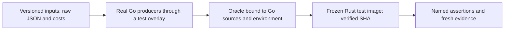
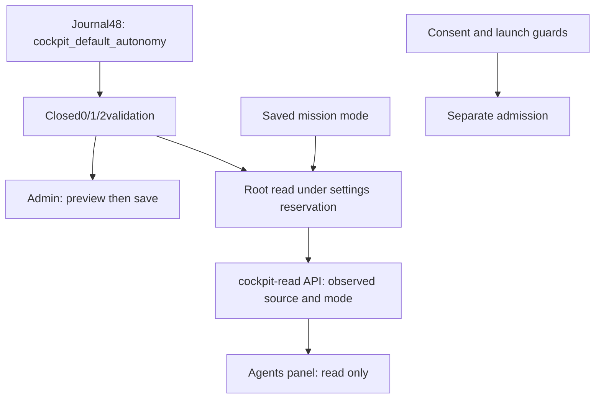
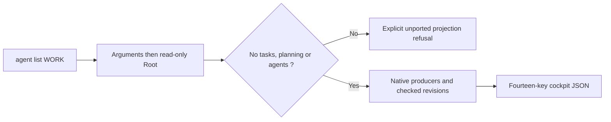
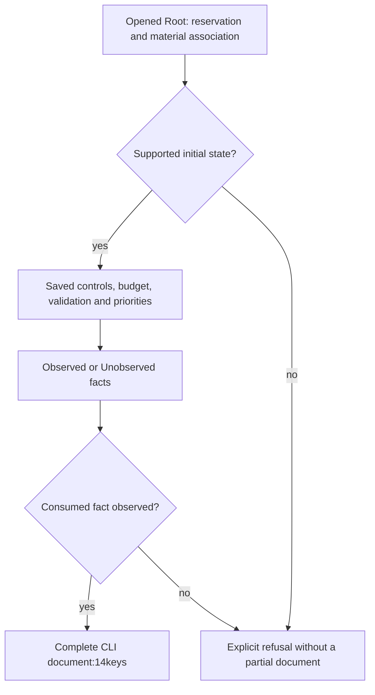

# Go/Rust cockpit serialization contracts

The maintained bench compares two real producers: Go `acceptanceSource` and
`CostTotal.Text`, then their Rust counterparts. It checks20cases:12source
cases (field order, null/empty values, latest attempt, gates/review, HTML and raw
JSON numbers) and8cost texts (absence, zero, partial reporting, rounding, large
values and negative zero). This is not the full `agent list` contract. The partial public integration of Root facts and all14keys is described below;
uncovered states, full freshness and authority still require proof.

Inputs `fixtures/cockpit-source-inputs.json` and Go results
`fixtures/cockpit-post-delivery-go.json` are maintained under
`tools/rust-migration/`. Task JSON remains a raw string: decoding and re-encoding
a `RawMessage` or numeric arguments can change `1.00`, `1e0` or `-0`, causing a
false mismatch. Cost cases retain original arguments rather than Go-normalized
copies.



The Go generator creates a temporary overlay, without adding Go product files
or opening Root. `--check-fixture` refuses changed results, environment or source
inventory; it never refreshes the oracle. `--write-fixture` requires a new path.
Changes go to fresh staging, diff review and atomic replacement under the shared
build lock, retaining the original. Source archives and before/after inventories
are checked; C/toolchain qualification and independent authenticity remain outside
this proof.

To create a Rust test image:

```sh
python3 tools/rust-migration/run_cockpit_oracle.py \
  --profile-invocation /PATH/BUILD/profile/invocation.json --output /FRESH/PATH
```

The runner uses recorded build options (debug/incremental), freezes the image
before execution and archives actual local compiler inputs (510in the retained
October28proof). It checks runtime corpus stability. This `cfg(test)` image must
never be installed. Compiled sources and runtime data have separate bindings;
replaying changed data does not claim current sources were rebuilt.

```sh
export SWARM_COCKPIT_UNIT_RECORD=/PATH/PROOF/result.json
python3 tools/verification/recipe.py run \
  --recipe tools/verification/recipes/cockpit-go-source-cost.json --output /FRESH/PATH
python3 tools/verification/recipe.py verify --evidence /FRESH/PATH
```

The recipe checks refusal to reuse old evidence directories, recomputes the current
Go oracle, then replays the retained Rust image without Cargo. Go is needed for
this differential check, not for the delivered application. No Root, provider,
installation or global watchdog is involved. Failures retain their causes and
stop the chain without changing old evidence. Rust source changes require a new
image; data-only corpus changes can replay the existing image. Hashes establish
neither signatures nor acceptance.

## Configurable initial autonomy — journal48

The user chose Automatic as the initial cockpit default, with three Admin
choices: Manual, Assisted and Automatic. Journal48 carries
`cockpit_default_autonomy` (string values `0`, `1`, `2`) with closed validation;
catalogue6 describes a scalar `choice` field. This display choice is neither
consent nor launch authority. A mission's saved mode takes precedence. Historical
journal47 remains readable without adopting this default; adoption requires
explicit Admin preview and save.

Current state: policy, catalogue, Admin selector and Root/API/Agents-panel reads
are delivered and verified in version240. Evidence below distinguishes units,
public journeys, compiled image and installed instance. Maintained recipe
`tests/rust_cockpit_autonomy.py` checks CLI/HTTP save and reread, rejection without
mutation, and mission-mode priority in an isolated Root.



The observation's `launch_authorized:false` is an invariant of this read contract,
not a hidden operator policy. Settings revisions remain exact decimal strings. A
journal without this choice yields `autonomy:null`, `source:not_configured`; an
older response without the observation displays an unobserved mode. Settings,
SQL and close errors retain their causes and never produce a substitute autonomous
mode.

A higher journal version does not prove adoption of every earlier independent
policy group. Admin preserves these absences on read; missing v1 core fields
and present future fields refuse. Only opening the editor proposes missing
defaults in a draft, with disclosure and required confirmation. The API can adopt
only the autonomy choice while preserving other groups as absent. The actual
local v41 journal exposed this distinction;
`engine_settings_admin_choice_ui.cjs` retains its counterexample.

### Verified local delivery —October28,2026

Version240, SHA `d4e5493f4b4dad0106d871ef6c564b9f83bfbea23bcbf1104fed58fbf431752d`,
is installed through the normal launcher and bound to the actual process. The
user's Autonomous choice alone was adopted from local journal41to48; other
values, history, five Works and controls were preserved with no consent change.
Evidence:12settings Rust tests (relevant sources unchanged),9scalar-choice UI
cases,20public CLI/API assertions,78browser assertions on image240, a historical
47→48witness, then14installed Version and16Admin checks without POST. Four
protected assets match the build archive. These different counts do not establish
a migration percentage. Recipes: `cockpit-autonomy.json` and
`cockpit-go-source-cost.json`; read-only installed check:
`tests/rust_installed_cockpit_autonomy.py`. Full historical `agent list` remains
to be connected. This delivery is not independent acceptance or closure of the
migration/Biba/PAEA projects.

## Agent list — initial public delivery241

Source `agent list WORK` now calls `RootStore::inspect_cockpit`. Its initial
scope is an ordinary Work with no tasks, planning or retained agents. It composes
all14Go keys from actual Work, validation, costs, stored pause/mode and slots,
validated priorities and cockpit observations. Empty collections follow actual
empty observations in this slice; unsupported Works explicitly refuse with
`cockpit-task-projection-unported`, `cockpit-planning-projection-unported` or
`cockpit-agent-projection-unported`. This is not complete agent list support.

As in Go, the CLI emits JSON with or without `--json`, validates arguments before
opening and retains close/output failures. The reader maintains Root association,
holds saved settings and compares observed revisions. SQL reads remain separate,
without an atomic snapshot or later-action authority. No launch, consent or
setting is changed.



Maintained bench `tests/rust_cockpit_agent_list.py` compares Go/Rust on the same
inert Root, normalizing only `pilotage.snapshot_as_of`, checked against actual
call windows. `project_view_key` hashes canonical Root pathname bytes, never Work
JSON. The comparator rejects invented keys and booleans substituted for counters.
The differential recipe passes52public assertions and4comparator tests;
`cockpit-agent-list.json` integrity is verified. Native image241 is qualified
without fixture features and installed. Increment review covers the four actual
compiler-input changes from240. Operator settings may intentionally differ from
Go’s fixed values; Go/Rust equality is verified under compatible policies,
without reproducing Go’s hidden16-slot clamp.

## Initial-task extension — delivered in version243

The delivered CLI supports `todo` tasks without dependencies, attempts, gates,
reviews or revalidation, in an ordinary Work without planning or retained agents.
It assembles actions, actual delivery observations, saved budget and pause/hold/brief
controls, and persisted priority rows only. An offered action grants neither consent
nor authority. Consumed guards must be `Observed`; a required `Unobserved` fact
refuses rather than inventing a passed gate. Unconsumed branches remain unobserved.
Other states refuse before publishing a document. Separate SQL reads and revision
fences do not create an atomic snapshot.

`rust_cockpit_agent_list.py --initial-tasks` compares the full Go/Rust document,
pause, priority, insufficient budget and recovery. The original241refusal is retained
before correction. Candidate243passes85journey assertions,15global-overlap
assertions and4comparator counterexamples;14Rust action tests and1priority test
also pass. Local installation is verified: image
9bc11252d9c37d1f76f2241325a6f05afee85a804c4e64d11e9aa6475fe909c3,
process1102767,4matching protected assets,14Version and16Admin FR/EN assertions.
The5Works, their controls and saved settings are preserved. These proofs do not
qualify tasks with dependencies/history, agents or planning, PAEA/Biba, or the
complete migration.



Actions are read-only proposals. Launches still require the engine's authority,
identity, workspace and budget gates.

## TODO dependencies — delivered in version244

The reader now observes dependencies between TODO tasks: they stay
pending, never fresh. Graph edges and waiting_on lists retain saved ordering;
start and override reasons identify the first dependency. evaluated_at clocks
are checked against real call windows without normalizing other facts. Controls
cover no edge, one edge, multiple prerequisites and a chain, then a blocked-state
refusal without a document. Version244extends243. The complete Go/Rust journey passes101main assertions,
15global-overlap assertions and5comparator counterexamples. The default profile
binds the2changed inputs (reader and notes), without fixtures. Installation is
verified: image2d28e0bc7fe061131617ee9c26ceb276bce74b2c36a304d85648b5b57e34015b,
PID1130985;4matching assets,14Version and16Admin FR/EN checks,5Works and their
controls preserved. Attempts, reviews, retained agents and planning remain
outside this slice. Complete migration is not inferred.
