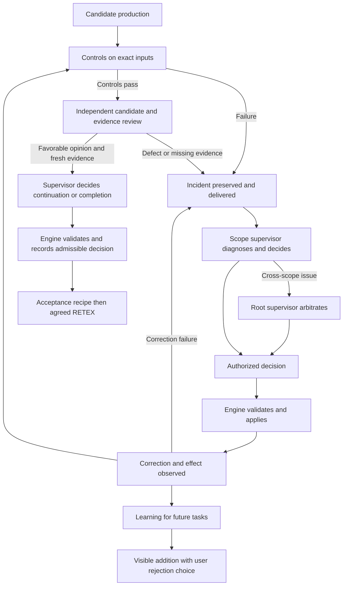

# Controls and feedback loops: improving agent work

Research state as of 11 October 2026. [Version française](../architecture/CONTROLS-AND-FEEDBACK.md).

## Intended improvement

An agent can produce a plausible change while citing a test that did not run,
using stale context, or misinterpreting a refusal. Swarm aims to make those errors
detectable, recoverable and less likely to recur. Quality means meeting the need
and obtaining acceptance under the required evidence, with fewer human restarts.

Controls improve reliability when they detect a real defect and cause a verified
correction. A new instruction or log entry alone establishes no such effect.
Speed and cost improvements need measurement: another review may reduce rework
while adding immediate delay. Prevention must improve subsequent work.

Operational learning changes the instructions, delivered context and working
contracts available to agents. Its effectiveness must be checked in subsequent
tasks; saving an instruction update alone does not establish improvement.

## Responsibilities

| Function | Question | Owner | Required evidence |
| --- | --- | --- | --- |
| Control | Does the candidate meet a verifiable condition? | Engine running the configured control | Exact inputs, candidate, command, original output and attributed result |
| Feedback | What caused the failure and what should change? | Scope supervisor; root for cross-scope issues | Received incident, diagnosis, authorized decision and observed effect |
| Learning | What should change for future tasks? | Supervisor, retaining the user's rejection choice | Attributed instruction addition, delivery and evaluation of its usefulness |

Independent review examines candidate and evidence in a separate context; it
never edits the candidate. Supervisors decide what work remains and when it is
finished. The engine checks admissibility, permissions, freshness, reservations
and required proofs before applying their decisions. Process exit, a passing test
or an acknowledgement is not business acceptance.

Correction restores the current work to a verifiable state. Learning adjusts
future instructions or contracts. RETEX evaluates their effects and proposes
further changes; it cannot replace unfinished requirements or acceptance checks.

## Example 1: a test claim has no matching receipt

**Observed in T2.** Delivery cited a local verbose test run and a package duration
of 8.302 seconds. The native control used a different command without `-v` and
recorded 11.434 seconds of wall time. These are distinct runs. Review requested
an attributed receipt for the alternative run.

A fresh local receipt now records exact argv, dates, original output, SHA-256,
exit 0 and unchanged source inputs. This run reports 7.274 seconds for the package
and 17.491583 seconds for the complete command. Delivery distinguishes both
measurements from the native control. Historical originals are retained; a new
candidate still needs fresh controls and independent review.

The next agent can determine what actually ran and whether evidence matches its
inputs. The general lesson is to bind each test claim to its own receipt and keep
package duration distinct from command wall time. Prevention must be checked in
subsequent deliveries.

## Example 2: evidence exists but the supervisor receives an empty inventory

**Observed; engine correction qualified.** A 759,750-byte original review context
was read using a limit intended for another artifact type. Eleven authenticated
sources existed, but the supervisor received an empty inventory. Repeating an
instruction to consult evidence could not repair that delivery boundary.

The general fix authenticates and reads the entire context and projects a fresh
inventory to root and child supervisors. Original proofs and journals remain
unchanged. Regression guards cover the original case, variants and invalid
inputs. Native operation established receipt, the supervisor's retry decision
and its application to a new journal. The next call encountered a provider quota;
no favorable final opinion is inferred from that partial chain.

Agents can distinguish missing context, insufficient capacity and a candidate
defect, instead of applying the same retry to three different causes.

## Example 3: the correction introduces another failure

**Reproduced during qualification.** A recovery projection tried to acquire the
SQL connection already held by the current mutation. More time or model budget
would not fix this engine deadlock.

The preserved stack identified the boundary. Projection now reads immutable
proofs, while the producer check at commit uses the existing transaction. Root,
child and invalid-input cases pass, as do the full suite and concurrency check on
the qualified cumulative source. Review subprocesses in these regressions are
controlled doubles; they do not prove real-model autonomy.

Recursive diagnosis also applies to a failed correction and to our own method.
The new failure stays linked to its parent; resolving it should restore progress
on the original need.

## Example 4: a provider quota rejects a call

**Observed.** Claude rejects a selection call with HTTP 429 and a stated deadline.
No usable opinion is returned. Swarm retains the rejection, consumed call and
history. Quota exhaustion is neither a candidate defect nor an acceptance verdict.

The provider account owns this dependency. Independent repairs can continue.
Resumption requires a changed precondition: expiry or explicit confirmation that
the account is restored, an attributed public operation, then a real call to
verify availability. A new rejection remains an incident, not a reason to repeat
an unchanged action. Benefit is measured as wasted calls avoided, without refunds.

## Example 5: two agents work in parallel

**Illustrative recipe, requiring verification.** One agent changes the global judge
while another prepares its settings UI. The supervisor retains ownership and the
shared-contract dependency. The engine checks reservations and binds evidence
to the reviewed candidate. If the contract changes, the UI's earlier proof may
become stale. The supervisor decides the required requalification; the engine
rejects effects on incompatible inputs. Independent tasks should keep moving.
Role names alone do not demonstrate actual concurrent real-model operation.

## Example 6: a business process

**Illustration, not an executed Swarm recipe.** One agent prepares an invoicing
file while another checks its supporting documents. A missing attachment or a
conflicting amount triggers diagnosis and a scoped correction decision. The root
handles cross-file issues or permissions. The engine checks transitions and proofs
before applying an admissible decision. The business owner decides completion
under its acceptance conditions; sending the invoice requires appropriate rights.

RETEX may propose an earlier attachment check. The user can reject the future
instruction addition. A proposal alone proves neither delivery nor effectiveness.

## Measure the improvement

Compare similar objectives and conditions. Preserve task type, engine revision,
model, budget, inputs and human interventions. Separate local checks, doubles,
real-model behavior and native acceptance.

| Metric | Definition | Interpretation risk |
| --- | --- | --- |
| First-pass acceptance | Results accepted without correction / reviewed submissions | Removing a control can manufacture a gain |
| Recurrence | Same root cause reappearing after a verified correction | Different error wording may hide the same cause |
| Human restarts | Interventions required to diagnose or resume work | Notifications alone are not required restarts |
| Time to acceptance | Authorized start to acceptance under required evidence | Separate provider wait, production, controls and review |
| Cost per accepted result | Attributed consumption, including failures and corrections | Failed attempts must remain counted |
| Resolved chains | Incidents with verified receipt, decision, application and effect | ACK or instruction update alone is insufficient |
| Control overhead | Time and consumption of controls by task class | More controls do not automatically mean better quality |

Each added control should address an observed risk and provide useful decision
evidence. Settings belong to the appropriate configurable contract; these observed
numbers create no arbitrary thresholds. Durable corrections preserve the original
case and relevant variants as regression guards, then transmit learning.

Qualified fixes demonstrate improvements to evidence, delivery and recovery
contracts. They do not yet quantify Swarm's overall speed, cost or autonomy gain.
Native final review, the acceptance recipe and RETEX remain required.

References: [research and evidence](../publications/20261005-cursor-moteur/dossier-recherche/revisions/20261011-instruction-learning-retex.md),
[recursive recovery](AUTORECURSIVE-RECOVERY.md), [traceability](TRACEABILITY.md),
[Cursor publication contract](CURSOR-ENGINE-CONTRACT.md).
