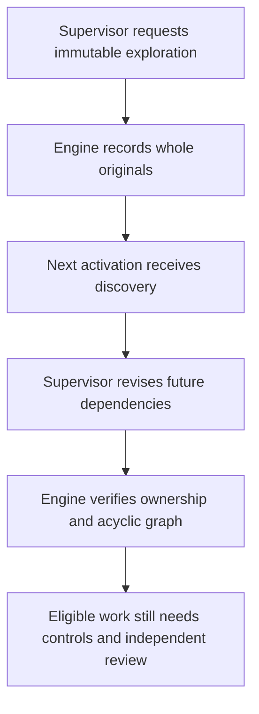
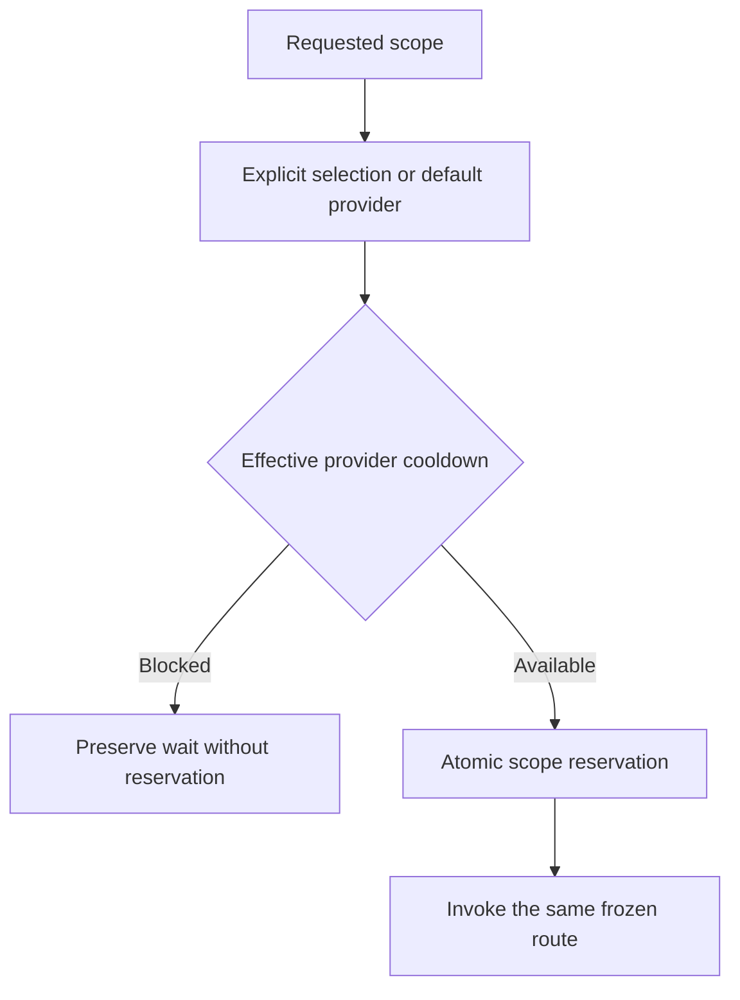
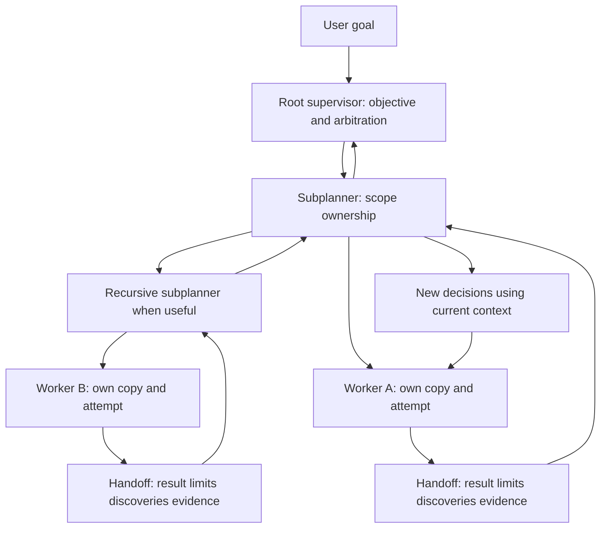
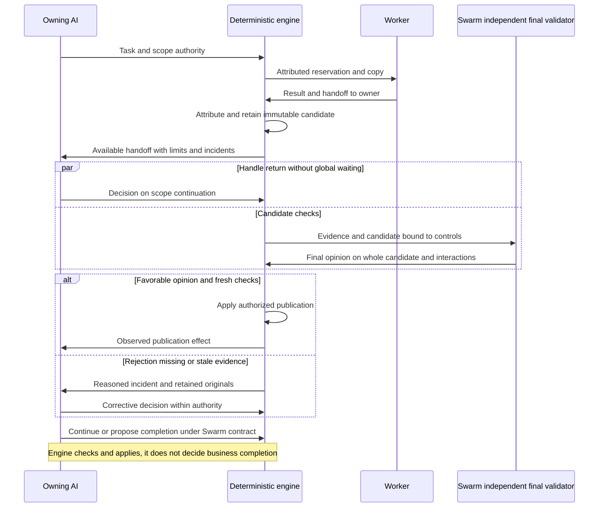
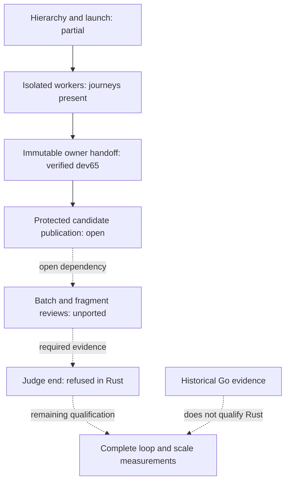
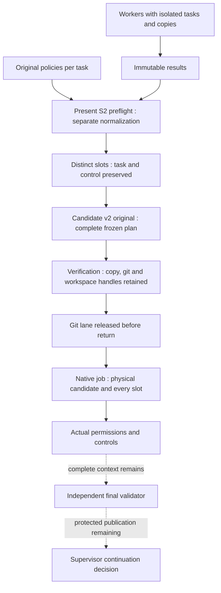
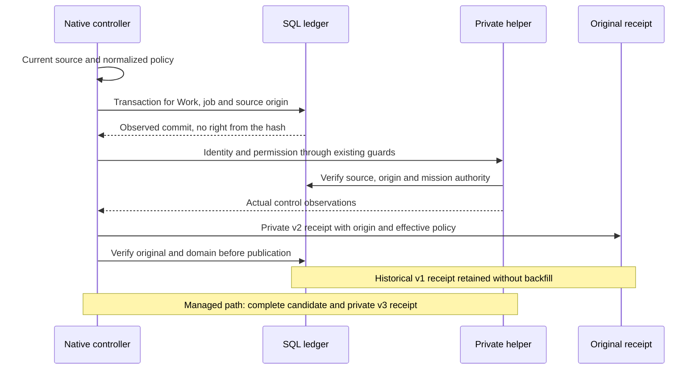
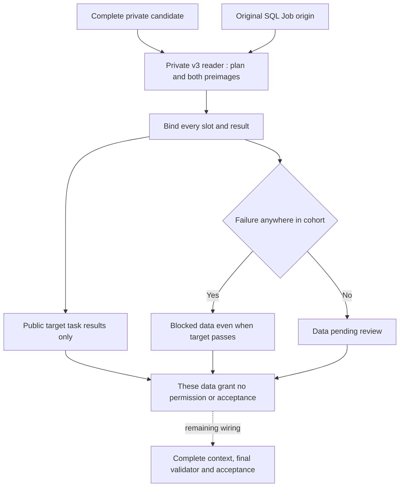
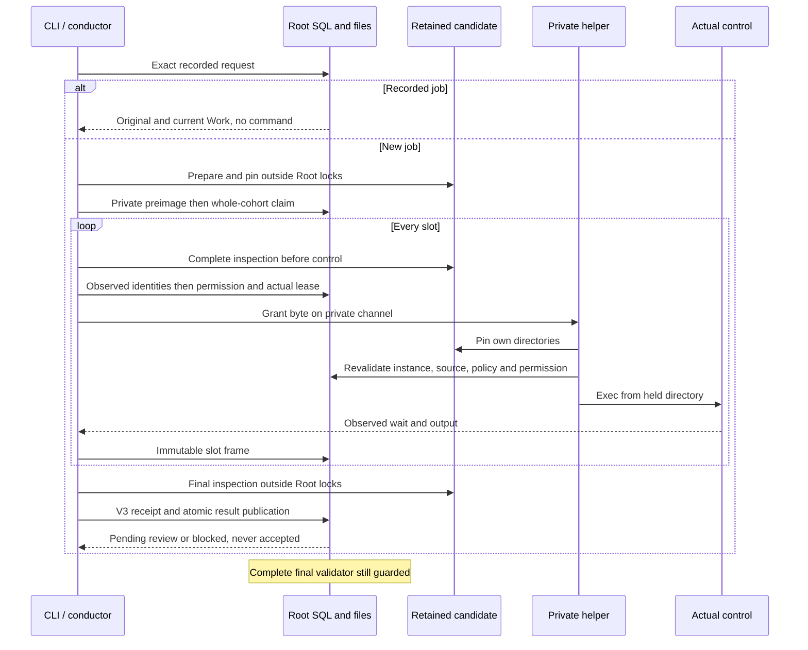

# Engine contract: January and February 2026 Cursor references

> **Current Rust reading:** see the October 25 review and end-of-page diagrams. Earlier results below remain historical Go evidence.

[Français](../architecture/CURSOR-ENGINE-CONTRACT.md)

Retained references: [Cursor — Scaling long-running autonomous coding](https://cursor.com/blog/scaling-agents), January 14, 2026, and [Towards self-driving codebases](https://cursor.com/blog/self-driving-codebases), February 5, 2026.

User clarification, October 10, 2026: both publications are retained. The previous correction wrongly excluded February. January remains the source for JAN-1 through JAN-7; February complements the architecture and explains its evolution. Document differences between versions without claiming compliance by combining their descriptions. This documentation correction does not change the engine.

This document separates a design rule, its engine enforcement and evidence that
it ran. “Cursor compliant” is not a certification: the article describes a
research experiment and its tradeoffs. Deterministic tests alone do not prove
that a live Swarm mission finishes without assistance.

## Responsibilities

The [agent parallelism contract](AGENT-PARALLELISM.md) explains needs, constraints
and required evidence, with Mermaid diagrams separating parallel production
from exclusive publication.

| Role | Responsibility | Permitted effect |
|---|---|---|
| Root planner | Owns the complete requirement; decomposes and adapts the work. | Structured planning decisions, no coding commands. |
| Scope planner | Owns its delegated slice; may delegate recursively within limits. | Tasks and decisions within its scope, no coding commands. |
| Worker | Completes a bounded task in its own repository copy. | Local changes and a handoff to the owning planner. |
| Independent reviewer | Examines the result and evidence for the candidate revision. | A reasoned opinion, without writing tools or self-acceptance. |
| Deterministic controller | Executes checks and enforces publication rules. | Receipts, refusals and atomic transitions when all conditions hold. |

The January publication separates planners and workers, supports recursive subplanners, and includes a judge at the end of each cycle followed by a fresh iteration. Swarm’s independent candidate review does not replace that global judge. Additional evidence and acceptance safeguards must be distinguished from these requirements. Global cycle judgment and fresh iterations remain open alignment gaps until demonstrated, not authorized deviations.

Repository copies separate changes and Git references. They are not a security
boundary against a malicious process with the host account's permissions. These
guarantees concern public engine operations; an administrator who can alter the
database or executables is outside that boundary.

## January requirements — historical audit state on October 10

This matrix defines the target, not already delivered features. Local limits and
Swarm safeguards are not Cursor prescriptions. Evidence must distinguish source
inspection, simulated tests and live-provider execution.

| ID | Expected behavior | Required evidence | Status in this audit |
|---|---|---|---|
| JAN-1 | Planners continuously explore the codebase and create tasks. | Show repository information actually available to the planner and adaptation based on a new discovery. | Partial: event-driven decisions exist; continuous exploration is not demonstrated by a tool-free prompt. |
| JAN-2 | Planning can be recursive and parallel. | Observe two simultaneously active subplanners with distinct owned scopes and persisted decisions. | Delegation exists; actual subplanner concurrency was not demonstrated in this audit. |
| JAN-3 | Workers complete tasks without direct worker coordination and publish their changes. | Observe two independent tasks in parallel, rejected lateral channels and delivered results. | Targeted tests passed; Swarm’s central integration path differs from Cursor’s described behavior. |
| JAN-4 | An end-of-cycle judge decides whether work should continue. | A verdict covering the objective and cycle results, with a persisted continue or finish decision. | Not demonstrated: candidate review or deterministic closure alone is insufficient. |
| JAN-5 | The next iteration starts with fresh context. | Observe a two-cycle transition, the new context and preservation of the objective, evidence and limits. | Partial: fresh activation projections exist; a global cycle transition was not demonstrated. |
| JAN-6 | Coordination increases throughput without excessive central waiting. | Measure computation, lock waits, checks, review, publication and throughput at multiple concurrency levels. | Not measured; a 16-worker limit per mission and serialized publication lane were identified. |
| JAN-7 | Prompts and model selection fit each role. | Inspect actual prompts and compare long-running missions with identified models and costs. | Distinct routes exist; suitability and endurance were not demonstrated. |

The targeted coordination tests passed on October 10, 2026, including `-race`;
they do not alone cover JAN-1 through JAN-7. Missing evidence does not prove a
missing feature, but prevents claiming complete alignment. The engine audit
still needs to cover these requirements.

## February additions — historical audit state on October 10

February describes a continuous hierarchy, worker-owned repository copies and handoffs to the owner. It removes the judge in an intermediate evolution and the central integrator. JAN-4 and JAN-5 remain retained Swarm requirements; they are not described as invariants of February’s final system. Compare a continuous hierarchy with judgment checkpoints against explicit cycles before choosing how they fit together.

| ID | Addition to verify | Expected evidence | Status |
|---|---|---|---|
| FEB-1 | Recursive ownership and handoff to the owner | Durable return, exact owner, reactivation after restart | Partial: mechanisms present, real-provider journey pending |
| FEB-2 | Handoff includes limits and discoveries | Actual content used in a subsequent decision | Unproven |
| FEB-3 | Freshness during continuous work | Observed renewal preserving objective and evidence | Unproven |
| FEB-4 | Explicit throughput and quality tradeoffs | Measurements and a distinct validated publication policy | Unmeasured; Swarm checks retained |

## Rules to verify in the engine

| Invariant | Required refusal | Evidence to retain |
|---|---|---|
| Planners do not code in a hierarchical mission | An explicit planner/subplanner launch is rejected, never silently converted into a worker. | CLI and HTTP response; no residual agent, reservation or copy. |
| Exclusive delegation | A delegated requirement cannot be reassigned or handled by the wrong owner. | Rejected decision; unchanged revision and unconsumed events. |
| Worker isolation | Two attempts cannot write into one shared copy. | Paths, references and observed contents of two actual test copies. |
| Handoff ownership | Foreign scope, old attempt, another copy's file or incorrect digest is rejected. | Unchanged state after refusal; one valid return to its owner. |
| Reactivation | A current handoff wakes its planner; replay does not duplicate it. | Store reopened with attempt and event identities preserved. |
| Descendant closure | A parent cannot close with open children, unfinished work or stale evidence. | Each refusal exercised with freshness checks. |
| Independent acceptance | Passing checks without favorable review, or stale/unknown/negative review, are insufficient. | Candidate SHA, attempt, contract, hashed review context and receipts. |
| Bounded recovery | Known quota, exhausted limits or an already reserved call do not grant extra attempts. | Preserved counters/history; durable hold and explicit cause. |

See the [provider quota guide](PROVIDER-QUOTAS.md) for holds and explicit clearance.

Legacy manual launches without hierarchical organization remain compatible. They
are not autonomous missions demonstrating these properties; an autonomous launch
requires the complete organization.

## Remaining demonstrations

1. **Handoff quality.** The current contract carries findings and artifacts. It
   does not yet require separate fields for changes, limitations, deviations and
   requested decisions. Correct routing does not establish this quality.
2. **Live autonomy.** Observe a requirement, delegation, production, reasoned
   rejection, correction and closure using a real provider. Count simulated
   responses and external host interventions separately.
3. **Visible recovery.** After manually clearing a hold without a reset time,
   historical evidence must remain visible without appearing as a new active
   rejection. Permission to try again does not establish provider availability.
4. **Throughput and concurrency.** Measure the integration lock during checks and
   review, and the cumulative context size. Current serialization and refusal of
   oversized context must remain visible.

## Definition of done

Normal process exit is insufficient. An accepted result needs the tested
revision, actual commands with timestamps and exit codes, report, independent
opinion, decision, freshness, deliverables and external intervention count.
A host-written fix can strengthen Swarm; it must not become fabricated autonomous
success inside the mission evaluating it.

## Evidence size and review transport

The review prompt remains capped at 192 KiB, including instructions. The engine
preserves the diff from the repository base, reports, receipts and sources from
the same candidate. It first reduces unchanged patch context and removes only
new source files already present in full in the patch, after exact comparison.

If JSON escaping still exceeds the cap, long texts use complete UTF-8 blocks
identified by field, byte length and SHA-256. Other metadata remains JSON. The
canonical stored context and its digest stay unchanged. No summary replaces
proof and no earlier change is removed from the diff. A packet that still exceeds
the cap is rejected before calling the provider. Process tests reconstruct the
whole packet and compare every field with stored evidence; genuinely oversized
packets remain rejected.

A newly added report already reproduced in full in the diff may reference that
copy after exact text comparison. Its length and digest remain explicit. Modified
or partially present reports stay attached in full. On rejection, diagnostics
record actual prompt and instruction sizes without exposing content.

### T3 implementation: read exploration and future dependencies

The reserved planner may request `explore` with a unique id and JSON
`deliverable`: `list` plus a relative directory, or `read` plus exact files,
bound to the accepted Git commit. The engine preserves whole original sources,
blob and SHA256 identities, scope, generation and observed revision in a durable
event. It executes no caller command and changes no source. Actual role transport
capacity is computed after workflow and instruction overhead; oversized complete
input is refused. A later planner activation receives the originals. A replaced
accepted candidate makes earlier discoveries historical and cannot authorize
new operations from that old input.

`revise-dependencies` changes only the explicit dependency array of an owned
future todo task with no attempt. Acyclic graph, lease and absence of active or
already prepared production are checked transactionally. Criteria, requirements,
spent budgets and blocked producer results are preserved. The old and new
dependencies are attributed to the supervisor decision. Reordering never accepts
the producer whose ordering prerequisite was removed.

Two concurrent subprocess fixtures demonstrate distinct sub-supervisor leases,
atomic scoped decisions, own and ancestor counters, shared reservations, pause,
replay and persistence. They are deterministic provider doubles; real-model
behavior remains a T7 recipe. This isolated T3 source includes the original
developed T2 Judge but does not accept T2. Deferred correction27 is excluded.
Historical runtime26 lacked these capabilities at that audit; current installation qualification is recorded in the final delivery retrospective.

### Supervisor reservation and effective provider

Claim admission checks the provider selected for the requested scope, matching
the provider used for its invocation. A default-provider cooldown does not block
an explicitly selected alternative; the effective provider's own cooldown blocks
the reservation without spending a claim. Child selections remain scoped. Default
identity, other provider waits, counters and historical responses are preserved.
Replaying an applied claim does not create a new call.

Isolated tests first reproduce both wrong-provider refusal and missed selected-
provider refusal for root and child scopes. Selection, inheritance, cooldown and
model regressions pass locally. This does not certify alternative-account access
or native T3 recovery.

The **October 13 Go delivery** has fixture evidence for `judge`/`renew` and a cumulative real-provider recipe in the historical delivery section; it does not qualify the complete Rust journey. See [judgment cycles](JUDGMENT-CYCLES.md) and the candidate delivery reports.

## Evidence after direct delivery on October13

The matrices above retain the initial audit. The real Go cumulative recipe, corrections and independent opinions are qualified within the explicit table limits; see the [T1–T8 audit](../plans/engine-cursor-contract/completion-audit-20261012.md) and [final retrospective](CURSOR-ENGINE-RETEX-20261013.md).

| Requirement | Current evidence | Demonstration limit |
| --- | --- | --- |
| JAN-1/JAN-2 | Attributed SPEC discovery and two real simultaneously reserved subplanners | Two modules, not continuous large-repo exploration |
| JAN-3/FEB-1/FEB-2 | Parallel isolated workers and handoffs; two accepted/fresh results on one published candidate | Defective-worker/semantic-refusal recovery retains fixture evidence, not real observation in this recipe |
| JAN-4/JAN-5/FEB-3 | Received/applied continue/renew and new context; explicit end cycle5, nine closed scopes | Assisted resumptions, not multi-day endurance |
| JAN-6/FEB-4 | Two fixture levels, real overlap: 53.149 s, three recorded controls | No comparative real scale/cost campaign; cost unknown and usage incomplete |
| JAN-7 | Frozen standard route and discriminator-order fix with observed effect | No comparative model endurance study |

Current architecture combines continuous hierarchy and judgment checkpoints, exclusive publication and parallel production. Effective Admin policies replace the historical bounds in the initial audit. Direct development, isolated recipe, reviewed code and deployed binary have separate evidence. The historical mission stays paused; no Cursor certification or universal autonomy is claimed.

## Principle review and Rust migration — October 25, 2026

Both linked articles were read in full. Earlier sections retain **Go** audits and
recipes; they do not qualify Rust. The [active Rust plan](../plans/migration-rust/PLAN.md)
tracks delivery. The source observations below establish connections and refusals,
not a served-binary journey or a real scale campaign.

### Research principles without merging versions

In January, Cursor separates discovery/planning from implementation, supports
recursive subplanners, then describes cycle judgment and fresh context. Flat
shared-file coordination and long-held locks caused contention, fragility and
safe small tasks without ownership of the entire goal. Models and prompts matter;
adding agents alone is insufficient.

In February, an overloaded continuous executor drifts. The final architecture
assigns ownership to root planners, subplanners and isolated workers. One handoff
carries results, concerns and discoveries back to the owner, who can resume
planning. The judge was removed during an intermediate stage, and the central
integrator abandoned as a bottleneck. Progressive code convergence is distinct
from preparing a releasable version. These experimental tradeoffs grant no Swarm
permission to accept a candidate without its required evidence.

### Swarm decisions and observable outcomes

| Principle | Swarm decision and boundary | Required observable |
| --- | --- | --- |
| One owner, separate responsibilities | Root owns cross-scope decisions, subplanners own slices, workers implement; the engine applies authorized decisions. | A local discovery produces an attributed decision by the right owner. |
| Plan continuously | Adapt to dependencies and findings without waiting for every worker. | One current handoff informs a decision while another worker remains active. |
| Parallel production, owner-directed returns | Separate copies and attempts; avoid direct worker coordination. | Independent production overlaps and each handoff reaches its own owner. |
| Fresh context, retained history | Preserve objective, decisions, evidence, incidents and spending while supplying relevant current context. | Restart retains identities and actually delivers new information. |
| Reduce contention | Distinguish production, candidate preparation, controls, review and publication; measure waiting separately. | Long checks do not monopolize registry write authority for unrelated work. |
| Recover without invented success | Preserve cause and known effect; correct or route within authority; no unchanged retry. | Incident → decision → application → effect, without duplicate spending on replay/refusal. |
| Measure useful delivery | Count fresh accepted results, waiting, recovery and known cost rather than treating tokens or commits as delivery. | Compare equal workloads across concurrency levels with quality and interventions recorded. |

The **independent final validator** is retained: it examines the complete
candidate, criteria and interactions, using the same source candidate as the
checks. Positive local opinions or passing tests do not constitute its final
opinion. `pass`, `fail` and `unknown` remain distinct; missing evidence never
becomes approval. It grants no authority and does not decide that the global
need is complete. The supervisor owns continuation/completion under required
evidence; the engine checks freshness and applies the authorized decision.
This final candidate-validation role adds no central integrator doing or
arbitrating every worker's work.

| Swarm role | Decision or operation | Evidence and scope |
| --- | --- | --- |
| Subplanner | Propose, correct or continue within its scope. | Current attributed handoff, authority and dependencies. Does not wait for validation of an unrelated candidate. |
| Independent final validator | Return `pass`, `fail` or `unknown` for the complete candidate. | Criteria, checks and originals for that candidate, including interactions and unresolved concerns. Does not close the mission. |
| Root acting as global judge | Decide continuation or propose global completion. | Current results and required closure evidence; a proposal creates no missing proof. |
| Deterministic engine | Refuse or apply the authorized transition. | Schema, authority, reservations, freshness and evidence; no replacement for business judgment. |

Final validation does not impose a global barrier on unrelated scope decisions.
Contention requires scenarios and measurement; no arbitrary refusal deadline or
invented success rate is added to claim this risk solved.

Cycle judgment, final validation and protected publication are **Swarm**
contracts. Retaining JAN-4/JAN-5 is our design choice, not the final February
architecture. A transactional publication guard requires neither a central
integrator agent nor a lock held during a model call. Quality policy and any
relaxation require explicit decisions; this review changes neither.

### Examined Rust state and APEX ordering

| Chain | Rust source observation | Remaining outcome |
| --- | --- | --- |
| Hierarchical planning | `planning_run_material.rs` advertises task/delegation/recovery; `planning_decision.rs` still restricts managed-repository operations. | Verify the complete loop, beyond advertised operations. |
| Managed worker handoff | Installed Rust dev65 freezes a result commit and exact report, then the lease-fenced relay submits it to the owning scope. Original worker/attempt, settings, report and Git attribution are checked again by the canonical writer. | Handoff is verified on two isolated Roots, without acceptance. Candidate publication, managed validation and full-cycle scale evidence remain open. |
| Large evidence review | `managed_review_files.rs`, `managed_review_git.rs` and `managed_receipt.rs` still refuse batches/fragments. | Port producers, journals, checks and consumers together; never merely remove the refusal. |
| Global judgment | `planning_judge.rs` refuses `end` with `planning-judge-end-managed-evidence-unported`; existing `continue`/`renew` does not mean availability in every journey. | Requires current results and fresh closure evidence; process exit is not completion. |
| Scale qualification | Historical Go evidence and Rust fixture subprocesses remain distinct. | Requalify multiple Rust workers, rejection/correction, handoff, decision and restart; endurance and cost remain open. |

Dependency order: inspect actual contracts and existing ports → deliver useful
worker/candidate/owner return → qualify review and recovery → connect closure
under fresh evidence → measure the complete journey and record RETEX.
Independent branches can progress concurrently; this is not a global worker barrier.

Authorized SKYNET GLM contributions receive bounded tasks and necessary sources.
They propose without repository access or tools. The principal validates and
integrates; a GLM answer, diagram or document proves no port or acceptance.
Keep lots and evidence references in the existing Rust plan.

### Interrupted result retention

`managed_repository_result.rs` retains a private result ref before publishing
`results/AGENT/report.md` and its canonical manifest with no replacement. After
an interruption, retention reuses that ref; it must never resnapshot a changed
worker copy. The report cap comes from persisted `review_delivery_max_bytes`,
and each Git command uses the saved Git timeout. No retry or policy cap is added.
A failed retention may leave objects/ref/files: an error never proves rollback.
The new fixture deliberately refuses a file path using an owned empty directory,
then checks recovery with the clone parked. This is a filesystem-shape refusal,
not proof of ENOSPC, power-loss durability or final-validator acceptance. Its
source, outcome and remaining limits belong in the scaling plan and evidence.

### Git programs and source evidence

A worker copy’s Git configuration can name external filters. Result retention
must not execute them: `snapshot_tree` discovers effective filters, overrides
clean/smudge/process and required in command arguments, and verifies those values
before `add` and `write-tree`, without changing configuration. A key unrepresentable in `-c`
refuses before staging. These are technical operation invariants, not operator
policies or authority to execute code. The producer must have ended and directories
must be owned; this does not confine an arbitrary same-user process. Failed staging
can leave the index changed and never proves rollback.

The S2 candidate component, now consumed by the Root controller, checks
HEAD and parent using Git object reads without a worktree diff: even
`--no-textconv` permits clean-filter execution. It compares every tracked file’s
raw-byte hash with the original recorded after the controlled clone was created.
Refusal preserves that original; restoring bytes permits readback without
rebuilding the candidate.
Index flags (`assume-unchanged`, `skip-worktree`) cannot establish integrity alone.
Symlinks are read without following their targets; gitlinks and non-UTF8 paths
explicitly refuse until their custody is ported. A file observation is neither
a grant, an executed control nor final review. The 8192-byte read buffer does not
limit file size. The recipe must check a valid control, refusal without candidate
publication/acceptance and recovery; the plan retains proof and actual installed
version.

### Tasks, agents and control jobs

A control job is a recorded execution, not a mission or an agent. Workers keep
assigned tasks and copies and may progress concurrently. The S2 component plans
controls for the current task and every already accepted task in Work order.
Each original policy is retained and separately normalized under effective saved
settings; no aggregate ceiling is introduced. Equal control names in different
tasks retain their names with distinct transport keys. Missing, unauthorized,
nonautomatic or criterion-incomplete policies refuse before candidate creation.

The private candidate and Root native controller consume this plan. `task validate`
creates a job bound to the physical candidate and complete plan, with actual
permission for each slot, commands in the candidate project and originals for
recovery. `mission watch` also uses this path under its actual lease. A plan or
hash alone grants no command or task authority: Root guards and saved settings
remain authoritative.

The ordinary producer stays v2; the managed producer retains a private v3 receipt
with the full candidate. Both check policy → slot → result before public
conversion, original readback and replay. Inconsistent identity, arguments,
count, ordinal, job or version refuse. Managed final review, its complete cohort
context, acceptance and candidate-pointer publication remain open; control
receipts cannot replace them.

### Candidate original and effective controls

The private candidate checkpoint is now v2: it retains the complete plan
(original and normalized policies per task, ordered slots and transport IDs).
Preparation and verification compare that preimage against recomputation under
effective settings. A normalized default change may leave the business contract
unchanged: it now refuses with `managed-candidate-controls-changed`, without
replacing the original or recreating a preparation stage. Restoring initial
settings reads back the same original; this grants no command or job recovery.

An old private v1 checkpoint without a plan explicitly refuses with
`managed-candidate-controls-unbound` and remains preserved. No read-time backfill
occurs. This private candidate format differs from native job v1/v2 receipts
below. Historical evidence retains its bytes and scope. The checkpoint domain digest covers all fields except the digest itself:
plan, coordinates, tracked source hashes and physical observations. The producer
records it and the reader recomputes it; missing/changed digests refuse with
`managed-candidate-preimage-binding-mismatch`. An initial private v2 checkpoint
without this binding also remains preserved/refused. This integrity authenticates
no actor and cannot replace native guards. No old-candidate migration
API is provided yet; deleting an original or preparing a new stage after a job
is not a supported repair. The native controller retains physical descriptors and binds this preimage to
the job before any permission; the helper acquires its own witness.

### Candidate descriptors: ownership and release

The private verifier now provides `pin_candidate`: it verifies the same checkpoint,
ref, Git parent, effective plan and raw sources as ordinary readback, then retains
open descriptors for the copy, `.git` and workspace. The Git lane and ancestor
descriptors are released before return. The controller holds the witness through its owned execution and the helper
through exec; a procfs path
cannot outlive its witness. These handles prevent reuse of retained inodes,
without same-UID writer confinement or implicit native permission.

`prepare_candidate` and `verify_candidate` also consume this guard and explicitly
close every handle before returning observations alone. New witness ownership
stays outside generic close wrappers: an ancestor/lock failure cannot lose it
without preserving its close failures too. Partial acquisition closes each already
owned duplicate without closing borrowed handles; every release is attempted.
A close error remains an error, not proof of complete release.

A witness keeps the old inode after rename; this **does not authorize executing
stale sources**. Fresh verification of a replaced path must refuse; checking only
the held identities cannot detect that substitution. The controller revalidates sources and rights at permission time. Custody alone
does not authorize them. Final review remains explicitly refused until its
complete context and acceptance are ported.

### Source binding of native jobs

The ordinary path now binds source and normalized policy to an SQL origin, then
to its job digest and private v2 receipt. Readers verify normalized content, not
just a claimed digest. Replay/reconciliation check the original; v1 receipts
remain historical without migration writes. This binding is consumed before
permission and when reading control evidence for review. The managed path explicitly checks the complete candidate, repository sources,
actual Root/SQLite instance and current plan; it does not use the ordinary
no-candidate reader. Hashes imply no final opinion or candidate publication.

### Private cumulative receipts: v3 producer and reader

The reader supports a private v3 variant retaining the full candidate, hence
original/normalized policies per task and every slot. `controls_sha256` binds the
whole plan; `candidate_binding_sha256` binds the entire checkpoint preimage.
Readers check those contents, the original SQL row and Job domain, then original
slots/results. Coherently rewriting JSON with new hashes cannot replace the
recorded origin.

| Private receipt | Origin | Separate effective policy | Complete candidate |
| --- | --- | --- | --- |
| Historical v1 | absent | absent | absent |
| Ordinary v2 | present, no candidate binding | present | absent |
| Cumulative v3 | present, with candidate binding | absent, plan in candidate | present |

Mixed combinations and unknown versions refuse, without downgrade or backfill.
v1/v2 retain their exact bytes; the ordinary producer remains v2. The ordinary
source reader used by permissions/reviews explicitly requires no candidate
binding; the managed producer uses an explicit candidate-aware source path rather
than implicitly reusing this one.

**Data fixture example**, not managed execution: accepted task A and current B
each have a `check` control. Transport keys differ, original names remain and no
aggregate policy ceiling is added. If A fails and B passes, public controls stay
B-only but overall state is `blocked`, with A's task/control/transport attributed
in failures. The private receipt retains both observations. Conversion also
requires nonempty command arguments without NUL; two matching invalid values
cannot become proof of execution.

Readers compare normalization shape against only the normalizer's transformations
(trim, authority removal, positive resolution of an originally zero timeout),
without loading current limits or inventing historical limits. Actual cohort membership and normalization under saved settings are recomputed
at claim. Hashes and DTOs alone prove no permission, native owner, open descriptors
or current Git integrity. The native path checks these separately and publishes
control results without accepting the task. **Complete final review, acceptance
and candidate publication remain unwired.** Current native proof covers three
controls of the current task; a cohort with an accepted predecessor has component
proof only, pending actual managed acceptance.

The controller can now reconstruct a missing combined receipt from every known
original slot after current-source and SQL-origin checks through explicit reconcile
or retirement. It reruns no process; missing slots, unknown wait and changed source
still refuse. The [reconstruction contract](NATIVE-REVIEWER.md#reconstructing-the-combined-receipt-from-slot-originals)
distinguishes this recovery from still-open acceptance and final review.

## Mermaid diagrams — target and migration limits

The first two diagrams express the **Swarm target**, inspired by the publications
and extended by its own safeguards. They do not claim an already-qualified Rust
loop. The following diagrams distinguish gaps, preflight and job source binding.

### Native hookup — real preparation without execution

Explicit `task validation-candidate` now connects Root observations of the actual completed producer to single-parent candidate and cumulative plan preparation outside SQL/settings locks, then a second freshness observation. [Contract and sequence](NATIVE-REVIEWER.md#explicit-native-managed-candidate-preparation). This command alone creates no job or control. Execution now belongs to `task validate` and the native conductor; full final-review context, acceptance and candidate publication remain open. This stage does not establish global conformity with the Cursor publications.

### Native managed execution — verified state

The v3 producer, actual permissions, commands in the candidate, original recovery and terminal replay are wired. The [operational contract](NATIVE-REVIEWER.md#native-managed-controls-execution) describes descriptor ownership, lock separation and limits. `native-managed-validation` demonstrates three controls per job, an actual automatic lease, a failed command followed by the next control, reconciliation without reexecution and explicit retirement. It establishes neither managed final review, acceptance nor the full Cursor loop.

### Complete inspection available; final reviewer still guarded

The readonly managed inspection context is now wired to actual passed native controls and the complete tracked candidate. Saved reviewer limits, canonical cohort reports and literal symlink targets are checked without clipping or provider invocation. Final managed verdicts, accepted-baseline verdict applicability, acceptance and candidate-pointer publication remain open. See the [operational contract](NATIVE-REVIEWER.md#native-complete-candidate-inspection-before-final-review) and [dev84 evidence](../plans/migration-rust/evidence/20261025-scaling-s2-oi9dgo_e/native-review-context-ekf9ibrv/RESULT.md). The following execution diagram describes controls only.

