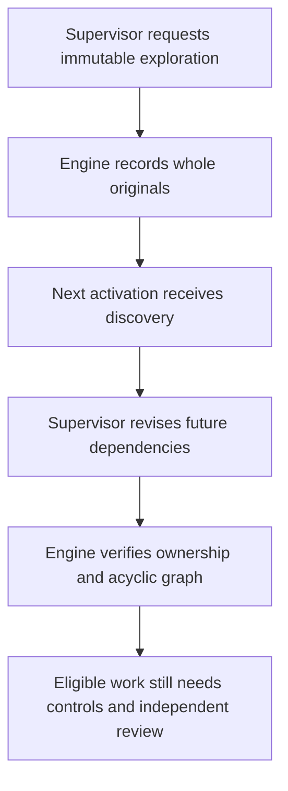
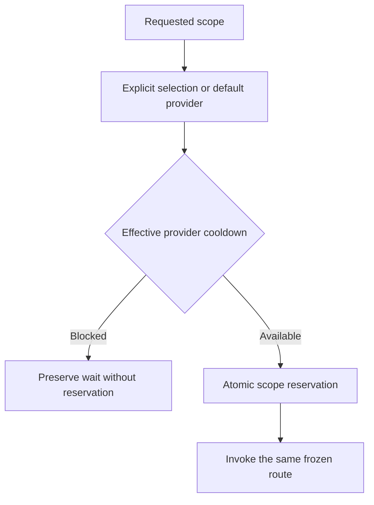

# Engine contract: January and February 2026 Cursor references

[Français](../architecture/CURSOR-ENGINE-CONTRACT.md)

Retained references: [Cursor — Scaling long-running autonomous coding](https://cursor.com/blog/scaling-agents), January 14, 2026, and [Towards self-driving codebases](https://cursor.com/blog/self-driving-codebases), February 5, 2026.

User clarification, October 10, 2026: both publications are retained. The previous correction wrongly excluded February. January remains the source for JAN-1 through JAN-7; February complements the architecture and explains its evolution. Document differences between versions without claiming compliance by combining their descriptions. This documentation correction does not change the engine.

This document separates a design rule, its engine enforcement and evidence that
it ran. “Cursor compliant” is not a certification: the article describes a
research experiment and its tradeoffs. Deterministic tests alone do not prove
that a live Swarm mission finishes without assistance.

## Responsibilities

The [agent parallelism contract](AGENT-PARALLELISM.md) explains needs, constraints
and required evidence, with Mermaid diagrams separating parallel production
from exclusive publication.

| Role | Responsibility | Permitted effect |
|---|---|---|
| Root planner | Owns the complete requirement; decomposes and adapts the work. | Structured planning decisions, no coding commands. |
| Scope planner | Owns its delegated slice; may delegate recursively within limits. | Tasks and decisions within its scope, no coding commands. |
| Worker | Completes a bounded task in its own repository copy. | Local changes and a handoff to the owning planner. |
| Independent reviewer | Examines the result and evidence for the candidate revision. | A reasoned opinion, without writing tools or self-acceptance. |
| Deterministic controller | Executes checks and enforces publication rules. | Receipts, refusals and atomic transitions when all conditions hold. |

The January publication separates planners and workers, supports recursive subplanners, and includes a judge at the end of each cycle followed by a fresh iteration. Swarm’s independent candidate review does not replace that global judge. Additional evidence and acceptance safeguards must be distinguished from these requirements. Global cycle judgment and fresh iterations remain open alignment gaps until demonstrated, not authorized deviations.

Repository copies separate changes and Git references. They are not a security
boundary against a malicious process with the host account's permissions. These
guarantees concern public engine operations; an administrator who can alter the
database or executables is outside that boundary.

## January requirements — historical audit state on October 10

This matrix defines the target, not already delivered features. Local limits and
Swarm safeguards are not Cursor prescriptions. Evidence must distinguish source
inspection, simulated tests and live-provider execution.

| ID | Expected behavior | Required evidence | Status in this audit |
|---|---|---|---|
| JAN-1 | Planners continuously explore the codebase and create tasks. | Show repository information actually available to the planner and adaptation based on a new discovery. | Partial: event-driven decisions exist; continuous exploration is not demonstrated by a tool-free prompt. |
| JAN-2 | Planning can be recursive and parallel. | Observe two simultaneously active subplanners with distinct owned scopes and persisted decisions. | Delegation exists; actual subplanner concurrency was not demonstrated in this audit. |
| JAN-3 | Workers complete tasks without direct worker coordination and publish their changes. | Observe two independent tasks in parallel, rejected lateral channels and delivered results. | Targeted tests passed; Swarm’s central integration path differs from Cursor’s described behavior. |
| JAN-4 | An end-of-cycle judge decides whether work should continue. | A verdict covering the objective and cycle results, with a persisted continue or finish decision. | Not demonstrated: candidate review or deterministic closure alone is insufficient. |
| JAN-5 | The next iteration starts with fresh context. | Observe a two-cycle transition, the new context and preservation of the objective, evidence and limits. | Partial: fresh activation projections exist; a global cycle transition was not demonstrated. |
| JAN-6 | Coordination increases throughput without excessive central waiting. | Measure computation, lock waits, checks, review, publication and throughput at multiple concurrency levels. | Not measured; a 16-worker limit per mission and serialized publication lane were identified. |
| JAN-7 | Prompts and model selection fit each role. | Inspect actual prompts and compare long-running missions with identified models and costs. | Distinct routes exist; suitability and endurance were not demonstrated. |

The targeted coordination tests passed on October 10, 2026, including `-race`;
they do not alone cover JAN-1 through JAN-7. Missing evidence does not prove a
missing feature, but prevents claiming complete alignment. The engine audit
still needs to cover these requirements.

## February additions — historical audit state on October 10

February describes a continuous hierarchy, worker-owned repository copies and handoffs to the owner. It removes the judge in an intermediate evolution and the central integrator. JAN-4 and JAN-5 remain retained Swarm requirements; they are not described as invariants of February’s final system. Compare a continuous hierarchy with judgment checkpoints against explicit cycles before choosing how they fit together.

| ID | Addition to verify | Expected evidence | Status |
|---|---|---|---|
| FEB-1 | Recursive ownership and handoff to the owner | Durable return, exact owner, reactivation after restart | Partial: mechanisms present, real-provider journey pending |
| FEB-2 | Handoff includes limits and discoveries | Actual content used in a subsequent decision | Unproven |
| FEB-3 | Freshness during continuous work | Observed renewal preserving objective and evidence | Unproven |
| FEB-4 | Explicit throughput and quality tradeoffs | Measurements and a distinct validated publication policy | Unmeasured; Swarm checks retained |

## Rules to verify in the engine

| Invariant | Required refusal | Evidence to retain |
|---|---|---|
| Planners do not code in a hierarchical mission | An explicit planner/subplanner launch is rejected, never silently converted into a worker. | CLI and HTTP response; no residual agent, reservation or copy. |
| Exclusive delegation | A delegated requirement cannot be reassigned or handled by the wrong owner. | Rejected decision; unchanged revision and unconsumed events. |
| Worker isolation | Two attempts cannot write into one shared copy. | Paths, references and observed contents of two actual test copies. |
| Handoff ownership | Foreign scope, old attempt, another copy's file or incorrect digest is rejected. | Unchanged state after refusal; one valid return to its owner. |
| Reactivation | A current handoff wakes its planner; replay does not duplicate it. | Store reopened with attempt and event identities preserved. |
| Descendant closure | A parent cannot close with open children, unfinished work or stale evidence. | Each refusal exercised with freshness checks. |
| Independent acceptance | Passing checks without favorable review, or stale/unknown/negative review, are insufficient. | Candidate SHA, attempt, contract, hashed review context and receipts. |
| Bounded recovery | Known quota, exhausted limits or an already reserved call do not grant extra attempts. | Preserved counters/history; durable hold and explicit cause. |

See the [provider quota guide](PROVIDER-QUOTAS.md) for holds and explicit clearance.

Legacy manual launches without hierarchical organization remain compatible. They
are not autonomous missions demonstrating these properties; an autonomous launch
requires the complete organization.

## Remaining demonstrations

1. **Handoff quality.** The current contract carries findings and artifacts. It
   does not yet require separate fields for changes, limitations, deviations and
   requested decisions. Correct routing does not establish this quality.
2. **Live autonomy.** Observe a requirement, delegation, production, reasoned
   rejection, correction and closure using a real provider. Count simulated
   responses and external host interventions separately.
3. **Visible recovery.** After manually clearing a hold without a reset time,
   historical evidence must remain visible without appearing as a new active
   rejection. Permission to try again does not establish provider availability.
4. **Throughput and concurrency.** Measure the integration lock during checks and
   review, and the cumulative context size. Current serialization and refusal of
   oversized context must remain visible.

## Definition of done

Normal process exit is insufficient. An accepted result needs the tested
revision, actual commands with timestamps and exit codes, report, independent
opinion, decision, freshness, deliverables and external intervention count.
A host-written fix can strengthen Swarm; it must not become fabricated autonomous
success inside the mission evaluating it.

## Evidence size and review transport

The review prompt remains capped at 192 KiB, including instructions. The engine
preserves the diff from the repository base, reports, receipts and sources from
the same candidate. It first reduces unchanged patch context and removes only
new source files already present in full in the patch, after exact comparison.

If JSON escaping still exceeds the cap, long texts use complete UTF-8 blocks
identified by field, byte length and SHA-256. Other metadata remains JSON. The
canonical stored context and its digest stay unchanged. No summary replaces
proof and no earlier change is removed from the diff. A packet that still exceeds
the cap is rejected before calling the provider. Process tests reconstruct the
whole packet and compare every field with stored evidence; genuinely oversized
packets remain rejected.

A newly added report already reproduced in full in the diff may reference that
copy after exact text comparison. Its length and digest remain explicit. Modified
or partially present reports stay attached in full. On rejection, diagnostics
record actual prompt and instruction sizes without exposing content.

### T3 implementation: read exploration and future dependencies

The reserved planner may request `explore` with a unique id and JSON
`deliverable`: `list` plus a relative directory, or `read` plus exact files,
bound to the accepted Git commit. The engine preserves whole original sources,
blob and SHA256 identities, scope, generation and observed revision in a durable
event. It executes no caller command and changes no source. Actual role transport
capacity is computed after workflow and instruction overhead; oversized complete
input is refused. A later planner activation receives the originals. A replaced
accepted candidate makes earlier discoveries historical and cannot authorize
new operations from that old input.

`revise-dependencies` changes only the explicit dependency array of an owned
future todo task with no attempt. Acyclic graph, lease and absence of active or
already prepared production are checked transactionally. Criteria, requirements,
spent budgets and blocked producer results are preserved. The old and new
dependencies are attributed to the supervisor decision. Reordering never accepts
the producer whose ordering prerequisite was removed.

Two concurrent subprocess fixtures demonstrate distinct sub-supervisor leases,
atomic scoped decisions, own and ancestor counters, shared reservations, pause,
replay and persistence. They are deterministic provider doubles; real-model
behavior remains a T7 recipe. This isolated T3 source includes the original
developed T2 Judge but does not accept T2. Deferred correction27 is excluded.
Historical runtime26 lacked these capabilities at that audit; current installation qualification is recorded in the final delivery retrospective.

### Supervisor reservation and effective provider

Claim admission checks the provider selected for the requested scope, matching
the provider used for its invocation. A default-provider cooldown does not block
an explicitly selected alternative; the effective provider's own cooldown blocks
the reservation without spending a claim. Child selections remain scoped. Default
identity, other provider waits, counters and historical responses are preserved.
Replaying an applied claim does not create a new call.

Isolated tests first reproduce both wrong-provider refusal and missed selected-
provider refusal for root and child scopes. Selection, inheritance, cooldown and
model regressions pass locally. This does not certify alternative-account access
or native T3 recovery.

Current `judge`/`renew` has fixture evidence for received context and observed effect; cumulative real-provider verification is now observed within the scope described at the end of this page. See [judgment cycles](JUDGMENT-CYCLES.md) and the candidate delivery reports.

## Evidence after direct delivery on October13

The matrices above retain the initial audit. The real cumulative recipe, corrections and independent opinions are now qualified; see the [T1–T8 audit](../plans/engine-cursor-contract/completion-audit-20261012.md) and [final retrospective](CURSOR-ENGINE-RETEX-20261013.md).

| Requirement | Current evidence | Demonstration limit |
| --- | --- | --- |
| JAN-1/JAN-2 | Attributed SPEC discovery and two real simultaneously reserved subplanners | Two modules, not continuous large-repo exploration |
| JAN-3/FEB-1/FEB-2 | Parallel isolated workers and handoffs; two accepted/fresh results on one published candidate | Defective-worker/semantic-refusal recovery retains fixture evidence, not real observation in this recipe |
| JAN-4/JAN-5/FEB-3 | Received/applied continue/renew and new context; explicit end cycle5, nine closed scopes | Assisted resumptions, not multi-day endurance |
| JAN-6/FEB-4 | Two fixture levels, real53.149s overlap, three recorded controls | No comparative real scale/cost campaign; cost unknown and usage incomplete |
| JAN-7 | Frozen standard route and discriminator-order fix with observed effect | No comparative model endurance study |

Current architecture combines continuous hierarchy and judgment checkpoints, exclusive publication and parallel production. Effective Admin policies replace the historical bounds in the initial audit. Direct development, isolated recipe, reviewed code and deployed binary have separate evidence. The historical mission stays paused; no Cursor certification or universal autonomy is claimed.
