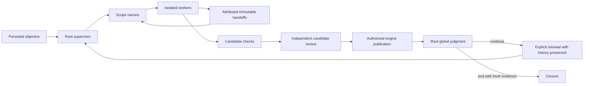

# Cursor engine evolution — architecture decision and evidence

[French detailed architecture](../architecture/CURSOR-ENGINE-EVOLUTION-20261010.md).
Decision consolidated on October 13. Development remains direct Codex work; the
historical mission stays paused. Local fixture evidence, real-model behavior and
native acceptance are separate. This decision grants no new execution authority.

## Decision T1: continuous hierarchy with explicit global cycles

Use continuously reactivated scope owners, with explicit root judgment and
context renewal. This records the composition already implemented in the engine;
independent review and cumulative real-provider verification remain required.

| Dimension | Global cycles with a completion barrier | Continuous hierarchy with judgment checkpoints — selected |
| --- | --- | --- |
| Correctness | Clear cycle assessment; discoveries can wait until the next cycle | Attributed handoffs and scope adaptation; global judgment stays separate |
| Recovery | Fresh cycle context; repeated work if identities are lost | Preserve revisions, events and generations; explicit renewal without refunds |
| Throughput | Barrier can wait for the slowest task | Independent production and early result staging; exclusive publication retained |
| Cost | Global restarts/context retransmission require measurement | Owner reactivation/current-state context require measurement; no claimed savings |
| Effort | Additional cycle scheduling alongside existing scopes | Reuse scopes, leases and operations, with root `judge`/`renew` |
| Compatibility | Enforcing cycles on all old missions changes business behavior | Preserve old missions/counters; guarded legacy closure is not proof of the new protocol |

Select the latter for attributed recovery and response to discoveries. Fixture
measurements establish overlap and observed waiting, not real accepted throughput,
model suitability or financial savings.

## Research basis and deliberate Swarm differences

Primary sources rechecked on October 13. [January](https://cursor.com/blog/scaling-agents)
describes planning/work separation, judgment and fresh iterations.
[February](https://cursor.com/blog/self-driving-codebases) moves toward continuous
hierarchy and handoffs after simplifying central roles.
[July](https://cursor.com/blog/agent-swarm-model-economics) emphasizes shared
architectural decisions, third-party conflict handling and review perspectives.
They describe evolving systems, not one unchanged cumulative specification.

Swarm retains JAN-4/JAN-5 according to the user's requirement: the root supervisor
owns global business judgment, an independent reviewer assesses the candidate,
and Go validates/applies authorized decisions. Exclusive publication is Swarm's
candidate-freshness choice, not February's final architecture. A new custom VCS
or AI conflict resolver is not claimed implemented.

[Google ADK](https://developers.googleblog.com/why-we-built-adk-20/) separates
reasoning from deterministic workflow; [OpenAI](https://openai.com/index/harness-engineering/)
connects accessible environments, evidence and repository knowledge;
[Anthropic](https://www.anthropic.com/engineering/harness-design-long-running-apps)
examines planning, generation and evaluation according to task/model needs.
These comparisons do not establish Swarm autonomy or cost results.

## Implemented boundaries and verification

| Contract | Actual components and evidence |
| --- | --- |
| Root judgment/renewal | `planning_judge.go`, `planning_context.go`, `planning_schema.go`; received-context and `judge`/`renew` tests |
| Exploration/adaptation | `planning_exploration.go`, `planning.go`; attributed Git reads, persisted discovery and concurrent fixture scopes |
| Early handoff/publication | `managed_result_staging.go`, `managed_publication_lane.go`, `managed_integration.go`; immutable results, rejection/recovery, checked candidate |
| Policy/model route | `quotas.go`, persisted Admin configurations and effective role route; shared preview/history/revision validation |
| Relocated projects | [PROJECT-RELOCATION](PROJECT-RELOCATION.md); authorized root alias, refused inner redirects |

Global cycle decisions are separate from candidate review. `judge` and `renew`
are root operations under lease, current revisions and input events. Continue
and renewal are distinct decisions; budgets, attempts and history are preserved.
Legacy manual/closure paths keep their guards and are not automatically upgraded.
See [JUDGMENT-CYCLES](JUDGMENT-CYCLES.md) and [AGENT-PARALLELISM](AGENT-PARALLELISM.md).

Schema 32 migration is verified on an isolated database. Updating the shared
historical service requires checking other works, backup and compatible recovery,
then public verification. Source delivery does not establish native installation.
No historical attempts, consumption or proofs are rewritten.

## eBPF study and remaining acceptance

Start with existing engine events/Go measurements. An optional kernel collector
could be compared when unexplained kernel waiting justifies it; it has not been
implemented or activated. PID/cgroup attribution cannot replace rights,
reservations, candidate validation or supervisor judgment. The French study
records capability/BTF, data loss, cleanup, overhead and prospective Admin controls.

[T1–T8 completion audit](../plans/engine-cursor-contract/completion-audit-20261012.md)
and original receipts identify the remaining requirements. The current missing
conditions are real-provider cumulative verification, independent assessment on
the same candidate, any necessary corrections, and the final cumulative RETEX.
