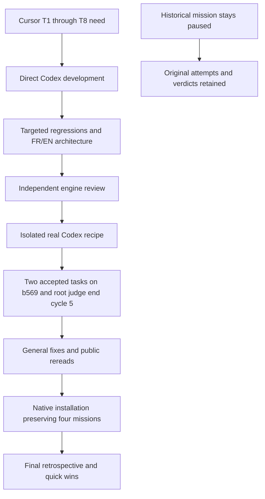

# Final retrospective — direct Cursor engine delivery T1–T8

October 13, 2026. Direct development by Codex, followed by explicitly authorized isolated real-provider verification and independent review. No Claude. The historical mission remains paused with its original attempts and verdicts. [French report](../plans/engine-cursor-contract/RETEX-final-20261013.md).

## Delivered result and evidence

Engine candidate `60c3dc65edf0f1f3915414e284f58543c6814924` completed the real Codex recipe with root `judge end`, cycle 5. Two worker tasks were accepted, all nine retained scopes closed, and published project bundle `b569bb35fb5816bb806826000f99be32b973108c` returns alpha=42/beta=7. The original project remains clean at `12237f3054868454d7c1ed415f49a84217245b9b`, returning0/0. Two subplanners were simultaneously reserved; workers overlapped 53.148968 seconds.

There were two native review calls in total: a first partial review and one final cumulative review covering both tasks on b569. Both final controls are fresh, executed/PASS/exit0 on that same candidate. Events record three control executions: alpha at first publication, then alpha and beta at the second. Engine-code review is separate from those project reviews. Original receipts and opinions are in [the evidence directory](../plans/engine-cursor-contract/evidence/t7-20261013/).

The final phase after schema-order repair lasted 217.79 seconds, including closure and bundle verification. This is not total campaign time or a general throughput estimate. Later candidates `6bfd100` (metrics) and `3f121f7` (read projections) preserve production/review/publication behavior; public rereads verify the same r127 and two fresh acceptances without paid repetition.

## Preserved failures and operator interventions

- Initial harness forced inherited CLI gpt-6.1-sol/xhigh instead of Swarm's configured standard. Its real capacity refusal is retained. Explicit public preview/apply selected gpt-5.6-sol/medium for the root, reviewer and relevant scopes; consumption was preserved.
- Harness mistakes confused the mission-start envelope with Work, assumed an unchanged revision after pause, and used a nonexistent judgment field. Those originals remain; they are not attributed to the engine. The first counter fixture collided with an existing event revision and is excluded as a behavioral red.
- A FIRST instruction fed repeated cycles. The operator paused new starts and supplied a phase instruction publicly. Shared guidance now resumes the remaining need after acquired prerequisites, without reset.
- Sub-supervisors kept creating planners instead of workers despite textual clarification. Nine scopes are retained. Textual and explicitly stronger-model probes failed to fix the branch choice. The discriminating probe changed only property order: same complete prompt/model/semantic JSON schema, `kind` first produced `task`. Serializer repair then led to actual worker creation, delivery and acceptance. No hierarchy cap or silent operation conversion forced success.
- Independent review found browser-history preview/apply disagreement and a lost Codex failure cause, then a tool-error envelope misclassified as a provider error. Valid reds and targeted greens are retained.
- ENOSPC was resolved by cleaning 45GB of reconstructible Go cache after confirming no concurrent build. No mission, proof or source checkout was removed.
- Public metrics showed zero controls despite integration events. The shared reader now counts both managed and automatic event shapes, including failed executed controls, isolates works and rejects malformed structures. The same public ledger now reports three.

Model changes, restarts, quota changes and phase instructions were operator interventions. Final acceptance then proceeds through the native controller and reviewer. This campaign does **not** establish end-to-end autonomy without intervention or autonomous engine-code repair by the historical mission.

## Measurements and limits

The native ledger has 44 recorded reservations/calls: 40 planning, 2 worker and 2 review. Reported input tokens total 1,392,836 and output 29,750; eight entries lack usage. A reservation does not prove inference was sent. Diagnostic probes outside the mission are separate. No call reports cost: **actual cost unknown**, not zero dollars. Internal client retries and caches are not fully attributable.

Planning/decision ceilings were explicitly raised from 40 to 60 through public operations to process retained scopes and close, keeping 25 consumed claims at that point. Final usage: 40 activations, 30 decisions,one attempt per worker and zero worker retries. Requested routes are frozen; unreported backend model identity is not invented.

Targeted Go checks are used, not repeated execution or promotion of the historical full suite. Source integrity, fixtures, real recipe, independent review and deployed binary have separate receipts. eBPF remains a study, not an enabled integration. No actual defective worker followed by semantic-review refusal and autonomous repair was observed; prior fixtures cover those paths separately.

## Read latency exposed during installation

One retained five-task/two-batch mission took 41.663s for its public snapshot and 20.952s for CLI work show, while storage and the other three missions responded normally. Source diagnosis found repeated review guards over the same context/batches. A read-local clone now shares guard results keyed by complete Work, Task and historical mode, keeping success and refusal only during that projection. The live Store and next request reread files.

Four targeted tests, nine including variants, pass with `-race`: changed contract/attempt/candidate/state/historical mode, missing/restored evidence, next-read freshness and no cached approval on the live acceptance path. Independent delta review approves. The installed snapshot takes **1.768s**, CLI **10.418s**, with the same r43, five favorable reviews and five fresh validations. One observation per path is not a p95 or universal promise.

## Cumulative JAN/FEB interpretation

January and February remain different published versions. The initial architecture audit is retained, supplemented by current evidence rather than presented as certification.

| Requirement | Observed result | Limit |
| --- | --- | --- |
| JAN-1 | Attributed SPEC discovery before task creation | Two modules, no continuous large-repo exploration claim |
| JAN-2 | Two simultaneously reserved subplanners and persisted decisions | Nine scopes include assisted over-decomposition |
| JAN-3 | Parallel isolated workers, handoff and publication | Lateral-channel refusals retain fixture evidence |
| JAN-4 | Explicit root end judgment, cycle 5 | Candidate review remains separate from global judgment |
| JAN-5 | Continue/renew and new received context preserve objective/history | Operator-assisted resumptions |
| JAN-6 | Two fixture concurrency levels and real53.149s overlap | No scale or comparative real-cost campaign |
| JAN-7 | Frozen standard route and effective discriminator correction | No comparative model endurance study |
| FEB-1/FEB-2 | Attributed reports/handoffs, accepted descendants, owner closure | No actual defective-worker recovery after semantic refusal |
| FEB-3 | Renewals and closure preserve proofs | No multi-day continuous endurance evidence |
| FEB-4 | Parallel production, exclusive publication, three recorded controls | Unknown cost and unmeasured scale compromises |

## Completed quick wins and optional next work

Completed repairs: discriminator-first schema without semantic/rights change; safe provider error categories separated from tool failures; preview/apply validate identical persisted bytes including newline; historical control counts preserve earlier executions; immutable received buffers bind parsing and hashes; request-local guards remove redundant review work while acceptance remains fresh. Graph fullscreen editing, Admin modals, colored console, instruction rejection, product RETEX and 50/200/500-card browser recipes have separate local T8 receipts. New project proposals remain the user's choice.

| Evidence-based proposal | User value | Effort / risk | Observable success |
| --- | --- | --- | --- |
| Real workers passed their only attempts | Verify autonomous repair after semantic refusal | Medium / additional provider calls | Independent refusal, received supervisory decision, repair and fresh acceptance actually observed |
| 44 ledger entries, 8 without usage and no cost | Understand consumption and value | Medium / provider fields may remain unavailable | Per-call received or explicitly unknown usage; missing cost never presented as free |
| JAN-6/FEB-4 currently two real workers | Measure scaling tradeoffs | Medium / expensive campaign unless bounded | Compare production, waiting, review and throughput at chosen levels within authorized budget |

These are optional subsequent evolutions, not unfinished criteria of this direct delivery, and grant no implicit new mission or budget.

## Installation and closure

The shared server was updated through native `install.sh` and the public local launcher, retaining the same address and canonical project root. Preflight found four missions, three preparations and no active agent/lease/review/AI turn. Only the originally unpaused work was temporarily paused. Supported `swarm init` migration created a0600 backup; the previous binary remains in the operator cache. No private database inspection, surgery or manual acceptance was used.

Installed-code qualification at `3f121f7` confirms running/installed binary identity, ready health, matching served Admin/graph/console assets, readable Admin configuration, and preserved consumption/candidates/task states for all four missions. The final delivery step installs documentation-only changes through the same path and restores departure states. Operational closure requires PASS identity and preservation assertions in operator-cache `t7-release-final-receipt.json`, preserving earlier originals. These pages do not substitute for that receipt. The historical mission stays paused.

Direct development, qualification and its retrospective are complete within this scope; the final installation check above establishes operational closure separately. The limits above remain explicit; no full-suite PASS, universal autonomy or Cursor certification is claimed.
