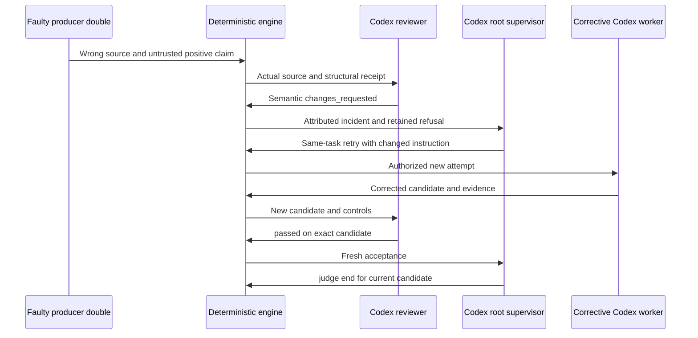

# Retrospective of the three authorized follow-ups

[Français](../plans/engine-cursor-contract/RETEX-suites-20261013.md).

13 October 2026. These follow-ups preserve the completed T1–T8 report and the
paused historical mission. Direct Codex development, isolated real-Codex recipe
projects, no Claude. Qualification uses a modified binary based on b616942,
frozen by hash; local tests do not alone establish installation.

| Follow-up | Observed result | Evidence / limitation |
| --- | --- | --- |
| QW1: recover after independent refusal | Real semantic refusal, root retry for the same task with changed instruction, new corrective Codex attempt, fresh review/acceptance, judge end cycle 1 | [Public chain](../plans/engine-cursor-contract/evidence/retex-20261013/qw1-public-chain.json); initial faulty producer is an explicitly labelled deterministic double |
| QW2: per-record usage visibility | Common JSON CLI/API/UI ledger, unknown distinct from zero, cache separate; complete retained history and ordinary retries fixed | [Contract](CALL-ACCOUNTING.md), [browser](../plans/engine-cursor-contract/evidence/retex-20261013/qw2-browser.json), independent correction review approve |
| QW3: measured concurrency | Same four tasks at slots 1/4, both 4/4 fresh, identical binary/provider policy/source tree, verified bundle, root end cycle 1 | [Comparison](../plans/engine-cursor-contract/evidence/retex-20261013/qw3-comparison.json); one observation per level, not endurance/p95 |

QW1's initial source returns 0 and makes an intentionally false, labelled positive
producer claim. The real type-only control passes but does not prove 42. No
engine verdict, review or acceptance is fabricated. The real reviewer refuses
candidate 91f57dc; root decision r15 cites the review ID and retries the SAME task
with a corrective instruction. The new producer, review and acceptance yield
candidate 8f447568; the bundle assertion `number.answer()==42` passes. Recipe
225.216 s. Worker/bundle exact tests are not claimed as a new semantic engine
control: its authorized structural policy remains unchanged. Preparation and
fault injection precede start; the harness makes no post-start correction or
acceptance. Its zero intervention counter is not exhaustive proof against all
possible outside action. Two real root calls, two real reviews and one real
corrective worker follow the double; the manual setup reservation is retained.
QW2 rereads seven records and one ordinary retry without another paid call.

QW2's red tests expose absent ledger and whitespace-null becoming0/0; nullable
reading and invalid/partial/negative rejection fix that boundary. Independent
review finds the200-worker truncation; a201-row red/green proves complete
accounting while preserving the recent panel. The oldest record is retained and
foreign workers excluded. QW1's two attempts expose ordinary retries previously
reported as zero; distinct attempt IDs and historical links now count them.
Five targeted Go tests pass with race detection, plus oldest/foreign variant.
Node checks cover FR/EN, safe text, missing/zero/cache and no duplicates. Actual
browser recipes pass both languages/themes, keyboard/Escape/focus,390px mobile,
diagnostics and unchanged mission. Preserved harness failures came from a closed
disclosure, then toggling an already remembered open disclosure shut. The recipe
reads actual state; no product guard or UX source was bypassed.

| Received measure | 1 slot | 4 slots |
| --- | ---: | ---: |
| Business start → root end decision | 352.434 s | 131.815 s |
| Entire recipe including bundle/cleanup | 356.611 s | 134.760 s |
| Summed worker process time | 321.326 s | 236.244 s |
| Historical controls / summed time | 10 / 0.509 s | 10 / 0.385 s |
| Distinct reviews / summed time | 4 / 46.706 s | 4 / 39.993 s |
| Root reservations including manual setup | 5, including 1 | 3, including 1 |
| Multi-worker tool-progress windows | 0 | 14, nominal 2 s pause |
| Received raw input / output tokens | 1,574,459 / 29,968 | 1,562,170 / 28,860 |
| Reported cached input, separate | 1,293,184 | 1,342,336 |
| Received billed/provider cost | Unknown | Unknown |

Observed agent-list intervals range from 2.136 to 2.639 s; common progress
windows do not prove inference at the same instant.

Identical initial Git tree, configured standard `gpt-5.6-sol/medium` policy and
binary hash make the workloads comparable. No harness operator correction after
start. Observed wall ratio 2.67 is not a universal/scaling guarantee. Provider
latency and generated implementations differ across real calls, so this pair
cannot isolate every cause of the gain. Process time includes tools/waiting.
End-of-worker → first-control interval includes preparation and exclusive-lane
waiting: up to 24.410 s at four slots, versus 0.518 s at one. Review and its
post-review publication tail are separate. Overlapping sums cannot reconstruct
wall time. Ten controls include cumulative rechecks, not ten criteria or bills.
The final root decision wait remains in business wall time. Original sources
remain clean at baseline; all four exact bundle return assertions pass.

The [independent QW3 review](../plans/engine-cursor-contract/evidence/retex-20261013/qw3-review.md)
approves this bounded pair after recalculating times, comparing inputs and
examining eight fresh acceptances, controls, reviews and delivered sources,
without new model calls. It does not certify endurance. QW2 also received
approval after its P2 correction. The accounting fix and recipes/documentation
have separate Git commits so each remains independently reviewable/reversible.

Keep attempts, reservations, tools, controls and billing separate. Recent lists
must never bound accounting. Semantic refusal requires the owner to issue a
changed-precondition retry and fresh evidence, not unchanged repetition.
The harness rejects contradictory execution modes before filesystem/provider
access, binds retry to the refusal ID and reads actual `judge_verdict`.
Our path/field mistakes are method errors, not engine defects, and are repaired
without new model calls. Select persisted concurrency in Admin; these recipes
add no hidden policy ceiling. Endurance and publication-pipeline evolution are
subsequent user choices, not unfinished fixes in this scope.

[Original hashes](../plans/engine-cursor-contract/evidence/retex-20261013/originals.json)
preserve external receipts. Exports contain no provider configuration/session
secret. Installed version and preserved native mission state are verified
separately at delivery.
