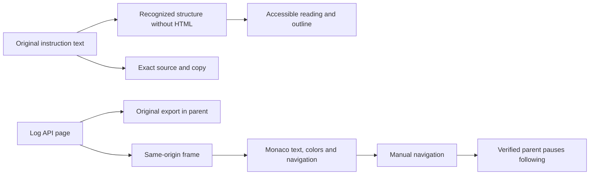

# Reading instructions and logs

The shared instruction reader separates **Structured reading** from **Source
text**. Reading adds hierarchy; source retains every received character,
including line endings. Copy uses that exact source. Clipboard refusal opens a
selectable source view and reports failure rather than claiming a successful copy.

## Instructions

`web/text-reader.js` presents Markdown headings, paragraphs, ordered and nested
lists, written checkboxes, quotations, simple tables and fenced code. Bold,
emphasis and inline code remain distinct. A standalone label ending with a colon
before a list or paragraph break also becomes a section heading. An explicit
outline moves keyboard focus to the selected heading.

Explicit `> [!NOTE]`, `TIP`, `IMPORTANT`, `WARNING` and `CAUTION` blocks use shared
semantic colors. Checked items remain statements in the source, not evidence of
execution or engine acceptance. No status is inferred from arbitrary words or
colors. User documents are never translated.

Consumers include task instructions (`task.next`) in the inspector, instruction
revisions, retained shared instructions and prepared launches. Instruction,
correction, next action, objective and scope fields offer an explicit **Reading
preview**, refreshed while typing only when open. Reading and copying never save
or launch anything. Task instructions are not labelled as an attempt's complete
prompt. Source/reading choice, outline state, source scroll and reader focus survive inspector
refreshes; document text is never stored in presentation preferences.

## Writing a readable instruction

The palette follows Swarm: navy/cyan headings, paper surfaces, a distinct code
background and amber or red warnings. Colour always accompanies a label. The
reader does not assign arbitrary colours to sentences or interpret warnings as
engine decisions.

Example supported by the reader:

````markdown
# Prepare delivery

## Objective
Keep **all evidence** in `report.md`.

Checks:
1. Read the contract.
2. Verify the results.
   - Preserve the originals.

> [!WARNING]
> Do not claim acceptance without evidence.

| Check | Expected result |
| --- | --- |
| Tests | Preserve results and command |

```json
{"request_id":"example", "approved":false}
```
````

Reading preferences do not rewrite the instruction. Use **Source text** to check
the exact characters and **Copy source text** to reuse them. The input preview
stays closed until explicitly requested.

## Logs

Monaco remains read-only. The parent retains original API entries and exports.
Choose an event on the loaded page, move previous/next or jump to the next
error/warning signal. Counts reflect actual entries. Manual navigation pauses
live following; **Follow live** resumes it. The pause message requires the exact
origin and sending frame.

JSON keys, numbers, literals and inline code have distinct theme tokens. Written
levels and timestamps retain their existing colors. **Comfortable reading** and
**Wrap lines** are local presentation preferences (`swarm-log:reading`), never
execution policy. They do not change original text or export. Ctrl+F and existing
source/page filters remain available.



## Contract and checks

Rendering uses DOM nodes and `textContent`, never document-supplied HTML. Images
are not fetched. Only explicit HTTP/HTTPS links become isolated navigable links;
other link syntax remains readable text. This is a presentation subset rather
than a complete CommonMark implementation. Exact source remains available for
complex or unsupported syntax. Instruction code blocks retain their contents;
log JSON may be indented for reading while export retains original API data.
Long code and tables scroll locally rather than widening the page.

Run `node tests/text_reader_test.cjs`, then
`node tests/dense_text_ui.cjs BINARY EVIDENCE_DIRECTORY`, with the affected log,
hidden-console, instruction/RETEX and design recipes. The
[increment report](../reports/window-identity-20261017.md) distinguishes local
checks, clipboard/log doubles and the running installation.

## Task details: understand before acting

The panel starts with the task and one **What should I do now?** area. Bold
labels distinguish the agent’s assignment, execution, latest activity and work
status. Completed execution does not mean the task is validated. **AI and
instructions used** discloses the selected AI, reported model and known project
instructions, with explicit unknown states.

**Before starting** uses the engine’s unsatisfied prerequisites
(`pilotage.tasks[id].waiting_on`). Related tasks appear by title and open their
own details. Downstream tasks are disclosed separately; their presence promises
no automatic start. Missing prerequisite observations are never shown as met.

A failed `git cat-file` read operation, identified by the producer’s command
prefix, receives a readable explanation and guidance to check the repository
before retrying. Its exact technical original remains available in a disclosure.
This presentation repairs no Git data and depends on no hash, repository path
or English stderr wording. Unrecognized blockers retain their visible reason.
Actions and refusals still come from the engine; reading executes no command.
Disclosures and keyboard focus survive refresh of the same task, without forcing
those disclosures open when navigating to another task.

Recipe: `npm run test:task-reading`, isolated root with no provider.
