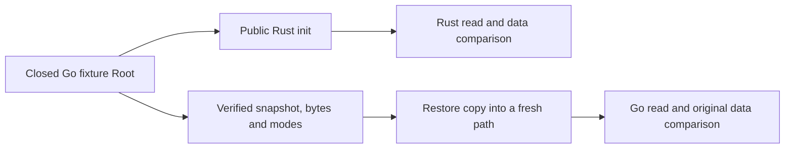

# Initializing a Go Root for Rust

The public command `bin/swarm --root /path/to/project init` initializes Rust
settings and applies its SQL migrations to an existing Root. It starts no agents
and does not adopt their permissions or processes. Opening a Go Root without its
Rust settings before this step refuses; that refusal does not prove data loss.

`tests/rust_cutover_go_root.py` creates an inert Go37 Root containing a Work,
task and budget, captures a cold snapshot, then uses the explicitly supplied Rust binary (retained runs233 and238). Ten assertions
check public reads, Work JSON, every existing SQL column, created settings and
restoration into a fresh path that Go can read with the original data. These
are owned fixture records, not user missions or authority migration.

`tools/rust-migration/cutover_snapshot.py` only supports caller-owned closed
fixtures: no writer, WAL or SHM. It verifies bytes/modes and rejects links and
special files. It neither discovers/stops writers nor backs up a live application
or replaces an existing Root. Restoring historical data does not transfer physical
execution bindings, authenticated identities or current permissions.

This rollback check precedes any Rust business write after conversion. It does
not qualify downgrading while preserving new writes, active agents, online backup
or production rollback. Those criteria remain separate from this bounded R6 proof
and local service cutover.

The permanent recipe `tools/verification/recipes/go-rust-closed-cutover.json`
requires explicit `SWARM_CUTOVER_GO_BINARY` and `SWARM_CUTOVER_RUST_BINARY`.
Go is a local verification oracle only, never installed as the active engine.
The harness adds no global verification watchdog.
