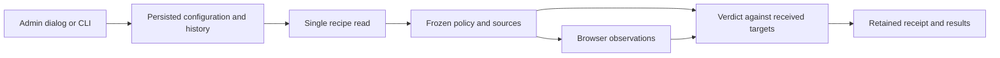

# Configure graph performance targets

Open **Administration → Graph performance targets → Configure targets** to set keyboard latency (milliseconds), samples per workload, and card counts with rendering targets.

A **30 ms** value is an observed result. A target defines the acceptable result; changing it does not accelerate the graph. **p95** is the latency below which 95% of samples should fall. With five samples, this calculation selects the maximum. One sample can support a diagnostic, but cannot estimate a representative distribution.

Preview does not save the configuration. Confirmation requires a reason and records a new revision. Concurrent edits are rejected: reload before confirming. Escape cancels and returns focus. History preserves values, actor, date and reason. Restore older values by entering them as a new revision; history is never erased.

## Defaults and storage

Defaults have one source: `config/graph-performance.json`, embedded at build time. They are displayed as **Default values** until the operator saves an override. The configurable recipe no longer hides these targets in its assertions.

The CLI and web share the same engine validation. `.swarm/graph-performance.json` atomically stores current values and history. Expected revisions, operation identifiers, interprocess locking and symlink rejection protect changes. Replaying the same operation does not create a second revision. No secrets are stored here. API-advertised maxima drive the form and reflect only exact Go/JSON integer representation, up to 2⁵³−1 on 64-bit platforms. The historical caps of 60,000 ms, 100 samples, 10 profiles and 10,000 cards are removed. Durations and samples remain positive; the recipe requires at least one workload, distinct card counts and at least two cards per graph. Web requests remain bounded to 16 KiB and configuration/history to 1 MiB; these transport/storage bounds are advertised separately. Preview validates the actual writable size without writing.

These settings do not alter agent budgets, execution timeouts or tool-call limits.

## CLI

```sh
swarm --root /path/project run-limits performance show
swarm --root /path/project run-limits performance history
swarm --root /path/project run-limits performance preview --input targets.json
swarm --root /path/project run-limits performance apply --input targets.json
```

Read the current revision before preparing a complete request:

```json
{
  "schema_version": 1,
  "event_id": "performance-configuration-001",
  "expected_revision": 0,
  "values": {
    "keyboard_p95_ms": 100,
    "samples": 5,
    "loads": [
      {"cards": 50, "render_p95_ms": 1000},
      {"cards": 200, "render_p95_ms": 1000},
      {"cards": 500, "render_p95_ms": 2000}
    ]
  },
  "reason": "Responsiveness targets approved for this project"
}
```

## Configurable recipe and evidence

```sh
node tests/graph_performance_ui.cjs /path/swarm /path/results /path/project
```

The recipe reads settings **once through the public CLI**, before browser actions. `performance-policy.json` records the revision, exact values, policy hash and recipe hash. Functional journeys still cover French/English and dark/light themes. Workloads, sample counts and acceptance targets come from the frozen configuration. The result also includes this policy. Later edits cannot reinterpret a completed result.

For automatic validation, explicitly authorize this command in the task's public policy and declare the recipe, candidate/binary and selected configuration as relevant inputs. Saving new targets does not replace an already-authorized validation contract. Changing a target never promotes an old failure to a pass.

The historical B03 recipe (`tests/graph_draft_ui.cjs`) retains its original targets to reproduce archived evidence. The configurable entry point adapts it into a temporary output file, rejects incompatible source changes and leaves that archive unchanged. New performance checks must use the configurable entry point above.

[Guide français](../GRAPH-PERFORMANCE.md)

## Verdict matches received settings

The configurable entry point uses the same targets for single-workload diagnostics
and the final verdict across workloads. It rejects incompatible recipe formats.
Generated-verdict tests cover stricter/relaxed targets, equality and custom card
counts with controlled observations; these tests are not browser measurements.

Local measurement on October 13, 500 cards: five reloads, rendering p95 1,342 ms;
five keyboard observations, p95 31 ms. Received targets remained 2,000 ms and
100 ms; no target was raised to obtain PASS. The cold first opening, 1,691 ms,
is reported separately. The receipt preserves binary, recipe and frozen policy.
This measurement calls no model.

“Add workload” retains the last row’s rendering target using the same `render_p95_ms` field as the engine. After saving and readback, focus returns to settings, or reload if readback failed. The Admin recipe checks eleven complete workloads, values above historical caps, persistence/reopening, both languages and themes.


