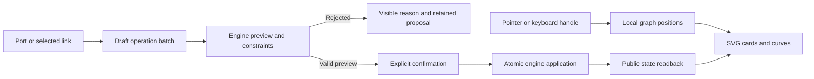

# Graph workbench

The cockpit supports full screen, movable cards and visual dependency proposals.
`web/graph-studio.js` reuses the local SVG/Dagre renderer, cockpit preferences and
public graph draft API. It adds no remote dependency or private storage operation.

## Interaction

- **Full screen** expands the workbench. Escape returns to the cockpit and restores
  button focus. The task inspector remains visible above the workbench.
- **Move card** handles support dragging and keyboard arrows. Escape cancels an
  unfinished gesture. **Arrange cards** restores automatic placement.
- Positions persist in this browser by project, mission and orientation. They
  survive reload but are not shared between users. Storage failures are visible.
  They never change task state, work revision, reservations or agent execution.
- Drag an output port to another card to prepare a dependency. Keyboard users can
  activate an output and then an input. The draft remains editable.
- Select a link to remove it or change its prerequisite/destination. Delete stages
  removal. Reconnection creates one batch: remove the original and add the new link.
- **Preview**, then **Apply explicitly**, use engine validation. Gestures never
  confirm or apply a dependency implicitly.

## Authority and recovery

The engine owns confirmed tasks and dependencies. `/api/v1/graph-drafts`, `/preview`
and `/apply` check identity, freshness, activity, dependencies and cycles. Rejection
preserves the confirmed graph and proposed edits. Apply requires a valid preview.
After a failed save, an older persisted draft cannot be previewed in place of the
visible proposal. Explicit recovery rereads the revision and recreates the draft;
it does not apply edits.

Cubic curves follow ports and orientation. Moving cards can clear their route;
this renderer does not automatically eliminate every intersection in an arbitrary
manual arrangement. Existing zoom, search, branch folding and canvas panning remain.
Role and state colours use shared semantic pairs, with text labels and visible focus.

## Verification and limits

`tests/graph_studio_ui.cjs` drives the real CLI, candidate server and Chromium on
isolated roots: full screen/focus, keyboard, pointer/cancellation, persistence,
creation/removal/reconnection, cycle rejection without mutation, inspector/mobile,
French/English and both themes. No provider is called. `tests/graph_studio_test.cjs`
checks failed draft saving and recovery. Existing load harness measurements are
local evidence, not proof of model autonomy or provider cost.

Source delivery does not automatically update the native server. Candidate-bound
proofs and remaining criteria are recorded in the [delivery plan](../plans/engine-cursor-contract/graphe-ux-20261012.md).
