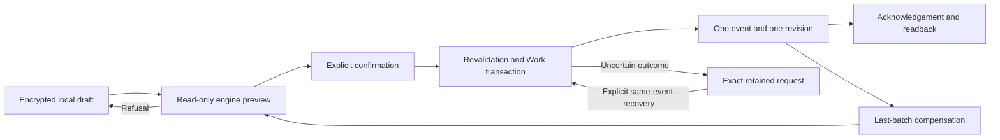
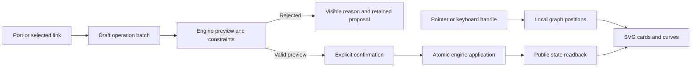

# Graph workbench

## Rust integration

The native cockpit uses `web/cockpit-native-graph.js` on actual Work objects.
The native business workflow below applies to **manual plans**. Hierarchical
missions retain their contract revision workflow; batches do not bypass roles
or the existing refusal of manual task creation.
Zoom buttons or Ctrl + wheel, fit, canvas panning, keyboard/pointer card handles,
orientation and full screen are presentation preferences. Positions are local to
the HTTP origin, Work and orientation; they change no revision or budget. Escape
cancels an active drag before closing full screen. Full screen uses a native modal
dialog for keyboard isolation and restores focus to its opener on close.

“Analyze and select” provides three exclusive disclosures: “Read a branch”,
“Compare two tasks” and “Move a group”. Applying a filter or enabling selection
closes the panel to free graph space; results and selection stay visible in the
main flow. This local reading workflow is intended for analysts:

- **Isolate branch** retains the chosen task and all transitive prerequisites and
  dependents. Siblings are hidden without recalculating placement.
- **Show paths** retains the union of directed paths from start to end, following
  prerequisite→task links. Identical endpoints isolate one card; no path leaves
  the previous view intact with an explicit message.
- **Show entire graph** restores all cards and links. The mini-map, search and
  export follow the filter; fit considers visible cards only.
- **Select multiple cards** temporarily changes card activation (click, Enter or
  Space) into selection. Text lists exact IDs; a patterned border and accessible
  pressed state identify selected cards. Leaving this mode retains the group;
  **Clear selection** empties it. A selected card’s handle moves the group with
  pointer or arrow keys, preserving relative placement. An unselected handle
  moves only its own card. Group translation clamps at the SVG origin without
  negative coordinates. Escape during a gesture rolls back the entire group;
  undo/redo cover a completed group move. Outside a gesture, Escape exits selection
  mode before closing full screen.

Filtering cancels provisional gestures and clears selection so hidden cards
cannot move unexpectedly. Filters and selection reset on rerender and change no
task, link, revision or permission. Business batch preview remains distinct from
these reading filters. The permanent `tests/rust_graph_analyst_ui.cjs` journey,
called by the native recipe, covers these rules in FR/EN, both themes, keyboard,
pointer and mobile. Its diamond graph is an in-memory projection fixture, never
evidence of an engine mutation.

### Multi-task draft, preview and business undo

**Multi-task draft** opens a workbench separate from the confirmed graph. Preparing
or editing a task only adds a proposal. **Duplicate** copies title, deliverable,
criteria and prerequisites into a blank identity; it copies no status, proof,
model, budget or permission. **Duplicate task** in the individual editor also
prepares a new task that requires explicit confirmation. An ID already used in the plan or draft refuses without converting creation into editing; input remains available.

**Preview batch** calls the engine without changing Work or event history. The
preview shows complete before/after definitions, including every prerequisite
and criterion. Refusal invalidates the previous preview; cycles remain explicit.
**Apply explicitly** rechecks content, revision, rights and activity inside one
transaction, then records one event and one revision for the entire batch. New
tasks can reference each other. Failure must never report a partially applied
batch as successful. No command launches an agent or changes a budget.

Local drafts use AES-GCM encryption with a session-derived key that is never
stored; origin, Work and session isolate this preference. Storage contains only
a versioned ciphertext envelope and technical nonce. Session rotation can make
an old draft unreadable. Storage/crypto refusal stays visible and preserves the
original. The exact application request is retained before POST; if that save
fails, this workbench sends no new batch.

Only one workbench may edit a draft per origin, Work and session. A Web Lock
immediately refuses a second tab; closing the workbench releases protection.
A proposal is accepted only after local saving; refusal preserves form input.
Browser-managed local storage is not a server backup. Browsers without Web Locks
or crypto explicitly refuse this workbench.

After a lost response, draft editing freezes. **Resume the same request without
duplication** requires an explicit action and reuses the same event and content.
The engine reads its recorded result or revalidates the request; no new event is
invented to bypass a conflict. A commit/close error never proves rollback.
Acknowledgements distinguish applied revision, current Work readback and replay.

**Draft options → Refresh draft baseline** explicitly rereads the plan while
retaining proposals. Starting definitions become the current observations and
must be inspected in a new preview. An ID created meanwhile or a missing task
blocks this recovery: remove or rename the proposal. Refresh applies nothing.

**Preview undo of last batch** requests a compensation derived from the actual
recorded event. No intervening Work event is allowed. Prior definitions are
proposed; a newly added task is removed only while still unused and without any
agent history. Invalidated proofs are never revived. Applying undo appends a
revision and event while preserving original history. Arbitrary historical
mission undo and chains of business redo are not provided.

Batch definitions are complete: title and deliverable cannot be empty or
whitespace-only. The engine refuses these values without mutation; an empty field
never means “keep the old value”. Preview must match the actual applied candidate,
including compensation.

### Native CLI/API contract

This native format is separate from historical Go `graph_drafts`; their tables
and documents remain unchanged. Persisted `graph_draft_authorizations` rows still
apply: independent prepare/apply rights, changed-task scopes and current
revocation, including replay. Without a row, historical local operator behavior
applies; observed identity is neither remote authentication nor confinement
against the OS owner.

- `POST /api/v1/graph-batch/preview` and `/apply` require session/CSRF and the same
  opened datastore, with `{ "work": "ID", "request": REQUEST }` as body.
- `./bin/swarm task graph-preview WORK --input batch.json --json` and
  `task graph-apply WORK --input batch.json --json` share preparation and
  transaction handling. Both native commands return structured JSON.
- `REQUEST` contains `schema_version:1`, `event_id`, `expected_revision`, `changes`,
  `undo_of` and `preview_digest` (the last two default to empty strings). Each
  change is `{before,after}`; definitions contain exactly
  `id,title,deliverable,criteria,depends`. Adds use `before:null`. Arbitrary deletion
  refuses; undo supplies `undo_of` with `changes:[]`.
- Preview returns `work,revision,changes,preview_digest,no_implicit_launch:true`.
  Application reuses that exact digest, binding content, candidate, revision and
  rights. Acknowledgement returns `work,event_id,applied_revision,replayed`; Work
  may be newer during replay and is never presented as a historical snapshot.
- Unknown/duplicate fields and invalid types refuse. Transport and criterion
  bounds use existing settings; there is no hidden batch, retry or time ceiling.
- Public refusal reasons are static (cycle, permissions, stale baseline…). SQL,
  private paths and cleanup causes never become form diagnostics. Errors
  retaining a known effect remain distinct from ordinary refusals.

“Graph tools” groups arrangement, undo/redo, dependency highlights, orientation,
navigation reset and export. Its default is collapsed on mobile, expanded on
desktop; crossing the existing layout breakpoint reapplies that default. Close
or Escape restores summary focus. Zoom, search, creation and full screen remain
in the main toolbar. The 100% button preserves the viewport center under clamping;
+/− are disabled at the existing 15%/200% bounds.

Fit overview includes moved cards. At the existing minimum zoom (15%), a visible
message asks to move cards closer. “Undo placement” restores the last completed
move or arrangement once. “Redo placement” recovers that undo once; a new
completed placement invalidates it. Cancelled or unchanged gestures retain it.
Undo/redo reset on rerender; restored coordinates are saved locally without
changing tasks.
The mini-map shows the visible area. Click to center, use arrow keys to move half
a viewport, Home for the origin and End for the far edge.
The **ID** button copies the exact identifier without opening the editor. Success
requires clipboard acknowledgement. Refusal or an unavailable API leaves a
selected readonly identifier without claiming a successful copy.
“Graph gestures” opens a named modal with a title, scrollable content and visible
close action, including above full screen. Close or Escape restores the help
button focus without closing the graph. Card titles and labels are abbreviated to 24 UTF-16 units to leave
room for controls; their full text remains in the tooltip.

Search matches task IDs and titles regardless of case or accents. It highlights
matches without hiding cards or links; Enter or “Next” centers the next match
and focuses its card. “Previous” or Shift+Enter in the query moves backward,
wrapping to the last match from the first. “Clear search” or Escape in the input clears highlights.
Zoom and positions remain unchanged. The query stays local, is not persisted
and resets on a new render. No matches produces an explicit message.

Ctrl + wheel keeps the graph point under the cursor; existing zoom limits and
native scroll clamping still apply. Rerenders of the same work retain orientation,
zoom, positions, scroll and full screen in memory, including outer studio scroll
on short screens. An unfinished drag remains
provisional even during zoom: persistence excludes it and rerender cancels it.
Restoring full screen waits
until the task editor closes so it cannot cover a pending form. Focusing the saved
task does not scroll the restored view. Orientation, canvas/studio scroll and tools
expansion are saved in a versioned local preference per work and origin; zoom and
positions retain their existing per-direction format. Reload restores the view
under available scroll clamps without opening full screen. Another work restores
its own preference. Invalid JSON and storage refusal remain visible; refusal never
claims persistence. “Reset navigation” clears this preference and returns to
left→right/origin; zoom and placements retain their dedicated controls.

“Highlight dependencies” chooses a card: a solid border marks the target, dashes
mark direct prerequisites, dots mark direct dependents, and related links are
emphasized. The status lists each group’s IDs. No cards or links are hidden.
“Clear dependency highlights” removes the markers. Highlights reset on rerender. The form offers literal ID/title
search regardless of case or accents. Selected prerequisites stay visible outside
the filter and are listed separately. No matches is explicit and clears no choice.
Escape clears a nonempty query; the next Escape closes the form. Enter in this
query never submits the task form.

“Export SVG” requests a local `swarm-graph.svg` download. It retains placement,
links, labels and resolved theme colors with a theme background, omitting handles,
ports, buttons and external resources. It opens outside the application; the
canvas grid and mini-map are outside this SVG. The download performs no POST and
contains no session credential. The status announces a download request, not
confirmation that a file was saved. Generation failures remain visible and allow
another explicit request. Characters not representable in XML are rejected
without changing the work.

“Add task” and card activation open the task form. Title, deliverable, criteria
and prerequisites are explicitly saved through `/api/v1/action` (`task-add` →
`task.add`, `task` → `task.update`). The engine retains session/CSRF, bound Root,
revision, activity, reference and cycle checks. The minimap reflects moved cards. Connecting output and input ports by pointer
or keyboard stages destination prerequisites in the task form; activating a link
or pressing Delete stages removal. Gestures do not save. Selecting prerequisites
adds or removes links for one task. Refusals retain inputs; uncertain outcomes prevent
resubmission until closing and refreshing. Success requires a protected readback
and waiting for cockpit observations to reload before closing the form. The button and a live status region
announce “Saving…” through readback and cockpit refresh. Refusal or an uncertain
outcome clears the busy indication while retaining its diagnostic; uncertainty
keeps resubmission disabled. No agent starts. Managed plans retain their
engine refusals.

Run `tests/rust_graph_navigation.py --binary bin/swarm --output FRESH_DIRECTORY
--editing` for the native journey. Without `--editing`, every presentation gesture
must leave the Work identical. `--workspace-preview` is an iteration overlay and
does not establish embedded resource delivery.

**Migration limit:** atomic batch drafts, their engine preview and historical undo/redo are not yet connected to the Rust cockpit. The historical
contract below remains the target for these capabilities, not evidence of native
availability. [APEX recovery and open criteria](../plans/migration-rust/GRAPH-REGRESSION-20261031.md).

### Move cards and edit links

Drag a card body to change its local placement. A click without movement opens
the task; the handle and its keyboard arrows remain available for individual
cards and selected groups. Escape cancels the provisional move; Undo placement
restores the previous one. Moving never changes Work. Tool icons complement
visible text; colors use the theme semantic pairs with a status legend.

On mobile, zoom, search and full screen use compact icons whose accessible
names and tooltips retain their labels. Main actions keep visible text to leave
a useful graph surface.

**Add task** opens the existing form: enter an identifier, title, deliverable,
criteria and prerequisites, then Save. The engine checks revision, rights and
cycles. **Multi-task draft** remains the option for preparing a batch.

Connect an output to an input to propose a link in that form. Click an arrow to
open **Edit a dependency**: choose another prerequisite or **Remove this link**,
then inspect and save the next form. Enter/Space on the arrow opens this modal;
Delete directly prepares removal. None of these proposals saves before Save.
Background panning ignores cards and arrows to preserve their gestures.

## Historical workbench and remaining target

The cockpit supports full screen, movable cards and visual dependency proposals.
`web/graph-studio.js` reuses the local SVG/Dagre renderer, cockpit preferences and
public graph draft API. It adds no remote dependency or private storage operation.

## Interaction

- **Full screen** expands the workbench. Escape returns to the cockpit and restores
  button focus. The task inspector remains visible above the workbench.
- **Move card** handles support dragging and keyboard arrows. Escape cancels an
  unfinished gesture. **Arrange cards** restores automatic placement.
- Positions persist in this browser by project, mission and orientation. They
  survive reload but are not shared between users. Storage failures are visible.
  They never change task state, work revision, reservations or agent execution.
- Drag an output port to another card to prepare a dependency. Keyboard users can
  activate an output and then an input. The draft remains editable.
- Select a link to remove it or change its prerequisite/destination. Delete stages
  removal. Reconnection creates one batch: remove the original and add the new link.
- **Preview**, then **Apply explicitly**, use engine validation. Gestures never
  confirm or apply a dependency implicitly.

## Authority and recovery

The engine owns confirmed tasks and dependencies. `/api/v1/graph-drafts`, `/preview`
and `/apply` check identity, freshness, activity, dependencies and cycles. Rejection
preserves the confirmed graph and proposed edits. Apply requires a valid preview.
After a failed save, an older persisted draft cannot be previewed in place of the
visible proposal. Explicit recovery rereads the revision and recreates the draft;
it does not apply edits.

Cubic curves follow ports and orientation. Moving cards can clear their route;
this renderer does not automatically eliminate every intersection in an arbitrary
manual arrangement. Existing zoom, search, branch folding and canvas panning remain.
Role and state colours use shared semantic pairs, with text labels and visible focus.

## Verification and limits

`tests/graph_studio_ui.cjs` drives the real CLI, candidate server and Chromium on
isolated roots: full screen/focus, keyboard, pointer/cancellation, persistence,
creation/removal/reconnection, cycle rejection without mutation, inspector/mobile,
French/English and both themes. No provider is called. `tests/graph_studio_test.cjs`
checks failed draft saving and recovery. Existing load harness measurements are
local evidence, not proof of model autonomy or provider cost.

Source delivery does not automatically update the native server. Candidate-bound
proofs and remaining criteria are recorded in the [delivery plan](../plans/engine-cursor-contract/graphe-ux-20261012.md).
