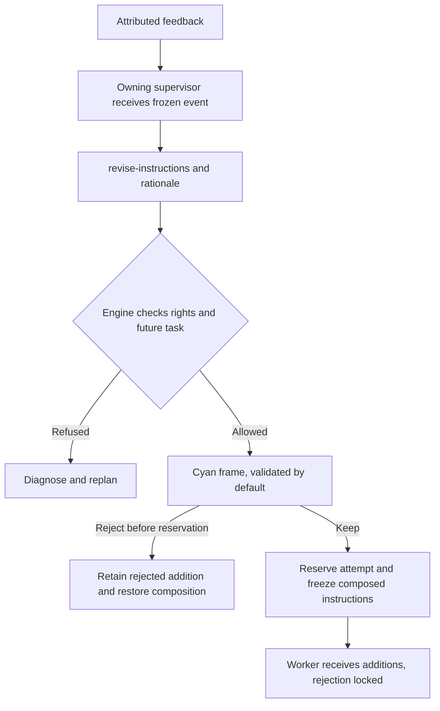

# Recursive instruction improvement

The owning supervisor or sub-supervisor can learn from an actually received
execution event and propose `revise-instructions` for a future owned `todo` task.
`next` contains the addition and `reason` its rationale. The deterministic engine
checks and applies this attributed decision; it does not invent the learning.

The addition is **validated by default**. A cyan frame in the task inspector
shows improved instructions, their state, rationale, owner and date. **Reject**
removes an addition from future instructions while preserving its history.
Instruction validation grants no task acceptance or project evolution authority.

Existing lease, holder, generation, work/scope revision, received-event and budget
checks apply. Only `kind`, `id` and `next` are allowed; other structured fields
must be empty or zero. The existing 2,000-byte protocol bound applies to each
addition. Criteria, deliverable, dependencies, attempts, limits and evidence are
preserved. Duplicate additions, including rejected ones, and out-of-scope, delegated-supervisor or
already executing tasks are refused. Multi-operation decisions are atomic.

`instruction_base` retains the original. `instruction_revisions` retains every
addition, source event, decision, owner, holder, generation, rationale, timestamp,
state and before/after hashes. Active additions compose with the original, newest
first for bounded planner display; workers receive the complete composed
instruction even with their own launch profile. `used_by_attempt` records which
attempt reserved the additions. Once reserved, Reject is unavailable and never
rewrites an agent's received context. Manual intervening instruction changes are
not silently overwritten. Replays create no duplicate or extra provider call.

Public `task.update` inputs for a future task retain active learning as a
separable composition. `instruction_base` remains the immutable original;
`instruction_operator_base` holds the current operator input, while the public
event retains the requested text. Rejecting one learning removes only that
addition, preserving operator inputs, other learning and historical hashes.
Legacy operator prefixes followed by the entire recognized composition are
reconciled on the next mutation; ambiguous edits remain refused. This recovery
never rewrites a context already reserved by an agent.

Launch reservation and revision/rejection use the same transaction and work
revision. A queued/starting/running/stopping session forbids changes. Concurrent
operations have one winner; the other must read the new state. The public operator
command is `planning reject-instructions WORK --input ...` or
`POST /api/v1/planning?work=WORK&action=reject-instructions` with `schema_version`,
`event_id`, `expected_revision`, `task_id`, `instruction_revision_id`, and `reason`.
Rejection spends no AI decision and routes an `instruction_rejected` event
to the owner for its next decision. The UI waits for server confirmation and displays
refusals instead of claiming success.
Received refusals appear immediately on the current card, even during a slow
snapshot readback. Local feedback participates in inspector caching: unchanged
task data cannot preserve an obsolete pending message. Button eligibility is
reassessed after readback; stale revisions require a fresh user decision rather
than an automatic replay.

After acceptance, the optional retrospective and quick wins phase offers project
evolutions. Those remain user choices and require preparation/adoption and launch
authority. Learning grants no extra budget, agent or acceptance.
