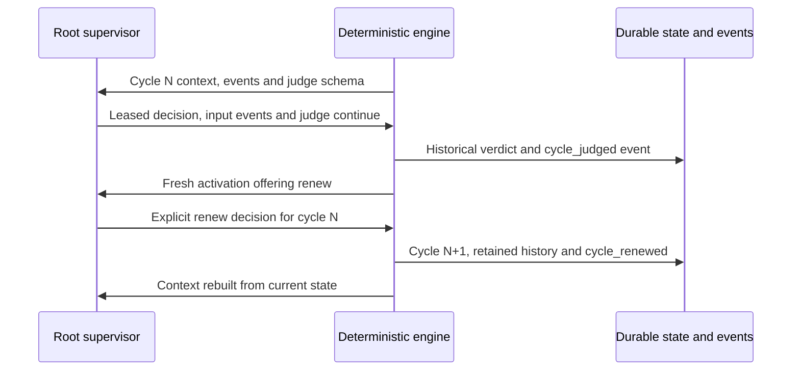

# Global judgment and cycle renewal

[Français](../architecture/JUDGMENT-CYCLES.md)

The root supervisor decides whether the objective should continue or end.
Global judgment concerns the cycle and cumulative evidence; independent review
examines each candidate. Judgment does not replace checks or candidate review
and creates no task acceptance.

## Received context and decision contract

Root context contains `global_cycle` (identity, current verdict, policy and
history count) and `cycle_operations` (available actions). The provider schema
offers `judge` before a verdict, then `renew` after `continue` when cycle policy
permits. Subplanners receive neither global operation. The proposed cycle number
matches the delivered receipt.

A cycle decision contains exactly one operation, with the usual `input_events`,
`reason`, supervisor lease, generation and current revisions. The public
`planning decide` path validates these values transactionally. The provider
schema guides output; it does not authorize execution.

Continue operation:

```json
{"kind":"judge","judge_cycle":1,"judge_verdict":"continue","expected_candidate":""}
```

Subsequent renewal operation:

```json
{"kind":"renew","judge_cycle":1}
```

Verdict and renewal are separate supervisor decisions. The engine infers neither
from the other. Task/delegation fields are refused on cycle operations, and cycle
fields are refused on other operations.

## Durable effect and fresh context

The direct public `planning judge` verdict cannot process `input_events`: supplied inputs are rejected without mutation. Ending requires pending returns to have been acknowledged. To examine and acknowledge returns while proposing `end`, the supervisor uses `planning decide` with a valid lease and a single `judge` operation. Input validation, closure and acknowledgement share one transaction; a list supplied to a direct verdict never establishes that its events were handled.



`continue` records the verdict and appends a root `cycle_judged` event. `renew`
marks the previous cycle renewed, increments its identity, clears only the live
verdict/reason/attestation and appends `cycle_renewed`. Objective, requirements,
results, incidents, attempts, counters and settings remain intact. The next
activation receives the fresh cycle and current inputs, without processing
acknowledged events again.

`JudgeState.MaxCycles` is persisted and editable through the Admin modal and
public `quotas` operations. Zero means no cycle ceiling. Activation, decision
and provider budgets still apply; renewal neither resets them nor authorizes
another provider call.

## End and refusal

An `end` judgment attests the current managed candidate in `expected_candidate`.
The engine verifies fresh required evidence, closed children, received/processed
events and no active process. The explicit structured end decision closes the
judge and root scope. A blockage, exhausted budget or process termination never
substitutes for this supervisor decision.

Stale cycles, duplicate verdicts, renewal without `continue`, pause, expired
leases, incompatible fields or insufficient evidence refuse mutation. Replaying
the same event returns its result without another verdict, event, spend or cycle.
The existing public `planning judge` and `planning renew` commands keep their
contract; this document describes the supervisor's operations in `planning decide`.

## Evidence and limits

`planning_judge_operations_test.go` exercises decisions, reopen/replay, received
context, child scopes, invalid inputs, pause and fresh end versus an active
process. A deterministic local provider subprocess receives the schema, returns
decisions and then receives cycle 2 through `planningStep`. This establishes
protocol transmission and effect, not real model judgment quality or autonomy.
The historical mission remains paused; these checks establish no deployment.
See the [direct development plan](../plans/engine-cursor-contract/developpement-direct-20261012.md).
