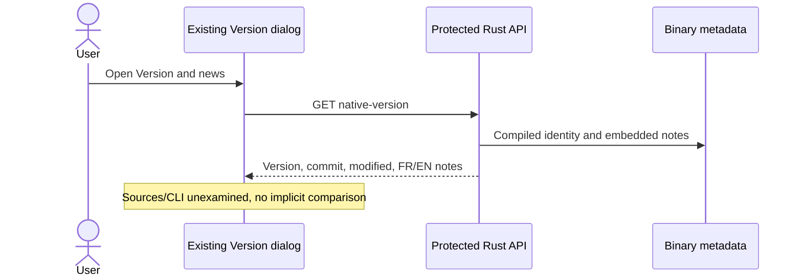

# Stable local cockpit — 8 October 2026

Historical Go cockpit record. The current path is the [Rust launcher](NATIVE-LOCAL-LAUNCHER.md); proofs below remain historical.

The Linux launcher provides start/restart/status/open/stop/logs, exact process ownership and saved project/address settings. Restart replaces its server while preserving missions. The optional mount mask tracks the actual Go process rather than only its wrapper.

The cockpit has a stable address and a real FR/EN sign-in form. The launcher opens local authentication privately. Persistent HttpOnly/SameSite cookies survive restart; mission permalinks contain no key. Host, Origin and CSRF guards remain enabled. Session lifetime is explicitly configured.

Verification: seven isolated native lifecycle tests pass, including preservation, foreign listeners, stale PIDs, exact adoption, atomic replacement, mount masking and private browser opening. The full Go suite passed in 517.310 seconds; focused race, frontend/i18n, vet, repository-contract and diff checks pass. The four language/theme variants and rejected-key focus were checked in the browser. The historical cockpit was restarted after verifying no active worker/reviewer; its ten mission IDs/statuses were preserved, and the existing browser authentication worked in a new tab.

Regression recipes found and fixed a TIME_WAIT bind-probe false positive, a mount-wrapper stop that could leave Go alive, and a nil Store in static-handler fixtures. Historical acceptance manifests remain unchanged; a distinct current-candidate manifest binds the new inputs without claiming independent acceptance. Inherited historical captures do not qualify the new sign-in form.

This is a local Linux launcher, not a remote deployment or system service manager. It does not delete data or kill unrelated processes/agents. The host CIFS share remains unchanged. No commit or push was performed. See the French report for the detailed incident record.

## Version and news in the Rust cockpit
The existing button displays the active server's compiled identity and embedded
FR/EN notes through protected GET `/api/v1/native-version`. Each explicit open
rereads it; no storage polling is added. The Git link points to the compiled
binary base, and uncommitted changes are disclosed. Local notes are not a published
release. This view examines neither checkout sources nor the CLI; it infers no
identity comparison or storage health. Invalid/unavailable responses replace old
data with a visible error. Close/reopen triggers a fresh read without automatic retry.

