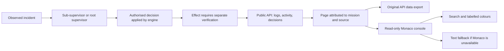

# Log console

Open **Monitoring → Logs** for the selected mission. Locally bundled Monaco
presents read-only data. Errors are red, warnings amber, activity cyan and
explicitly recorded successes green. Written levels accompany colours in both
themes, using Swarm's semantic tokens.

Sources remain distinct: attempt output, engine activity, supervisor incidents
and decisions. A recorded decision or acknowledged incident proves neither a
successful correction nor completion. Reasons, identities, operations and
current states come from public APIs. The console executes no commands and
accepts no results.

`Ctrl+F` searches the displayed console. Attempt output uses server search;
engine activity filters apply to the loaded page and the interface states this
limit. Cursors and history limits stay visible. Live following can be paused
for reading; export preserves the original API response rather than rebuilding
evidence from presentation colours.

A same-origin authenticated frame isolates Monaco's dynamic style nonce. Parent
messages require the exact origin and sending window. Script and cockpit policies
remain unchanged. Agent content is rendered as text.

The isolated `tests/log_console_ui.cjs` recipe checks received data, colours,
languages, themes, keyboard, filters, source/mission changes, live following,
export, network refusal and text fallback. It calls no real model and does not
prove autonomous supervisor recovery.

A hidden console retains the received message page but defers Monaco rendering. A `ResizeObserver` resumes rendering once the host has positive width and height; content is neither discarded nor replayed. This avoids wrapping measurements on missing DOM ranges. The graph recipe covers five reloads with the console hidden; the console recipe covers opening and filtering.
