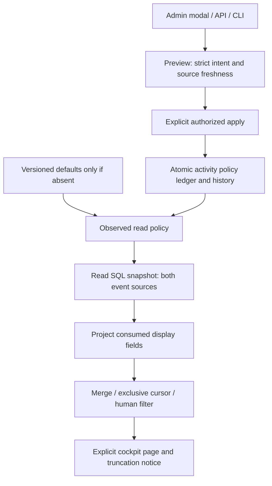

# Native activity feed

G1 provides protected GET/HEAD `/api/v1/activity?work=WORK&before=CURSOR&limit=N&decisions=0|1` and `activity show WORK --input QUERY.json --json`. Query files require schema_version1; cursor/limit/filter are optional. The cockpit reads and paginates explicitly, without polling. Recorded origins are inferred categories, never authenticated identity, autonomy or business acceptance.

Read cockpit_events and events by descending source sequence in one readonly SQL transaction, then merge by descending `at|rank`. Preserve Go source prefix and minimum12-digit rank spelling, including lexical comparison of signed/long ranks. The full cursor is exclusive. Human filtering keeps origin=vous. `more` requires one additional eligible entry; next_cursor is empty otherwise. history_truncated reports a source sentinel beyond the selected bound, even with an empty filtered page. SQL TEXT/BLOB strings use Go UTF-8/UTF-16 replacement rules; malformed consumed payload types refuse instead of Go’s misleading fallback. Historical payloads are polymorphic: project the eight display strings without imposing Request on review results whose criteria are objects. Unconsumed fields establish neither command validity nor authorization.

## Saved settings

Only an absent activity-policy.json uses the explicitly identified versioned config/activity-policy.json defaults: page_default_rows50, page_max_rows200, source_max_rows500. A present malformed source fails. The private ledger retains revision/history. Shared commands: `run-limits activity show|history|preview|apply`; endpoints `/api/v1/activity-policy`, `/preview`, `/apply`; Admin → Activity feed pagination modal. Preview writes nothing. Explicit confirmation uses checked atomic publication/backup; receipt and source are reread. Uncertain publication requires readback, never an automatic retry.

Default page rows must be positive and covered by any page maximum. Null removes either maximum; the modal spells it `unlimited`. Source0 reads no payload but checks a truncation sentinel. Omitted/zero requested limit selects the saved default. Only the saved page maximum clamps larger requests. JSON/JavaScript exact integers and usize conversion are representation constraints, not a hidden operator ceiling. Saved agent_provider_config_max_bytes governs both policy reads and serialized history. Saving changes no agent, mission history, execution budget or completion decision.

Changes require schema_version1, valid event_id, expected_revision, all three value keys (nullable maxima), nonempty reason; optional preview_token binds intent/source/settings/instance. CAS/event conflicts409, invalid submission400, stored-source errors500. Exact replay returns the current ledger without writing. Native object duplicates/unknown fields refuse. Unknown Work404 replaces Go’s empty list. Unknown/duplicate query keys and noncanonical counts refuse400; opaque cursors use form_urlencoded decoding. File policy and SQL snapshot are not jointly atomic: read_policy identifies the observation actually used.

## Evidence and limits

Permanent activity-read-rust200 passes3 steps (public Go/native8 groups, source-window3, browser4 FR/EN×themes320/1440), integrity VERIFIED. Pagination component5 tests and Rustdoc/i18n pass. Local installed200:23 checks plus14 Version assertions; five unchanged Works were also read before activation. Actual198 history exposed polymorphic review events; counterexample and200 repair are retained. Aggregate qualification stays BLOCKED for concurrent changes and older findings. See docs/plans/migration-rust/evidence/20261027-activity-l8z4x8wi/RESULT-RETEX.md.

A finite source cap selects the entire recent window, not a per-page quota. Pagination cannot cross that window: more=false can coexist with history_truncated=true. Increase source_max_rows or select null in Admin, then reread the first page to access older history. This matches Go; rank-only SQL cursor pushdown would change time ordering and the contract.

Example: a mutation can store criteria as ["evidence"], while a review result stores [{"criterion":"evidence","passed":true}]. These are different producers. Activity does not consume criteria, so that field must not block its read. Conversely title=false invalidates a consumed field and remains an error. Prevention: inventory historical producers before reusing a command DTO; test another producer’s payload and an invalid displayed field.

