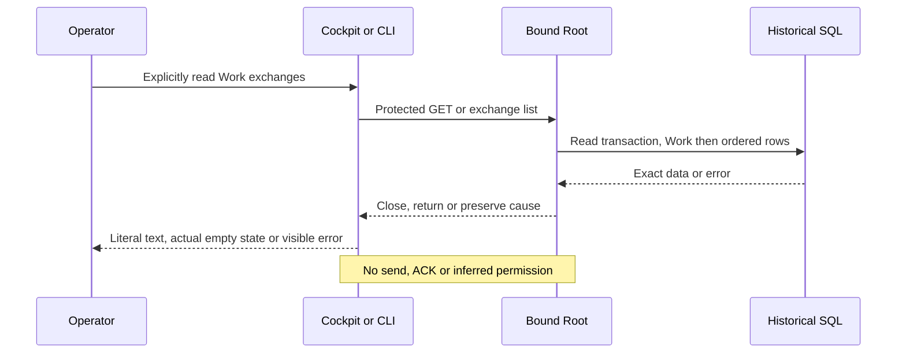

# Rust agent exchange reader

This slice ports exchange list WORK and GET/HEAD /api/v1/exchanges?work=WORK. The read journey is installed and verified on local version194; send/ACK operations and overall migration closure remain separate.

One read transaction validates the existing Work then reads agent_exchanges ordered by created_at,id. Historical mission-status inputs use that same reader; extraction preserves the established Go artifacts decoder (distinct null/[], duplicate/null fields and type errors). Empty optional fields are omitted like Go. SQLite BLOB and TEXT pass through the same Go decoder; invalid UTF-8 bytes and lone UTF-16 string surrogates become U+FFFD without losing duplicate members. SQL NULL becomes refused empty JSON input, never a successful empty array. No new row, time, retention or business-default cap. Unknown Work, malformed storage and SQL/finalization/rollback/Root-close/output failures remain visible failures, never empty success.

The API requires an authorized session, empty body and exactly one valid work; unknown/duplicate query members are explicitly refused. This strict native input contract does not claim to copy ambiguous Go query Get behavior. CLI uses the same readonly Root and closes before output/flush.

In the native cockpit select a Work, open Agent exchanges and request Read exchanges. No polling or automatic sending. Selection changes suppress stale asynchronous rendering. All data is rendered as literal text; artifact paths/hashes are declarations, never opened or verified files. Failed reads stay visible and require explicit recovery; no empty state is invented.

This reader creates, sends, consumes and acknowledges no exchange. It proves neither agent identity, transmission, authority nor autonomous progress. Those decisions/evidence remain under supervisor and engine control contracts. Write-operation migration remains separate.

HEAD verification reads actual TCP bytes after a valid GET: the usual HTTP client hides HEAD bodies and cannot establish this proof. The shared witness refuses an actually published body without adding a time limit.

Evidence: recipe194 PASS2/verified integrity (public Go/native7 and browser4), TCP HEAD witness5 tests +4 earlier policy routes, prior status reader4 before/after, installed21 +Version14 and five unchanged Works. Actual live Work/exchange contents are compared by digest without retention in the new report. Exact17-file review keeps three concurrent identity/preparation changes open, without implying global conformance. See the retrospective under docs/plans/migration-rust/evidence/20261027-exchanges-hq2js3us.

