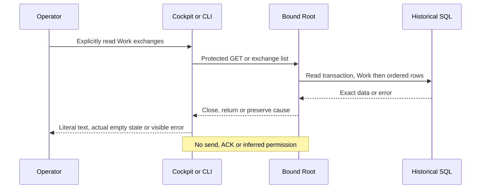
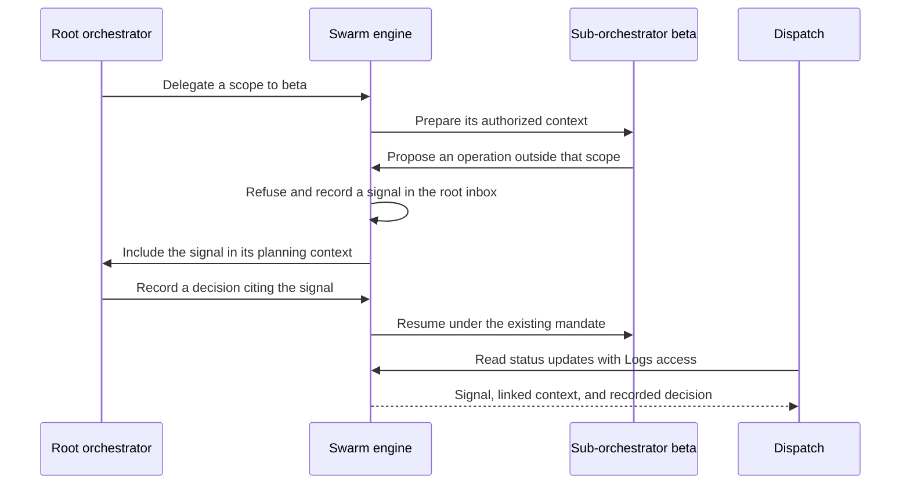
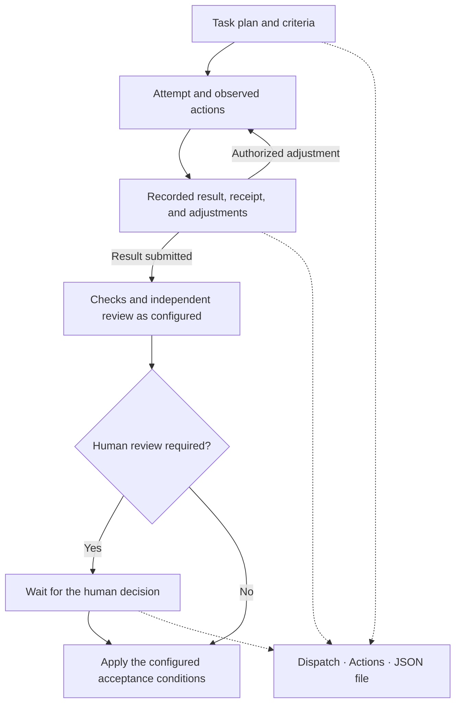
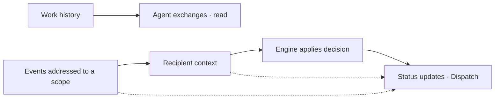
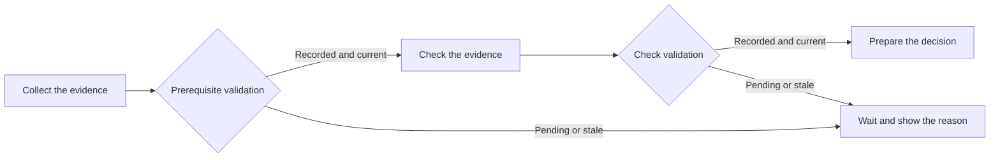
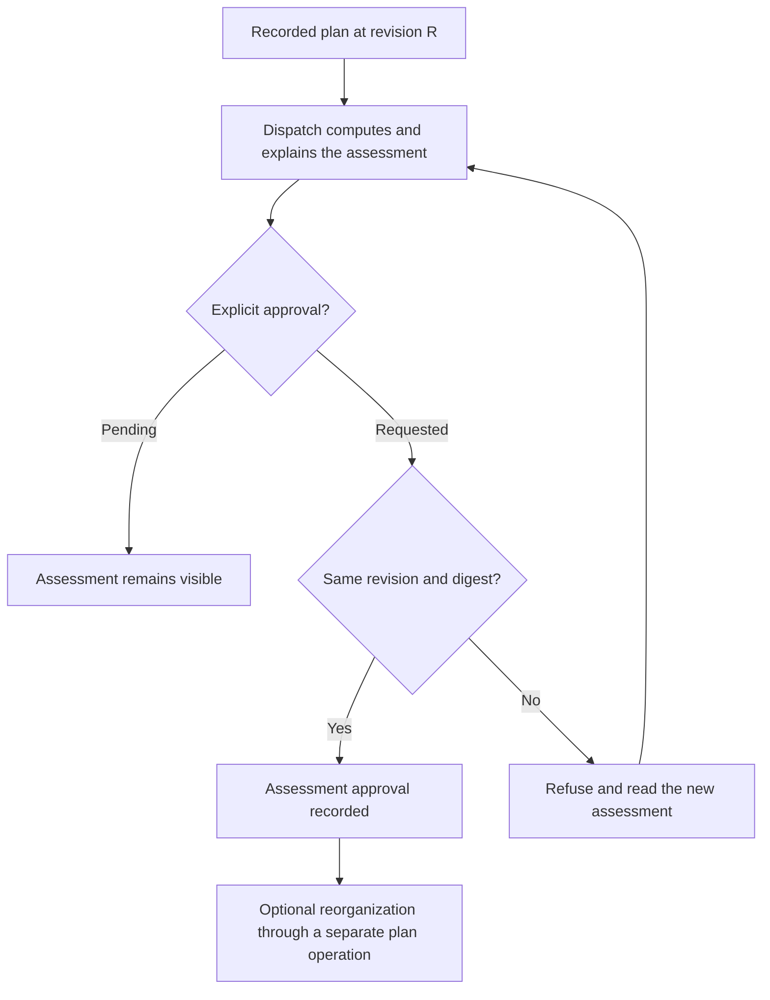
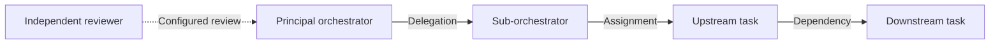

# Rust agent exchange reader

This slice ports exchange list WORK and GET/HEAD /api/v1/exchanges?work=WORK. The read journey is installed and verified on local version194; send/ACK operations and overall migration closure remain separate.

One read transaction validates the existing Work then reads agent_exchanges ordered by created_at,id. Historical mission-status inputs use that same reader; extraction preserves the established Go artifacts decoder (distinct null/[], duplicate/null fields and type errors). Empty optional fields are omitted like Go. SQLite BLOB and TEXT pass through the same Go decoder; invalid UTF-8 bytes and lone UTF-16 string surrogates become U+FFFD without losing duplicate members. SQL NULL becomes refused empty JSON input, never a successful empty array. No new row, time, retention or business-default cap. Unknown Work, malformed storage and SQL/finalization/rollback/Root-close/output failures remain visible failures, never empty success.

The API requires an authorized session, empty body and exactly one valid work; unknown/duplicate query members are explicitly refused. This strict native input contract does not claim to copy ambiguous Go query Get behavior. CLI uses the same readonly Root and closes before output/flush.

In the native cockpit select a Work, open Agent exchanges and request Read exchanges. No polling or automatic sending. Selection changes suppress stale asynchronous rendering. All data is rendered as literal text; artifact paths/hashes are declarations, never opened or verified files. Failed reads stay visible and require explicit recovery; no empty state is invented.

This reader creates, sends, consumes and acknowledges no exchange. It proves neither agent identity, transmission, authority nor autonomous progress. Those decisions/evidence remain under supervisor and engine control contracts. Write-operation migration remains separate.

HEAD verification reads actual TCP bytes after a valid GET: the usual HTTP client hides HEAD bodies and cannot establish this proof. The shared witness refuses an actually published body without adding a time limit.

Evidence: recipe194 PASS2/verified integrity (public Go/native7 and browser4), TCP HEAD witness5 tests +4 earlier policy routes, prior status reader4 before/after, installed21 +Version14 and five unchanged Works. Actual live Work/exchange contents are compared by digest without retention in the new report. Exact17-file review keeps three concurrent identity/preparation changes open, without implying global conformance. See the retrospective under docs/plans/migration-rust/evidence/20261027-exchanges-hq2js3us.

Each exchange shows its source attempt. After a successful read, navigation
buttons follow exact `reply_to` identifiers in the same Work response. Focus
moves to the linked exchange heading without another API read. Missing
references are visible and duplicate identifiers fail the view.
Acknowledgement is shown as recorded data, including an explicit absent state.

The browser journey `tests/rust_agent_exchanges_browser.py` verifies the
protected JavaScript bytes served by the executable, navigation in both
directions, no additional read and error states in both languages and themes.

## Supervision and status updates in Dispatch

The [Anthropic guide *Building Effective AI Agents*](https://resources.anthropic.com/hubfs/Building%20Effective%20AI%20Agents-%20Architecture%20Patterns%20and%20Implementation%20Frameworks.pdf#page=15) describes hierarchical supervision on pp. 15–16 through delegation, reporting, and dedicated context. The diagram below shows the Swarm scenario shipped in `v0.1.1-dev.410`. The engine enforces each scope's boundaries. Worker reports are addressed to the scope of their task. In the verified arbitration scenario, the engine addresses `beta`'s out-of-scope refusal to `root`. The planning-event timeline is available under **Dispatch → Team and validation → Status updates**. The exchange reader above retains its own recorded acknowledgement.

| Display | Evidence |
| --- | --- |
| **Sent** | Canonical deposit in the recipient's inbox with timestamp, message, and ID. |
| **Received in context** | Inclusion of the same signal in a saved planning context for that recipient. The context digest is verified and linked to the activation. |
| **Processed** | Applied decision by the recipient citing the signal. An acknowledgement can have zero operations, and Work acceptance has its own checks. |

The protected `GET /api/v1/agent-logs/orchestration-signals?work=WORK` joins the evidence in a read transaction. It shows when evidence is still absent for a pending signal. The raw context remains private. The recipe observed arbitration, `beta` resuming, and the intermediate state with the context recorded while the decision was still pending. The closure code also deposits a signal for the parent. Its recipe stopped in the fixture provider before emission and remains to be replayed. [APEX plan and recipe](../plans/ORCHESTRATION-SIGNALS-APEX.md) · [Integration and checks](https://github.com/mo0ogly/swarm/pull/69).

### Depth and context management

The code allows a sub-orchestrator to delegate to a child within its mandate, budget, and configured depth limit. Each activation receives the tasks and events scoped to it. A worker reports to its own scope. Closing a scope records a signal addressed to the immediate parent. An authority refusal requesting arbitration is addressed to `root`. The APEX recipe above exercised one level of delegation. End-to-end verification of a deeper chain, including closure and final synthesis, remains open.

The planner proposes structured operations such as `delegate` and `task`. The engine validates them and schedules activations. It batches events under the configured limit and refuses a context exceeding its byte limit. Recorded contexts and report references are available for later reads. Automatic token-aware conversation editing, autonomous model memory, and direct routing of user interactions to specialists remain unestablished. These limits define the scope of comparison with the variants and guidance on p. 15 of the Anthropic guide.

## Work loop, evidence, and review

The [Anthropic guide](https://resources.anthropic.com/hubfs/Building%20Effective%20AI%20Agents-%20Architecture%20Patterns%20and%20Implementation%20Frameworks.pdf#page=11) describes a plan, act, observe, and adjust loop that can stop for human review (pp. 11–12). It also describes evaluator–optimizer refinement (pp. 21–22). In Swarm, checks, independent review, and human review follow the configured Work conditions. The diagram summarizes the documented journey and the evidence available for inspection.

The task JSON file reads the recorded plan, attempts, and adjustments. It shows when human acceptance is pending. Visible actions depend on available tool events and receipts. See [the Dispatch user guide](USER-GUIDE.md) for opening the file and the observation limits.

## Peer collaboration

The [Anthropic guide, pp. 16–18](https://resources.anthropic.com/hubfs/Building%20Effective%20AI%20Agents-%20Architecture%20Patterns%20and%20Implementation%20Frameworks.pdf#page=16) describes coordination emerging among specialists. Its competitive intelligence example combines work sharing, cross-checking findings, and collective synthesis. The table gives the verified scope in Swarm Rust `v0.1.1-dev.410`.

| Mechanism | Verified scope |
| --- | --- |
| Direct exchanges | The CLI and cockpit read recorded messages, linked replies, and acknowledgements. The historical send and consume commands belong to the Go contract. |
| Event-driven coordination | The engine prepares contexts from events addressed to a scope. The supervisory recipe verifies `beta → root` escalation and resumption after the decision. |
| Group conversation and role negotiation | Capability unestablished on the shipped engine. |
| Shared read/write blackboard | Capability unestablished. Work history exposes its recorded exchanges. |
| Peer cross-checking and synthesis | The guide's complete scenario remains to be demonstrated, including conflict resolution and convergence. |

## Sequential workflows

Under **Dispatch → Task graph**, directed dependencies define a sequence in advance, such as **Collect → Check → Prepare the decision**. The engine checks prerequisite state and the freshness of applicable evidence. If a prerequisite requires human review, its first result alone cannot open the next stage. A justified waiver follows the applicable validation contract. Each edge remains visible in the graph.

This structure corresponds to predefined dependencies in the [Anthropic guide, pp. 18–19](https://resources.anthropic.com/hubfs/Building%20Effective%20AI%20Agents-%20Architecture%20Patterns%20and%20Implementation%20Frameworks.pdf#page=18). The engine controls order and start conditions. Agent output can vary. An authorized planner can propose a new task with dependencies within its scope, subject to engine checks. This supports adapting the plan through a recorded decision. General declarative routing, such as choosing B or C based on a score threshold, remains unestablished for the task graph. See [product architecture and work models](../PRODUCT-ARCHITECTURE.md#précision--modèles-de-cadrage-et-modèles-de-travail).

### Example — data analysis

The [Anthropic guide, p. 19](https://resources.anthropic.com/hubfs/Building%20Effective%20AI%20Agents-%20Architecture%20Patterns%20and%20Implementation%20Frameworks.pdf#page=19) maps to a work plan of **Scope → Prepare the data → Analyze → Deliver the report**. Each task specifies the input it expects, the deliverable it produces, and the acceptance criteria. The dependency controls the next task's eligibility. Actual access to a file or data source also depends on the execution workspace and configured permissions.

Configure the analysis checks per task with authorized checks or human acceptance as appropriate. The independent reviewer examines the result when configured. Model **Draft → Substantive review → Revise** as three tasks if the review produces findings to hand back to the writer. Final acceptance has its own criteria.

This is an example plan. Dynamic analysis routing, data-source connections, and dashboard or report distribution need suitable operations or integrations. The complete domain workflow remains to be verified.

### Audit and reassess the choice with AI

The **Help** dialog in Prepare explains the four workflow patterns with examples and selection criteria. On mobile, the title and close button stay visible while the content scrolls. It distinguishes coordination patterns from catalog templates and explains the role of deliverables, prerequisites, and independent review.

Under **Prepare with AI → Choose a workflow architecture**, select **Draft an AI assessment**. The draft asks about dependencies, handoffs, scopes, validation, recovery, and measured costs or delays. The recommendation can be a sequence, a hierarchy, a justified combination, or insufficient evidence. Review and send the request explicitly in the conversation.

When the plan or a constraint changes, select **Draft an AI reassessment**. Provide the previous assessment and the new evidence, or include the full conversation if it contains the previous assessment. The draft asks whether to keep the choice, change it with reasons, or report insufficient evidence. Both assessments are available in preparation history. The operator decides whether to adopt a plan.

### Automatic assessment and approval in Dispatch

Open **Dispatch → Team and validation → Workflow architecture assessment**.
Reading the recorded graph computes the assessment. A chain of at least two
tasks with one possible order recommends a sequence. A hierarchy is recommended
when work in separate delegated scopes can advance at the same graph stage and
a recorded prerequisite crosses those scopes. Independent branches alone leave
the choice undetermined. Requirement prerequisites with a unique producer
also constrain the computed order. Ambiguous provenance leaves the assessment
undetermined. The reasons, numbers of tasks, dependencies and scopes,
and the revision are visible. The structural calculation uses no model calls.
Contextual assessment remains available in Prepare with AI.

After a saved change, the next Dispatch read shows the new revision’s assessment.
A graph edit applied in Dispatch already triggers that read. **Approve this
assessment** records approval for the exact revision and digest. A stale
submission is refused. Approval and plan reorganization are separate operations.
Approval by itself leaves the Work unchanged.

See the [APEX recipe](../plans/WORKFLOW-ARCHITECTURE-APEX.md#avis-automatique-dans-conduite).

### Responsibility projection in Mission control

The graph reads planning scopes, their parents, task assignments and the
configured independent reviewer. It displays these relationships.

Dependency arrows retain their editing controls. Responsibility links are
read-only. Delegation uses solid amber arrows. Gray assignment arrows are
visible on opening and can be filtered by scope. The graph header shows the
recorded hierarchy and the engine recommendation for the current revision.
Unavailable and stale recommendations are reported in the graph. The dashed green review link represents
configuration. Receipts and status signals
remain available in **Team and validation**. The animated outline reflects a
current observation of a running process. Historical views, the system reduced
motion preference and **Pause animation** support static reading.
