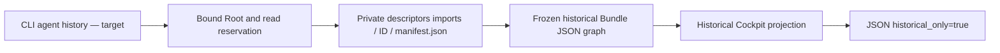

# Imported agent history

State: candidate being connected; local version219 still refuses `agent history`.
The active plan and evidence are in
[AGENT-HISTORY-20261027](../plans/migration-rust/AGENT-HISTORY-20261027.md).

The target `agent history ID --root ROOT [--json]` reads the private manifest
`.swarm/imports/ID/manifest.json`. It always returns JSON, even without `--json`:
`{"historical_only":true,"history":...}`. Missing/null history stays `null`; empty
collections and omitted fields follow Go's format. The identifier must be a
valid local name; the current Work need not exist.

The frozen graph also checks known types in manifest fields that are not returned
(Work, events, assistant, automation state, files). Unknown fields are tolerated;
duplicates, null and invalid UTF8 replacement follow Go JSON rules. It does not
replay import admission: old versions, revisions and values remain archive claims.
The current Agent's native extensions are outside the historical graph. Neither
the versioned contract nor its generator needs Go sources at runtime or when
regenerating the Rust module.

A recorded running status, PID, cost, decision or bookmark proves no activity,
authenticated authorship or current permission. The reader never signals a
process, inserts an Agent, replays a control or writes SQL, budgets or visits.
It does not verify signatures, blobs, event chains, freshness or completeness.
Physical reading is Linux-only and does not establish OS confinement.

Invalid names, private path symlinks, incompatible ownership/modes, missing
manifests, invalid types, read/close/output errors remain visible failures. No
successful empty list is fabricated. Primary and cleanup causes survive. The
result can become stale immediately; the whole archive is not one atomic snapshot.
Memory follows manifest size, without a new hidden read ceiling.

File restoration in the recipe uses inert fixtures only. It is neither a
supported Rust import/restore operation nor permission to modify a real Work's
private data.
