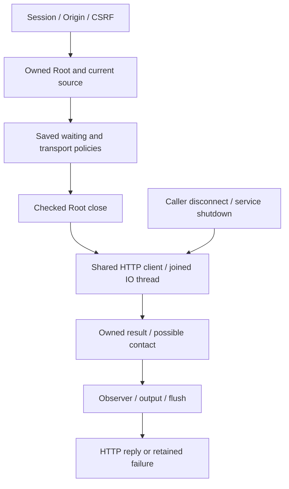

# Native manual API connection probe

Rust implements POST `/api/v1/providers/connections/test`. **Test an API connection** in Admin tests existing connections or unsaved drafts, with a provider-charge notice. Entered keys remain in modal memory for another explicit action and clear on close; this flow never saves them.

## Admission and ownership

Requests use connection change version1, expected digest, connection and explicit key replacement. Host/session/Origin/CSRF precede decoding and Root opening. The engine checks its owned instance, current source, data and exact retained-key destination. Stale digest refuses409; invalid/disabled drafts refuse400. With `replace_key:false`, submitted key data does not replace the saved key or move it to another destination.

Root closes with checked cleanup before network. No provider file, Work, Agent, reservation or budget changes. The engine admits the contract and supplies a private snapshot; the adapter performs IO. The owner retains job/capacity through observation. The probe never finishes a mission or replaces supervisor business decisions.

The sole message is `Réponds seulement : Connexion réussie.` without mission context, project instructions or tools. Authentication is optional; nonempty keys use Bearer. The shared client retains system TLS/proxy, refuses redirects/tools, requires HTTP200 with one complete text choice and never retries. Echoed keys are redacted; rendering uses text, never HTML. Public diagnostics disclose no private URL, remote error body or key.

## Effective settings

| Persisted source | Unit and effect |
| --- | --- |
| `provider-wait.json`: `max_duration_seconds` | Total seconds; zero is unlimited. |
| `preparation_call_response_max_bytes` | JSON body bytes; null is unlimited, zero refuses nonempty bodies. |
| `preparation_call_http1_max_headers` | Positive HTTP1 header count. |
| `preparation_call_http2_max_header_bytes` | Positive HTTP2 bytes representable as u32. |
| `preparation_call_observation_ms` | Positive cancellation observation interval. |

Only these four transport dimensions are shared with preparation; enablement, messages/turns, JSON/SSE mode and business deadlines remain separate. Silence/ownership lease are not probe deadlines. The same Admin/API/CLI edit persisted values; Admin help explains sharing. Missing policy refuses501 before contact without adopting defaults. The observed installation retains settings41; explicit Admin adoption is still required to use the probe and was not imposed.

The synchronous bridge owns/joins its IO thread even from entered Tokio. Thread/runtime creation, opaque panic, transport, decoder and deadline causes remain retained. Nothing is detached. Disconnect/shutdown cancel local IO according to the saved interval, never prove remote cancellation or unbilled cost. No new hidden duration/retry/concurrency ceiling exists.

## Results and recovery

Provider failure remains HTTP200 with `ok:false` and a safe code, never feature success. Results carry `text`, `error`, `latency_ms`, `provider_contact_may_have_occurred`, `source_digest`, `settings_revision` and `wait_revision`; revisions are exact strings.

Possible contact is independent of local mutations. True never proves remote completion, known cost or acceptance. The owned receipt survives response, observation, encoding and late output/flush failure; original causes remain in memory with safe projections. Internal source/IO errors remain500, never empty successful fallbacks.

Negative results stay visible and allow another explicit action. Missing reply/local cancellation show uncertainty, disable the draft and require reload; missing policy gets specific guidance. Footer actions remain visible on narrow screens without splitting words. Result focus reveals its scrolling status; close restores focus.

## Evidence and limits

Local174 was observed through actual binary, fixture-free default profile, protected assets, FR/EN notes and Version dialog. Ten HTTP groups cover retained keys, destination refusal/replacement/recovery, stale source, saved caps and unlimited-call shutdown. Five comparisons use the real Go server. Four browser surfaces cover FR/EN, themes,320/1440px, contrast, keyboard, failure/cancellation. Three tests cover entered Tokio/panic and result custody; another covers late CLI output. Only owned loopback HTTP fixtures are used, no real account. Original failures, versions, verified recipes and RETEX remain in the [plan](../plans/migration-rust/PLAN.md), evidence `20261027-api-connection-probe-r6eeepeu`.

Native adds fresh source admission and the save path's key choice; Go test does not enforce every such check. Go constants20000/1MiB/500 are not hidden policies and legacy diagnostics are not fabricated. Ordinary native `complete` retains its credential requirement; broader parity and agent API execution remain separate. No global Go conformance, account availability, known billing, independent acceptance or completed migration is inferred.

