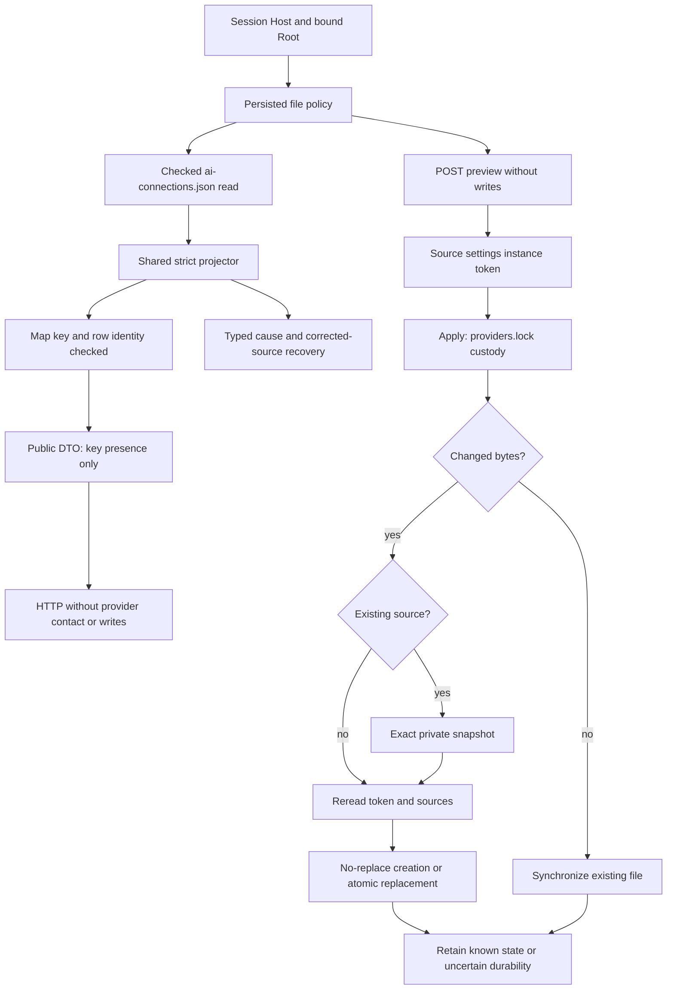

# Native API connection inventory

`GET/HEAD /api/v1/providers/connections` reads authenticated operator declarations. The response retains `version:1`, the actual source-byte digest and sorted `id`, `label`, `base_url`, `model`, `disabled`, `has_key`, `provider` rows. The key remains private; only its presence is exposed. Endpoint and model are stored declarations, not availability evidence or contact authority.

An absent file returns an empty list and empty-byte digest without creating a file. Stored `null` returns an empty list with its own digest. Format/type/unknown-field, read, inconsistent map-key/row identity and close failures remain server errors. The same inherited strict projector validates the namespace catalogue: this full read does not change active/disabled alias rules. Selecting/executing an API provider remains explicitly unported.

The file cap comes from existing persisted `agent_provider_config_max_bytes`, consumed through the launch policy. No 32-connection or 64KiB cutoff is added. Session, Host and Root binding apply; query parameters, read bodies and unsupported methods refuse. Read custody is acquired and closed; no network call, execution reservation, Agent, Work or file is changed. A null row has an empty identity and therefore refuses inventory, while the namespace guard retains its inherited compatibility. The `api-connections-read-rust` recipe uses an isolated inert Root, a valid Admin control then absence, fake private values, invalid sources, refusal and recovery.

## Native save with preview

`POST /api/v1/providers/connections` uses Go fields `version`, `expected_digest`, `connection`, `replace_key`, with native `preview` and `preview_token` extensions. `preview:true` creates neither a file nor publication lock; its response contains hashes, token and flags only. Apply with `preview:false` and the current token. An old POST without preview explicitly refuses. CLI `providers connections show|preview|apply --input FILE` shares Root methods; `show` takes no document. Historical Go UI is not embedded in Rust; adapting it and delivering native UI remain separate.

The endpoint is normalized without trailing slash and must be HTTP(S), without embedded credentials, query or fragment. Keys must be representable without HTTP header injection. IDs retain the connection-v1 format (at most64 ASCII bytes, no `api-` prefix); models use the existing model-v1 grammar. These formats are not execution limits. No Go32-connection/64KiB-file/20KiB-request/8192-key-byte cutoff is copied: current file and transport limits apply.

`replace_key:false` ignores the submitted key and retains the existing key, or empty on creation; setting any key, including the first, requires `replace_key:true`. Changing destination while retaining a key refuses. `replace_key:true` replaces the key, or removes it when empty. Applied replies retain `saved:true` without key disclosure. The token binds before/after bytes, CLI catalogue, settings/revision and observed directory/database identities. It grants no identity, authority or enduring lease. CLI `api-ID` collisions refuse even for a disabled connection.

Application reacquires Go-compatible `providers.lock`, rereads the token, retains an exact private source snapshot and rereads bindings before atomic publication. An absent source uses no-replace creation. A no-op synchronizes the existing file without an extra snapshot. Pre-replacement failures preserve the source; a visible replacement with uncertain durability or a later close/output error explicitly preserves possible recorded state: reread before recovery. A snapshot alone never proves current-file replacement.

Validation also covers the effective retained key. A stored key that cannot be represented as a header produces a safe source error (`api-connection-stored-key-invalid`) without writes; explicit replacement or removal permits recovery. Request errors are client refusals; malformed stored sources, read/close errors and invalid saved policies remain server errors. A stale digest is a conflict. Tests use owned inert Roots and fake keys only. Provider HTTP testing and native execution remain to be migrated.

