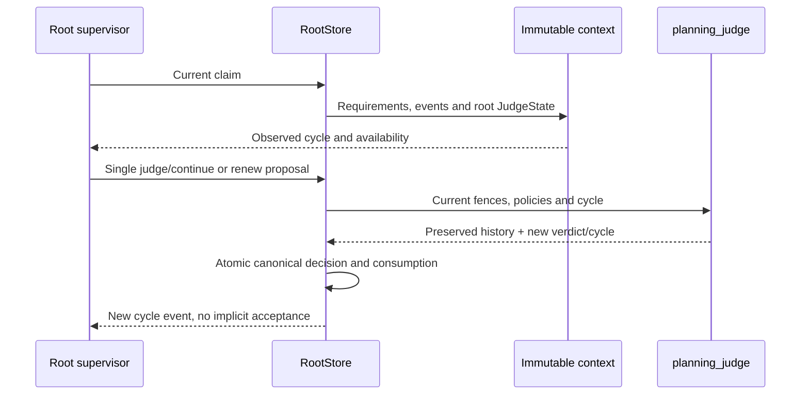
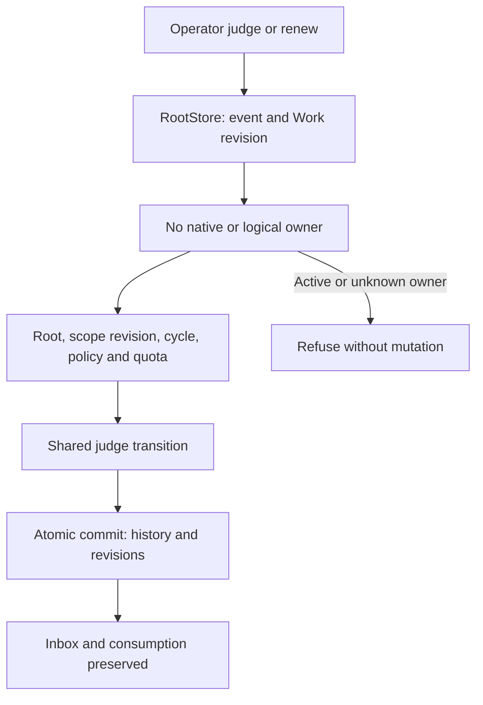

# Native global judge: cycles, quotas and history

Root `judge/continue` and `renew` are verified on native fixtures in lot177. They do not replace independent candidate review. `judge/end` still refuses because its native managed-candidate evidence contract is unported. This is not global completion.

## Decision contract

The root supervisor proposes one operation through its ordinary leased decision. The engine checks mission, revision, declared holder, generation, received inputs, current policies and cycle. These declarations are concurrency fences, not semantic agent authentication.

```json
{"input_events":["received-event"],"reason":"Continue the still-open objective","operations":[{"kind":"judge","judge_cycle":1,"judge_verdict":"continue"}]}
```

One verdict is recorded per cycle. `{"kind":"renew","judge_cycle":1}` then adds `renewed_at` to the last record and opens cycle2. Previous verdicts, reasons, references and dates remain. A continue reference is supplied data, not verified candidate evidence. Tasks, reviews, attempts, activations, decisions and spending are never reset. A global operation cannot be mixed with plan changes.

Children receive no root `JudgeState` and cannot judge root. Test13 first records an actual private root reason, then asserts its absence from the child's full prompt and refuses the attempted global verdict while retaining its actual call.

## Policy and recovery

Enablement `max_judge_cycles` and quota `judge_cycles` persist the mission ceiling;0 removes that ceiling. Other budgets and representation bounds still apply. A last allowed `continue` cannot renew beyond quota and never automatically becomes `end`.

Existing `planning_decision_max_reason_bytes` caps new UTF8 reasons. Admin's catalogue and `engine-settings preview/apply/show` expose it; `planning_decision` and `planning_judge` consume it. For these caps, `null` removes the limit while0 rejects nonempty reasons, unlike cycle quotas. Durable consistency still checks verdicts, cycle, dates and history alignment, without reapplying the old4000byte admission policy to stored data. Witness:5000bytes accepted under6000 remain readable after saving200, which refuses a new excessive reason.

Mission ceilings already appear in the native Mission limits dialog, Judge group (`web/native-quotas.js`). General Admin consumes the dynamic catalogue (`frontend/engine-settings/admin.js`). CLI save/reopen/effective-consumer flows are verified here; browser interactions were not rerun for this backend-only change.

An active planner owner blocks quota editing. The recipe verifies unchanged state, then uses public pause → edit → resume → new claim, preserving history and consumption. Full root history remains subject to existing context caps: unlimited cycles do not imply an unlimited prompt. There is no automatic truncation or cap increase.

## Received context and version changes

`native_planning_claims` retains exact received context and SHA. Freshness now also compares root JudgeState. Old context lacking that field cannot prove reception and is never backfilled. Legacy14 verifies an old **unexecuted** claim: unchanged refusal, public resume and genuine new context, with old rows/reservations preserved. Old in-flight results require separate qualification and reconciliation before R7.



## Evidence and limits

Normal06 `9fb426`:275 archived effective sources without fixture features;47 named tests, strict Clippy and private Rustdoc04. Control11/faults12 cover actual native cycles, long reasons, seven targeted refusals, active-owner quota protection, restoration and no-exec replay. Child13 covers scope/privacy; legacy14 covers only an old unexecuted claim. Durable recipe: `tools/verification/recipes/native-global-judge-cycles.json`; steps ran separately against the frozen binary, not one whole invocation against concurrent checkout.

These are owned inert processes, not paid models, authenticated humans, installation or global acceptance. Full conductor, managed HTTP planning routes, managed candidate, remaining parity, data restoration and final cutover remain open in the plan.

## Direct operator commands

Lot178 verifies `planning judge WORK --input request.json --json` and `planning renew WORK --input request.json --json` on normal05 (`d1b953fd`). They differ from `planning lease-renew`, which extends a held claim. Supply actual current revisions:

```json
{"schema_version":1,"event_id":"operator-verdict","expected_revision":12,"scope":"root","scope_revision":3,"judge_cycle":1,"judge_verdict":"continue","reason":"Continue the open objective"}
```

Renew uses a new event ID, current revisions and cycle, without `judge_verdict` or `expected_candidate`. Neither command creates a claim or model call. Both preserve inbox acknowledgements, spending and activation/decision counters, increment Work and root-scope revisions and retain the canonical command event. Unlike leased decisions, they append no cycle inbox event. Nonempty `input_events` are rejected for both commands; acknowledgement requires `decide` with actual received context.

Root scope, active unpaused planning, current scope/cycle and no logical holder or ownership-retaining native run are required. Lease expiry does not prove physical completion. Foreign fields, including holder and plan operations, are refused. Existing saved quota/reason policies apply; `end` stays refused. Exact canonical replay returns current state without another transition, including after lowering the new-reason cap.



Evidence178: direct06 covers commands, fourteen targeted refusals, saved/reopened caps, quota and replay; held08 uses a socket, peer credentials and pidfd for a genuinely held inert provider, then requires its original leased result to apply after release; cycles07 rechecks the leased native path. Quality03 retains48 named tests, strict engine Clippy and private Rustdoc; CLI documentation is checked separately. Durable recipe: `native-global-judge-cycles.json`, including direct commands and live ownership. No global recipe watchdog; the witness120s lease is an explicit product fixture input.

CLI behavior is verified without installation or actor authentication. Lot179 adds [the actual protected planning HTTP endpoint](NATIVE-PLANNING-HTTP.md). `/api/v1/action` remains task-only; cycle actions use `/api/v1/planning`. No browser verification or edits to Claude’s frontend work in these lots.
