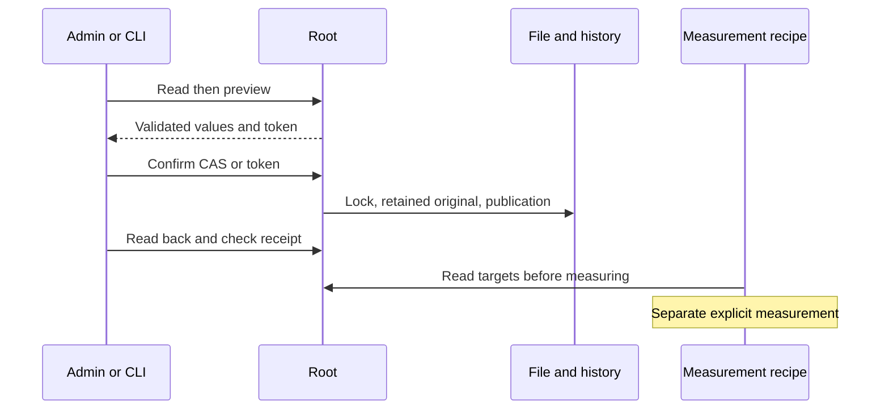

# Rust graph performance targets

The API/CLI/Admin journey is installed and verified on local version189. Overall migration closure remains open.

Private graph-performance.json preserves Go schema_version, revision, values and history. Only actual absence selects versioned config/graph-performance.json; invalid/denied files never become defaults. GET/HEAD /api/v1/graph-performance and POST /preview, /apply share the producer with CLI run-limits performance show|history|preview|apply. Preview writes nothing; explicit Go CAS remains supported and an optional native token adds freshness. Exact replay returns current state without another revision.

Keyboard/render targets and samples are positive; loads have at least two cards and unique card counts: measurement recipe preconditions. The 2^53−1 bound is technical. Sample count and targets are persisted operator choices editable in the Admin dialog, without copied hidden Go policy ceilings. Existing agent_provider_config_max_bytes also covers this file and full serialized history under common engine-settings validation/Admin/API/CLI; null is unlimited, zero refuses nonempty content.

The dialog loads actual values, adds/removes workload profiles, previews, confirms and reads back using shared receipt checks. New rows are empty, without hidden values. Uncertain outcomes require readback; HTTP200 alone proves no saving. Compatible locks protect backup and atomic publication; causes and known/uncertain effects survive output. No mission or consumption is modified.

Historical consumer tests/graph_performance_ui.cjs reads public configuration and freezes it before measuring. Its archived graph recipe still depends on Go graph journeys; this slice does not claim to make that recipe fully native or prove rendering improvements. Saving objectives starts no benchmark and changes no agent engine. Evidence and limits remain in the slice plan.

The native view adds source, digest and exact (lossless decimals), plus bounds describing only technical preconditions. It does not expose old fixed Go request/file limits; configuration_max_bytes reflects the saved shared setting as decimal or null. Compared Go clients consume configuration/history and the measurement recipe reads values; presentation metadata is not claimed byte-for-byte equivalent.

Final recipe PASS with verified integrity: public API/CLI7, actual Go6 groups/13 cases, browser4 FR/EN/themes, codec5, installed18 and Version dialog14. See the slice retrospective in docs/plans/migration-rust/evidence/20261027-graph-performance-lh7z80oy. Global review explicitly remains open for concurrent preparation changes; this does not accept the entire engine.

