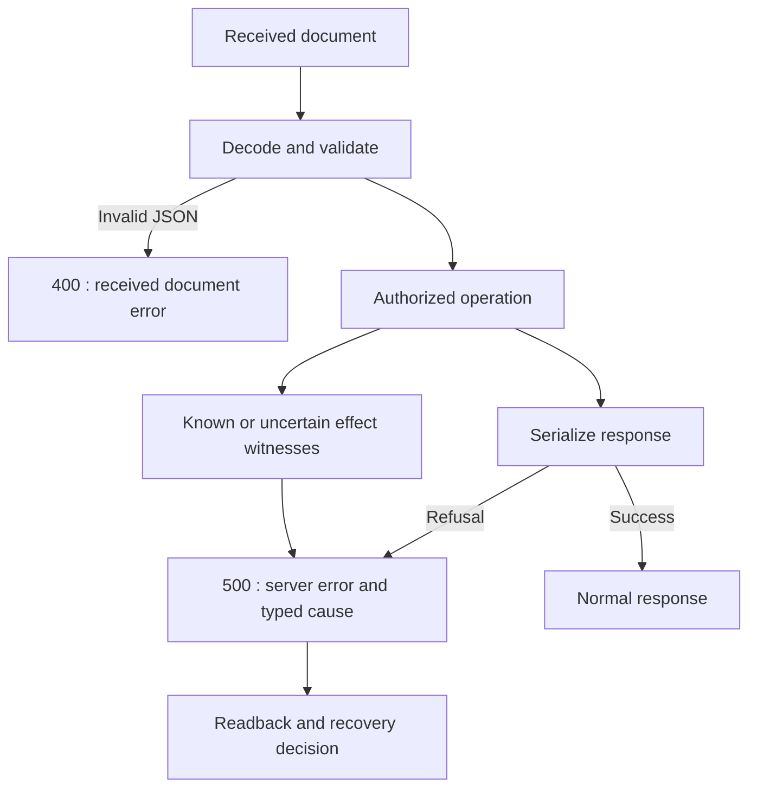

# Native API JSON errors

[French](../architecture/NATIVE-HTTP-ERRORS.md). Shared native contract from the
[consultation migration](NATIVE-SESSION-VISIT.md); evidence and installation stay
in the [plan](../plans/migration-rust/PLAN.md).

Invalid received JSON uses HttpServiceError::Json, web-document-invalid,
HTTP400. Serialization failure of a server-produced response uses ResponseJson,
web-response-encoding, HTTP500. These are protocol categories, with no operator
ceiling, deadline or new policy. The original typed JSON cause survives; public
messages contain neither private bodies nor secrets.

This distinction applies to API response/projection serde_json::to_vec and
to_value producers: consultation, cockpit/live, logs, settings, limits,
preparation, providers, budgets and existing report projections. Normal response bytes and request
validation remain the same. Reading an existing server JSON document is a
separate contract: never mechanically classify every from_slice as500 without
checking its origin.

HTTP500 proves no rollback. Work, configuration, preparation, provider, trust
and consultation effects keep separate witnesses in their existing envelopes.
Consultation receipts survive encoding, close, output/flush and refused owner
observation. Read current state before deciding recovery; this code grants no
automatic retry.

The counterexample deliberately uses a refusing serializer because the current
fixed consultation DTO cannot naturally cause that error. It reproduces400
before the correction and must return500 with the same cause afterwards. This
proves a response boundary, not a real SQLite/disk failure or independent
acceptance of every API.

