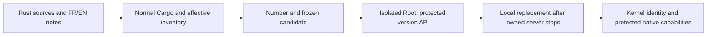
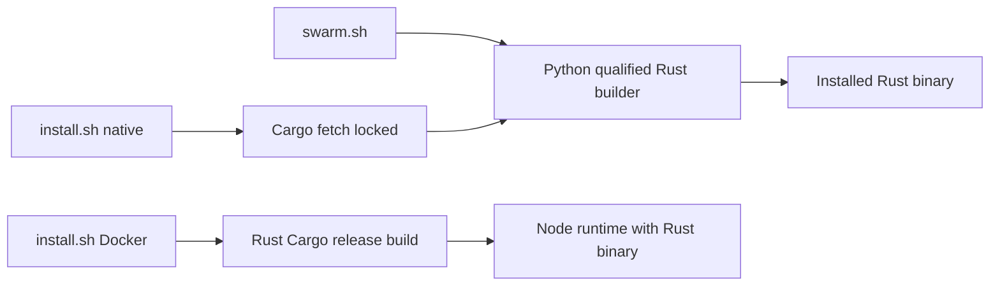

# Local Rust launcher

`./swarm.sh` keeps its shell/Python wrapper and builds only the Rust engine: no Go compiler or fallback. Linux, Python 3, Cargo/Rust and offline Cargo dependencies are required. Switching this launcher does not deliver the complete historical cockpit.

```sh
./swarm.sh build
./swarm.sh start --no-open
./swarm.sh status
./swarm.sh restart --no-open
./swarm.sh open
./swarm.sh stop
```

`configure` saves project, address and binary in local, untracked `deploy/local-web.json`. Existing root/address/binary, startup/stop deadline and mount-mask options remain available. Its `rust_target_dir` key, or `SWARM_RUST_TARGET_DIR`, selects the local Cargo cache; the technical default is `.cache/rust-build-local`. The target must be exclusive during compilation. External binaries remain external; automatic source builds cover only `bin/swarm` and `bin/swarm-local`. `build.sh OUTPUT` also emits a qualified Rust candidate without activating a service; `SWARM_VERSION` can supply an explicit valid label.

Normal builds exclude fixture features and retain effective dependencies, artifact characteristics and hashes under `.cache/local-delivery/`. Maintained recipe/test sources live in the repository. Broader candidate fingerprints invalidate cache reuse; numbering depends on effective dependencies, delivery tools, release notes, actual commit/dirty state and observed configuration/toolchain. A changed graph may require a second build to correct the proposed number. Native collector configuration limits still apply; this establishes neither build-chain confinement nor overall acceptance.



Build/qualification failures precede stopping the existing server. Isolated probes and local stops use SIGINT so the engine can drain. Foreign listeners are refused; PID, kernel start time, executable and argv establish local process ownership. Startup/stop expiration remains an error; unknown processes are never killed. Existing explicit lifecycle deadlines differ from mission policy; no global recipe watchdog is added.

Readiness requires cookie-authenticated `/api/v1/native-capabilities` with the exact native HTTP profile, rather than a login-page HTTP 200. Protected GET/HEAD `/api/v1/native-version` returns compiled identity and embedded French/English notes. Browser opening selects `/login?next=/live.html`: enter the local key in its form; the launcher generates no secret link. The historical Version and what's new dialog and complete cockpit are not ported by this increment.

Absent Roots use public initialization; existing Roots are opened by the engine without implicit launcher init. Engine migration/protection, consent, budgets and paused-mission guards remain authoritative. Starting may resume already authorized missions through these guards; the launcher grants no consent. Verified local installation proves neither publication nor completion of the migration.

Before serving HTTP, the conductor reads eligible automatic missions without mutation. A historical lease without a native epoch refuses with `mission-legacy-lease-requires-migration`; it is neither adopted nor erased. Explicit revision-guarded `mission pause` preserves the mission for inspection without automatic departures; unpause does not migrate its lease. This startup check does not promise future health: later incidents remain supervised.

An existing project never prepared by Rust needs explicit `bin/swarm --root PATH init`, after an appropriate backup. The launcher does not silently initialize missing configuration. Public initialization validates the existing schema, preserves valid native configuration or installs versioned initial values when absent, and grants no execution consent. Schema, ownership or invalid-configuration refusals require diagnosis rather than deleting files or repeating unchanged.

## Rust distribution entry points — October24



Go is absent from these build/runtime paths. Docker uses locked default-feature Cargo release builds and the checked-in SQLite FILESTAT configuration; BuildKit caches are derivatives, not evidence. Without explicit compiler metadata, a direct Docker build reports devel/unknown truthfully; image identity is recorded by its recipe. Native installation keeps the previous executable if compilation fails. Historical Go sources, test comparisons and dated reports remain separate references. CLI and web reuse JavaScript assets without a Go fallback. `open` opens the login form, never a secret URL.

## Compiled inputs and unused candidates

The launcher separates its broad candidate inventory (cache invalidation) from Cargo-qualified actual inputs. An unused test may change without refusing a delivery whose compiled inputs stayed identical. The cache records the current broad inventory after checks. Every effective input must match the qualified profile bytes, including after qualification; delivery tools, FR/EN notes, Git, environment and toolchain are compared before/after. A mismatch retains the previous server and establishes no installation. These observations are not an atomic filesystem lease.

`tests/test_swarm_version_candidate_race.py` covers a valid control, cache reuse, changed unused tests and refusal after changed compiled input, Git, compiler, notes or launcher. Its compiler and probe are explicit doubles; only actual public build and verification establish a delivery.
