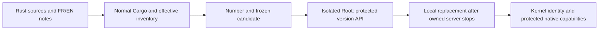
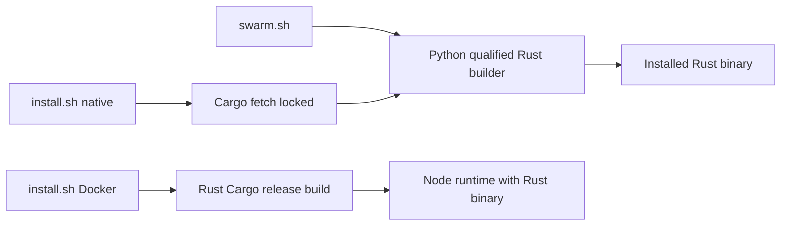

# Local Rust launcher

`./swarm.sh` keeps its shell/Python wrapper and builds only the Rust engine: no Go compiler or fallback. Linux, Python 3, Cargo/Rust and offline Cargo dependencies are required. Switching this launcher does not deliver the complete historical cockpit.

```sh
./swarm.sh build
./swarm.sh start --no-open
./swarm.sh status
./swarm.sh restart --no-open
./swarm.sh open
./swarm.sh stop
```

`status` takes a nonblocking shared lifecycle lock. A concurrent exclusive operation
returns JSON `status:"concurrent-operation"` and exit 2; `running`, `ready`, `pid`,
`binary` and `binary_sha256` are null (unknown). It does not read unpublished state
or probe the server. After release, normal status returns 0 for an owned running
process, 1 for absence; HTTP/version errors still refuse. Shared readers coexist;
mutations retain exclusive locking. Process identity is checked again after both
version and readiness observations. No new timeout, retry or operator policy.
Regression: `tests/test_local_status_lock.py` and
`LocalWeb.test_status_during_lifecycle_mutation_preserves_live_identity`;
recipe `tools/verification/recipes/local-status-lock.json`.

Installed read-only check (requires the ready managed Authority instance, free
lifecycle lock and latest qualified source image): recipe
`tools/verification/recipes/local-status-installed.json`, maintained source
`tests/local_status_installed.py`. It verifies identity/state before and after our
brief owned lock, compiled notes and owner-key UI refusal. Busy lock or stale image
refuses; it grants no human session and leaves the connected Version dialog open.

`configure` saves project, address and binary in local, untracked `deploy/local-web.json`. Existing root/address/binary, startup/stop deadline and mount-mask options remain available. Its `rust_target_dir` key, or `SWARM_RUST_TARGET_DIR`, selects the local Cargo cache; the technical default is `.cache/rust-build-local`. The target must be exclusive during compilation. External binaries remain external; automatic source builds cover only `bin/swarm` and `bin/swarm-local`. `build.sh OUTPUT` also emits a qualified Rust candidate without activating a service; `SWARM_VERSION` can supply an explicit valid label.

Normal builds exclude fixture features and retain effective dependencies, artifact characteristics and hashes under `.cache/local-delivery/`. Maintained recipe/test sources live in the repository. Broader candidate fingerprints invalidate cache reuse; numbering depends on effective dependencies, delivery tools, release notes, actual commit/dirty state and observed configuration/toolchain. A changed graph may require a second build to correct the proposed number. Native collector configuration limits still apply; this establishes neither build-chain confinement nor overall acceptance.



Build/qualification failures precede stopping the existing server. Isolated probes and local stops use SIGINT so the engine can drain. Foreign listeners are refused; PID, kernel start time, executable and argv establish local process ownership. Startup/stop expiration remains an error; unknown processes are never killed. Existing explicit lifecycle deadlines differ from mission policy; no global recipe watchdog is added.

Readiness requires cookie-authenticated `/api/v1/native-capabilities` with the exact native HTTP profile, rather than a login-page HTTP 200. Protected GET/HEAD `/api/v1/native-version` returns compiled identity and embedded French/English notes. `open` asks the native binary `swarm-rust web-ticket ADDRESS /live.html --json` for a **single-use sign-in link** and passes it only to the browser opener (never printed or logged). The ticket is a private `.swarm/web-ticket-<address hash>-<ticket hash>` file holding its expiry, never the secret; `GET /login?ticket=` consumes it by unlinking (exactly one winner, even concurrently), sets the local-key cookie and redirects to the sanitized `next`. Replayed, expired, foreign-address or malformed tickets get the login page, HTTP 401 and a generic message. Its lifetime is the v50 setting `web_login_ticket_seconds` (Admin, “Server and access”, 60 s at installation); an older Root must first adopt it by saving settings. If issuing fails (older binary, setting not adopted), `open` prints the code and opens `/login?next=/live.html`, where the key is entered in the form. The ticket grants only the local key’s access under the same UID: no new separation from agents (EP-07 stays open). The **Sign out** button (live cockpit and workspace) sends a protected `POST /api/v1/logout` (cookie, Origin, CSRF): the server expires this browser’s scoped and legacy cookies and redirects to `/login`. This is not revocation: the `.swarm/web-session-*` key, other browsers and unconsumed tickets stay valid. To revoke, `./swarm.sh rotate` stops the owned server, replaces the key with `swarm-rust web-rotate ADDRESS --json` (refused while a server still listens, atomic write, new key never printed), then restarts without rebuilding and opens a fresh link. Because tickets are bound to the key fingerprint, every earlier cookie and link is refused. A ticket can only be issued for an address whose key exists (`web-ticket-server-never-started` otherwise). The historical Version and what's new dialog and complete cockpit are not ported by this increment.

**`authority` mode (phase B).** Once the Root has saved `web_access_mode=authority`, the engine refuses the local-key cookie everywhere except the two launcher probes (`GET/HEAD /api/v1/native-version` and `/api/v1/native-capabilities`, no query), so `start`, `restart` and `status` still verify version and digest. `open` then issues no ticket: it reads the `--listen` address from the systemd unit installed by `deploy/authority/install.sh` (`/etc/systemd/system/swarm-authority.service`, the single source of truth for that address; `SWARM_AUTHORITY_UNIT` for isolated tests), prints `http://DAEMON-ADDRESS/` and opens `http://DAEMON-ADDRESS/login`. Missing, unreadable unit or no `--listen 127.0.0.1:PORT`: `open` refuses (exit 2) with no silent fallback to the local key; `start --no-open` succeeds with a warning. The mode is read with `swarm-rust engine-settings show --json`. Test: `tests/test_swarm_local.py::test_open_in_authority_mode_targets_daemon_sign_in`. **`./swarm.sh authority` command**: `install --admin LOGIN --display NAME` (release daemon build + `sudo deploy/authority/install.sh`), `enable` (full switch: authority mode and daemon key saved, engine moved to the unit's internal address, `sudo systemctl enable --now swarm-authority`, `/login` opened; refused while the installed daemon is not the last build), `disable` (back to the local key), `status`, `reset-password LOGIN` (sudo break-glass when no administrator can sign in) and `accept-restore` (after a deliberate restore of the daemon state, otherwise refused by the engine with `web-assertion-rollback`). `install` also restarts the engine in authority mode (shared assertion format). A failing step stops there; rerun after fixing it (completed steps are no-ops).

Absent Roots use public initialization; existing Roots are opened by the engine without implicit launcher init. Engine migration/protection, consent, budgets and paused-mission guards remain authoritative. Starting may resume already authorized missions through these guards; the launcher grants no consent. Verified local installation proves neither publication nor completion of the migration.

Before serving HTTP, the conductor reads eligible automatic missions without mutation. A historical lease without a native epoch refuses with `mission-legacy-lease-requires-migration`; it is neither adopted nor erased. Explicit revision-guarded `mission pause` preserves the mission for inspection without automatic departures; unpause does not migrate its lease. This startup check does not promise future health: later incidents remain supervised.

An existing project never prepared by Rust needs explicit `bin/swarm --root PATH init`, after an appropriate backup. The launcher does not silently initialize missing configuration. Public initialization validates the existing schema, preserves valid native configuration or installs versioned initial values when absent, and grants no execution consent. Schema, ownership or invalid-configuration refusals require diagnosis rather than deleting files or repeating unchanged.

## Rust distribution entry points — October24



Go is absent from these build/runtime paths. Docker uses locked default-feature Cargo release builds and the checked-in SQLite FILESTAT configuration; BuildKit caches are derivatives, not evidence. Without explicit compiler metadata, a direct Docker build reports devel/unknown truthfully; image identity is recorded by its recipe. Native installation keeps the previous executable if compilation fails. Historical Go sources, test comparisons and dated reports remain separate references. CLI and web reuse JavaScript assets without a Go fallback. `open` opens a short-lived single-use link, or the login form as a fallback; never a URL containing the durable key.

## Compiled inputs and unused candidates

The launcher separates its broad candidate inventory (cache invalidation) from Cargo-qualified actual inputs. An unused test may change without refusing a delivery whose compiled inputs stayed identical. The cache records the current broad inventory after checks. Every effective input must match the qualified profile bytes, including after qualification; delivery tools, FR/EN notes, Git, environment and toolchain are compared before/after. A mismatch retains the previous server and establishes no installation. These observations are not an atomic filesystem lease.

`tests/test_swarm_version_candidate_race.py` covers a valid control, cache reuse, changed unused tests and refusal after changed compiled input, Git, compiler, notes or launcher. Its compiler and probe are explicit doubles; only actual public build and verification establish a delivery.

### Refresh an initialized authority installation

`./swarm.sh authority install` without arguments refreshes an initialized
installation: build the daemon, install through sudo, strictly read the engine
mode and restart the engine in authority mode. Accounts, key, pin and first user
are preserved. A fresh installation still requires `--admin LOGIN --display NAME`;
an initialized marker without pin/public key refuses before replacement. Failed
or malformed settings readback reports that the daemon was installed but the
remaining step did not run; it never becomes an empty success.

Daemon and engine must share the assertion format (v1 and v2 are not
interchangeable). An engine v2 paired with a daemon v1 rejects assertion-format:
refresh both components without disabling authority or accepting old assertions.
The sudo stage needs the operator terminal when noninteractive permission is absent.

**Pair guard before any replacement (prevention of the October 31, 2026
incident).** Before any `start` or `restart`, and before stopping anything, the
launcher refuses (exit 2, « Paire d’assertion incompatible » message) an engine
replacement when the Root’s saved access mode is `authority` and the installed
daemon and the candidate engine do not speak the same assertion protocol. The
protocol is read from the embedded domain bytes
(`swarm-authority-assertion-v2\0` then `v1`;
`rust/crates/swarm-authority/src/assertion.rs` signs and verifies with it).
Pass cases: `owner-key` mode, a never-initialized Root (no `.swarm/state.db`),
an absent installed daemon (nothing on disk to desynchronize), equal protocols.
Fail-closed refusals: divergent pair, a daemon file without any recognized
marker, unreadable engine settings from an initialized Root. The refusal message
names both binaries, their protocols and the recovery:
`./swarm.sh authority install` (which replaces the daemon before the engine
restart the guard observes). Limits: the guard observes
`/usr/local/lib/swarm-authority/swarm-authority` (`SWARM_AUTHORITY_INSTALLED`)
only; a daemon served from elsewhere fails closed at runtime with
`assertion-format`. Read-only (settings + bytes); it stops, starts and
reconfigures nothing. Test: `tests/test_local_pair_guard.py`; recipe
`tools/verification/recipes/local-pair-guard.json` (12 tests, pinned to the
supplied binary digest).

## « Comptes et accès » administration (authority mode)

In `authority` mode the daemon serves the sign-in page and the cockpit; the
native cockpit's **Comptes et accès** view (menu entry reserved to `admin`
rights) provides the Wattson Tools-menu equivalent at Swarm standards:

- **Accounts**: create/edit/deactivate, API key display and creation (the
  secret is shown once; only its digest remains consultable), revocation,
  active sessions and forced sign-out. Passwords are never displayed or
  exported.
- **Groups** (union of rights): create, duplicate, rename, edit the
  permission profile; an account's effective rights are the union of its
  groups. The last administrator can neither lose the `admin` right nor be
  deactivated (`last-admin` refused server-side).
- **Habilitations**: roles × permissions matrix, one row per catalog API
  family (14) and per menu entry (`view.<id>`, 16); the built-in `admin`
  role is locked (30 checked and disabled boxes). The API stays the
  authority: a menu view hidden UI-side is also refused with 403
  server-side (`policy.rs`, schema 3).
- **Access journal**: connections (date/subject/view/mean/status filters,
  sorting, 50-per-page pagination, CSV/JSON export), per-session action
  detail, dashboard (4 KPIs + 6 SVG charts per day and per view),
  administration actions, manual purge (regex + confirmation) and
  `audit_retention_days` retention (empty = disabled, otherwise integer
  ≥ 1; read-back after write), daemon log level changeable live. The regex
  purge is subject to a server rate limit.
- **Daemon settings**: configuration read then written with `revision`
  (conflict = `revision-conflict` refusal), instance diagnostics.

API under `/api/v1/authority/*` (accounts, groups, policy, audit, config,
journal); granularity = API families + `view.<id>` per menu entry; default
policy deny-by-default with Biba floors. Every sign-in and administration
action is recorded in the daemon's signed journal (`audit.jsonl`,
hash-chained).

Verification: permanent recipe
`tools/verification/recipes/authority-admin-ui-rust.json` — i18n `--check`
then a real browser journey on supplied binaries (41 named checks: FR/EN ×
themes sign-in, menu entry, direct link refused without the right, account,
API key, locked matrix, custom role, journal, dashboard, purge, 390 px
mobile, full English translation; `recipe.py run` PASS then `verify`
VERIFIED). Qualification evidence under `.swarm-fixtures/` with SHA-256 of
both binaries. Limits: local verification — neither independent acceptance
nor installation; the recipe does not exercise the remote relay or key
rotation beyond the secret-shown-once.
