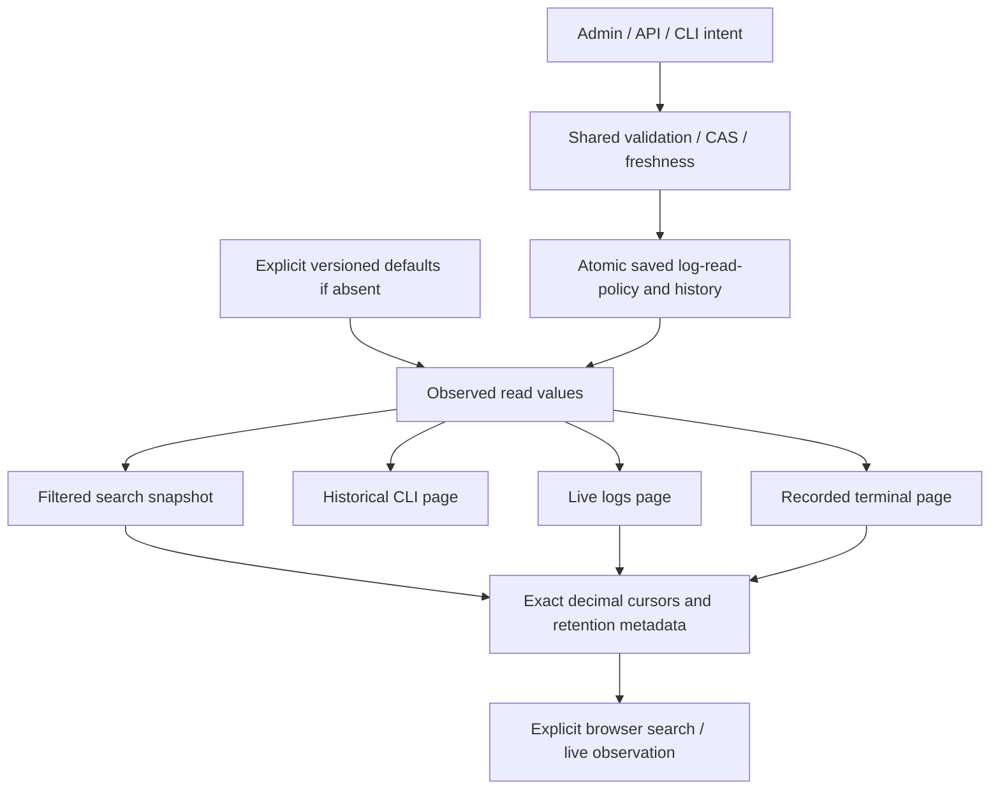

# Historical log search and native pagination

Delivered locally in205. Permanent recipe4steps PASS/integrity VERIFIED: Go/Rust API8, legacy settings3, browser4 FR/EN × themes320/1440px with AA text contrast and exact i64 cursor, JavaScript10. Historical Rust2, text/live10, activity8, targeted Rustdoc/i18n. Installation55 assertions plus Version14,30Agent reads and5Works unchanged.202→204 includes concurrent changes not accepted here;204→205 changes only notes. No global completion. [RETEX](../plans/migration-rust/evidence/20261027-log-query-8i8c635h/RESULT-RETEX.md).

## Reads and data

Protected GET/HEAD `/api/v1/logs?work=WORK&agent=AGENT&after=SEQ&q=TEXT&kind=KIND`; CLI `logs query WORK AGENT --input QUERY.json --json`. Files require schema_version1; optional after0/empty query/empty kind are protocol origins. Explicit Work/Agent must belong to the opened datastore. Query uses SQLite literal instr(lower(message),lower(query)); %/_ are not LIKE wildcards, and SQLite lower is not full Unicode search. Kind is exact or empty for all. Unknown/duplicate keys, invalid identities/noncanonical signed i64 cursors refuse before IO. This query permits negative cursors; the live protocol stays nonnegative.

Rows ascend by seq strictly after the cursor. Go keys: entries (seq,agent_id,at,kind,message), next_cursor, retained_from, retention_gap, more. Retention anchor is the whole Agent history minimum before filtering, zero when empty. Empty filtered pages preserve input cursor and true anchor/gap. Gap matches Go after>0 and after<first-1, including signed i64::MIN wrapping representation; it proves neither completeness nor measured loss. More requires one actual extra row; decode its sentinel before deciding, as Go. SQL TEXT/BLOB strings use Go per-invalid-byte UTF-8 replacement, never parse JSON-looking log text. NULL/incompatible cells remain errors, not skipped successful rows.

Work/Agent/anchor/page share a readonly SQL snapshot under existing project material association checks. Statement finalization, rollback, binding, Root close/output preserve causes. No launch, signal, retention/deletion, reservation, budget or business decision. Recorded data establishes neither authentication nor execution. File policy and SQL are not jointly atomic; read_policy reports the observation used.

## Persisted source and four consumers

Versioned config/log-read-policy.json defaults: search_page_rows100, history_page_rows200, live_log_page_rows100, terminal_page_rows100. Only genuinely absent private log-read-policy.json selects them. A present invalid source fails. Every key is required and nullable: positive rows/chunks or null unlimited. Zero cannot form a progressing page and refuses. Exact JSON/JavaScript integer bounds concern page choices, never stored row IDs. Unlimited materializes all matching retained rows, with proportional memory, without changing retention.

One producer/validator/ledger serves Admin → Log and terminal pagination, `/api/v1/log-read-policy`, `/preview`, `/apply`, and `run-limits logs show|history|preview|apply`. Explicit preview/confirm/readback, exact replay returns current state; conflicts409, invalid input400, stored source/storage500. Preview writes neither source nor specific lock. Apply can create its coordination lock even when refusing a mutation; Err after publication never proves no recorded effect.

The four choices reach query_logs, historical_agent_logs (zero latest ascending, negative starts seq>0), agent_logs_after and terminal_events_after. Free live readers require explicit row choices, no fallback100. Composite live reads can observe different policy revisions; no joint atomicity or frozen agent-limit change is claimed.

Saved agent_provider_config_max_bytes governs source reading and complete serialized history. An old project missing that field can read explicit versioned defaults when the source is absent: checked O_PATH observation, no unbounded private payload read, no implicit adoption. configuration_cap_adopted=false distinguishes old absence from explicit unlimited null. A present source or save requires the adopted cap; Admin states that prerequisite. Adopting its existing settings group stays explicit. Merely observing this field does not require the whole launch/environment policy.

## UX and exact cursors

Agent harness offers explicit historical search, literal/exact-kind filters, next-page action and retention-gap notice. Render text with shared semantic log styles; messages never become HTML and unknown kinds never become arbitrary CSS classes. Errors preserve earlier results, never empty success. Editing a filter invalidates cursor without automatic IO.

Numeric Go fields remain unchanged. Native exact metadata carries decimal i64 next_cursor, retained_from and row sequences; live pages add next_exact. Clients retain decimals through the next URL. Older numbers are accepted only if exactly representable; rounded/contradictory cursors refuse before adopting rows. i64 endpoints are storage representation, not operator limits. Ten JavaScript guards cover actual JSON loss above53bits, signed endpoints, types and contradictions.

## Retained limits

Legacy LIVE_PAGE_ROWS100 still governs telemetry call/tool/span/alert windows, never these four readers. That distinct native policy stays open; it is neither immutable protocol nor configured by this modal. Existing harness sampling cadences/series and cockpit HTTP completion barrier are separate follow-ups. Component tests, actual Go comparison and distributed acceptance remain distinct. Restoring a corrupted fixture policy proves no autonomous production repair.

Exact decimal strings are authoritative. Comparing decoded numeric values cannot prove lexical consistency of raw numeric wire bytes above53bits.

