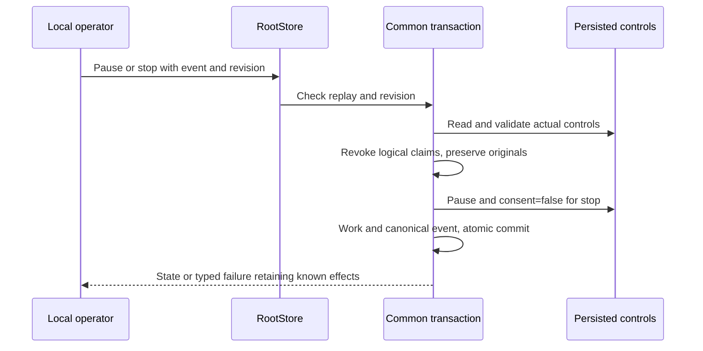

# Native global mission controls

Lot180 ports `mission show|pause|unpause|stop WORK --root ROOT [--input request.json] --json`. Verified on fixtures using normal16:42 targeted Rust tests, strict engine/CLI Clippy/private Rustdoc, public18, live-process19, HTTP regression20 and real EPIPE17 pass. Lot182 adds start/resume configuration; see [the start contract](NATIVE-MISSION-START.md) and its qualification evidence in progress. The complete automatic conductor and watch remain unported. These results establish no installation.

## Two pause levels

Mission pause lives in `cockpit_controls`, consumed by existing worker/planner admission and native controllers. Planning pause is the independent `work.planning.paused` field, controlled by `planning pause|resume`. Global unpause does not change that field.

| Action | Global effect | Planner claims and consent |
| --- | --- | --- |
| show | Read actual state, preserve null absence | No inferred authorization |
| pause | Pause new departures | Increment scope generations, clear logical holder/expiry, preserve consent |
| stop | Pause new departures | Same logical revocation, append canonical consent=false |
| unpause | Lift departure pause | Preserve mode/consent, no new consent, dispatch or model call from this command |

Common revision/event transactions preserve funding/reservations/activations/decisions/tasks/judge history and old claim contexts. Logical revocation never frees physical ownership rows. Real completion/originals remain the existing controllers’ responsibility. The command sends no process signal; ongoing calls retain their own supervision/freshness checks. Held19 witnesses a real permitted inert planner through socket/SO_PEERCRED/pidfd and SQL registry before public pause. Native supervision then detects the revoked lease, stops its process without fixture signalling, retains actual wait/original and records refusal. Public unpause permits a fresh claim/preview without rewriting the original or refunding its estimate. This does not prove active-worker behavior, escaped descendants or hostile processes.

## Request and missing controls

Show takes no input file. Mutations require a strict audit envelope:

```json
{"schema_version":1,"event_id":"global-pause-1","expected_revision":12,"reason":"Pause new departures to examine the result"}
```

Replace example values after reading current revision. Schema1/safe event/positive revision/nonblank audit reason are protocol invariants. No hidden reason-length policy is added; existing transport limits apply. Submitted actors/enabled/slots/foreign fields refuse. Engine-observed operator/time do not authenticate a human.

Show preserves absent controls. Pause/stop on absence explicitly record **manual and paused**, without new consent, avoiding the historical SQL automatic-mode/two-slot defaults. Manual denies automatic admission in previously absent state. Initial slots come from saved Admin `mission_dispatch_default_slots` validated against `mission_dispatch_max_slots`, exposed through engine-settings preview/apply/show and the dynamic Admin catalogue. No additional numeric ceiling is introduced.

Existing mode/slots are preserved even after policy tightening:17 remains17 after saving initial3/max4. Safety pause must not clamp state or be blocked by the new admission ceiling; future admissions apply their own current policy. Unpause requires existing controls and never turns absent/false consent into true. Existing valid automatic mode/consent may allow an authorized conductor to resume departures after unpause; this command creates no conductor.

Legacy settings without the slot policy require explicit Admin/API/CLI adoption before initializing controls; no fallback2. Malformed existing controls refuse with cause, without implicit repair/reset.

## Errors and recovery

Stale revision, foreign request, absent unpause controls, malformed SQL state, generation overflow, allocation/encoding/write failure remain typed. Refusal preserves Work/events/controls/reservations. Common transactions roll back a staged control if subsequent audit writing fails; after repairing the precondition, replay the same unrecorded event without refunding consumption.

Exact replay returns current state without another revocation, even after another command changed pause. Known commits retain metadata through close/output failure; read back first. Old claim contexts stay immutable but revoked generations do not become valid after unpause: establish a real new claim instead of reconstructing old evidence. Stop also revokes logical claims, an explicit improvement over legacy Go stop.



## Evidence and limits

42 unique Rust tests for the final contract: envelope3/Rootcontrols2/legacy readers3/mutation engine11 from quality04 (19 tests, consumed engine bytes unchanged), CLI diagnostics5/common CLI17 from quality13 and late web diagnostic1 from quality14. Root fault injection fails audit after staging controls, checks full rollback then successful same-request recovery. Valid generation control precedes i64::MAX and unchanged-state refusal. sdk-depfile05 retains qualifier failure/four Python tests/requalification of original17 CLI tests without reexecution. Engine Clippy/private Rustdoc06 are reused for identical engine bytes; changed CLI has its own source04 checks13. Normal16 SHA `2e3c519931f83b0f8f307d176748ace34d413f7e067910d4a9549f9b6dfcbc7f`:279 archived effective inputs, no fixture features. Public18 checks worker previews before/after and refusal while paused, logical claims/immutable stale context/new claim, saved slots/refusals/replay. Held19 covers the actual inert planner termination above. HTTP20 rechecks eight planning commands and sixteen refusals on this binary. Existing true consent under a genuinely active conductor was not reproduced; these commands create no true consent.

Permanent recipe: `tools/verification/recipes/native-mission-controls.json`, running `tests/rust_native_mission_controls.py`, `tests/rust_native_mission_pause_held.py`, `tests/rust_native_mission_output.py`, HTTP regression and SDK dep-info guard. Manifest validated; final steps executed separately on frozen binary, not as a whole concurrent-checkout run. Assertions and exact sources are retained. New/changed functions have current Rustdoc/docstrings and explicit policy/error-chain review; same-session review is not independent. No global watchdog. These proofs establish no paid provider, authenticated actor, complete automatic conductor, browser, installation or global migration completion. Public controls remain local; no new global-control HTTP adapter is advertised.


## Output failure after commit

EPIPE12 reproduced a committed pause whose JSON error lost `recorded_work` despite retaining it in a human message. The common formatter now recovers all three typed preservation wrappers and known Root/Web outcomes, independently of web-specific fields. It never parses error text into a revision and omits metadata for unknown effects. Known metadata does not turn failure into success or discard causes.

Output17 closes the pipe reader before exec after a valid command witness: actual EPIPE/nonzero failure/BrokenPipe, exact recorded Work/revision, persisted pause/canonical event once, and unchanged events/controls/finance on exact replay. Original-root21 also revisits the actual counterexample12 Root: its committed revision remains and the original request replays without event/control mutation. No data reset manufactures success; original12 remains intact.

SDK05 qualified original17 CLI tests without rerunning them. The later formatter change required fresh CLI13–14 and normal16 qualification; repeated executions are not counted as additional unique tests. Linux behavior is verified; no other-platform compilation is claimed. Route-specific encoding/Root-close faults were not injected; their branches are reviewed and compound formatter causes have targeted tests.


Retained-Root replay also has a permanent recipe: `rust_native_mission_output_replay.py --binary BIN --profile PROFILE --original-proof EPIPE_PROOF --output FRESH`. It requires a fixture birth and an already recorded canonical event matching the exact request before any command. Original-root22 checks unchanged Work/events/controls/finance on actual counterexample12. Missing Root/original refuses rather than reconstructing evidence.
