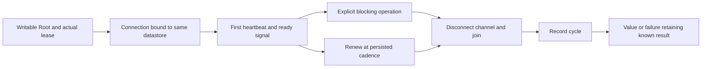
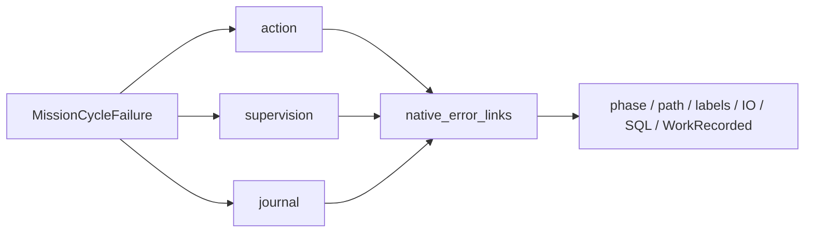

# Conductor cycle with lease maintenance

`RootStore::run_mission_cycle` maintains an actual lease during one explicit synchronous operation. The Root must be writable and bound to the lease’s datastore/process. A second connection verifies that binding and renews the lease before signalling readiness; an already exited thread prevents callback startup. This API neither selects tasks nor constitutes the complete conductor or `mission watch`.



Cadence comes from `mission_supervision_poll_interval_ms`, frozen with the clock limits and claim revision. Admin changes do not rewrite an existing lease. There is no second global deadline, business retry or implicit model call. `MissionCycleMonitor::is_running` observes only the thread; every command and grant retains authoritative guards. Lease loss neither reacquires ownership nor forcibly stops an already released worker.

The return type is `Result<T, Box<MissionCycleFailure<T>>>`. On failure, `action` retains the exact result if the callback started, `supervision` retains heartbeat/peer-close causes, and `journal` retains the cycle-write cause. `action=None` does not prove that no heartbeat was written. A successful value before a late failure remains available. `Error::source` exposes only one primary cause: adapters must inspect the other fields too, without assuming rollback or retrying automatically. Journalling reflects the caller-declared operation, not proven business reconciliation. The caller retains explicit lease/Root close obligations. Panics propagate after heartbeat shutdown; no returned-result guarantee applies then.

## Planner validation during private preflight

The parent defers its full provider revalidation until private CLOEXEC-channel EOF, avoiding exclusive providers.lock contention while the helper performs pre-exec validation. Parent Work/claim/pause checks and deadlines continue. Complete helper validation and freshness checks remain unchanged; a busy provider lock after EOF still refuses. EOF alone never proves successful execution. No delay or retry is added. HTTP and command formats stay unchanged.

## Evidence and replay

Normal14 archives283 effective inputs without fixture features. SDK16 matches all186 engine inputs. quality19 contains seven cycle and six planner tests; strict engine/tests/example Clippy and private Rustdoc pass. cycle-permanent22 replays the seven tests and real lock conflict with before/after source verification; permanent17 runs the actual worker inside the cycle and submits without acceptance. planner-held24 verifies pause and recovery of an actual planner. Recipe22 and17 integrity was verified. Original failures and sources remain in the plan and lot184 archives. Source review is a same-session declaration, not independent review or overall acceptance.

Set `SWARM_MISSION_CYCLE_SOURCE` to the retained compiler snapshot, then run:

```sh
python3 tools/verification/recipe.py run --recipe tools/verification/recipes/native-mission-cycle.json --output FRESH_EVIDENCE
python3 tools/verification/recipe.py verify --evidence FRESH_EVIDENCE
```

The current recipe requires all ten test names (eight historical checks and two diagnostic projections) and verifies snapshot bytes. It does not alone discover the delivered compiler graph; that proof is retained separately. The panic test emits its expected diagnostic before catching it. For the actual worker, use the four binary/profile variables documented in NATIVE-MISSION-WORKER.md.

Limits: automatic selection, retry/cost/report policies and the complete driver/watch remain unported. System-close and thread-creation faults are not all injected. Future adapters must retain every cause and known result before publication. No running server or embedded agent context was updated. Concurrent UI changes remain distinct from this frozen candidate; these proofs establish neither their acceptance nor conformity of the whole current checkout.

## Structured failure publication

`MissionCycleFailure::diagnostics()` projects the `action`, `supervision` and `journal` phases separately, retaining traversal paths, typed labels and numeric IO/SQLite codes. It reuses `native_error_links`, including independent cleanup branches and custom `std::io::Error` inners. Every encountered `RootStoreError::WorkRecorded` retains its identity/revision tuple; multiple observations stay distinct without arbitrarily selecting a latest revision. These observations do not prove a new write.

The projection never serializes the successful generic value or private `Display` messages. `action_started` and `action_succeeded` describe the retained result without inferring a Work revision. Callers must handle that value separately, then preserve their own encoding, output and close failures. Unknown error families remain limited to their `source()`; the known wrapper graph does not establish completeness for arbitrary external error types. No retry, budget, timeout or authority is added. This API prepares the future conductor adapter; `mission watch` remains unavailable.

Two projection tests cover all three phases, three observed revisions, independent causes, custom IO/rustix, private data exclusion and a nonserializable value. The actual heartbeat fault test also checks both SQL failure phases and recovery. The permanent recipe now requires nine cycle tests plus the provider-lock test (ten names). Lot185: quality01 passes all nine tests, strict Clippy and private Rustdoc; permanent04 requires all ten names and its integrity is verified. normal03 qualifies 283 inputs without fixture features; 191 engine inputs (sources, configuration and manifest) match the SDK. The normal SHA remains identical to lot184: tests exercise this generic API; the CLI does not yet consume it. Lot184 results retain their historical scope.


