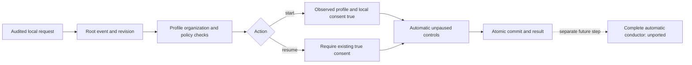

# Native mission start configuration

`mission start WORK --input request.json --root ROOT --json` records a profile and explicit local consent. `mission resume` reactivates controls only while existing consent remains true. Lot182 is locally verified:48 named Rust tests, engine/CLI Clippy/Rustdoc, seven CLI/HTTP recipes and an API atomicity/recovery case pass. This establishes no installation. The complete automatic conductor and `mission watch` remain unported.

```json
{"schema_version":1,"event_id":"mission-start-1","expected_revision":12,"reason":"Authorize this local mission","profile":{"provider":"configured-provider","role":"worker","workspace":".","level":"standard","capture_output":true},"slots":3}
```

Use an actually configured provider and current revision. Role is explicit (`worker`, `planner`, `subplanner`), with no hidden role choice. Limits and skills retain their profile vocabulary; storing them proves no execution-path completeness. Input cannot supply `actor`/`updated`; the engine observes them. Missing profile requires a saved one. Missing slots reuse saved controls, or the existing persisted Admin `mission_dispatch_default_slots` only when absent. Existing nullable `mission_dispatch_max_slots` supplies the operator ceiling; no extra Go ceiling is copied.

Both operations check mission archive absence, organization/reviewer, declared reviewer capacity, provider/model configuration, real project-contained workspace, saved limit policy and current slot policy in the transaction. External files are not one atomic system snapshot; each future launch must recheck sources, rights and reservations. Configuration invokes no provider/model/probe, creates no attempt and consumes no budget.

Resume accepts only schema_version/event_id/expected_revision/reason and preserves profile and consent receipt. Stop records false, after which resume refuses. Unpause never renews consent. If the operator lowers the ceiling below saved slots, resume refuses without clamping; correct policy or explicitly start with a compliant count.



Exact replay returns recorded results before fresh configuration checks and does not reapply a start after a later pause. Refusals preserve state. Read/close/SQL/encoding/output causes remain errors; failures after commit retain known Work/revision metadata and require readback before recovery. Local actor/declared consent proves neither authenticated human identity nor hostile-process confinement.

Recipe: `tests/rust_native_mission_start.py`, using a binary bound to a normal no-fixture profile. `--expect-unported` retains the old181 binary's RED. Current qualification and limits are recorded in PLAN.md, lot182.

Evidence182 distinguishes start13 (public controls and altered-schema rejection), atomic-api24 (real SQLite constraint after Root.open), and atomic-replay25 (permanent recipe). The SQL error rolls back profile, consent, controls and events together; the same request succeeds after fault removal while finances/originals remain unchanged. The verification caller is `rust/crates/swarm-cli/examples/mission_start_atomicity.rs`, distinct from the shipped CLI. Its183 compiled engine inputs and shared workspace features are compared to normal04. Strict helper Clippy23 passes. Initial verifier15/16/17/19 refusals happened before fixture execution and are never PASS.

Permanent replay, from the repository root, using a new destination:

```sh
python3 tests/rust_native_mission_start_atomicity.py --binary docs/plans/migration-rust/evidence/20261022-182/normal-native04 --profile docs/plans/migration-rust/evidence/20261022-182/normal04/result.json --sdk-binary docs/plans/migration-rust/evidence/20261022-182/atomic-api24/sdk-binary --sdk-profile docs/plans/migration-rust/evidence/20261022-182/atomic-api24/profile.json --output /tmp/swarm-mission-atomicity-replay
```

Frozen binaries/profiles must be available; absence is a missing precondition. These proofs establish neither overall acceptance nor independent review. The audited envelope and explicit role differ from Go’s bare profile input; exhaustive RM02 parity remains open.
