# Native automatic-worker admission

Current state: candidate 201 is being qualified, with Binding v4. Results 183–200 below remain historical and do not establish the new 201 checks. Product `mission watch` remains unwired; no overall acceptance of the current checkout is claimed.

Lot183: the native path is locally verified; the source-bound increment review is recorded separately. The complete conductor and `mission watch` remain unported. `RootStore::prepare_mission_worker` requires an actual nondeserializable `MissionLease` plus schema/event/revision/task identifiers. Launch choices come from the saved profile, subject to existing task-specific model selection in the common factory. Automatic attempts preserve the shared profile. Raw origin/conductor_id fields supplied to the manual path grant no automatic authority.

Optional opaque Agent field `native_mission` grants nothing alone. Its strict reader checks the actual agent.start event, canonical Agent request, normalized command/claim receipt and generations/settings revisions. Before grant it also checks the current lease, frozen clock policy, observed owner host/PID/process stamp, current consent and its sequence, unchanged profile, automatic mode, pause/archive and capacity under persisted Admin settings. These observations establish neither authenticated human identity nor protection against hostile same-UID database/filesystem writers.

Conductor revocation prevents new starts. Already released workers retain independent native supervision, matching Go stopMission and CLI watch; no new forced-stop policy is added. Publication/settlement still require their existing checks and never imply acceptance. A queued automatic intent can be cancelled after revocation using historical provenance and actual absence of a process/grant; requiring active consent would prevent cancellation. A new start/lease never refreshes an old intent by itself.

Absent metadata preserves legacy manual Agent serialization; older readers may refuse the new field. No live/shared Go Root is migrated here. Lot183 introduced no DDL; candidate197 adds the auxiliary journal below. No hidden slot ceiling, global test watchdog or implicit budget is introduced. Ordinary fence defaults mean absence of automatic provenance, not an operator setting. Roles/phases/event names/schema1 are protocol invariants; slots and timing policies use saved settings. Schema/read/encoding/kernel/clock/close/SQL causes stay typed, writes remain transactional, and failures after commit must retain known Work metadata.

The permanent `tests/rust_native_mission_worker.py` replay prepares two tasks through public operations, binds normal and SDK binaries to their profiles, then asserts refusals, cancellation and an inert process report. The replay passes in evidence/20261022-183/permanent31, whose integrity was verified by the runner. No global watchdog, paid call or implicit acceptance.

Replay: set `SWARM_WORKER_NORMAL_BINARY`, `SWARM_WORKER_NORMAL_PROFILE`, `SWARM_WORKER_SDK_BINARY` and `SWARM_WORKER_SDK_PROFILE` to the four qualified files, then run `python3 tools/verification/recipe.py run --recipe tools/verification/recipes/native-mission-worker.json --output FRESH_EVIDENCE`. Follow with `python3 tools/verification/recipe.py verify --evidence FRESH_EVIDENCE`. These variables select local evidence, not product policy or secrets.

Retained first replay worker18: incorrect created=true preview expectation; the contract returns false after rollback. Test-only correction; engine profile unchanged.

Local evidence: normal26 has no fixture features and archives281 effective inputs; SDK28 matches all184 normal engine inputs. Recipe31 has two steps: qualifier guards (one named witness/refusal/recovery test) and an actual worker. quality06’s117 named Rust executions (114 distinct names) and seven public flows11–17 cover the same executable bodies before comment-only corrections in three files; they are not presented as rerun on normal26. Final strict Clippy/Rustdoc are retained in quality30. review39 records the same-session four-axis declaration, without independent review or overall acceptance.

Limits: refusals exercise actual queued intentions; the four guard phases exist in source, but this recipe does not inject a separate revocation at each boundary. Managed Git, full conductor/watch, R6 data and R7 cutover/RETEX remain open. These checks do not update the existing running server.

Final seal: normal35 and SDK37 were rebuilt after removing one trailing blank line; their executables are byte-identical to normal26/SDK28 exercised in31. final-equivalence38.json retains equality and the engine-only changes since quality06 (comments/blanks in four files). Evidence31 is reused, not presented as a new execution.

Candidate scope: eight shared inputs changed after snapshot35 (settings/catalogue, translations and live surfaces). Review39 covers the22 increment files; canonical-drift.json retains the drift. No build or qualification of the combined current checkout is claimed. Concurrent-change integration remains open.

Shared-settings integration: normal41 and SDK43 incorporate the eight inputs identified after35; both permanent44 steps pass with verified integrity. integration-quality45 contains seven named tests in four targets (settings, catalogue, cache health and telemetry). Review39 remains bound to candidate35 and is not renamed into an overall review of41. Three Live assets changed again after41; their behavior and current-checkout integration remain with the interface workstream. This resumption did not write any concurrent input.

Lot184: the current replay now requires the real worker to execute inside `RootStore::run_mission_cycle`, asserting `heartbeat_cycle_used`. Historical183 evidence keeps its archived former contract and does not establish this maintenance. Contract and limits: `docs/en/NATIVE-MISSION-CYCLE.md`. Verification is retained below.

The184 worker-under-cycle contract passes in permanent17 using normal14/SDK16 (lot184), with verified recipe integrity. Planner setup uses the provider-lock phase repair; the full driver/watch remains open. See docs/en/NATIVE-MISSION-CYCLE.md for retained errors and limitations.

Lot186: the recipe also checks `RootStore::reported_costs` and `costs show` on actual agents from this inert flow. The simulated25 USD declaration remains distinct from attempts without cost; CLI `scope=retained-worker-attempts` excludes planner/reviewer/reservations. See [Reported costs](REPORTED-COSTS.md). Worker21 PASS with verified integrity does not establish a full dispatcher/watch or authenticated invoice.

Lot187: persisted v32 reported-task-cost policy exposed in Admin. SDK checks refusal without mutation, equality, zero/null, saved changes and actual execution refusal after lowering the threshold on an already queued intent. Historical25 USD is fixture data, never authority: together with the real inert worker report25 USD, total50 USD retains two declarations and missing-cost attempts. Worker13 PASS; no invoice, installation or complete dispatcher. See [Reported costs](REPORTED-COSTS.md).

Final lot188: requested level is also retained in the admitted task profile. Normal21/SDK23 share all285 code/config/asset inputs with distinct entrypoints. The frozen bundle preserves its consumers’ translations; concurrent checkout Live changes remain outside this qualification.

## Effective task profiles

The factory requires a worker parent profile, then selects the saved task profile
when present, otherwise its parent. Saved model choice overrides provider and
level; common preflight still validates routing policy. The effective role must
also be worker. Since lot189, Binding v2 retains separate parent and effective
profile hashes. The archived197 factory wrote Binding v3, preserving both hashes and
binding the acquired workspace turn ordinal. Candidate201 preserves these fields
in Binding v4 and adds the physical Root instance (see the201 contract below).
Both profile hashes are re-read before grant in the transaction; changes refuse
before provider startup. Automatic staging preserves configured profiles; Agent
and its canonical event retain the actual request. The v1 reader keeps its
historical parent-only contract, without retroactive v2 protection. Future public
profile editing must handle queued v1 intentions. A hash does not authenticate
an actor with datastore write access.

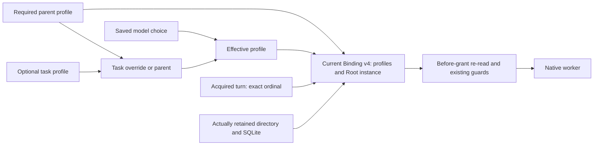

Recipe: mission-task-profile; healthy manual control, observed failure, native
retry decision, public model choice, preview and actual automatic intention.
Negative parent/task corruption changes actor (audit excluded from the identity
plan projection but included in the profile hash) after genuine admission. Original refusal is
retained, and fixture bytes are restored only after unchanged-Work refusal.
These inert fixtures establish neither paid model behavior nor global acceptance;
verification results remain in the migration plan.

## Historical v1 intention compatibility — increment190

mission-legacy-intent builds its verification example against immutable188
engine inputs. That engine creates the real v1 receipt/Agent through public
operations and keeps its lease/heartbeat alive while normal189 executes the same
Agent through agent run. No SQL v2-to-v1 conversion: provenance actually comes
from the older factory. The model is inert Python; this proves no real provider,
human identity or retroactive v2 task protection for older intentions.
The fixture uses readiness and a stdin finish signal without an arbitrary global
deadline. A fresh-Root negative EOF must retain its typed cause, exit with failure
and leave the intention queued with no provider. RuntimeError intentionally
redacts private IO text: a static witness is emitted only after inspecting the
actual expected UnexpectedEof cause. Action/close causes remain separate; no
close fault is injected. See PLAN for exact sources, binaries and proof results.

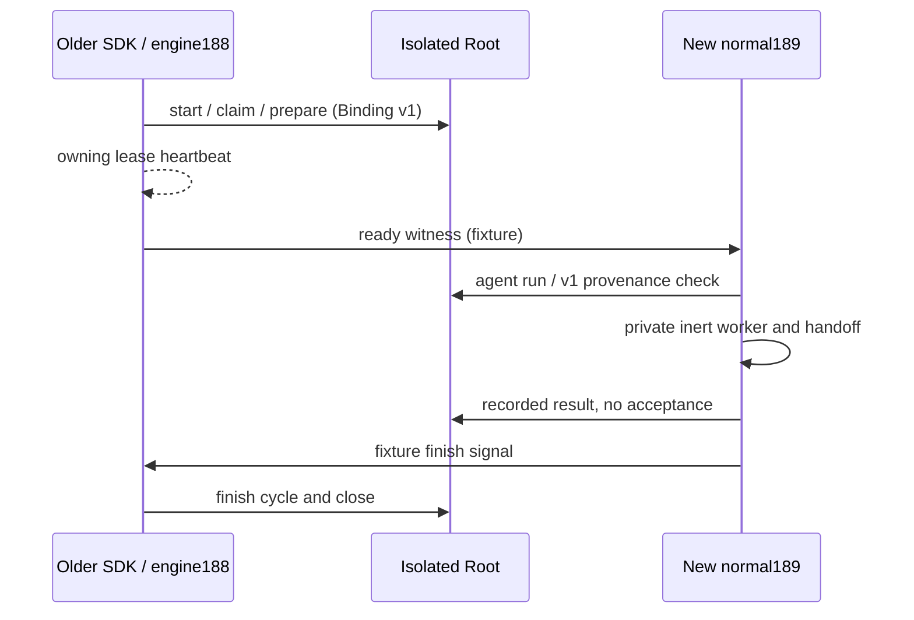

## Task ordering

mission order WORK --root ROOT --json and RootStore::mission_task_order read
Work and cockpit_tasks in one SQL snapshot. All tasks appear regardless of state:
saved priority descending (absence is schema37 neutral0), longest prerequisite
depth ascending, then lexical ID. priority/depth are exact decimal strings; signed
comparison never negates i64::MIN. Iterative full-graph validation has no recursion
or attempt cutoff: cycles, missing/repeated dependencies, invalid/duplicate IDs
and orphan priority rows refuse. Ill-typed SQL never becomes a zero fallback.
Statements finalize and snapshot rollback preserve independent errors. This reader
creates no event, reservation or provider and selects no ready task. It is not an
executable plan: actual selection/admission still requires consent, fresh evidence,
retry, slots, budgets, workspace and global FIFO. Root/CLI priority writes are described below; HTTP/priority UX remain
unported. No new Admin screen is claimed.

## Audited ordinal priority

mission priority WORK --root ROOT --input FILE --json uses Root mission.priority.
Input requires schema_version1, unique event_id, current expected_revision,
existing task_id, nonblank reason and canonical signed decimal i64 priority
STRING (examples: "0", "10", "-1"). Higher values sort first; zero is neutral.
Ordinal values consume no slots/budget. i64 is SQLite representation, not a
hidden reintroduction of the older console's0..9 business range. JSON numbers,
null, plus sign, -0, leading zeros, whitespace and representation overflow refuse.
Omission never means reset to zero.
The writer validates a unique task and saves value/cockpit audit/Work event and
revision through the common transaction. Exact event replay returns the original
mutation without another audit/revision; conflicting intent or stale revision
refuses. Reopened mission order consumes actual persisted values. Modes, consent,
profiles, reservations and attempts remain unchanged. Local environment operator
attribution authenticates no human. Root API/CLI only: HTTP/priority UX and full
automatic dispatch remain unported. Any future limited operator vocabulary must
be persisted, validated and visible rather than hidden in a UI attribute.
Audit failure is tested on an already-open Root; a fresh Root rejects extra
triggers first, which is different evidence from transactional rollback.

The compatibility fixture now uses ready-envelope version2 (distinct from
Binding1), carrying the actual original public request retained by the old SDK.
New CLI replay leaves canonical receipt/Work/audit/consent unchanged before
executing that v1 Agent. Internal receipts serialize audit fields forbidden at
the public input; do not resubmit them as user requests or weaken validation to
accept them. Original public requests and internal receipts are retained
separately. Exact proof references remain in PLAN.

## Workspace boundaries

Shared preparation and departure guards compare canonical Unix paths by equality
or separator-delimited prefix. Trailing separators are removed before adding
one: root '/' remains an ancestor rather than becoming incorrect prefix '//'.
The rule covers active agents and running integrations; siblings such as
'/project/a' and '/project/ab' stay disjoint. No path is forbidden to hide a bad
comparison. Preflight still enforces actual Root containment and host observations.
The negative recipe only corrupts an active row in an owned fixture after a
genuine disjoint queued intention: no legitimate filesystem-root project or
exploit is established. It requires refusal without SQL mutation, exact restore
and ordinary admission. SQL unit projections also cover the integration guard,
without establishing native integration. SQL rows observe resources; they
authenticate no identity/process. Candidate197 reuses these boundaries; its
qualification is described below.

## Workspace queue observation — candidate196

RootStore::mission_workspace_queue(WORK), CLI mission queue WORK, read Work and
all workspace_turns in one coherent transaction. First older blockers concern
this Work’s waiting rows; waiting/acquired overlapping trees block, released rows
do not. Ordinals are exact decimal strings. Strict types/states/identifiers,
canonical Unix paths and timestamps; no silent normalization of historical Go
relative paths. SQL/finalize/rollback and close/output remain failures, secondary
causes preserved.

This observation enqueues/acquires/releases no turn, authenticates no process
and authorizes no departure. The candidate197 writer below rechecks in its authoritative
transaction; evidence196 still establishes only the reader. Recipe rows are observation data,
never public admission proof. Historical noncanonical Go rows need qualified
adoption/migration or refusal before activation. Tests/default candidate profile
are qualified within the limits below; no installed delivery.

196 verified on normal04 (289effective inputs archived without fixture), uninstalled: native07 then queue10 two stepsPASS/stable/integrityVERIFIED. Quality06 five reader tests plus one compound-error translation test, engine/CLI Clippy/Rustdoc PASS. Compound finalize injection is an error projection, not an actual SQLite fault. Five native rows are fixture metadata, not public acquisitions.

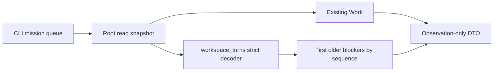

Go setProfile in dispatcher.go503 calls resolveWorkspace before persistence. Reading dispatch alone therefore does not establish historical relative rows. Other producers/imports and real Go database parity remain unqualified; strict observation is not migration/adoption. Candidate197 implements acquire/release under actual lease and Bindingv3, with qualification separate from evidence196. The full conductor/watch remains unported.

## Candidate197 — lease-owned FIFO: contract and bounded local verification

`RootStore::sync_mission_workspace_queue` requires the opened Root and its actual
nondeserializable lease, reserved settings and a writer transaction. It rereads
Work/priorities and validates the complete DAG/order (priority descending,
depth ascending, lexical ID). The structural projection retains every status,
launch-held, unsupported-branch or profile refusal. A structural `Ok` profile is
not readiness: its consumer checks lifecycle on a discarded copy, fresh dependency
and requirement-prerequisite evidence, supported retry decisions, saved attempt
limits, budget, reported costs and actual provider/workspace sources. This
observation persists no attempt, reservation or consumption.

These checks precede available-slot and workspace-occupancy filtering: a ready
task keeps its place while its workspace is occupied. Capacity settings are
validated without inventing free capacity. `ready` means a standing claim, never
a grant. Callers must explicitly synchronize before the factory. Preview does
not synchronize and fully rolls back its staging. This API does not supply the
complete automatic dispatcher/watch.

Auxiliary append-only `workspace_turn_events` preserves transitions and released
generations before requeue. Synchronization updates waiting claims, releases
obsolete waiting claims and preserves acquired claims. `agent.start` acquires
its FIFO turn atomically with Work/reservation/Agent/journal. Binding v3 retains
both profile hashes plus `workspace_turn_seq`, an exact decimal string bound to
the actual Work, task, workspace and Agent. Provenance/acquisition are rechecked
before grant. Historical v1/v2 intentions retain their original read contracts,
without retrospective FIFO or SQL conversion manufacturing that protection.

Safe queued cancellation or safe terminal settlement releases in that same
Work/reservation/Agent/journal transaction. Quarantined or unknown execution
retains its turn; `Err` never establishes absence of effects. Terminal replay
checks its own historical generation without altering a newer registration.
These observations establish neither authenticated identity, task acceptance nor
new protection against hostile writers of the same datastore.

### Permission withdrawal and waiting-claim cleanup

After checking the lease, exactly five semantic refusals are distinguished:
`planning-mission-paused`, `mission_archived`, `mission-controls-required`,
`mission-autonomy-required` and `mission-consent-required`. Only these cases
synchronize an empty candidate set, release waiting claims and preserve acquired
claims. The original cause returns in `permission_refusal`, which every consumer
must handle. Cleanup returning `Ok` grants no departure and renews no lease.

Within global permission, lease and journal checks, unknown variants, malformed
SQL, corrupted proof, invalid settings or an invalid lease remain `Err`; technical
failure of those checks never becomes successful cleanup. Per-task readiness
refusals remain distinct in the `refused` list. Failures
before commit trigger checked rollback; secondary causes and commit/close
uncertainty remain visible under the existing transactional error contract.

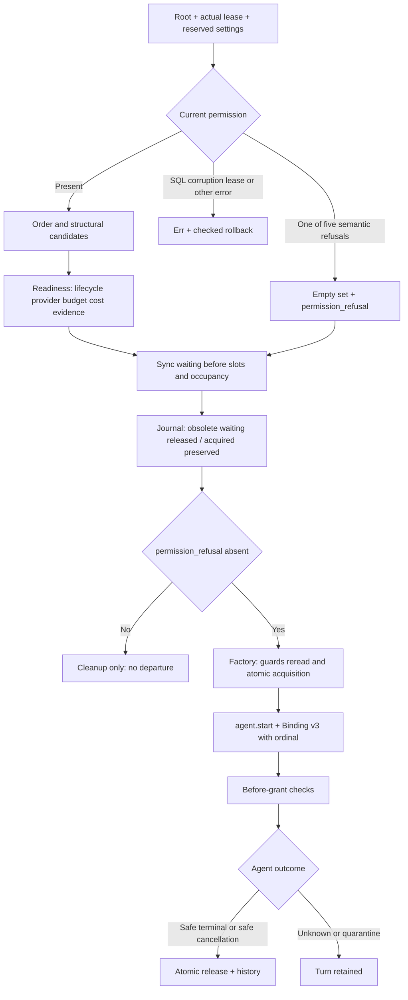

Original before-pause15 retains two valid SDK assertions followed by the exact
planning-mission-paused cleanup failure. The corrected final39 normal default
engine (292 effective inputs, SHA88859e0d, no fixture features) and final40 FIFO
SDK pass final43: concurrent registration, exact no-mutation FIFO refusal,
acquisition/cleanup/cancellation journal faults with rollback and recovery,
complete acquired-turn/reservation preservation, same-workspace progress after
release, requeue history, inert worker completion and public CLI reopen.
final44 passes existing worker/cost scenarios. final45 and final46 execute genuine
historical v1/v2 intentions produced by engines188/192 under their real owning
heartbeat, with public control replay and EOF refusals. All four recipes have
verified integrity. quality21 retains17 named Rust tests plus strict Clippy and
Rustdoc; final39 adds only reviewed Rustdoc lines to five product files. The old
test inputs remain retained and are not claimed rebuilt; final47 checks final
Clippy/Rustdoc. Binary hashes changed, so all four public recipes were replayed
on the final binaries rather than inferred equivalent from comments alone.

Limits: one of five semantic permission-withdrawal variants is exercised through
the public flow. Unknown/quarantine/crash recovery, terminal replay after the same
task gets a new generation, full fairness/conductor/watch and independent acceptance
remain open. The journal fault is SQLite ordinal exhaustion, not filesystem
saturation. These are owned inert fixtures without paid provider or task acceptance.
At the earlier comparison, twenty effective inputs differed in the concurrent canonical checkout (Live,
telemetry, settings/assets and lib.rs); their originals are preserved and excluded
from this qualified candidate. No combined checkout qualification, installed
service, release or updated embedded/running agent contexts is claimed.

Terminal consumer correction verified: before52 reproduced success despite a
missing genuine released snapshot; after60 exposed that terminal recovery was
reading in autocommit. The settings reservation does not establish an SQL
snapshot. The corrected branch explicitly opens a read transaction, rereads
Agent/reservation/FIFO proof, and preserves read and rollback errors separately.
Shared verify_terminal now checks historical FIFO after exact durable receipt
matching; recovery replay and worker-evidence observation use this guard.
No current consent/lease is required for already completed work; manual/v1/v2
history gains no retroactive FIFO. New unit guards include missing release,
foreign owner, wrong sequence, legacy compatibility and restoration.

Final normal65 (292 effective inputs, SHA8e5af7aa, default without fixture features)
shares actual core bytes/features with SDK66/67/68. quality69 passes18 named Rust
tests and strict engine/CLI/SDK Clippy plus private Rustdoc. completion-after70
passes real provider completion -> failed settlement -> retained turn/reservation
-> live-owner refusal -> owner exit -> public reconcile -> exact release/replay.
Removing the released proof then refuses with mission-agent-turn-release-missing;
exact restoration and replay pass without new provider files/SQL mutation.
final71–74 pass worker/costs, genuine old v1/v2, and concurrent FIFO lifecycle;
all five recipes have verified retained integrity (7 steps total). The planner
production-retry witness/faults61 also passes on normal55, before the final
terminal-recovery transaction change; it exercises unchanged observer/guard code,
not the final65 replay branch. This reuse is explicitly bounded, not a claimed rerun.
retained76 separately archives/checks all nested output bytes, including original
failed60. The recipe verifier alone covers its declared artifacts, not these nested
outputs. Source review binds the archives independently. No live store is cloned.

Reusable lesson: enforce new provenance in every result consumer, including
terminal replay and planner evidence; guard all related reads in a real SQL
snapshot. A settings lock and a green producer test establish neither requirement.
Keep failed healthy controls, diagnose their first failed precondition, and restore
negative fixture corruption exactly before proving recovery. Unknown/quarantine,
crash without a complete receipt, same-task new-generation terminal replay and
four other semantic permission variants remain unverified. Full conductor/watch,
concurrent Live/telemetry integration, installation and global acceptance remain open.

Qualification and concurrent work: review77 observed23 canonical differences,
including new RootStore/planning_native/reviewer gate changes during checks.
The count describes that capture only; qualified profiles remain bound to immutable
inputs. The final review retains exact exclusions and bytes. FIFO evidence does
not qualify or repair concurrent changes; integration is required before cutover.

## Next selection and admission — increment198

`RootStore::dispatch_mission_worker` is a locally qualified Linux Rust API.
Strict requests contain schema_version, event_id and expected_revision; the engine
chooses the task. Callers hold a real lease bound to the opened Root instance and
process. Outcomes are a queued intention, replay or explicit no-admission result;
this API starts no provider/watch loop and has no dedicated CLI command yet.

Before synchronization, the engine searches the canonical event original under a
real transaction and reserved settings. Its task comes from that original, never
a reconstructed current-profile request. Manual originals, foreign Work, wrong
original revision, invalid provenance or changed profiles refuse. Presence and
request/Work bytes, including an orphan namespace conflict, survive existing
storage retries: observed disappearance or replacement never becomes new selection.
Replay retains current profile/consent/capacity checks and original receipt/FIFO
proofs; released state alone does not establish refusal. The shared Agent.start
namespace does not prove historical creation by this selector.

Genuine absence permits synchronization of every ready candidate before slot and
occupancy checks. Synchronized revision is checked before any return, including
empty readiness or withdrawn permission. Synchronization may already be committed;
its effects remain explicit. A FIFO blocker or clean direct occupancy refusal can
yield to a disjoint candidate; mission capacity stops the pass. Compound,
commit/cleanup or unknown failures stop without choosing another task. The actual
factory repeats its guards and atomically acquires the turn with the intention.

Prepared, Replayed and NoAdmission establish neither a started process nor
acceptance. NoAdmission can contain committed cleanup, readiness/permission/resource
refusals that consumers must inspect. Errors preserve phase, preparation identity,
known queue effects and earlier causes. Diagnostics also traverse secondary causes
without displaying identifiers, prompts or tables. Callers maintain heartbeat and
retain outcomes alongside independent close/output errors. Recover uncertain
outcomes by the same event. No operator ceiling, timeout, retry, budget or slot
policy is added; existing persisted sources remain authoritative.

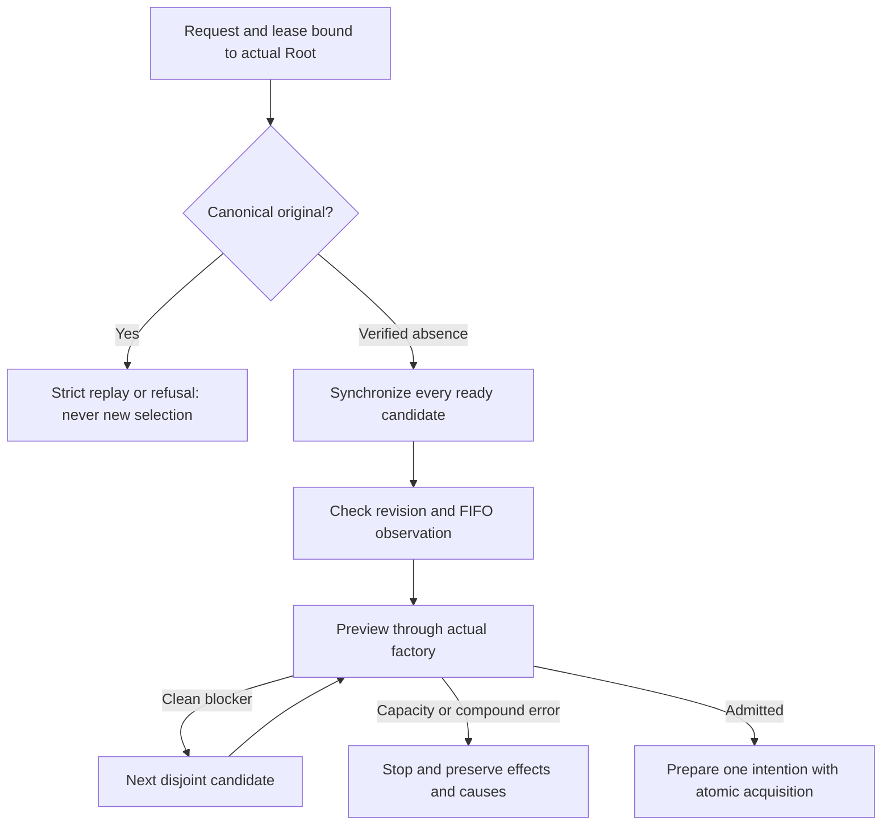

Evidence: normal24 (ab349179,293 effective inputs without fixtures), SDK26 matching
200 engine inputs,20 focused tests10 reused on identical executable bodies, Clippy/Rustdoc27. Permanent
mission-worker-dispatch recipe public28 PASS/integrity VERIFIED checks disjoint
selection, queued replay without SQL changes, capacity after public blocker
withdrawal, pause preserving the acquired turn and3original conflicts (manual with
its true revision, foreign Work, wrong original revision). retained29 archives and
rehashes116nested output files outside cache, without Root databases. SDK starts
no provider; separate setup uses inert programs and retains simulated cost. Source
checks writes/flush; a partial marker is neither final result nor successful close.

Limits: no actual BUSY/finalize or EPIPE injection, or uncertain commit/close;
revision race covered by projection, not concurrent interleaving. The pre-fix
namespace counterexample and executable remain in the plan (before04/13);20tests
pass after correction. Watch, terminal replay after a new generation and global
acceptance remain open. The23concurrent canonical Live/telemetry/settings/Root/lib
inputs are excluded: no combined qualification or installation. See plan and
REPLAYS for commands, hashes, original failures and remaining recovery.

The Rustdoc-only refresh (doc-only22) preserves executable bodies and line counts; normal24 and SDK26 also match prior binaries byte for byte (binary-equivalence24). The current profile and Rustdoc27 nevertheless bind the final documented bytes.

## Worker independence after the conductor exits

Recipe `mission-watch-worker.json` uses proof SDK `mission_watch_worker`, then
the actual normal binary's `agent run` command in a separate session. The
conductor retains its lease and heartbeat until the inert provider program has
actually entered. Recorded permission or spawn alone is insufficient: kernel
PID/stamp/parent, entry marker and consumed-input hash must match. The socket
peer is attributed to the owned supervisor before any blocking frame read.

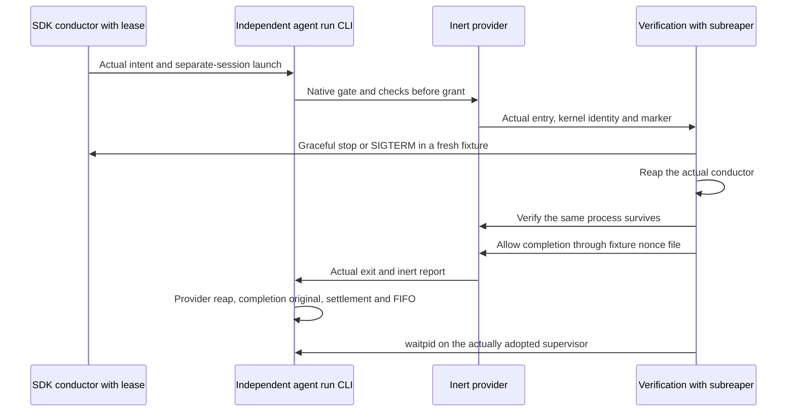

Graceful exit retains the stopped-lease/close receipts; SIGTERM retains its actual
kernel status without inventing those receipts. After reaping the conductor,
the same supervisor/provider remain alive with the same acquired turn and
reservation. Completion explicitly checks the original against public output:
`kernel_reaped`, `output_complete` and `workspace_release_confirmed` are true,
`recovery_required` is false, identity and reservation remain bound. The exact
receipt is copied with SHA256. Verification also reaps the CLI with actual
`waitpid`: a provider-reap receipt does not prove CLI reaping. Public replay
preserves SQL and provider markers; no task is accepted.

Local evidence: increment199 `public23`, two PASS steps with verified integrity,
twelve Python guards and two actual flows (graceful then SIGTERM); three targeted
Rust tests in `unit08`, strict Clippy in `clippy11`. Normal198/24 and SDK199/10
share all 200 default engine inputs without fixtures. `retained24` preserves 115
nested outputs, including both completion originals, without cloning Root
databases. Publication and close failures no longer bypass cleanup; original
counterexamples and secondary causes are retained.

This B1 proof does not wire product `mission watch`: the SDK uses example-only
`pre_exec`, prohibited in product crates by `forbid(unsafe_code)`. The eventual
product launch needs separate qualification. No paid provider, installation,
complete automatic recovery, concurrent Live qualification or overall acceptance.

## Verified product session bootstrap

Private Linux helper `_mission_worker_entry AGENT --root ABSOLUTE_ROOT --json`
validates transport before session/Root effects, calls safe rustix `setsid`, then
reuses the actual `agent run` consumer. Its name grants no authority. CLI, engine
and proof SDK retain `forbid(unsafe_code)`. Launchers must use ordinary spawn:
making the child a process-group leader before exec would cause `setsid` to
refuse. This helper is not a second provider supervisor.

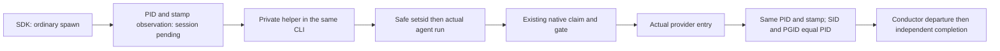

Spawn alone does not prove session creation. The SDK retains the initial
observation and asserts independence only after actual provider entry and
PID/stamp/parent/SID/PGID checks. Failures after `setsid` preserve the observed
SID and original typed CLI cause, including recorded state, close and output.
Session refusal retains errno without calling Agent runtime. Refusal unit tests
inject the syscall error; the positive session path runs in an actual child,
never in the host test runner.

Increment200: normal05 `c734f0c4`, 294 effective default inputs without fixtures;
SDK10 shares all 200 engine inputs. Five CLI06 and three SDK11 named tests, strict
Clippy and private Rustdoc12 PASS. Public14 PASS/VERIFIED integrity: fourteen
guards, four public refusals without Root creation/mutation, then actual graceful
and SIGTERM flows through the product helper. Retained15 preserves 129 outputs,
including completion originals, identities and kernel statuses; no Root database
is cloned.

The archived199 B1 SDK used pre_exec; current200 replay uses the safe helper.
Product `mission watch`, descriptor-bound Root channels and recovery phases
remain unwired. Test201 established that replacing `.swarm` at a constant path
can make the worker execute in a copy while the conductor retains its original
instance. Conductor lease and interprocess worker checks are insufficient for
this case. The shared fix is being qualified; resistance to replacement or
hostile same-UID writers is not established. No installation or overall acceptance.

### Physical datastore binding — candidate 201 under qualification

The implemented contract observes the file actually connected to SQLite through
`sqlite_filestat('main')`. Within the query closure, a new Linux O_PATH|CLOEXEC
witness follows SQLite’s own FD through procfs; it never owns, duplicates or
closes that data FD. The witness is compared with private, regular, single-link
state.db opened with O_PATH and NOFOLLOW relative to the retained directory.
RootBinding retains both device/inode identities and the handles preventing
inode reuse during its lifetime. Missing capability, mismatched association or
observation failure refuses without pathname-stat fallback.

The current factory produces Binding v4, adding root_instance to the parent/effective
profile hashes and FIFO ordinal. Its canonical original protects that linkage;
a caller-supplied tuple creates no authority. Before claim and grant, inspection
requires v4 and compares the actual opened instance. Existing lease/process/profile/
consent/capacity/FIFO checks remain required. Versions 1–3 retain historical read,
cancellation and settlement behavior under their proofs, without new launch rights
or backfilled physical provenance that was never observed.

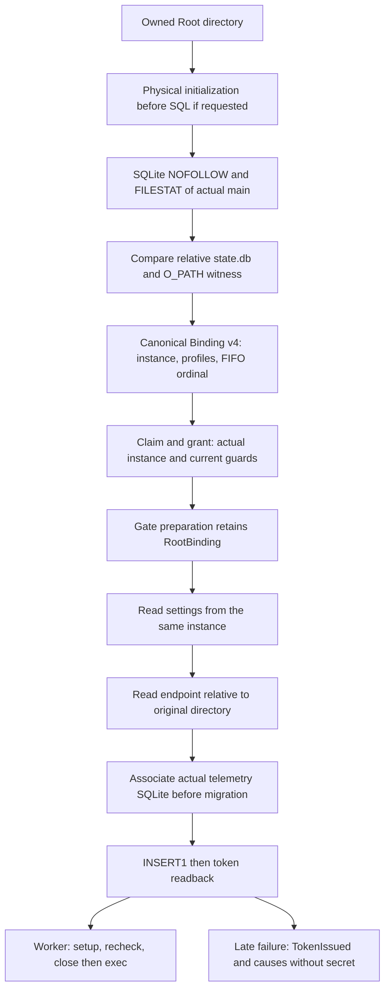

On Linux, explicit initialization prepares a private file before connection and
writes the schema after associating the real FD with the relative file. Missing
files are published from already closed temporaries with NOREPLACE. Permission
repair targets an O_PATH-retained inode through procfs, without opening/closing
a data witness that could remove SQLite locks. RootStore::open opens an existing
Root; writable does not mean initialize. Initialization code alone establishes
neither its guards nor an absence of effects.

The worker retains the binding acquired before prepare_agent_gate, reads settings
only after comparing the reopened Root, and keeps it through the telemetry launcher.
Endpoint reads are descriptor-relative. The separate telemetry store retains its
actual SQLite and O_PATH witness, compares its file before migration/issuance, and
requires INSERT1 plus matching digest/agent/time/null-revocation readback. The
secret is returned only after verification. INSERT0 cannot become false success;
a readback or close failure after INSERT1 preserves typed TokenIssued. That marker
records a reported write stage, not a grant, delivery, acceptance or guarantee that
the row still exists. Primary and cleanup causes remain separate; LaunchTelemetry
Debug exposes neither the token nor its environment.

The standalone launcher retains its API and accepts an owned0755 directory with
private files. The worker uses its actual RootBinding through the bound API.
Reviewer and planning still use the public route without their preparation binding:
their original-instance continuity and post-success markers remain to be wired.
A late recheck alone does not prove no earlier mutation reached a copy. There is
no implicit installation or qualification of those consumers.

The bootstrap201 fix now installs the explicit zero SQLite busy timeout
immediately after connecting, before the first FILESTAT capture, for Root and
TelemetryStore. Root then loads its saved Admin value before ordinary SQL;
`bind_root` and later identity observations do not reset that effective value.
Zero is the existing technical phase before settings load, not a new operator
policy. Both permanent interprocess-contention and saved-Admin-value guards actually
PASS74 on candidate65. The public busy CLI flow92 also PASS on normal65 with typed Prepare refusal and
unchanged recovery. The guards establish handler ordering; CLI timing establishes
no performance bound or guarantee and does not cover TelemetryStore. See the [bootstrap contract and provenance](../plans/migration-rust/evidence/20261022-root-instance-201/bootstrap-busy-handoff.md).

.cargo/config.toml configures LIBSQLITE3_FLAGS=-DSQLITE_ENABLE_FILESTAT with
force=true. Cargo must run with cwd equal to the selected immutable source, not
merely a manifest located elsewhere. Collectors prebind, compare and archive its
bytes for normal/SDK, which must use the same config. The record also retains the
environment before Cargo applies config; neither that record nor Rust features
establish actual C flags. Runtime capability must be exercised on the intended
binaries. Historical profiles with config absent on both sides remain compatible
without rewriting their proofs.

These handles bind local physical storage; they are **not OS confinement** against
a hostile same-UID actor, substituted procfs or deliberate ABA. SQLite still opens
a NOFOLLOW path before FD observation: connection or SQL preparation can have their
own hot-journal recovery effects. Their absence is unproven. This increment claims
neither zero effects for arbitrary connections nor hash-only protection.

#### Evidence201 and remaining criteria

Intermediate results16–62 keep their historical scope: FILESTAT/O_PATH capability,
profiles18/31/45, tests33/34 then 53 tests47–54 and public59. Zero-test35 remains
preserved; its three guards actually PASS49. Defects08/26 ran the provider in a
copy; later FAIL60 refuses in the conductor before spawn and did not establish
the DB-only worker behavior.

[Normal65](../plans/migration-rust/evidence/20261022-root-instance-201/canonical-normal65/result.json)
8bd7ebc0… qualifies 301 inputs matching frozen source63; SDK77 shares engine/config.
**67 named tests PASS**: 57 engine67–75, 5 CLI78 and 5 SDK79. Corrected bootstrap and
diagnostics guards now exercise this profile, with archived sources/test binaries
and verified integrity. [Result85](../plans/migration-rust/evidence/20261022-root-instance-201/quality85/result.json)
reports strict Clippy and Rustdoc PASS within the selected engine/CLI/SDK scope.
No result establishes installation, independent acceptance or overall qualification
of the concurrent Live graph.

[Probe schema2](../plans/migration-rust/evidence/20261022-root-instance-201/sdk-late-probe-plan62.md)
adds spawn_ready after actual binding/monitor checks, then waits for spawn before
the existing Command. This fixture window preserves every check and error; its
booleans convey no authority. Schema1 keeps its historical protocol.

[Directory88](../plans/migration-rust/evidence/20261022-root-instance-201/public-directory88/result.json)
and [DB-only89](../plans/migration-rust/evidence/20261022-root-instance-201/public-database89/result.json)
PASS are validated by root and exercise that late point: two controls with actual
provider entry/completion, child exit0 and SDK CHECKED_CLOSED; two faults after
spawn_ready produce worker child exit2 with the expected instance code, no provider
entry and unchanged copy. Owned processes are actually reaped, the original is
restored and public stop/reconcile/replay/cancel are checked. Under substitution,
the SDK preserves EXPECTED_SUBSTITUTED_CONTEXT_REFUSAL, without inventing a logical
stop or checked close on the substituted context. Both recipes pass integrity
verification; [retention90](../plans/migration-rust/evidence/20261022-root-instance-201/public-retained90/result.json)
archives 141+142 nested outputs.

[Snapshot80](../plans/migration-rust/evidence/20261022-root-instance-201/snapshot80-replan.json)
refused before runtime because two notes62 were absent. Source86 adds only those
documents, with all 301 inputs65 identical, before snapshot87 and recipes88/89.
This failed prerequisite remains preserved separately. FILESTAT-absent57v3 and
the before-fix SqlInputError gap remain historical; corrected diagnostics are
exercised73 without erasing the original observations.
[Busy-before61](../plans/migration-rust/evidence/20261022-root-instance-201/bootstrap-busy-handoff61.md)
refused SQLite5 after 5017838602ns under a real lock, consistent with the inherited
5s handler; control/recovery/hashes matched without a threshold.
[Busy candidate92](../plans/migration-rust/evidence/20261022-root-instance-201/boot-busy-candidate92/result.json)
PASS with verified integrity: exit2 under lock, typed causes
`root-database-identity`, `database-identity-operation:Prepare`, `sqlite-code:5`,
**4440712ns** measured; recovery and DB/settings/SQL hashes unchanged.
[24 observations93](../plans/migration-rust/evidence/20261022-root-instance-201/busy-retained93/result.json)
are archived. No threshold, watchdog or performance commitment is inferred;
guards74 establish zero-before-capture rather than latency. This CLI flow does
not establish TelemetryStore timeout behavior. The 12 harness guards fix a stale
false phase flag; its [before-fix counterexample](../plans/migration-rust/evidence/20261022-root-instance-201/busy-phase-review62/result.json)
FAIL is preserved, without changing compiler source65.

Still open: legacy admissions within their scope,
telemetry zero/opt-out and late effects beyond targeted tests, reviewer/planning
binding, final review of current bytes/docs and affected consumers.
[Review preparation62](../plans/migration-rust/evidence/20261022-root-instance-201/review-scope62.md)
counts 43 compiled deltas against199 and 25 references; it is not a conformance
declaration. Sources include the actually compiled concurrent Live/telemetry
changes, without overall acceptance of their graph. Hot-journal/same-UID limits
remain explicit;201, product watch wiring and the migration remain open.

With the same normal65/SDK77 binaries, [watch recipe98](../plans/migration-rust/evidence/20261022-root-instance-201/public-watch98/result.json)
passes: 14 guards, graceful conductor exit and conductor SIGTERM, with the granted
worker completing independently. Integrity verification passes; [129 outputs99](../plans/migration-rust/evidence/20261022-root-instance-201/watch-retained99/result.json)
are retained. This SDK does not establish integration of the production driver.
TelemetryStore's lasting zero busy timeout remains a pre-existing policy without
an identified Admin setting. That open criterion differs from the temporary Root
bootstrap zero, telemetry opt-out and a zero-row INSERT result.

## Historical compatibility and transfer between roles

Binding1, Binding2 and Binding3 intentions remain readable and cancellable; they
cannot obtain a new execution requiring Binding4. Recipes
[v1/103](../plans/migration-rust/evidence/20261022-root-instance-201/legacy-v1-103/result.json),
[v2/104](../plans/migration-rust/evidence/20261022-root-instance-201/legacy-v2-104/result.json)
and [v3/118](../plans/migration-rust/evidence/20261022-root-instance-201/legacy-v3-118/result.json)
verify refusal, cancellation/release and idempotent recovery using genuine old
producers after a v4 control. They establish neither old completed recovery,
public v3 mission.start replay nor fresh admission. The historical v3 SDK exits
with its expected nonzero EOF; that is not a successful graceful close.

[Descriptor transfer116](../plans/migration-rust/evidence/20261022-root-instance-201/gate-component-unit116/result.json)
passes six tests but remains Linux test-only. Integration into planning/reviewer
is not established. The compiled reviewer reproducer110 remains unexecuted;
its [tool block115](../plans/migration-rust/evidence/20261022-root-instance-201/reviewer-wrapper-tool-block115.json)
is retained separately. Component tests establish no role protection.

## Observing intentions before a future launch

`RootStore::observe_mission_worker_continuation(&MissionLease)` reads existing
intentions in one SQL snapshot under actual Root/process binding and a current
lease. Saved settings govern SQLite; no retry, TTL, new storage or agent-count
ceiling is added. Retained history order is not relaunch priority. The report is
for a trusted local caller, not an HTTP DTO or transferable authority through IDs.

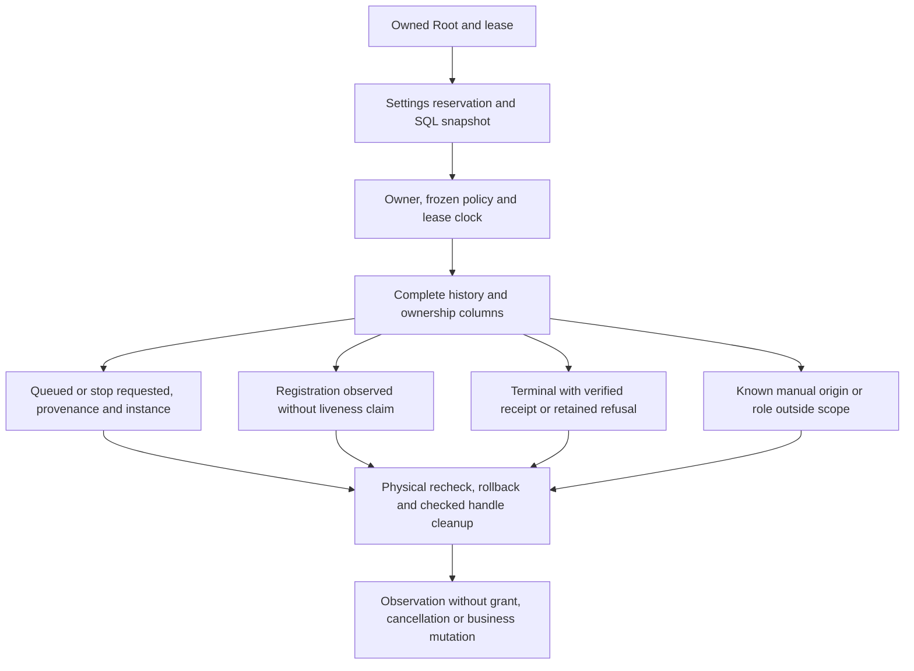

An automatic queued intention requires historical attribution and Binding4 on the
actual instance; its generation remains explicitly compared with the observing
lease. This alone checks neither current permission/capacity nor the final gate.
Active registration requires coherent fields and a Go RFC3339 heartbeat without
inferring freshness or process liveness. Starting may precede child registration.
Running/stopping require the registered child. Stopping may retain an opaque
incomplete-output incident result; presence proves neither its contents, a
terminal outcome nor recovery rights.

A verified terminal requires the private receipt and established release evidence.
Cancellation before registration without a receipt remains explicitly unproven,
never eligible for relaunch. Semantic refusals remain typed entries; decoding,
SQL/IO or cleanup failures make the whole report unusable for action. Primary,
secondary and per-entry causes remain traversable through Box and IO.
`CompleteButUnusable` does not imply failed cleanup: a final physical recheck can
also invalidate a complete report. This call replaces neither gate nor recovery;
the caller still closes its lease and Root. Documented SQLite read/recovery effects
remain distinct from business mutation.

[Corrected frozen159 and ten tests161](../plans/migration-rust/evidence/20261022-root-instance-201/continuation-unit161/result.json)
verify structural guards, error wrappers and actual empty Roots. Original
[counterexamples156](../plans/migration-rust/evidence/20261022-root-instance-201/continuation-review-before156/result.json)
are retained. [Public flow169 on162](../plans/migration-rust/evidence/20261022-root-instance-201/continuation-public169/result.json)
verifies two genuine queued v4 intentions and graceful/SIGTERM conductor exits,
with Agent/Work/receipt/FIFO public projections unchanged before spawn.
[CLI profile164](../plans/migration-rust/evidence/20261022-root-instance-201/continuation-normal164/result.json)
and [SDK166](../plans/migration-rust/evidence/20261022-root-instance-201/continuation-sdk-profile166/profile.json)
share 202 observed engine inputs and the build configuration, without fixture
features. [129 outputs170](../plans/migration-rust/evidence/20261022-root-instance-201/continuation-retained170/result.json)
are archived and recipe integrity passes. Six SDK tests172, fifteen guards and
[strict Clippy/Rustdoc173](../plans/migration-rust/evidence/20261022-root-instance-201/continuation-quality173/result.json)
pass. [Corrective review167](../plans/migration-rust/evidence/20261022-root-instance-201/continuation-corrective-review167.md)
is favorable for F1/F2/F3 in the same context, not an independent review. These
binaries are not claimed installed.

Separate [ledger185 evidence](../plans/migration-rust/evidence/20261022-root-instance-201/continuation-ledger-public185/result.json)
executes engine libtest177: one actual positive reservation, all typed SQLite rows
strictly equal around two observations, unchanged public projections and
connection total_changes. Stop, cancellation, release and close are verified
separately afterwards. Seven harness guards pass;
[41 outputs186](../plans/migration-rust/evidence/20261022-root-instance-201/continuation-ledger-retained186/result.json)
are archived. This cfg(test) proof is not a public ledger API; SDK166's
reservation_rows_verified field stays false. Harness cause-transmission defect188
is addressed separately and is not qualified by185. Actual quarantine and
terminal/old-generation observations remain outside these proofs. Production
mission watch, independent review and global acceptance remain open. Durable
stdout/stderr files are not an inherited Go prerequisite: the historical path
uses os.DevNull. Product file capture is deferred; see the
[after-cutover register](../plans/migration-rust/AFTER-CUTOVER.md).

## First worker CLI conductor — verified candidate209

The uninstalled Rust candidate provides `mission watch WORK --root ROOT [--json]`,
`mission status WORK --root ROOT` (FR/EN text), and
`mission status-native WORK --root ROOT --json` (new version1 protocol).
Start still records consent; watch now explicitly consumes it to admit and launch
eligible workers. The web server does not yet run this conductor. Historical
`mission status --json` remains refused: the native view does not substitute for
the Go cockpit DTO.

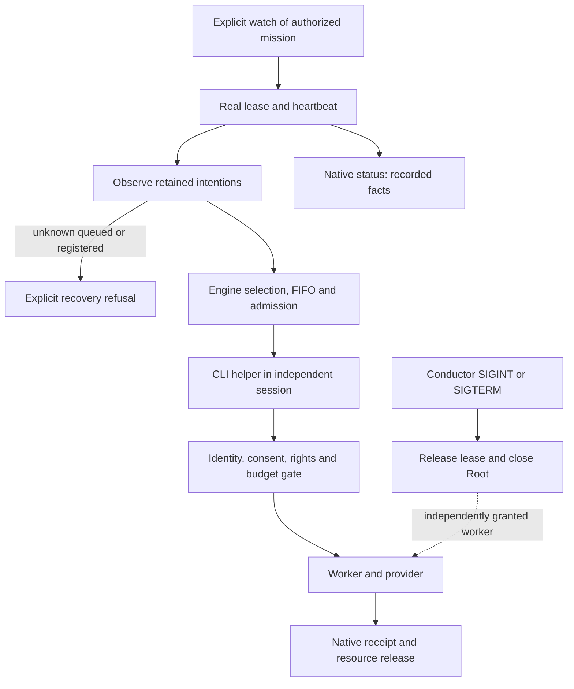

Cadence comes from the persisted policy frozen at claim; no local delay, retry
or ceiling is added. Owned children are reaped with nonblocking try_wait; selection
does not wait for their completion. Helper stdout/stderr use null as in Go.
New stdout observations are version1 JSONL, also without --json; they establish
neither permission nor durable receipt. A blocked stdout consumer remains a
synchronous limitation. worker-started observes spawn and carries
provider_start_verified=false; the provider may already have progressed.

Status-native returns schema_version/work/revision/controls/supervision/agents/
limitations. Reads are sequential, not one transactional snapshot. PIDs and a
present lease establish no process liveness. Prompts, environment, private stamps
and free-form error text are excluded. Close precedes publication; read/refusal,
flush and cleanup causes remain retained. A known admission followed by failure
carries LifecycleRecorded, without rollback/refund or an invented revision.

[Recipe213](../plans/migration-rust/evidence/20261022-root-instance-201/watch-public213/result.json)
PASS with verified integrity: pause then SIGINT, SIGINT and SIGTERM on three fresh
Roots. Each proves actual inert provider entry, granted-worker survival after
conductor exit0, actual helper reap0, receipt, release of the same FIFO turn and
estimated reservation; the task stays unaccepted. Ten Python guards pass.
[Binary209/profile](../plans/migration-rust/evidence/20261022-root-instance-201/watch-normal209/result.json)
identifies the candidate. [10 Rust tests and Clippy204](../plans/migration-rust/evidence/20261022-root-instance-201/watch-targeted204/result.json)
and [Rustdoc206](../plans/migration-rust/evidence/20261022-root-instance-201/watch-rustdoc206/result.json)
cover identical CLI203 code, before the embedded APEX text-only adjustment209.
[Independent review196](../plans/migration-rust/evidence/20261022-root-instance-201/watch-review196.md)
is favorable within scope. [Retention216](../plans/migration-rust/evidence/20261022-root-instance-201/watch-retained216/result.json)
keeps26/46 outputs from original failures205/211 and215 outputs213, without DB copies.

Open: automatic planning/review/validation, managed/recovery, adoption of another
conductor's intention, web integration and historical Go status JSON. Blocked
observations name missing automatic roles and keep mission_complete=false.
Unknown automatic intentions refuse before another departure, without cancellation
or relaunch. Repaired harness failure-cleanup branches remain double-tested, not
exercised by positive recipe213. No installed server was replaced, no real mission
launched and no whole-G3 or lot201 acceptance is established.

## Queued intention restart — verified W2 candidate

`mission watch` can resume an automatic Binding4 worker still queued with no
registered process. Under a real new lease, the engine appends a receipt to
`native_mission_worker_adoptions`; original Agent, attempt, request/binding,
Work, FIFO and reservation remain unchanged. The receipt links historical claims
and settings revisions with current consent. Adoption does not refresh context
or authorize launch: the current gate rechecks actual Root identity, lease,
profiles, rights, budget and freshness. Manual, stop, registered/terminal and
legacy bindings1–3 refuse.

The adoption request contains schema_version1, event_id, expected_revision and
agent_id, never supplied permission. Exact replay under the same lease is
idempotent; changed payload or another receipt in the same epoch refuses. The API
reserves settings and checks data inside the existing writer transaction,
preserving SQL/rollback/commit/close causes, and starts no process. Its result is
a private local Agent; CLI only projects safe fields. The JSONL
mission-worker-adopted observation carries provider_start_verified=false and
mission_complete=false before the ordinary independent helper.

[Recipe224](../plans/migration-rust/evidence/20261022-g3-watch-restart/public224/result.json)
PASS with verified integrity: eight guards; eight actual API calls on one Root
(stale revision/pause/conflicting replay/same epoch/stopped lease refusals,
adoption, replay and recovery); restart on a separate fresh Root; three W1 journeys
on the same new binary. Actual typed SQL admission/reservation rows, Agent,
attempt, binding and FIFO are compared; real inert-provider entry, survival after
SIGINT, native receipt and single settlement are verified. Separate Roots avoid
mistaking restored controls for refreshed context: pause/unpause advances Work
revision. Failure223 and its method cause are retained, without removing a gate;
that first helper's exact inner error was not captured (stderr null).

[Normal profile219](../plans/migration-rust/evidence/20261022-g3-watch-restart/normal219/result.json),
SDK219/222 share identical engine sources;11 CLI tests218,4 engine tests220,
strict Clippy and Rustdoc pass. [Retained outputs225](../plans/migration-rust/evidence/20261022-g3-watch-restart/retained225/result.json)
keep65 files223 and341 files224, without Root database copies.
[Plan and review](../plans/migration-rust/evidence/20261022-g3-watch-restart/PLAN.md)
separate local verification from acceptance. Not verified here: registered-process
restart, concurrent grant revocation, stale-context reauthorization, automatic
roles and web server. No installed server replacement, real mission or global
acceptance; the preceding W1 limitations still apply outside this narrow extension.

## Planning through watch — locally verified W3 journey

The candidate connects one foreground step_planning per conductor pass, after
observing explicit controls (enabled consent, automatic autonomy, neither paused
nor archived). Planner authority remains its native scope claim, as in the Go
path; the conductor lease is not a new authorization passed to the private gate.
This limitation is separate from heartbeat. The result becomes version1
mission-planning-step JSONL: scope/input/claim, idle/applied status,
settings_revision as a SettingCount decimal string, integer work_revision,
decision_applied and explicit limits. No private Work, prompt or raw model output
is published. Known Work effects survive later dispatch/publication/cleanup
errors; refusals never become idle.

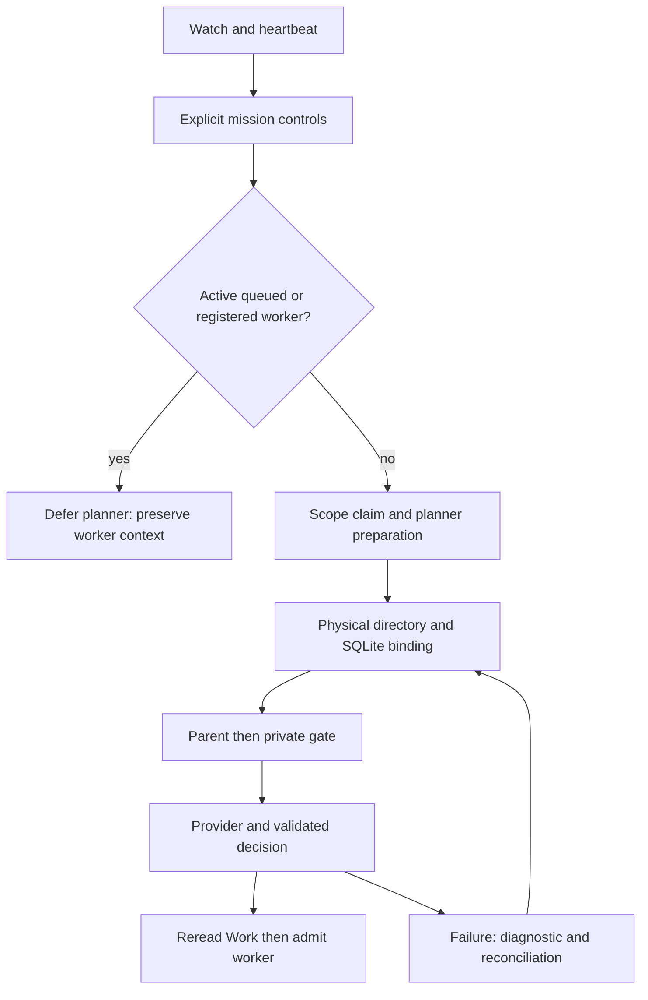

Planner preparation stores an immutable normalized per-claim instance link in
native_planning_run_bindings without changing legacy Run schema. A RootBinding
retains directory and database O_PATH descriptors throughout run and reconciliation.
Parent, private gate and application fence compare the actual connected database
and its association with the directory. Feedback checks this link before report
publication and within its transaction: candidate228 missed this branch (W3-R1),
corrected230. A legacy Applied receipt without a link stays historical reading,
never a new grant. Legacy failures without provenance are not silently adopted.
This local guard does not confine hostile same-UID processes.

State: build232, strict Clippy/Rustdoc233 pass;25 targeted Rust tests231 pass
before two equivalent CLI style simplifications. [Recipe244](../plans/migration-rust/evidence/20261022-g3-watch-planning/public244/result.json)
passes16 evidence guards,12 shared public guards and the journey across three
isolated Roots. Watch performs both root/child planning activations, then runs
the inert worker through its native completion receipt, FIFO release and estimated
reservation. Process completion does not validate the task. A quiescent SQLite
copy in the same directory refuses without logical mutation or diagnostic
publication, for both an Applied receipt and a saved failure. Restoring the
original inode permits historical replay or single failure settlement, without
a new provider call. The settlement control uses a separate equivalent Root.
Fixture renames keep each file single-linked; failures and restoration have
targeted guards without weakening product protections. [Outputs237](../plans/migration-rust/evidence/20261022-g3-watch-planning/retained237/result.json)
retains attempts234/235 and236; no Root database copy is exported. Profile232
identifies the native binary; later docs/release notes are not assumed embedded.
No installed server was replaced and no global acceptance follows;
[independent review](../plans/migration-rust/evidence/20261022-g3-watch-planning/HANDOFF-review.md) approves this bounded scope. Foreground planning can delay
watch signal handling and does not offer Go parallelism; it defers while an
automatic worker is active to preserve immutable preparation. These are candidate
functional limitations, not new operator policies. Automatic reviewer/validation,
registered-process recovery, stale-context reauthorization and web integration
remain open. [W3 plan](../plans/migration-rust/evidence/20261022-g3-watch-planning/PLAN.md).

Additional affected regression [243](../plans/migration-rust/evidence/20261022-g3-watch-planning/public243/result.json)
passes eight W2 guards, eight actual adoption API checks and queued restart, then
three W1 pause/SIGINT/SIGTERM journeys: five fresh Roots. SDK241/242 bind the
same204 engine inputs as native232. The legacy event validator now accepts exact
idle planner records only; applied or malformed records still refuse. Its
before-fix counterexample and source gap are retained in replan240/HANDOFF-recipe.
[244](../plans/migration-rust/evidence/20261022-g3-watch-planning/public244/result.json)
replays W3 with16+12 guards and three fresh Roots. Both recipe integrity checks
pass. [Outputs245](../plans/migration-rust/evidence/20261022-g3-watch-planning/retained245/result.json)
retains341/215 output files without Root databases. Earlier236/239 remain scoped
historical proofs; final byte review and independent verdict are in the W3 plan.

### Automatic finished-report relay — locally verified contract
`mission watch` also observes workers finished before its generation. For a
current automatic worker, the engine checks original provenance and terminal
receipt, selects exactly one nonempty report in its workspace and submits it
through `task.submit` under current lease and consent. Submission is not
acceptance. Missing/stale/ambiguous reports emit waiting observations; unknown
IO/proof refuses with its cause. Later errors retain known Work revision.
Filesystem and SQL observations are not an atomic snapshot.
Admin → Agents exposes `agent_report_clock_skew_seconds`: installation choice2s;
0requires mtime at/after attempt start. A larger tolerance admits older reports.
Historical absence refuses until explicit adoption; display windows are unrelated.
Planning pause differs from mission pause: it prevents planner activation without
undoing a submitted handoff. Proof: review601, recipe598, profile597. Automatic
controls/reviewer and Go parallelism remain to be connected.

## Automatic continuation after handoff —659
The conductor relays the report then executes saved controls under rechecked
owning lease and consent; the private gate binds parent/Root/source. The receipt
still requires review and never accepts the task. Controls drain before the next
planner pass without a session cap. Existing heartbeat stays on its thread.
Terminal replay reads without fresh permission or process. Public revocation
during an actual control sends TERM and retains wait, claim and durable facts
without PASS. Recipes657/658/profile643 in [review659](../plans/migration-rust/evidence/20261023-g1-status-contract/decision659/result.json).
Automatic reviewer connected and verified702 below; foreground SIGINT cancellation, full recovery and web remain open.

### Automatic reviewer — locally verified journey702
`mission watch` drives planner → automatic worker → canonical report → native
controls → native reviewer. Reviewer claim and permission require the actual
owning lease and current consent, with a normalized `native_mission_review_bindings`
ledger separate from controls. Existing mission reviewer budget reserves and
counts in the same writer; consumption is never reset. Private gate and polling
check parent, epoch, physical Root, producer and consent. The automatic source
hash includes the binding; manual jobs keep their original domain. Deleting a
binding cannot turn an automatic job into a manual job.
A same-attempt result is not automatically retried; running state requires
reconciliation. Control selection leaves review-owned tasks to their review
lifecycle. Receipts publish before the next planner pass; the existing heartbeat
continues in its independent thread. Public replay of the original claim after
conductor exit reads the verdict without a fresh lease, call or reservation.
No task acceptance follows. Diagnostics retain static decoder reasons without
private contents; Root returns the greatest explicitly recorded revision for
the first known Work identity, not guaranteed current state or rollback.
[Evidence702](../plans/migration-rust/evidence/20261024-g3-auto-review/decision702/result.json):
fixture-free profile693; complete journey/replay, real absent-quote refusal,
no report resubmission after failed controls, public revocation with wait/TERM;
six manual control and seven manual reviewer journeys including error/recovery.
Two690 counterexamples fail before692 and pass afterwards;19cause traversal
and9CLI tests pass, with strict Clippy/Rustdoc.
Limits: automatic review currently requires an original automatic worker.
Manual-producer parity, in-flight planner consent, foreground SIGINT cancellation,
complete registered/managed/recovery/web paths, Go concurrency and global
independent review remain open. No automatic mission acceptance or installation;
G3 and the full migration remain open.

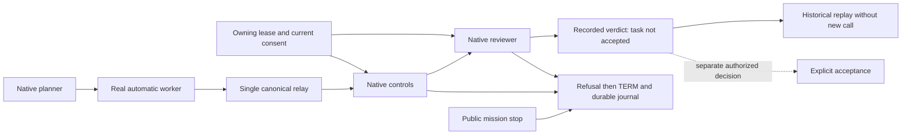

#### Additional refusals verified709
`mission-reviewer-revocation` holds the real reviewer after permission: a released
positive yields a favorable review, then a fresh Root is publicly stopped during
the same wait. The engine terminates the reviewer (TERM15), retains wait/grant/
closed channel and incomplete reply in its journal, and keeps claim/funding
without a favorable verdict or acceptance. Immediate cancellation is not claimed:
existing source polling may wait on IO and saved policies.
`mission-planner-reconsent` proves an already permitted planner cannot apply its
old decision after stop then a fresh start: actual `stale_lease` refusal. Stop
then plain resume already refuses `mission-consent-required`; no correction was
needed for these cases. This does not establish every consent path or race. The
absent-quote recipe now compares journal `original_reply` with the emitted fixture
reply without rendering private contents publicly.
[Evidence709](../plans/migration-rust/evidence/20261024-g3-auto-review/decision709/result.json),
recipes705/707/708 on693,3steps each with integrity. SIGINT during a foreground
call remains distinct and unqualified; asynchronous Go parity is still open.

#### Public status and explicit acceptance after automatic review —711
The same real watch journey is consumed by `mission status`: a favorable review
still awaits review before an explicit action; no task is already accepted.
An explicit fixture `task update` verifies native evidence and yields validated
status. Changing the actual report makes validation stale; restoring exact
bytes restores validated status. Reads change neither logical/physical database
bytes, consumption nor reviewer invocation. Maintained recipe
`mission-auto-review-acceptance`,711PASS3steps and integrity on693; this proves
neither authenticated human authority nor automatic mission acceptance.

#### Manual producer — automatic review locally verified730
A manually launched worker can now produce an automatic review after a submitted
report and valid native controls. The new reviewer still requires the actual
owning lease, automatic mode, current consent and its own epoch/source binding.
Manual producer origin grants no reviewer rights. The worker permission writer
retains `native_agent_execution_origins`: actual directory and connected SQLite
identity. The child gate requires this provenance; the producer reader also
verifies the current completed attempt and complete original terminal receipt.
Neither Actor nor AgentExecutionSnapshot changes; no historical journal is
enriched afterwards. Legacy absence refuses this new path without adopting the
current Root. Report relay and first automatic controls for a manual producer
are not established by this scenario: report submission and controls are explicit
before watch. That limitation remains the next assembly step.
[Evidence730](../plans/migration-rust/evidence/20261024-g3-auto-review/decision730/result.json):
716refuses before correction;729real manual→automatic review then a fresh Root
is byte-copied to another SQLite inode in the same directory: exact
`agent-origin-instance-changed` before claim/reviewer/debit, unchanged Work/funding,
both files retained and original restored.725/726 cover automatic-origin
refusal/replay/revocation;727six manual controls and728seven manual reviewers
pass on fixture-free722.3metadata guards, strict Clippy/Rustdoc. Private-module
compile failure718 and optional-table assertion724 remain retained;721/729 fix
preconditions without weakening safeguards. Compilation, recipes and bounded
Root review are not global independent acceptance; SIGINT/async/registered/
managed/web and R6/R7/RETEX remain open. Nothing installed or published.

#### First controls and review for a manual producer — verified743
After a native manual launch and explicit report submission, `mission watch` now
executes the first controls then reviewer without manual `task validate`. Shared
`mission_producer::completed` checks the attempt, original terminal receipt and
physical provenance. Report relay remains automatic-worker-only; controls and
reviewer also accept a verified native manual producer. This is an internal
operation contract; no public flag selects rights. Writers retain the actual
lease, epoch, consent and budget; private source guards recheck freshness.
[Evidence743](../plans/migration-rust/evidence/20261024-g3-auto-review/decision743/result.json):
731refuses before correction;739manual→report→automatic controls→reviewer with
ordered events and receipt bound to the real producer/report, no manual validate.
A byte-identical SQLite copy to another inode in the same directory refuses
before control/review claim or debit. Conductor supervision still acquires and
releases its own lease: only unchanged Work/funding/provider effects are claimed,
not absence of every SQLite write. Both files are retained and the original
restored.740/741/742cover automatic-origin refusal/replay/revocation on fixture-
free737.155mission-family tests pass,2targeted runtime-policy guards, strict
Clippy/Rustdoc. One specialized ledger test remains ignored without its fixture,
so no complete suite is claimed. Six/seven manual journeys727/728 retain their
722scope. Manual report submission remains explicit. Full async/SIGINT foreground/
registered/managed/web, R6/R7 and global acceptance remain open; nothing deployed.

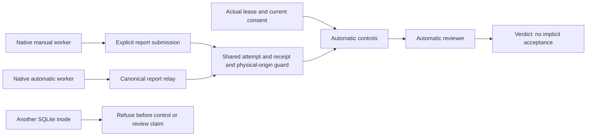

### Resumed conductor observes a registered worker

A new `mission watch` may observe a registered intention after the previous watch
exits, without owning a child handle for that worker. Planning stays deferred
while this context is active; engine admission and resource accounting remain
authoritative. Observation grants no process adoption, relaunch, cancellation or
wait authority. Registration alone proves no liveness: the recipe separately
uses actual kernel handles and a peer.

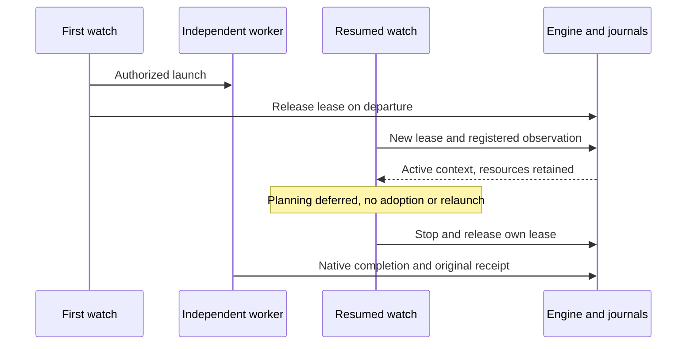

Permanent recipe `mission-watch-registered-observer.json` covers this journey
and spool/pidfd-refusal cleanup on owned fixtures without a paid provider. The
`children_still_running` count refers to this watch’s launched children; registered
agents are listed separately. Incoherent-process recovery, full asynchronous
scheduling, web integration and global acceptance remain open. Nothing installed.

### Roles independent of the conductor loop

Controls, reviewer and planner use one scoped job at a time under the actual
Root peer and lease. Main keeps observing/dispatching and publishes after joining;
shutdown retains causes before lease release. Active-worker deferral is observed
independently of the role phase. See the current diagram in
[Rust migration](RUST-MIGRATION.md). Bounded qualification1072 is verified; full Go role
concurrency, web integration and installation are not claimed.
