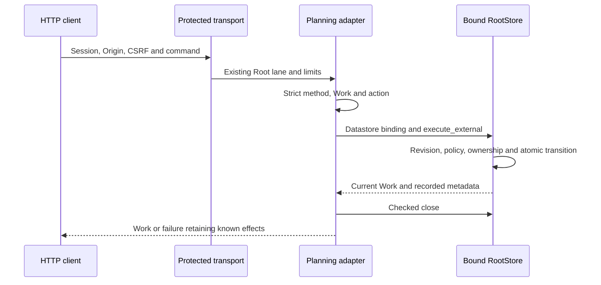

# Native planning HTTP API

Lot179 ports the existing client path: `/api/v1/planning?work=ID&action=ACTION`. Normal Rust uses the same RootStore as CLI. This adapter implies no delegation, model call or human acceptance, and these local checks do not change the installed server.

## Reads and commands

`GET` or `HEAD /api/v1/planning?work=ID` reads the actual complete Work, including planning; `action=show` is also accepted. HEAD retains status without a body. Other methods refuse with Allow `GET, HEAD, POST`.

`POST` requires explicit action `enable`, `claim`, `lease-renew`, `decide`, `judge`, `renew`, `pause` or `resume`. The body is the strict native PlanningRequest with the actual schema/event/revision and action-specific fences. Example after reading the root scope:

```http
POST /api/v1/planning?work=w-example&action=judge
Content-Type: application/json
X-Swarm-CSRF: RECEIVED_TOKEN
Cookie: CURRENT_SESSION_COOKIE
```

```json
{"schema_version":1,"event_id":"operator-cycle-1","expected_revision":12,"scope":"root","scope_revision":3,"judge_cycle":1,"judge_verdict":"continue","reason":"Continue the open objective"}
```

Example identities, revisions and tokens are placeholders, not authority or defaults. Clients must also satisfy Host/Origin checks. `/api/v1/native-capabilities` advertises nine planning route entries including show; admission still depends on native platform, current mission and required evidence.

`judge`/`renew` preserve pending inputs and consumption, `lease-renew` extends a held claim, and `decide` requires the actual lease/delivery fences. See [cycle contract](NATIVE-GLOBAL-JUDGE.md). `enable` observes the server’s effective catalogue, as CLI does; an unannounced model refuses. Other commands retain engine validation and start no process through this route.

## Protection, failures and recovery

Host/session/Origin/CSRF checks precede Root access. Existing transport limits and Root lane apply without another local policy. The retained startup datastore binding is checked before reads or mutations. Root retains schema/source/mission/revision/physical and logical ownership/quota/persisted-policy checks. Declared holders, actors and references do not authenticate identity.

URL admission requires one safe Work, no duplicate/foreign key or empty action. GET for an unported specialized action never becomes a successful Work-shaped preview. Process actions step/run and managed operations/previews remain unported on this route. Query duplicates and unknown GET actions are deliberately stricter than Go; clients cannot rely on first-duplicate selection or read fallback.

| Response | Verified effect or contract |
| --- | --- |
| 200 | Actual encoded Work; exact replay returns current state without a second transition |
| 400 | Invalid query/body or business refusal, without mutation in tested cases |
| 403 | Access/session/CSRF refusal before Root |
| 409 | Revision or another explicitly classified conflict |
| 501 | Unported action/preview, never empty success |

Original causes remain typed server-side and in safe owner observations. A recorded command retains Work/revision metadata through encoding/close/output failure; missing response does not prove rollback. Read back state and replay the same event explicitly, without refund or a fabricated new claim. Generic EPIPE13 checks the shared post-commit path; no encode/close fault specific to this new route was injected.



## Evidence and limits

Source02, normal11 SHA `0c8141d4a3b1855c9221721902da185d521098495ab9cad1c0a95cc4ac6cd0c6`:276 archived effective inputs, no fixture feature. Quality09:18 named targeted tests, strict Clippy and private Rustdoc. HTTP14: actual session/read/HEAD/capabilities/eight commands, sixteen targeted refusals, canonical events/Work/finance preserved, long history readable under a lowered cap and replay without transition. Driver13: default environment inheritance, real post-commit EPIPE and explicit recovery. Original recipe failures and correct catalogue refusal are retained.

Permanent recipe: `tools/verification/recipes/native-planning-http.json`. Final steps ran separately on the frozen binary; the manifest is validated without claiming its whole execution on a concurrent checkout. The server helper accepts an optional explicit isolated-catalogue environment without serializing variables/secrets. No global watchdog. No full browser UX, human identity, autonomy, hostile same-UID confinement, installation, managed end, data restoration or global cutover is established.
