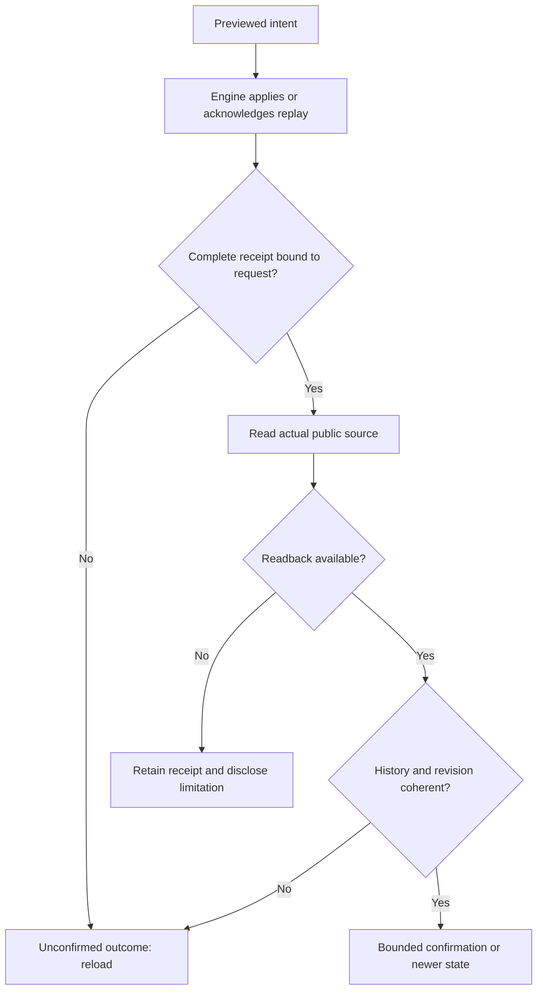

# Policy confirmation in native clients

The engine owns validation and publication. A client confirms an action only after correlating its receipt with actual readback. HTTP200, applied flags or values already equal to the request never establish a new recorded change.

Shared web/native-policy-receipt.js handles compatible files (browser/provider waiting and future graph objectives) separately from SQL runtime-limit scopes. It checks the previewed intent, freshness token, revision and resolved values. File receipts are joined to original change history; equal revisions also require the actual source digest. SQL receipts are joined to the returned entry/history, including rollback targets. Exact decimal strings prevent JS rounding. Only protocol omitempty omissions receive their specified zero/empty spelling, never operator defaults.

A newer revision is allowed when the acknowledged record remains present. Replay never becomes a new application. Actor/time/reason are compared data, not authenticated identity or business-completion authority.

States remain distinct: malformed/unrelated receipt means unknown outcome and reload; a valid receipt followed by unavailable readback retains the receipt without a new confirmation; successful but contradictory readback raises an alert rather than green success. No new deadline policy or automatic retry is introduced. History stays engine-owned; clients never edit databases.

Incident/evidence: docs/plans/migration-rust/evidence/20261027-web-request-policy-jnok5wvr/REPLAN-SHARED-RECEIPTS.md. The182 counterexample uses a test response not forwarded to the engine: unchanged source, false visible success. Current correction/runtime verification remain tracked in that lot. Other Swarm receipt families are not globally qualified. Already loaded pages receive new assets on reload; embedded agent contexts are independent.

Reason comparison follows Go JSON representation: an isolated UTF16 surrogate becomes U+FFFD, without translation or trimming. Valid text stays unchanged; this is not a business reason policy.

